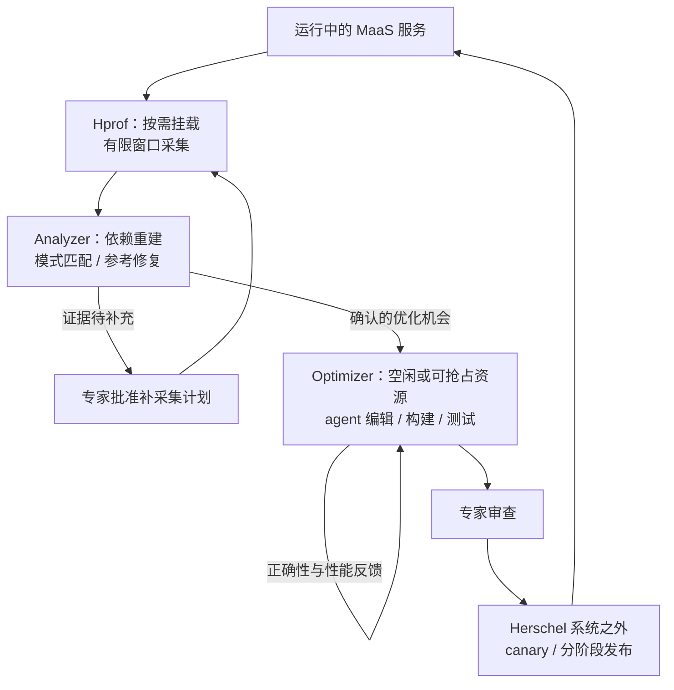

# 顶会论文调研：推理框架运行时自动优化 agent

初次论文检索：2026-10-30；整理更新：2026-11-05（Herschel、Autopoiesis、FlashVector 全文精读与 MaaS 方案对照）。与本人的研究方案相互参照：[研究方案](02_研究方案.md)。
依据：会议官网、正式 proceedings、作者论文与开源代码。PDF 下载与解析状态以 `papers.json` 和 `scripts/validate_research.py` 的校验结果为准。

## 1. 结论与阅读顺序

当前 MaaS 持续优化方案的直接近邻包括 **Herschel 的生产观测与 agent 代码优化、Autopoiesis 的在线策略演化，以及 FlashVector 的生产服务栈优化**。配置搜索、通用在线调优和有状态推理系统提供各环节的基础。

建议优先读十篇，先读 Herschel、Autopoiesis 与 FlashVector，再对照其余七篇：

1. **Herschel，arXiv v1（2026-09-30）**：MaaS 生产按需 profiling、机制诊断、agent 引擎/kernel 优化、空闲资源上的 PD 实验，以及专家审查后的外部发布流程；§4 全文精读。
2. **Autopoiesis，arXiv v1（2026-04-08）**：运行中演化 serving 策略代码、模拟评估与纯函数热替换；§4 全文精读。
3. **FlashVector，arXiv v1（2026-09-15）**：推荐服务栈的跨层优化、自动持续触发、隔离节点生产回放与 shadow canary；§4 全文复读。
4. **SCOOT，WWW 2025**：与“暴露推理引擎参数并自动优化”最直接重合。
5. **TuxBot，SOSP 2026**：与“agent 在服务持续运行时调参数”最直接重合，但对象是 Linux OS。
6. **OnlineTune，SIGMOD 2022**：动态 workload 和受约束在线探索的必要基线。
7. **OPPerTune，NSDI 2024**：部署后联合调节数值、类别参数及其作用范围。
8. **LaTune，WWW 2026**：LLM 推理配置的两阶段优化与运行时选择；配置选择与在途引擎热更新分别核对。
9. **MorphServe，MLSys 2026**：运行中的层精度与 KV 容量联动；与“状态不丢失地切换”密切相关。
10. **QoServe，ASPLOS 2026**：依据请求 slack 和批次成本，逐轮改变 prefill chunk；是动态 scheduler 的直接基线。

Herschel 已连接生产低开销观测、证据补采集、引擎/kernel 修改和备用资源实验，并在案例中处理 PD handoff 与状态语义。Autopoiesis 则实现 serving 策略的模拟评估和纯函数热替换。当前方案的研究定位聚焦 **两种更新路径的联合选择、混部与分离服务的候选接入及节点轮转，以及固定资源预算下的长期业务净收益**；这些增量通过机制实现和对照实验建立。

相关 arXiv 预印本按机制单独收录，Herschel、Autopoiesis 与 FlashVector 列入 §4 精读，SEIS、VibeServe 与 agent 调优基准列入 §7。三篇已下载预印本的会议身份按各自核实状态记录，§3 的 17 篇顶会主表采用独立身份计数。

## 2. 筛选与核实标准

主表只收录已核实主会或正式 proceedings 的工作：SOSP、OSDI、NSDI、EuroSys、ASPLOS、WWW、MLSys、SIGMOD/VLDB。这里按系统、数据与 ML 系统领域选择相关顶级会议，不把所有会议笼统写成同一 CCF 等级。

PVLDB 和 PACMMOD 采用期刊形式承载相应会议研究论文，文中保留卷期信息。不能把 SIGMOD demo、NeurIPS workshop 或只有 arXiv 的工作混作主会论文。

发表身份与下载版本分别核实。部分下载是作者 arXiv 版本，而非出版社最终排版。TuxBot 的 arXiv v2 与 IBM 发布页实验数字不同，本文不拼接两种版本的收益数字。

检索覆盖关键词：`LLM inference configuration tuning`、`SLO-oriented tuning`、`online system tuning agent`、`runtime adaptive serving`、`safe contextual Bayesian optimization`、`scheduler KV cache kernel backend`，以及 2025–2026 年会议目录和核心论文的相关工作。

## 3. 相关性总表

“在线执行”只表示服务过程中的决策；“热调参数”还要求配置能够对同一个运行中的引擎生效。两者不能互换。

| 编号 | 工作与会议 | 优化对象/方法 | 与用户思路的关系 | 不能直接等同的部分 |
| --- | --- | --- | --- | --- |
| 01 | SCOOT · WWW 2025 | 推理引擎参数；约束 BO/MOBO | 最直接的多旋钮调优先例 | 非 LLM agent；实验含 TP、block size 等结构参数 |
| 02 | TuxBot · SOSP 2026 | OS 运行时参数；双循环 LLM 控制 | 不停机 agent 调优最接近 | 非推理引擎；不解决 KV/graph 状态协议 |
| 03 | LaTune · WWW 2026 | 边缘推理参数；降维、迁移、多目标优化 | 运行时选配置的直接先例 | 公开实验代码不能证明在途请求热切换 |
| 04 | OnlineTune · SIGMOD 2022 | 在线数据库参数；安全 contextual BO | 动态 workload、探索损失基线 | 数据库场景；非 LLM agent |
| 05 | GPTuner · VLDB 2024 | 数据库旋钮；LLM 知识 + BO | 参数语义、筛选与缩小范围 | LLM 主要组织知识与搜索空间 |
| 06 | λ-Tune · SIGMOD 2025 | 数据库配置脚本；LLM 候选与评估 | 联合生成配置、计入调优成本 | 不能据此声称在线热调 |
| 07 | MorphServe · MLSys 2026 | 权重精度与 KV 容量；运行时控制 | 持续推理时保留状态地适配 | 专用机制；精度变更涉及质量约束 |
| 08 | Llumnix · OSDI 2024 | 跨实例请求重调度与 live migration | 运行时状态迁移与持续服务 | 专用调度系统，非通用旋钮 agent |
| 09 | Sarathi-Serve · OSDI 2024 | chunked prefill 与 batch 调度 | scheduler 参数作用机制 | 调度算法，非在线搜索 agent |
| 10 | DistServe · OSDI 2024 | PD 分离、资源/并行计划 | goodput 目标与分层资源决策 | 规划与系统架构，非单引擎热调 |
| 11 | FlashInfer · MLSys 2025 | attention 与 KV 格式、动态调度 | kernel 控制能力和 graph 兼容依据 | attention engine，非配置搜索 agent |
| 12 | AdaServe · EuroSys 2026 | 多 SLO 的动态投机配置 | 按 workload/SLO 调执行参数 | 投机解码专用动作空间 |
| 13 | METIS · SOSP 2025 | RAG 配置与调度联合选择 | 多旋钮交互和质量/资源联动 | 应用层 RAG 参数，不是底层引擎旋钮 |
| 14 | Ave · SOSP 2026 | agent 生成优化 GPU kernel | agent 的约束、验证与反馈设计 | 编译时生成代码，非在线调现成参数 |
| 15 | OPPerTune · NSDI 2024 | 部署后配置；混合参数在线学习 | 动作范围、参数筛选与在线优化 | 通用云应用，不含推理状态语义 |
| 16 | TUNA · EuroSys 2025 | 有噪声的系统配置评估 | 识别收益、稳定配置选择 | 不直接解决 workload 非平稳性或热更新 |
| 17 | QoServe · ASPLOS 2026 | 请求 QoS、动态 chunk、混合优先级 | 逐轮改变 scheduler 策略的直接先例 | 专用控制；非 scheduler/KV/kernel 通用 agent |

## 4. 优先精读论文

优先级按研究相关性确定；Herschel、Autopoiesis 与 FlashVector 以预印本身份精读，§3 的 17 篇顶会主表与身份计数保持不变。

### 20. Herschel: Continuous Optimization of Production LLM Inference through On-Demand Profiling

**arXiv 预印本，固定作者 v1（2026-09-30），Alibaba Group，17 页。** [作者页面 v1](https://arxiv.org/abs/2609.40247v1)；[PDF v1](https://arxiv.org/pdf/2609.40247v1)；[本地原文](papers/20_Herschel_arxiv_v1.pdf)；[逐页文本](paper-text/20_Herschel_arxiv_v1.txt)；[精读证据](evidence/herschel-close-reading-2026-11-05.json)。正文与结论位于 p1–13，参考文献位于 p13–17；以下均用本地 PDF 物理页码。发表身份按 arXiv 预印本记录。

**与当前方案的关系。** Herschel 已将 MaaS 生产观测、按需低开销 profiling、机制诊断、agent 修改引擎/kernel、空闲资源实验和部署验证连接起来。它直接覆盖当前方案的应用场景及多项核心环节。精读需要分别定位 profiler 的运行时接入、候选代码的实验执行，以及经专家审查进入生产发布的过程。原文 §1、§4、§7，p1–2、p4、p7。

#### 系统组成与执行闭环

| 组件 | 输入与实现职责 | 输出及后续环节 |
| --- | --- | --- |
| Hprof | 控制面选择进程、调用、支持的对象字段及采集窗口；本机 daemon 向运行进程挂载探针 | Python 调用、运行时字段、host API 与设备活动记录 |
| Analyzer | 重建算子执行与跨进程依赖，检查低效模式及参考修复的适用条件 | 带证据的优化机会和建议；缺少关系证据时申请专家批准的补采集 |
| Optimizer | agent 在受控资源上编辑、构建、正确性检查与性能实验，使用反馈继续修订 | 满足实验要求的最佳候选，或失败记录与未解决问题 |
| 专家与外部发布流程 | 审查代码语义、测试结果和部署适用性，执行 canary 与分阶段发布 | 通过正确性及 serving-SLO 监控决定扩大部署 |

§4 的 Figure 3 明确把 canary 和 rollout 标为 Herschel 之外；§7 说明专家审查后进入这些流程。系统以自动化观测、分析与候选实验连接生产优化，发布流程保留人工审查。原文 p4、p7，Figure 3 已目视核对。

#### Hprof：运行时挂载、可变覆盖与资源生命周期

Hprof 的“不重启”首先描述 **profiling 的接入与退出**。初次进入目标进程时，CLI 用 `ptrace` 暂停选定线程，检查其栈以避开已知 allocator/loader/threading 锁上下文，临时重定向以调用 `pthread_create`，由 loader thread 通过 `dlopen` 加载进程内 controller。CLI 恢复原线程并释放 `ptrace` 后，再等待加载完成。后续命令通过 socket 发给 controller。这里的 runtime attachment 是观测组件挂载，候选优化代码的部署由 §7 的审查和发布流程描述。原文 §5.1，p4。

Python probe 通过常驻 router 拦截 CPython frame evaluation，在默认 evaluator 前后记录调用、线程、进入/返回时间，并读取支持的对象字段。调用区间包含 native 执行与等待；engine-specific reader 提取 tensor shape、token 数等状态，连接到具体调用。reader 随内部布局演进更新，§10 报告六个月发布过五个 reader 版本。原文 §5.2、§10，p4–5、p12。

NVIDIA probe 使用 CUPTI 记录 CUDA Runtime API 与 kernel、内存操作、同步等设备活动，依据 correlation ID、device/stream 建立提交到执行的关系。其他设备通过 adapter 接入统一接口。停止采集时关闭新 callback 入口、处理已进入调用与延迟设备记录；CUDA 状态转换会阻塞 API 进入并排空已跟踪调用。probe 按可安全回收、可复用状态决定卸载和资源保留。原文 §5.1–5.2，p4–5。

fleet control plane 依据待调查的 serving condition 选择实例与采集时机，采用 canary collection 和并发限制。初始窗口通常为 30 秒；作者生产样本中每窗至少包含十个完整推理 step，中位数超过 700。后续窗口根据调查缺失的证据扩展调用、字段或进程覆盖。异常是触发来源之一，持续存在的低效也可主动调查。原文 §3、§5.3，p3、p5。

#### Analyzer：机制匹配、补证据与修复复用

Analyzer 从 Python 调用、host 提交与设备活动重建算子完整区间及输入 shape；CUDA Graph replay 通过 graph identity、launch correlation 和模型层序规则恢复算子关系。缺少 composition 或输入时保留未解决状态。算子效率以理论 FLOPs/数据量、实际区间和设备峰值计算 MFU/MBU，使用 `SOLop = max(MFU, MBU)` 表示相对计算/带宽上界的达成率。graph padding 单独记录。原文 §6.1，p5–6。

跨组件分析覆盖 critical path、暴露的通信时间、同步 RPC、状态分配/使用/释放及实际复用。代码语义与对象标识用于判断输出是否仍有消费者、计算是否还承担必要状态更新。Table 1 给出 **35 个模式：8 类 25 个引擎模式，以及 3 类 10 个算子模式**；知识来源为超过 20,000 条性能相关 PR/CR、专家知识和生产调查，模式关联参考修复。原文 §6.1–6.2，p6–7。

算子机会的 Hotness 先按 workload critical-path 时间占比加权预估可恢复部分，再按 fleet GPU-hours 加权，用于机会排序。模式匹配缺少必需证据时，Analyzer 请求专家批准的新采集计划。确认机制后，将参考修复的来源、代码变化和适用条件交给 Optimizer。该设计已覆盖“低开销观测 → 缺失证据补采集 → 机制诊断 → 候选修复”的完整联系。原文 p7。

#### Optimizer：真实资源实验与 PD 状态约束

§7 的实验通常使用 **8–32 张空闲或可抢占加速卡，包含 PD 分离服务所需的 P/D 资源**。缩小部署规模时，实验保留触发问题的 workload 与依赖，并确认原始问题仍能在基线中出现；硬件相关假设在目标设备上测试。抢占后保存代码和测量结果，中断实验重新运行。它已覆盖“生产发现问题，在额外资源上改代码和验证”的执行方式。原文 p7。

agent 使用当前执行证据和参考修复，进行编辑、构建、测试与修订。构建失败、正确性结果和性能反馈指导下一轮；性能对照使用相同 workload/settings，并关闭高开销 profiling，未解释的性能问题再用 offline profiler 分析。停止条件包括假设被否定且缺少新线索、预算耗尽和进展停滞。结果为最佳已测候选或失败报告。原文 p7。

引擎改动示例覆盖 KV 传输与计算重叠、KV/metadata/buffer 复用、speculative draft 数与无用计算裁剪、异步 KV 控制调用，以及 Worker dispatch 前的 DP 协调。kernel agent 针对生产 shape、dtype、layout 和硬件生成或特化算子，测量完整算子/融合组后集成到 runtime 再评估 serving workload。这里的 runtime integration 描述候选实现集成，v1 展开的生产接入流程为专家审查、canary 和 staged rollout。原文 §7，p7。

#### profiling 实验：测量条件与数字口径

| 项目 | 作者报告与适用范围 |
| --- | --- |
| 测试平台 | 每台 8×H20、双路 48 核 Xeon 8469C、1 TiB DRAM；CUDA 13.0、PyTorch 2.13.0、vLLM 0.29.0 |
| 延迟负载 | 同实例 P/D 混部；BF16 Qwen3-32B TP2 与 Qwen3-235B-A22B TP8；输入 4096/8192 token、输出 512 token，短输入并发 32/64、长输入并发 32 |
| 对照 | unprofiled latency reference；100 Hz blocking py-spy；关闭/开启 shape 与 stack 的 PyTorch-lite/full |
| Hprof-full 活跃采集开销 | 所测配置中 TTFT <0.5%、TPOT <7%；关闭 accelerator tracing 的 Hprof-python，median/P95 TPOT <1.5% |
| Hprof-full 主机资源 | 0.12–0.46 CPU cores、2.3–2.8 GiB peak RSS、1.5–8.8 MiB/s trace；最高观测速率下 30 秒约 265 MiB |
| 调用与时间线保真度 | Qwen3.5-35B-A3B 上 per-symbol call count 一致率 99.2%、直接父子关系一致率 99.98%；同 workload 分别采集的 kernel 顺序一致，duration 相对差异中位数 1.6%、P95 10% |
| 生命周期测试 | Qwen3.5-35B-A3B 上 50 次 attach–collect–detach，观测到的各阶段无 worker hang 或推理中断 |

来源：§8.1、Figure 6、Table 2，p8–9，图表已目视核对。开销数字对应活跃采集窗口；长期平均影响还取决于采集频率、并发及目标实例。Figure 6 的柱为各配置最大观测开销，须线为观测范围，非正变化画为零。50 次生命周期实验为特定条件下的观测结果。

生产研究持续六个月，覆盖 120 多个 model variant、10 多类 accelerator 和数十个集群，采集约 17,000 traces；其中超过 3,900 条、约 23% 匹配至少一种低效模式。该比例描述已采集 trace 的模式命中，诊断准确率与 fleet 整体效率提升须另行测量。原文 §8.2，p9。

#### 四个优化案例：改了什么、验证了什么

| 案例 | 实际改动与状态条件 | 作者报告及口径 |
| --- | --- | --- |
| §9.1 KV 创建阻塞 dispatch | 补采 EngineCore 调用与 workId，确认同步 KV 对象创建只在后续保存时需要；改为异步创建，计算先行，KV 保存仍等待创建成功 | GLM-5.2 短上下文 prefill 吞吐 +3.3%；含三个 Qwen 模型为 +3.3%–5.7%，已部署 |
| §9.2 DP 协调前移 | agent 恢复请求边界/进展，识别 Hybrid Attention 的 PD handoff tail，将协调移至 EngineCore；保留 tail sampling、idle-rank、draft 与 graph/fusion 条件 | 原 Hybrid patch 已部署；后续 upstream port 在 8×XPU-A 的 35B/122B/397B 上离线测得 +6.0%/+4.8%/+2.5% 吞吐 |
| §9.3 裁剪 P 侧无用 MTP | 保留第一个完整 MTP forward 构建交给 D 的 prefix/recurrent state，移除后续两个没有消费者的 draft forward | 典型短上下文 TTFT 约 −6%；已广泛部署；第一个 forward 内预测分支的进一步裁剪仍为优化机会 |
| §9.4 PagedAttention 布局 | Q 一次转换并复用，K 以兼容布局加载，减少共享内存往返；按生产 shape 验证 | 测定 shape 的 PA 耗时 −60.9%，SOL 由 7.3% 到 18.7%；端到端 TPOT 约 −8% 至 −32% 来自该项与 KV preparation、copy、host submission 的组合 |

来源：§9、Table 3–4、Figure 7–12，p9–12，相关图表已目视核对。§9.2 的 Hybrid 适配为 +766/−150 行；后续 upstream port 的最终 runtime diff 为 +707/−32、测试为 +692/−1，两个版本分别记录。该 port 的每个吞吐值是并发 32/128 下两项“最大观测配对收益”的均值。Table 3 的部署数量约 50/50/100/30 为四项结果的各自范围，全文结果按这些具体优化案例组织。

#### 对当前方案与特性表的影响

| 当前方案环节 | Herschel 已展开的内容 | 本项目后续验证重点 |
| --- | --- | --- |
| MaaS 持续自优化 | 真实生产问题、跨层观测、agent 引擎/kernel 修改、反复实验与生产部署 | 同一持续实验中的长期业务交付与完整预算 |
| 低开销观测与诊断 | runtime attachment、按需窗口、可变覆盖、模式匹配和专家批准补采集 | 在该基础上定义观测预算与实验选择规则，测量诊断质量及净收益 |
| 备用资源实验 | 8–32 张 idle/revocable 卡、缩小规模保留触发条件、包含 PD 资源 | 固定双节点混部或三节点分离预算中的候选代表性、排队、资源竞争和轮转效率 |
| PD 有状态优化 | handoff tail、recurrent/prefix state、DP metadata、MTP/graph 条件及 KV 传输 | 候选版本接入、请求绑定、Mooncake 会话和目标内存的发布生命周期 |
| 两种更新路径 | 在线 profiling 与受控代码实验；集成后的候选经审查进入外部发布 | 原地策略更新与实例替换的共同动作模型、路径选择和生效回执 |
| 自用 API 与成本 | 原文描述内部 agent，未给出强制使用目标服务同 endpoint/同容量的部署合同 | 明确 API 数据流、内部推理容量竞争和全成本 |

**本调研判断。** Herschel 是当前方案的直接近邻：生产低开销观测、证据驱动诊断、空闲资源实验和 PD 代码优化已有明确覆盖。后续研究主张聚焦两种执行方式的联合选择、系统内完整混部实例与分离角色的候选发布及节点轮转，以及完整资源预算下的长期净收益。特性表将“运行时挂载 profiler”“修改运行时实现”“原地热更新策略”分列解释；PD 场景与状态语义按已覆盖内容标注，发布与轮转按 §4、§7 的系统边界标注。

### 18. Autopoiesis: A Self-Evolving System Paradigm for LLM Serving Under Runtime Dynamics

**arXiv 预印本，固定作者 v1（2026-04-08），尚未核实顶会发表身份。** [作者页面 v1](https://arxiv.org/abs/2604.07144v1)；[PDF v1](https://arxiv.org/pdf/2604.07144v1)；[本地 34 页原文](papers/18_Autopoiesis_arxiv_v1.pdf)；[逐页文本](paper-text/18_Autopoiesis_arxiv_v1.txt)；[精读证据与口径检查](evidence/autopoiesis-close-reading-2026-11-05.json)。以下页码均为本地 PDF 物理页码；机制陈述依据原文，“本调研判断”表示我们的分析，不代表已经实现或复现实验。

**为什么优先读。** 它已把“线上观测 → LLM 改策略代码 → 候选评估 → 热替换 → 下一轮演化”组织成持续闭环，是当前 MaaS 持续自优化方案的直接近邻。核心区别在于 **plan 与 policy**：plan 是当前请求/模型分配、资源配置及并行方案；policy 是产生和更新 plan 的算法。普通动态调度可在策略代码不变的情况下生成不同 plan；Autopoiesis 连生成 plan 的策略代码也持续改写。不能再把“LLM 在线优化 serving”本身作为本项目没有先例的贡献。原文 §2、§4，p3–7。

#### 问题：为什么连调度算法都要变

论文联合考虑三种代价：重调度频率、调度搜索投入、重配置幅度。搜索更充分可能得到更好的资源方案，但求解期间旧方案仍在运行；迁移更多权重或调整更多资源可能改善随后服务，却加重过渡期损失；过于频繁地重新规划则累积两种开销。§3 用稳定/波动负载的对照说明，没有一个极端策略能覆盖全部阶段。这里的“静态策略”指规则或算法保持不变，不表示基线完全不会动态调整资源。原文 §1、§3、§5.1，p2、p5–9。

策略表示为两个共同演化的函数：

| 函数 | 输入/输出与职责 | 控制的代价 |
| --- | --- | --- |
| `should_reschedule(ctx) → {0,1}` | 根据当前 workload、集群状态和现有 plan 判断是否重调度 | 重调度次数与旧方案失配持续时间 |
| `schedule(ctx) → plan` | 为当前状态生成新 plan；冷启动时现有 plan 为空 | 求解耗时、新方案质量、相对旧方案的重配置幅度 |

它不要求 LLM 为每个业务请求或每个 token 作一次决策。在线执行的是生成后的策略程序；LLM 位于较慢的策略演化循环。原文 §4–5，p6–9。

#### 闭环：实时服务与异步演化怎样连接

数据面使用当前策略处理业务，同时周期记录 workload/cluster 状态到固定大小的环形 buffer。一次演化结束后，控制面请求近期滑动窗口；数据面用后台线程传送快照，连续快照允许重叠。控制面针对快照演化候选，找到更优程序后将其写入共享 staging area；数据面在下一次 monitoring step 加载。窗口长度可配置，正文没有把它设为对所有负载适用的固定常数。原文 §4、§6.2，p6–7、p11–12。

**两种“改变”要分开。** 上图加载的是策略代码；新策略在后续调用时可能产生新的部署 plan，而执行这个 plan 才发生资源、权重或并行配置的重配置。代码替换轻量，不意味着新 plan 的执行也零成本。原文 §5.1、§6.2，p7–8、p12。

#### 目标与 evaluator：哪些时间实测，哪些靠模型估算

主目标是最小化一段 trace 的完成时间。按 p8 的式 (1)：

\[
T_{total}=t_{sched}(1)+t_{serve}(1)+\sum_{i=2}^{N}\bigl[t_{stale}(i)+t_{reconfig}(i)+t_{serve}(i)\bigr].
\]

冷启动包含首次调度/模型初始化及服务；之后每次重调度分三段：求解新 plan 时旧 plan 继续服务、部分资源重配置时其余资源继续服务、最后按新 plan 稳定服务。`t_stale` 是求解期间沿用旧方案的时间段，不能在它之外再无条件加一次完整调度耗时。重调度次数 `N` 也由候选策略决定。这个模型比只评估新配置的稳态吞吐更接近持续服务的成本问题，但主实验目标仍是 trace completion time，不能直接改写成累计 SLO goodput。原文 §5.1，p7–9。

候选评估用数据面近期 trace 回放，而不是把每个候选直接放进真实业务流试错。evaluator 在 monitoring 点执行候选触发逻辑；触发后运行候选调度程序，**实测其 wall-clock 求解时间**，再用 serving simulator 估计服务与重配置成本。反馈除总分外还包含重调度次数以及 stale、reconfiguration、serving 的累计分项，便于下一次 LLM 变异判断收益来自哪里。§5.3 举 monitoring 间隔为 5 秒的例子，不是所有在线控制的固定周期。原文 p9–10。

Appendix B 的模型细节值得单独注意：

| 模型项 | v1 的具体做法 | 本调研解读 |
| --- | --- | --- |
| 服务成本 | roofline 估计各层 prefill/decode 算子，结合计算量、HBM 带宽和 TP all-reduce 成本 | 是分析模型，不是对所有候选真实 GPU 执行时间的逐一测量 |
| 显存可行性 | 检查分片权重是否超过设备显存的 0.8，给 KV 预留余量；不满足时给很大惩罚 | 不能直接替代活跃/可驱逐/传输中 KV 的实际分配与引用协议 |
| 重配置成本 | 按 plan 改变模型的 GPU 类型、TP、数量估计 terminate/drain 与 PCIe 权重重载；包含模型相关利用率系数 | 主文提及 KV 迁移，不等于该附录已提供完整 RDMA/KV 迁移状态机 |

原文 §5.3 称模拟器的保真度在 Appendix B 验证；本地 v1 p22–23 实际提供的是成本公式与假设，没有给出独立的预测误差表或校准误差图。本次可核实的是模型结构，尚不能据此确认模拟器在我们三节点 RDMA、cache 热度和在途传输场景上的预测精度。§7 声明了集群部署；候选评分依赖模拟器，不应反向推断全部主实验都只是模拟。

#### 演化：LLM 修改什么，历史怎样复用

§5.2–5.4 的流程包括 seed 初始化、LLM diff 变异、评分与反馈、候选选择迭代。seed 可采用 greedy/ILP 调度和周期/阈值触发等不同算法。候选保留采用受 MAP-Elites 启发的选择机制与 island population，兼顾性能和多样性；搜索在收敛或预算耗尽时结束。系统 prompt 编码代价结构和 trade-off，迭代 prompt 加入父子成本分解、最好得分和近期探索摘要。它既改变阈值，也改算法、约束、搜索空间和 solver 配置。原文 p9–11。

§6.1 用上轮优选候选及其变异初始化新一轮，即 warm-start re-evolution；不需要从空白重新搜索。演化级 timeout 限制整轮墙钟时间，候选级 timeout 避免生成程序长时间求解或不终止。§7.3 报告波动/稳定场景分别约 80/60 次迭代，在少于 10/8 分钟内收敛；10 个并行评估线程可使演化最多加速 8×。Figure 9 的四个快照中 warm start 有一个无加速，其余节省 71%、82%、83%；大幅漂移时历史候选未必可复用。上述数字是文中配置与场景的报告值，不是普适的控制响应上限。原文 p11、p14–15。

**配置存在版本内不一致。** §7 p13 写合成模型为 **GLM-4.7-Flash**，Appendix I p32 写当前部署使用开源模型；但 Appendix D 的 Table 6（p25）列 **Claude Opus 4.6 / Claude Sonnet 4.6**，采样权重 0.7 / 0.3。该表还列温度 0.7、最大输出 16384 token、最大代码长度 50000、最多 100 次迭代、种群 50、island 数 3、elite 比例 0.2。不能将这张表与正文拼成一套已确认的 GLM 复现配置；v1 未说明两者怎样对应。

#### 热替换：已做到的合同与尚未证明的部分

§6.2 将两个函数描述为纯函数，因此新代码可写入共享 staging area，在下一 monitoring step 异步加载；后续函数调用采用新版本，在途 serving plan 继续执行。这是一个有明确前提的代码替换设计：**将外部状态显式交给 `ctx`，保留当前 plan，让新策略只影响后续决策。** 原文 p11–12。

本调研判断：这个思路可借鉴为稳定策略接口，但不足以证明任意有状态组件都可照搬。替换 eviction 结构、KV 元数据、graph/backend 或分布式执行路径，还需给出旧新状态的转换/兼容、旧版本在途引用释放和跨 rank 失败语义。v1 的实现节说明了纯函数加载与 timeout，没有展开通用状态 schema 迁移、分布式原子提交或业务回滚协议；超时和模拟得分能筛除部分坏候选，不能当作完整的语义正确性证明。这里限定的是本文能支持的结论，不推断作者实现绝无其他保护措施。

#### 主实验：资源、负载、基线与收益口径

§7 的主对比如下。三种基线分别用于不同环境，不能看成同一集群上完成了全部两两对照。以下“正文降幅”保留作者用词，不表示本项目已经复现。

| 环境与主要变化 | 作者声明的部署 | 对应基线 / 被服务模型 | §7.1 正文报告的完成时间降幅 | Figure 7 基线 / Autopoiesis 的时间比 |
| --- | --- | --- | --- | --- |
| 同构，负载变化 | 4 节点、32×H100-80G；机间 InfiniBand 50 GB/s | DistServe；Llama3.1-70B | 平均 27%，最高 31% | ShareGPT 1.23×，LongBench 1.31× |
| 异构，负载与硬件差异 | 64 GPU：20×A100-40G、20×A100-80G、8×H100-80G、16×H20-96G；机间 20 Gb/s | HexGen；另含 Llama3.1-8B、Llama2-13B | 平均 30%，最高 33% | ShareGPT 1.27×，LongBench 1.33× |
| 弹性，节点回收/补充 | 最多 8 节点、64×A100-80G，规模 24–64 GPU；机间 20 Gb/s | SpotServe；Llama3.1-70B | 平均 44%，最高 53% | MAF trace 1 为 1.35×，trace 2 为 1.53× |

来源：§7、Figure 7，p12–14。同构链路的 GB/s 与后两类的 Gb/s 是原文不同单位，不能混用。

**时间比与降幅需分开。** Figure 7 把 Autopoiesis 归一化为 1.00×；若基线时间为 1.53×，按图中已四舍五入的标注换算，Autopoiesis 相对基线的时间减少为 `1 - 1/1.53 ≈ 34.6%`，并非 53%。1.31× 同理对应约 23.7% 的时间减少，而非 31%。正文将这些比值差写成 reduction，存在口径冲突；摘要“平均 34%、最高 53% improvement”也不宜直接写成耗时降幅、SLO goodput 或省钱比例。引用时明确来自正文还是图中比值，不把两者混合成一组已确认降幅。

负载也需限定：§7 与 Appendix H.3 使用 ShareGPT/LongBench 子采样，并加入合成的阶段波动；DistServe/HexGen 按六阶段构造，MAF 则映射为弹性集群规模并结合 ShareGPT 请求。它们不是未经修改的持续付费业务流。Appendix H.3 的两个 MAF 场景共享 planner 可见的集群规模序列，而隐藏 workload 阶段不同。这里足以支持受控动态场景比较，生产原样流量的泛化仍要独立验证。原文 p13、p31–33。

#### 演化后的程序实例：不只是调几个数

§7.2 与 Appendix F/G 给出的改动包括：限制机间 TP 搜索、用精选 batch 候选代替穷举、为每模型至少一个 serving group 增加约束、依据 GPU 类型与模型选择分配、收紧 ILP 每变量 Big-M 上界、增加加权次目标、调整 CBC solver 参数。Appendix E 已显式向 LLM 提供“搜索粒度与求解代价”“迁移收益须覆盖重配置成本”等知识，因此结果应归因于领域提示、演化、evaluator 和候选设计的组合。不能直接把每条启发式都解释为在无先验条件下自主发现。原文 p14、p25–29。

§8 还有三个有助于判断范围的案例：

| 案例 | 隔离的权衡与主要观察 | 解读边界 |
| --- | --- | --- |
| §8.1 负载变化 | greedy 与 ILP 各有优势；演化策略在波动/稳定 trace 分别重调度 9/2 次 | 既改变每次求解代价，也改变何时求解 |
| §8.2 弹性资源 | 比较 full-migration 与 minimal-migration，演化策略选择合适迁移幅度 | 已将重配置代价纳入优化，不能将“考虑迁移成本”单独作为新增量 |
| §8.3 agentic 请求调度 | 多调用 workflow 逐轮揭示；决定 P/D 实例分配与排队顺序，模型与并行配置在轮次间不迁移 | 论文也覆盖请求级 PD 调度，不能笼统说它只研究集群 placement |

来源：p15–18、Appendix C.2 p24–25。§8.3 的 Table 4 报每轮调度/服务及总耗时；Appendix C.2 还提出 workflow 的 `Cω/SLOω` 及尾部分位目标。应区分“提出适用目标”与“主实验已报告该目标”：Appendix I 将 P95/SLO attainment 描述为替换 evaluator 聚合方式的适配思路，不足以代替本项目的业务累计 SLO goodput 评估。

#### 对本项目的启发与真正需要补的证据

| 本项目的问题 | Autopoiesis 已覆盖 | 我们需要进一步证明的内容 |
| --- | --- | --- |
| 低开销观测与问题诊断 | 周期状态记录、环形 buffer、后台快照、成本分项反馈 | 与常驻重型 profile 对照，验证触发式采样的诊断质量、误报漏报、采样开销与收益；仅使用后台线程不足以证明端到端零干扰 |
| 策略/代码持续更新 | 纯函数策略的异步热替换，保持在途 plan | runtime 更新与备用节点代码实验的执行选择、兼容验证，以及接入、排空与撤回成本 |
| 混部双节点、分离三节点的生产加实验布局 | 调度/重配置成本建模及请求级 PD 调度已有先例 | 完整实例或 P/D 角色从实验到生产的验证、请求绑定、连接与节点轮转的长期收益 |
| 使用本服务或外部 API | API 演化、开源模型成本讨论；不要求前沿闭源模型 | 明确同 endpoint、同容量及数据控制域，测内部数据留存、闲时容量复用与满载机会成本；本次原文未确认其采用同服务依赖关系，也不能据此断言它不支持 |
| 长期净收益与演化开销 | 分钟级收敛、warm start、并行评估、API 时延/费用讨论 | 单独核算 LLM token/GPU、CPU evaluator、profile、切换、恢复与演化期间业务损失；异步运行并不意味着这些资源免费 |

Appendix I 明确承认 API 可用性/时延、模型幻觉、快照窗口长度与演化时间的限制：长窗口会平均掉新阶段，短窗口容易追逐噪声；自适应窗口、投机评估与提前终止仍作为后续方向。主文的时间模型没有显式列出 LLM 变异费用及其对共享推理容量的挤占；仅凭现有公式不能认定已完成“用本服务优化本服务”的全成本核算。原文 p32–33。

**本调研判断**：在线 LLM 策略演化、代码热替换、历史 warm start、trace 评估和迁移成本已有明确覆盖。当前 [研究方案](02_研究方案.md) 覆盖双节点混部与三节点分离的生产加轮转实验布局，将 runtime 更新与 offline 代码实验连接到同一观测、验证和发布闭环。研究证据聚焦低开销诊断、回放结果对生产的适用性、完整实例与 P/D 角色的接入及排空，以及各自完整资源预算下的持续收益；使用本服务 API 的内部信息留存和容量复用价值单独评估。

### 19. FlashVector: Agent for Hierarchical Model Serving Stack Optimization

**arXiv 预印本，固定作者 v1（2026-09-15），Stanford / Unity Vector，9 页。** [本地原文](papers/19_FlashVector_arxiv_v1.pdf)；[逐页文本](paper-text/19_FlashVector_arxiv_v1.txt)；[全文复读证据](evidence/flashvector-close-reading-2026-11-05.json)。对象为广告推荐服务，跨 GPU kernel、模型计算图、NVIDIA Triton model server 与 feature processing 四层。发表身份按预印本记录。

**执行机制。** §4.2 的 layer agent 统一实现 Profile、Diagnose、Optimize、Verify，运行结束后 Refine 知识库。Algorithm 1 每轮随机抽取一个层，在该层内按时间占比与预期收益排列假设，改代码或配置，先验证该层，再运行 full-stack load test 决定接纳；局部收益通过后，端到端回归仍会丢弃候选。新模型发布、运行中的模型长时间未分析会自动触发下一次优化，历史接纳与拒绝记录保留。原文 p4–6。

**验证条件。** 优化前保存权重、代表性输入及输出。确定性改写要求逐元素相同；浮点重排按声明的数值误差约束；有意近似依业务指标；配置变化通过固定延迟 SLO 的 shadow canary。重复 no-op baseline 给出的端到端噪声范围为 ±6%，2–6% 的改善最多扩展至 8 倍样本后复测。原文 §4.2，p5，Algorithm 1 已目视核对。

**隔离节点实验与生产接入。** §5.4 当前搜索 instance count 与 dynamic batch size 两项，queue policy 从 SLO 推导，副本数由 autoscaler 管理。实验在生产同机型的隔离节点上回放真实请求；两阶段模型先捕获 preprocessor 输出，再回放给 model server。agent 运行、监控、解读候选，打开 PR，经审查交付；Verify 通过 shadow-traffic canary 决定采用或丢弃，并在下次模型发布后再次优化。原文 p8。

| 实验结果 | 对应范围 |
| --- | --- |
| Table 1 最高 2× 吞吐、1.98× 延迟加速 | 六个生产推荐模型的 model-server 结果，各模型收益分别记录 |
| §5.1 最高 30× | Triton 输入序列化步骤的局部加速 |
| §5.2 attention 3.56× | 单 attention 模块 996.5 μs → 279.8 μs；其他 graph/embedding 改动另外测量 |
| §5.3 feature pod 约 1.6× | 相同延迟 SLO 下，多个改动累积将 940 RPS 提升到约 1500 RPS |
| §5.4 配置间吞吐相差超过 2× | 同一已做代码优化模型的不同配置区间；各模型相对基线的净提升另需对应测量 |

§5.4 Table 4 中 Model B 的 SLO 为 250 ms，所选 trial 的 p99 为 271 ms；图表目视核对与文本一致。该行与表注“在 SLO 下维持的吞吐”存在口径冲突，四行配置分别记录。原文 p6–8。

**与本方案的关系。** FlashVector 已覆盖跨层代码与配置优化、自动持续触发、历史积累、生产同机型隔离实验、真实流量回放及 canary 接纳。这些特性在相关工作表中按已实现内容标注。当前方案进一步研究 LLM 混部与分离服务的状态及统一发布生命周期、runtime 原地更新与备用实例替换的联合选择，以及固定集群总预算下的持续业务交付。

### 01. SCOOT: SLO-Oriented Performance Tuning for LLM Inference Engines

**WWW 2025，正式主会研究论文。** [正式 DOI](https://doi.org/10.1145/3696410.3714930)；[作者论文与录用说明](https://arxiv.org/abs/2408.04323)；[PDF](https://arxiv.org/pdf/2408.04323v2)；[代码](https://github.com/Ketonmi/SCOOT)。

**论文机制**：使用单目标和多目标 Bayesian optimization 调推理引擎；以已知约束剪枝，以随机森林学习会导致失败的隐含约束，并行评估候选配置。Table 1 同时包含 `max-num-seqs`、token budget、TP 和 block size。论文以独立压力测试评估候选，不能从“部署在生产环境”推导同一进程不停机热调。[原文 §1、Table 1、§3](https://arxiv.org/html/2408.04323v2)

**本调研判断**：这是必须正面对照的工作。“自动搜索已有推理参数”已被覆盖。增量应放在可热调接口、状态延续、负载漂移与累计在线收益。原论文的 BO 可移植到共同热调空间作基线，但要标注移植。

**重点复核**：每次候选如何执行、压力测试成本、生产集成方式、失败配置处理；不要只读最终加速比。

### 02. TuxBot: Semantic-Aware Online OS Tuning with LLMs

**SOSP 2026，已从官方日程核实主会。** [官方日程](https://sigops.org/s/conferences/sosp/2026/schedule.html)；[正式 DOI](https://doi.org/10.1145/3830418.3843885)；[作者 PDF v2](https://arxiv.org/pdf/2605.15026v2)；[代码](https://github.com/Columbia-DAP-Lab/TuxBot)。早期项目名为 SemaTune，不应按两个独立工作计数。

**论文机制**：服务持续运行，host-side 控制器依据参数 schema、机器观测、当前配置、近期动作和历史经验生成变更。快速与慢速 LLM 循环分工；类型化接口校验后执行。研究 OS scheduling、memory、I/O、power 参数，控制尺度是秒至分钟。[原文 §4](https://arxiv.org/html/2605.15026v2) LLM 通过外部 API 调用：实现支持 OpenAI API、OpenRouter 与 Gemini 兼容后端（作者 PDF v2 p8）；主配置以 Gemini 2.5 Flash 作 Reasoning 循环、Gemini 2.5 Flash-Lite 作 Instant 循环（p9），一次完整调优约 0.20 美元（p10、p16）。调优开销以 API 费用计，与被调系统的资源相互独立。

**本调研判断**：这是“在线调参数 agent”最强的概念重叠。推理研究要证明额外难点：KV 历史会延续、batch 在途、graph 绑定执行路径、rank 间协议关联。仅把 Linux 参数替换成 vLLM 参数，贡献可能不足。

**精读后补充的重叠点**：§4.2 已有“LLM 缩小参数空间，再交给 MLOS”的 trimming 模式；§4.5 也明确允许扩展到应用参数。因此“agent 选旋钮 + BO 搜索”或“改成应用参数”都不能单独当作新贡献。该节将适用范围限定为稳态长服务，并讨论漂移后重启调优 session。这里的 session 重启不是业务引擎重启。快速负载切换与推理状态成本，仍需单独研究。

**版本说明**：落盘 v2 的实验规模/收益数字与 [IBM 页面](https://research.ibm.com/publications/tuxbot-semantic-aware-online-os-tuning-with-llms) 不一致。对外引用数字应绑定版本；此处主要采用机制结论。

#### TuxBot 的 OS 参数：含义与具体例子

TuxBot 的实验对象是 Linux 的运行时控制参数。它不直接调整 vLLM 的 batching、KV 策略或 attention backend。论文主实验默认使用 8 项，扩展实验最多使用 41 个参数名。[论文 §6.1、§6.6](https://arxiv.org/html/2605.15026v2)

下表是默认 8 项。这里“OS scheduler”调度 CPU 线程；用户的“inference scheduler”组织请求和 token batch。它们处在不同层。

| 默认参数 | 控制含义 | 可能的性能影响与代价 |
| --- | --- | --- |
| `latency_ns` | Linux 5.15 CFS 的目标调度周期 | 改变 runnable 线程获得 CPU 的节奏；更短不保证整体更快 |
| `min_granularity_ns` | CFS 的最小调度粒度 | 降低后可能更及时切换，但可能增加上下文切换与缓存损失 |
| `wakeup_granularity_ns` | 唤醒任务触发抢占的门槛 | 较小可能减少唤醒等待，也可能带来频繁抢占 |
| `migration_cost_ns` | 任务被视作 cache-hot 的时间阈值 | 影响跨 CPU 迁移倾向，权衡缓存局部性与负载均衡 |
| `min_perf_pct` | Intel P-state 允许的最低性能级比例 | 提高性能下限可能减少升频等待，但提高能耗；不是 CPU 使用率下限 |
| `max_perf_pct` | Intel P-state 允许的最高性能级比例 | 限制性能上限，在性能与功耗之间取舍；不是 CPU 使用率上限 |
| `cstate_max` | TuxBot 对可进入 CPU idle state 的封装 | 限制深睡眠可能减少唤醒延迟，但提高空闲功耗 |
| `napi_busy_poll` | `net.core.busy_poll` 的封装，单位为微秒 | 在适用网络路径上主动轮询，权衡收包等待、CPU 占用和功耗 |

这些名称和路径针对论文 Linux 5.15 环境，不能当作所有新内核的统一接口。`cstate_max` 在源码中通过 cpuidle 的 state enable/disable 实现，不是要求重启机器修改启动参数。网络 busy polling 还取决于 socket、驱动与内核配置，并非所有服务都自动受益。[参数管理源码](https://github.com/Columbia-DAP-Lab/TuxBot/blob/TuxBot-SOSP-26/src/optimizer/parameter_manager.py)、[Intel P-state 文档](https://docs.kernel.org/5.15/admin-guide/pm/intel_pstate.html)、[网络 sysctl 文档](https://docs.kernel.org/5.15/admin-guide/sysctl/net.html)

例如，RPC 服务尾延迟高，原因可能是线程唤醒、收包等待与 CPU 从深睡眠恢复。控制器可以联合评估唤醒抢占、idle state 与 busy polling。它还必须考虑：主动轮询占用 CPU，并可能让深睡眠设置失去意义。这是联合系统控制，不能只把每个参数分别调到“更激进”。该例是机制解释，不是本地测量结果。

41 项实验进一步包括：

- 调频与电源：`scaling_governor`、`scaling_min_freq`、`scaling_max_freq`、`epp`、`turbo`、`pmqos`。
- 内存：`vm_swappiness`、`vm_dirty_ratio`、`vm_dirty_background_ratio`、dirty expire/writeback 周期、`zone_reclaim_mode`、`numa_balancing`。
- 网络：`netdev_budget`、`netdev_budget_usecs`、`somaxconn`、socket 收发缓冲、TCP congestion control/fastopen 等。
- 其他调度控制：`sched_autogroup_enabled`、`sched_cfs_bandwidth_slice_us`。

内存例子：`vm_dirty_background_ratio` 影响何时启动后台脏页回写；`vm_dirty_ratio` 影响写入任务何时承受回写限制。两者需要协调，不能只看每个值是否在数值范围内。[Linux VM 文档](https://docs.kernel.org/5.15/admin-guide/sysctl/vm.html)

**计数细节**：下载的 41 项配置同时包含 `busy_poll` 与 `napi_busy_poll`。源码明确后者是别名，setter 调用前者，二者写相同 sysctl。因此可以复述论文“41 个参数名”，但不能写成“41 个相互独立的底层控制维度”。其他参数也存在约束关系。参数数目应明确名称、别名、独立目标与实际有效参数的计数口径。

源码和清单的 Git blob SHA、下载来源及别名证据保存在 [TuxBot 参数审计](evidence/tuxbot-parameter-audit-2026-10-31.json)。原始公开配置和参数管理文件同样落盘。

从工作量比较，推理框架配置字段虽然已有数百个，但能在持续服务中正确生效的策略空间需要逐项审计。区别主要是 KV 历史、异步批次、派生对象与 graph/rank 一致性，不能按参数数量线性估算。两框架的实际候选与实施次序统一放在 [研究方案](02_研究方案.md)，不另设框架文档。

### 04. OnlineTune: Towards Dynamic and Safe Configuration Tuning for Cloud Databases

**SIGMOD 2022。** [正式 DOI](https://doi.org/10.1145/3514221.3526176)；[PDF](https://arxiv.org/pdf/2203.14473)；[作者页面 PDF](https://users.cs.utah.edu/~lifeifei/papers/sigmod22-onlinetune.pdf)；[代码](https://github.com/DBoptimizer/OnlineTune)。

**论文机制**：将在线调优建模为带 context 的优化问题，对环境特征分区并选择模型。结合模型预测与领域规则评估配置，通过局部子空间适配进行受约束探索。目标包含调优过程中的累计性能，并明确反对只针对静态 trace 的克隆实例调优。[论文](https://arxiv.org/abs/2203.14473)

**本调研判断**：如果新研究面对变化的 workload，必须比较 contextual BO 和安全探索。LLM 不是适应变化的唯一方式。推理缓存与队列的长时依赖也意味着不能无条件沿用“当前 context 决定即时 reward”的假设。

### 15. OPPerTune: Post-Deployment Configuration Tuning of Services Made Easy

**NSDI 2024。** [会议页](https://www.usenix.org/conference/nsdi24/presentation/somashekar)；[PDF](https://www.usenix.org/system/files/nsdi24-somashekar.pdf)；[代码](https://github.com/microsoft/OPPerTune)。

**论文机制**：针对已部署应用，自动筛选值得调的配置、管理配置作用范围，并联合调节数值型与类别型参数；在 workload 或基础设施改变时继续优化。[会议摘要与论文](https://www.usenix.org/conference/nsdi24/presentation/somashekar)

**本调研判断**：推理参数也有 engine、rank、请求、会话和 batch 等作用范围。将所有旋钮作为一个扁平全局向量可能导致错误控制。应先定义 owner/scope，再比较其在线混合参数优化方法。论文的“减少中断”也不能直接改写为任何参数都可零停顿热切换。

### 03. LaTune: Lightweight and Adaptive Configuration Tuning for LLM Inference on Edge Devices

**WWW 2026。** [正式 DOI](https://doi.org/10.1145/3774904.3792382)；[官方录用名单](https://www2026.thewebconf.org/accepted/research-tracks.html)；[出版社 PDF](https://dl.acm.org/doi/pdf/10.1145/3774904.3792382)；[代码](https://github.com/pkuaiweb/LaTune)。出版社下载曾返回 403；用户提供的正式排版 PDF 已收录并阅读，共 11 页，印刷页码 5404–5414。

**原文机制**：§4.2 用 Random Forest 与 Shapley 值选参数；§4.3 按模型、硬件和 workload 的 meta-feature 相似度迁移历史优选配置；§4.4 用 GPR、Matérn kernel 和 EHVI 做离线 MOBO，再从 Pareto 集选择满足当前资源预算的配置。参考适配器是 `llama.cpp`。论文不使用 LLM agent。[正式论文 §4](https://doi.org/10.1145/3774904.3792382)

**关键证据**：§4.4.2 的在线阶段使用预计算配置及其已测吞吐，不是在持续业务流中不断重新 BO。§5.3 报告约 0.12 秒的在线资源感知选择开销，但没有把它定义为 backend/KV 状态迁移或引擎重配置耗时。§5.2.2 对比三档背景资源负载；这不足以证明同一长期运行进程中的连续阶段切换。Appendix A.4 明确依赖配置排名稳定性，极端节流可能破坏该假设。

**代码边界**：公开 `llama_executor.py` 的测量路径会创建 server subprocess，并在 `finally` 中调用 `terminate()`。`04_adaptation_runtime.py` 是按资源档位调用评估器。该证据不足以认定支持一个长期运行的引擎在途热更新，也不能据此断言论文所有实现都不支持。[executor 源码](https://raw.githubusercontent.com/pkuaiweb/LaTune/main/llama_executor.py)、[runtime 入口](https://raw.githubusercontent.com/pkuaiweb/LaTune/main/04_adaptation_runtime.py)

**本调研判断**：需要对照其“预先找 Pareto 集、在线选择”的方法。新研究应单独证明状态保持、实际生效与全程累计收益，不能用选择器响应速度代替热切换验证。另需检验：当 bottleneck 从 scheduler 转到 KV 再转到 kernel 时，离线排名稳定假设是否仍成立。

### 07. MorphServe: Efficient and Workload-Aware LLM Serving via Runtime Quantized Layer Swapping and KV Cache Resizing

**MLSys 2026。** [正式论文页](https://proceedings.mlsys.org/paper_files/paper/2026/hash/8144a9d62e506af0fcdeac0e456b2710-Abstract-Conference.html)；[PDF](https://proceedings.mlsys.org/paper_files/paper/2026/file/8144a9d62e506af0fcdeac0e456b2710-Paper-Conference.pdf)。

**本地版本**：正式 proceedings PDF 下载超时，落盘的是 [作者 arXiv v2](https://arxiv.org/pdf/2506.02006v2)，共 19 页。正式版本共 20 页，章节与页码不能直接互换。状态保持、LayerSwapper、KVResizer 的机制同时对照了正式原文。

**论文机制**：运行时切换部分层的量化版本，将释放的内存用于扩充 KV；压力降低后反向调整。设计包括状态保持、异步操作和基于压力的触发，讨论了振荡抑制。[正式 PDF §4、§6.3](https://proceedings.mlsys.org/paper_files/paper/2026/file/8144a9d62e506af0fcdeac0e456b2710-Paper-Conference.pdf)

**本调研判断**：它直接说明“把某个参数改成可热调”本身可能需要系统机制。用户可借鉴其状态保持与过渡成本处理，但它不是通用调参 agent。量化会改变数值语义，不能把其实验中的质量结果扩大成所有负载严格无损。

### 17. QoServe: Breaking the Silos of LLM Inference Serving

**ASPLOS 2026。** [官方日程](https://www.asplos-conference.org/asplos2026/program/)；[DOI](https://doi.org/10.1145/3779212.3790206)；[作者最终排版 PDF](https://www.microsoft.com/en-us/research/wp-content/uploads/2025/10/QoServe_CC_final_v2.pdf)；[代码分支](https://github.com/microsoft/sarathi-serve/tree/niyama_asplos2026)；[作者 artifact](https://zenodo.org/records/18218177)。旧名 Niyama 是同一工作。

**论文机制**：在 Sarathi/vLLM 上支持请求级 QoS。§3.5–3.6 根据 deadline slack 和批次成本预测逐轮改变 prefill chunk；RF 预测器使用离线延迟 profile。系统还使用混合优先级和过载 relegation；变动 QPS 时可适配优先级系数。[原文 §3](https://www.microsoft.com/en-us/research/wp-content/uploads/2025/10/QoServe_CC_final_v2.pdf)

**本调研判断**：只让 agent 动态调 chunk 或优先级，不能自动构成新贡献。需要把动态规则/成本模型也作为 scheduler 基线，并控制请求降级与拒绝口径。它提供专用在线调度机制，但没有解决三层通用旋钮 agent 与状态保持控制合同。机构摘要仍保留旧名与旧实验数字；本调研以最终排版 PDF 为机制依据，不混用收益数字。

## 5. 支撑设计的论文

### 05. GPTuner: A Manual-Reading Database Tuning System via GPT-Guided Bayesian Optimization

**PVLDB 17(8):1939–1952，VLDB 2024。** [DOI](https://doi.org/10.14778/3659437.3659449)；[PDF](https://www.vldb.org/pvldb/vol17/p1939-tang.pdf)；[代码](https://github.com/SolidLao/GPTuner)。

**机制**：LLM 整理手册和讨论中的领域知识，辅助旋钮筛选、范围优化与 coarse-to-fine BO。[正式论文](https://www.vldb.org/pvldb/vol17/p1939-tang.pdf)

**可借鉴点（推断）**：为推理框架的旋钮建立语义与依赖库，先选有效参数再搜索。它支持“语义引导数值优化”的设计，不能当作在线持续调节推理引擎的先例。注意区分其 VLDB 研究论文、SIGMOD demo 和后续 research highlight。

### 06. λ-Tune: Harnessing Large Language Models for Automated Database System Tuning

**PACMMOD 3(1)，SIGMOD 2025。** [DOI](https://doi.org/10.1145/3709652)；[作者论文与会议信息](https://arxiv.org/abs/2411.03500)；[PDF](https://arxiv.org/pdf/2411.03500)。

**机制**：把调优背景整理为输入文档，生成整份配置候选，控制提示与候选评估成本，并考虑重新配置的开销。[作者论文](https://arxiv.org/abs/2411.03500)

**可借鉴点（推断）**：agent 可提出相互关联的配置组合，并给出有限候选，再交给真实测量。推理在线执行层仍需独立的类型/状态检查，不能直接执行任意配置脚本。

### 16. TUNA: Tuning Unstable and Noisy Cloud Applications

**EuroSys 2025。** [作者机构论文页](https://www.microsoft.com/en-us/research/publication/tuna-tuning-unstable-and-noisy-cloud-applications/)；[PDF](https://www.microsoft.com/en-us/research/uploads/prod/2025/02/TUNA.pdf)。

**机制**：研究性能噪声如何误导配置优化；检测异常配置，以学习方法提供较稳定的评估信号。[论文](https://www.microsoft.com/en-us/research/uploads/prod/2025/02/TUNA.pdf)

**可借鉴点（推断）**：观察吞吐上升，不足以归因于刚才的配置变更。推理研究需要重复、负载配对和稳定性分析。噪声去除不能替代 workload 漂移检测，更不能消除 KV 历史状态的影响。

### 08. Llumnix: Dynamic Scheduling for Large Language Model Serving

**OSDI 2024。** [会议页](https://www.usenix.org/conference/osdi24/presentation/sun-biao)；[PDF](https://www.usenix.org/system/files/osdi24-sun-biao.pdf)；[代码](https://github.com/AlibabaPAI/llumnix)。

**机制**：对运行中的请求跨模型实例重调度，使用 live migration 转移请求及内存状态，服务负载均衡、隔离与差异化 SLO。[会议论文](https://www.usenix.org/conference/osdi24/presentation/sun-biao)

**可借鉴点（推断）**：持续服务下改变 placement，需要专门的状态转移机制。把迁移作为 agent 动作时，应计入 KV 传输、源/目标一致性和带宽成本。它与“只改一个 Python 参数”有本质工程差距。

### 09. Taming Throughput-Latency Tradeoff in LLM Inference with Sarathi-Serve

**OSDI 2024。** [会议页](https://www.usenix.org/conference/osdi24/presentation/agrawal)；[PDF](https://www.usenix.org/system/files/osdi24-agrawal.pdf)；[代码](https://github.com/microsoft/sarathi-serve)。

**机制**：chunked prefill 与 stall-free scheduling，控制 prefill 对 decode 延迟的干扰，并改善 batch 的均衡。[会议论文](https://www.usenix.org/conference/osdi24/presentation/agrawal)

**可借鉴点（推断）**：说明 token budget 和 prefill 调度为何影响吞吐/ITL。适合定义 scheduler 动作与手写策略基线；持续 batching 本身不等于自动寻找参数。

### 10. DistServe: Disaggregating Prefill and Decoding for Goodput-optimized Large Language Model Serving

**OSDI 2024。** [会议页](https://www.usenix.org/conference/osdi24/presentation/zhong-yinmin)；[PDF](https://www.usenix.org/system/files/osdi24-zhong-yinmin.pdf)。

**机制**：PD 分离，并结合 TTFT/TPOT 条件选择两阶段资源和并行策略，考虑集群带宽。[会议论文](https://www.usenix.org/conference/osdi24/presentation/zhong-yinmin)

**可借鉴点（推断）**：借鉴其 goodput 目标及计算、通信和资源配比的联合考虑。[研究方案](02_研究方案.md) 在分离部署中采用三节点 RDMA 的生产 `1P1D` 加实验节点，按瓶颈独立优化 P 或 D，并逐步接入候选。替换 D/P 时分别短时形成 `1P2D`/`2P1D`；评估区分共存阶段的扩容收益与切换后稳态的优化收益，同时记录 P 预算、KV 传输、D 接纳及路由的耦合。

### 11. FlashInfer: Efficient and Customizable Attention Engine for LLM Inference Serving

**MLSys 2025。** [正式论文页](https://proceedings.mlsys.org/paper_files/paper/2025/hash/dbf02b21d77409a2db30e56866a8ab3a-Abstract-Conference.html)；[PDF](https://proceedings.mlsys.org/paper_files/paper/2025/file/dbf02b21d77409a2db30e56866a8ab3a-Paper-Conference.pdf)；[代码](https://github.com/flashinfer-ai/flashinfer)。

**机制**：可定制 attention、对异构 KV 存储的支持，以及适应请求变化且兼容 CUDA graph 的调度。[正式论文](https://proceedings.mlsys.org/paper_files/paper/2025/hash/dbf02b21d77409a2db30e56866a8ab3a-Abstract-Conference.html)

**可借鉴点（推断）**：kernel 层旋钮应来自实际执行接口和兼容集合。其动态调度能力不证明 vLLM 中任意 backend 可以直接热切换。设计上可先研究同 KV 布局、已准备执行路径之间的策略选择；是否有效仍需在生产框架中实测。

### 12. AdaServe: Accelerating Multi-SLO LLM Serving with SLO-Customized Speculative Decoding

**EuroSys 2026。** [官方录用名单](https://2026.eurosys.org/papers.html)；[作者 PDF](https://www.pdl.cmu.edu/PDL-FTP/BigLearning/AdaServe_EuroSys_26.pdf)。

**机制**：根据请求 SLO 和 workload，动态调整投机配置与资源分配，面向多 SLO serving。[论文](https://www.pdl.cmu.edu/PDL-FTP/BigLearning/AdaServe_EuroSys_26.pdf)

**可借鉴点（推断）**：表明自适应执行参数已有专用系统实现。用户如果加入 speculative 参数，需要把 acceptance rate、验证成本和公平性纳入 context；仅在该子空间优化时，要正面对比此类专用方法。

### 13. METIS: Fast Quality-Aware RAG Systems with Configuration Adaptation

**SOSP 2025。** [DOI](https://doi.org/10.1145/3731569.3764855)；[作者 PDF](https://www.microsoft.com/en-us/research/wp-content/uploads/2025/10/sosp25-final547.pdf)。

**机制**：对 RAG 请求联合选择多个配置并与 batch 调度协同，处理响应质量、延迟和资源的关系。[论文](https://www.microsoft.com/en-us/research/wp-content/uploads/2025/10/sosp25-final547.pdf)

**可借鉴点（推断）**：多旋钮优化不能忽略彼此作用。它控制的是 RAG 层上下文选择与生成方式；不能作为底层 KV 分配、scheduler 和 backend 联调已经解决的证据。

### 14. Ave: Guiding Agentic GPU Optimization Using Data-Flow Invariants

**SOSP 2026。** [官方录用名单](https://sigops.org/s/conferences/sosp/2026/accepted.html)；[DOI](https://doi.org/10.1145/3830418.3843902)；[PDF v2](https://arxiv.org/pdf/2604.18616v2)。

**机制**：用 data-flow invariant 与编译时检查指导 GPU kernel 优化 agent，并将违反约束的反例反馈给优化过程。[作者论文](https://arxiv.org/abs/2604.18616)

**可借鉴点（推断）**：优化 agent 使用可验证边界和有信息量的失败反馈。Ave 的生成与优化路线可用于备用节点的 kernel 实验；候选完成语义检查、构建、预热和端到端验证后，通过生产发布流程接入。

## 6. 对原始思路的逐项覆盖

| 用户设想 | 已有工作覆盖到哪里 | 值得验证的增量 |
| --- | --- | --- |
| 暴露更多参数 | 推理框架已有旋钮；SCOOT/LaTune 搜索已有配置 | 参数的生效合同、跨组件一致性和兼容性 |
| 自动优化很多参数 | SCOOT 的 BO；GPTuner/λ-Tune 的语义引导 | 机制归因减少动作空间及无效在线探索 |
| agent 在线运行 | TuxBot；Autopoiesis 的在线策略演化；通用在线方法还有 OnlineTune/OPPerTune | 推理专属状态、缓存滞后、graph 与异步执行 |
| 服务持续运行 | TuxBot/OnlineTune 的 live 服务；MorphServe/Llumnix 的运行时机制 | runtime 状态保持与候选实例逐步切流，记录已绑定请求完成、排空及业务连续性 |
| scheduler/KV/kernel 联合 | Herschel 的跨层诊断与引擎/kernel 候选；其他专用工作和底层机制 | 原地更新与实例替换的共同动作协议、执行方式选择和跨层瓶颈切换 |
| 提高吞吐 | 多篇已实现吞吐/延迟优化 | 全程累计 goodput、在线探索净收益和公平性 |
| MaaS 服务的持续自优化 | Herschel 的生产观测、agent 引擎/kernel 修改、空闲 PD 资源实验及外部发布；Autopoiesis 在线演化 serving 策略 | 两种执行方式的联合选择、系统内 PD 候选接入与轮转、固定预算下长期净收益；单独评估本服务 API 部署价值 |

## 7. 附带发现与排除项

以下条目不计入顶会主表。直接相关的 Herschel、Autopoiesis 与 FlashVector 列入 §4 独立精读条目；其余相关预印本、工程工具与排除项保留在这里：

- [AIConfigurator](https://arxiv.org/abs/2601.06288)：多框架配置优化，适合后续核对工业规划基线；本次未完成主会发表核实。
- [ATTUNE](https://arxiv.org/abs/2610.17528)：agent 调吞吐，但对象是训练；不列为推理在线主线。
- “An Expert in Residence”是 TuxBot 作者较早的 NeurIPS 2025 ML for Systems workshop 工作，不等于 NeurIPS 主会。
- EcoTune（EMNLP 2025）主要调 temperature、输出 token 等生成超参数，与保持模型/请求语义的框架性能调优不同。
- [SEIS](https://arxiv.org/abs/2610.04646)（arXiv 2026-10）：Claude Opus 5（Claude Code）与 GPT-5.6 Sol（Codex）在两小时一次的会话中迭代重写整个 mini-sglang 引擎；单张 H100 上 Qwen3-0.6B 单请求吞吐达到原实现的 3.27×。一个最终引擎省略约 39% 的词表行而 GSM8K 精度接近，只有代码审查发现了这一 reward hacking。
- [VibeServe](https://arxiv.org/abs/2605.06068)（arXiv 2026-05）：编码 agent 端到端生成定制 serving 栈；在 Llama-3.1-8B 上与 vLLM/SGLang 持平，在四张 AMD MI300A 上的 397B MoE 模型达到调优 SGLang 的 2.3× goodput。
- [InferenceBench](https://arxiv.org/abs/2607.20468)（arXiv 2026-05）：agent 在一张 H100、两小时内优化推理服务；15 种 agent 配置相对默认 vLLM 最高 4.05×，同等时间预算下低于简单超参搜索（最高 11.53×），agent 实际测试的不同配置很少。
- [AutoTuneBench](https://arxiv.org/abs/2609.18123)（arXiv 2026-09）：总结 agent 调优测量的四类失效（弱基线、跨机器不可迁移、饱和任务、基础设施缺陷）；同一 kernel 相对弱基线 10.6×、相对诚实基线 2.03×；释放 vLLM 与 SGLang 的测量语料。
- [P-PAS](https://arxiv.org/abs/2608.15171)（arXiv 2026-08）：vLLM 的 max-num-batched-tokens 不存在跨负载区间的单一最优静态值；按并发 prefill/decode 压力切换预算，在混合长度负载上相对最佳静态预算降低平均端到端延迟 3.0–3.1%。
- 工程工具 [vllm-autotune](https://github.com/SummerTea/vllm-autotune) 由外部编码 agent 修改单个配置文件、每次实验远程重启服务并在固定 workload 上测 goodput；[novitalabs/autotuner](https://github.com/novitalabs/autotuner) 在 SLO 与硬件约束下自动搜索 SGLang/vLLM 参数。

上述条目的核实记录见 [网络核实记录](evidence/web-verification.json) 的 `self_evolving_serving_related_work`。

当前 MaaS 方案以双节点混部或三节点分离的生产与轮转实验布局组织持续优化，真实业务观测驱动 runtime 更新或 offline 候选实验，再经逐步切流验证生产收益。目标服务自身 API 保留“用已部署的服务优化自己”的部署价值：内部源码、配置和 trace 留在运营方控制域，并复用已有推理容量；外部 API 和内部副本提供其他推理来源。与 Herschel、Autopoiesis、FlashVector 等工作对照时，分别核对观测组件挂载、候选代码实验与策略热替换的范围。研究评估两种执行方式的联合选择、系统内 PD 接入与轮转，以及全资源预算下的业务净收益。

本文没有使用博客排行榜、商业聚合页或二手摘要来确认会议身份。论文机制与边界优先依据正式原文、作者版本和源码。

## 8. 本地论文原文与定位

下面页码均指 **本地 PDF 的 1 起始物理页码**，包含可能存在的封面。正式印刷页码与其他版本不一定相同。正式发表身份和本地版本分开记录。

| 编号/论文 | 本地 PDF | 版本与重点定位 |
| --- | --- | --- |
| 01 SCOOT · WWW 2025 | [11 页](papers/01_SCOOT_WWW2025.pdf) | 作者 arXiv v2；p3 参数/问题，p4–6 BO/约束，p6–8 实验 |
| 02 TuxBot · SOSP 2026 | [18 页](papers/02_TuxBot_SOSP2026_arxiv_v2.pdf) | 作者 arXiv v2；p5–7 设计，p6 trimming，p7 范围讨论，p8–12 实验 |
| 03 LaTune · WWW 2026 | [11 页](papers/03_LaTune_WWW2026.pdf) | 用户提供正式排版；p4–6 方法，p7 选择开销，p11 假设与局限 |
| 04 OnlineTune · SIGMOD 2022 | [17 页](papers/04_OnlineTune_SIGMOD2022.pdf) | arXiv 提供的会议排版与附录；p4 架构，p5 context，p6–7 安全探索，p8 起动态负载实验 |
| 05 GPTuner · VLDB 2024 | [14 页](papers/05_GPTuner_VLDB2024.pdf) | 正式 PVLDB；p6–9 知识、参数筛选与 coarse-to-fine BO；部分页文本层不完整 |
| 06 λ-Tune · SIGMOD 2025 | [14 页](papers/06_LambdaTune_SIGMOD2025_arxiv.pdf) | 作者 arXiv 版；p3–8 prompt/候选/评估成本，p9 起实验 |
| 07 MorphServe · MLSys 2026 | [19 页](papers/07_MorphServe_MLSys2026_arxiv_v2.pdf) | 作者 arXiv v2；p3–4 架构/状态保持，p5–7 layer/KV 机制；正式版为 20 页 |
| 08 Llumnix · OSDI 2024 | [20 页](papers/08_Llumnix_OSDI2024.pdf) | USENIX 正式版；p6–9 设计，p6 live migration，p11 迁移评估 |
| 09 Sarathi-Serve · OSDI 2024 | [19 页](papers/09_SarathiServe_OSDI2024.pdf) | USENIX 正式版；p8–10 chunk/batch/token budget，p11 起实验 |
| 10 DistServe · OSDI 2024 | [19 页](papers/10_DistServe_OSDI2024.pdf) | USENIX 正式版；p5–9 goodput/placement，p9 在线调度，p10 起实验 |
| 11 FlashInfer · MLSys 2025 | [17 页](papers/11_FlashInfer_MLSys2025.pdf) | 正式 proceedings；p4 KV，p5–7 执行/动态运行时，p8–10 实验 |
| 12 AdaServe · EuroSys 2026 | [20 页](papers/12_AdaServe_EuroSys2026.pdf) | 作者提供会议排版；p4–8 多 SLO 投机解码与系统设计，p9 起实验 |
| 13 METIS · SOSP 2025 | [17 页](papers/13_METIS_SOSP2025.pdf) | 作者提供会议排版；p5–9 配置与调度，p10–12 实验 |
| 14 Ave · SOSP 2026 | [15 页](papers/14_Ave_SOSP2026_arxiv_v2.pdf) | 作者 arXiv v2；p3 总览，p6–8 约束验证与 agent harness；属于代码优化路线 |
| 15 OPPerTune · NSDI 2024 | [21 页](papers/15_OPPerTune_NSDI2024.pdf) | USENIX 正式版；p5–6 HybridBandits，p6–8 AutoScope，p9–13 实验 |
| 16 TUNA · EuroSys 2025 | [19 页](papers/16_TUNA_EuroSys2025.pdf) | 作者提供会议论文；p7–9 采样、异常配置与噪声模型，p10–13 实验 |
| 17 QoServe · ASPLOS 2026 | [16 页](papers/17_QoServe_ASPLOS2026.pdf) | 作者提供最终排版；§3.5–3.6 动态 chunk 与实现，§4.1.4 动态 chunk 实验；旧名 Niyama |
| 18 Autopoiesis · arXiv 预印本 | [34 页](papers/18_Autopoiesis_arxiv_v1.pdf) | 固定 arXiv v1，§4 独立精读；p7–10 执行模型/evaluator，p11–12 热替换，p12–15 实验，p22–23 模拟器，p25 配置冲突，p32–33 局限与目标适配 |
| 19 FlashVector · arXiv 预印本 | [9 页](papers/19_FlashVector_arxiv_v1.pdf) | 固定 arXiv v1，§4 全文复读；p4–5 layer-agent/验证/触发，p6–8 案例，p8 隔离节点回放、PR 与 shadow canary |
| 20 Herschel · arXiv 预印本 | [17 页](papers/20_Herschel_arxiv_v1.pdf) | 固定 arXiv v1，§4 独立精读；p4–5 Hprof，p5–7 Analyzer/Optimizer，p8–9 profiling 评估，p9–12 生产案例，p13–17 参考文献 |

## 9. 材料与复核

本目录只保留两个正文：[本文](01_顶会论文调研.md) 与 [自己的研究方案](02_研究方案.md)。20 份 PDF 均已落盘；其中 19 份来自公开下载，LaTune 使用用户提供的正式 PDF 副本，原文件保留。

| 材料 | 用途 |
| --- | --- |
| [papers](papers/) / [paper-text](paper-text/) | 原文与按物理页划分的可检索文本 |
| [论文清单](papers.json) / [BibTeX](references.bib) | 正式链接、下载来源、版本、大小、SHA-256 和引用信息 |
| [网络核实记录](evidence/web-verification.json) | 会议身份及论文机制的一手来源 |
| [FlashVector 精读证据](evidence/flashvector-close-reading-2026-11-05.json) | 隔离节点回放、自动触发、PR/canary、验证与收益口径，以及 Table 4 的 p99/SLO 冲突 |
| [Herschel 精读证据](evidence/herschel-close-reading-2026-11-05.json) | 固定 PDF/文本哈希、34 项机制与数字核对、证据行定位和图表复核 |
| [Autopoiesis 精读证据](evidence/autopoiesis-close-reading-2026-11-05.json) | 固定 PDF/文本哈希、页码与证据摘录、图表复核、收益口径和配置冲突 |
| [TuxBot 参数证据](evidence/tuxbot-parameter-audit-2026-10-31.json) | 参数名、源码 blob、41 项配置与别名关系 |
| [源码审计](evidence/source-audit-2026-11-01.json) | 两框架固定提交、原生消费点及候选扩展 |
| [校验脚本](scripts/validate_research.py) | PDF 结构、清单哈希、文本页标记与本地正文链接检查 |

MorphServe 的本地作者版与正式版页码不同；TuxBot、QoServe 的版本数字差异见各自条目。GPTuner 的 p2、p4、p5、p10、p11 文本层稀疏，检索可能漏内容，需查看原 PDF。公式、图表和双栏次序同样以 PDF 为准。

在本目录运行 `python3 scripts/validate_research.py` 可离线复核材料；下载与文本提取工具保留在 `scripts/`。该校验不验证论文实验结论，也不代表已运行 GPU、agent 或热切换实验。
