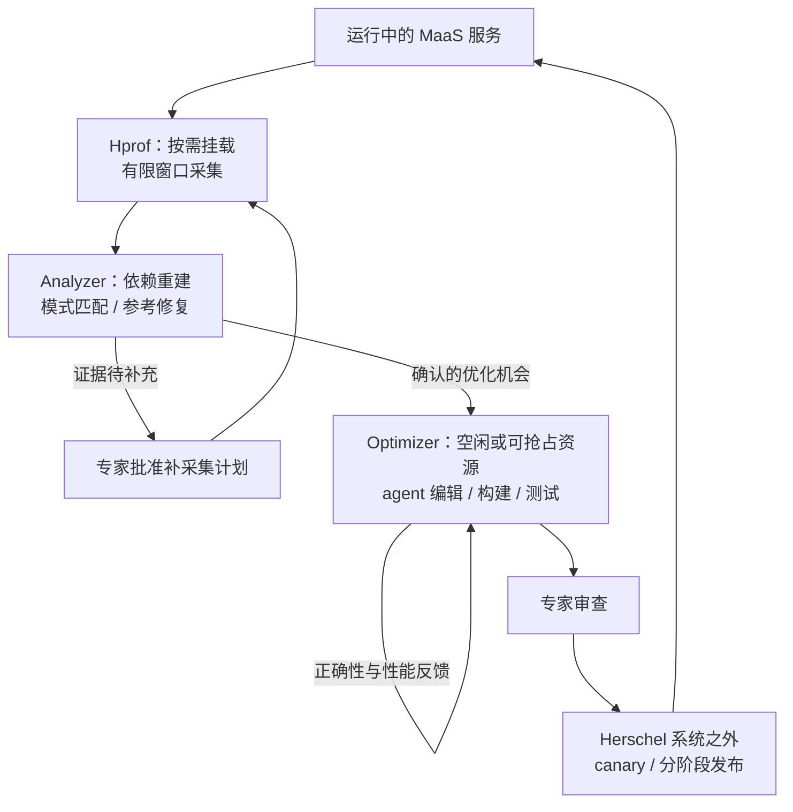

# 文献调研：推理自优化、PD 弹性、参数化调度、请求级路由、网络协同与软边界 PD

初次检索：2026-10-30；PD 专项：2026-11-06；参数化调度专项：2026-11-13；PD 请求路由专项：2026-11-15；EP/KV 网络协同专项：2026-11-17；软边界 PD 专项：2026-11-17。调研分为六部分：**第一部分对应 [MaaS 影子实验方案](02_研究方案_MaaS影子实验与持续自优化.md)**，研究生产观测、快调/慢调实验、验证与发布；**第二部分对应 [PD 在线角色渐变方案](03_研究构想_MaaS集群PD配比弹性调整.md)**，研究固定执行组数量下源请求服务与目标角色提前接纳的重叠；**第三部分对应 [参数化调度器方案](04_研究方案_参数化调度器的表达能力与在线优化.md)**，研究固定调度原语、策略表达边界、有状态热切换与在线优化；**第四部分对应 [PD 请求级路由方案](05_研究方案_PD分离下的SLO感知在途工作量控制.md)**，研究固定布局下的接纳、在途工作量、KV 交接与长尾；**第五部分对应 [EP/KV RDMA 协同方案](06_研究方案_PD分离下EP通信与KV传输的RDMA协同.md)**，研究跨机 EP 通信与 KV 传输在共享 RoCE fabric 上的隔离与协同；**第六部分对应 [软边界 PD 方案](07_研究方案_软边界PD与三级缓存全局调度.md)**，研究三级缓存、KV 加载与 prefill 位置的联合调度，以及持续 P 压力下的 warm 工作转移与有效容量响应。

依据为会议官网、正式 proceedings、固定版本作者原文与源码审计。原有 20 篇及精读、13 篇 PD 相关论文保留，参数化调度部分的 6 篇、请求路由与在途控制专项的 12 篇与 EP/KV 网络协同专项的 8 篇共同纳入，软边界 PD 专项新增 AMPD、Vesta、Bursts、Remote KV Tiers 与 KVCompass 五篇，共 64 份本地原文。合计 40 篇独立核实的会议论文/正式日程条目，其中 QUARTZ 属于 Findings of ACL，TaiChi 的 SC 2026 报告在 2026-11-18；其余 24 篇作者预印本或发表记录待对齐条目单列。不同部分共享论文采用同一编号，不重复计数。发表身份、下载版本与机制覆盖分别核对。

## 第一部分：MaaS 影子实验与持续自优化

### 1.1 结论与阅读顺序

当前 MaaS 持续优化方案的直接近邻包括 **Herschel 的生产观测与 agent 代码优化、Autopoiesis 的在线策略演化，以及 FlashVector 的生产服务栈优化**。配置搜索、通用在线调优和有状态推理系统提供各环节的基础。

建议优先读十篇，先读 Herschel、Autopoiesis 与 FlashVector，再对照其余七篇：

1. **Herschel，arXiv v1（2026-09-30）**：MaaS 生产按需 profiling、机制诊断、agent 引擎/kernel 优化、空闲资源上的 PD 实验，以及专家审查后的外部发布流程；第一部分 §1.4 全文精读。
2. **Autopoiesis，arXiv v1（2026-04-08）**：运行中演化 serving 策略代码、模拟评估与纯函数热替换；第一部分 §1.4 全文精读。
3. **FlashVector，arXiv v1（2026-09-15）**：推荐服务栈的跨层优化、自动持续触发、隔离节点生产回放与 shadow canary；第一部分 §1.4 全文复读。
4. **SCOOT，WWW 2025**：与“暴露推理引擎参数并自动优化”最直接重合。
5. **TuxBot，SOSP 2026**：与“agent 在服务持续运行时调参数”最直接重合，但对象是 Linux OS。
6. **OnlineTune，SIGMOD 2022**：动态 workload 和受约束在线探索的必要基线。
7. **OPPerTune，NSDI 2024**：部署后联合调节数值、类别参数及其作用范围。
8. **LaTune，WWW 2026**：LLM 推理配置的两阶段优化与运行时选择；配置选择与在途引擎热更新分别核对。
9. **MorphServe，MLSys 2026**：运行中的层精度与 KV 容量联动；与“状态不丢失地切换”密切相关。
10. **QoServe，ASPLOS 2026**：依据请求 slack 和批次成本，逐轮改变 prefill chunk；是动态 scheduler 的直接基线。

Herschel 已连接生产低开销观测、证据补采集、引擎/kernel 修改和备用资源实验，并在案例中处理 PD handoff 与状态语义。Autopoiesis 则实现 serving 策略的模拟评估和纯函数热替换。当前方案的研究定位聚焦 **快调与慢调的联合安排、影子证据对生产收益的预测、灰度及集群部署的自动判定，以及完整预算下的长期业务净收益**；这些增量通过机制实现和对照实验建立。

相关 arXiv 预印本按机制单独收录，Herschel、Autopoiesis 与 FlashVector 列入 §1.4 精读，SEIS、VibeServe 与 agent 调优基准列入 §1.7。三篇已下载预印本的会议身份按各自核实状态记录，§1.3 的 17 篇顶会主表采用独立身份计数。

### 1.2 筛选与核实标准

主表只收录已核实主会或正式 proceedings 的工作：SOSP、OSDI、NSDI、EuroSys、ASPLOS、WWW、MLSys、SIGMOD/VLDB。这里按系统、数据与 ML 系统领域选择相关顶级会议，不把所有会议笼统写成同一 CCF 等级。

PVLDB 和 PACMMOD 采用期刊形式承载相应会议研究论文，文中保留卷期信息。不能把 SIGMOD demo、NeurIPS workshop 或只有 arXiv 的工作混作主会论文。

发表身份与下载版本分别核实。部分下载是作者 arXiv 版本，而非出版社最终排版。TuxBot 的 arXiv v2 与 IBM 发布页实验数字不同，本文不拼接两种版本的收益数字。

检索覆盖关键词：`LLM inference configuration tuning`、`SLO-oriented tuning`、`online system tuning agent`、`runtime adaptive serving`、`safe contextual Bayesian optimization`、`scheduler KV cache kernel backend`，以及 2025–2026 年会议目录和核心论文的相关工作。

### 1.3 相关性总表

“在线执行”只表示服务过程中的决策；“热调参数”还要求配置能够对同一个运行中的引擎生效。两者不能互换。

| 编号 | 工作与会议 | 优化对象/方法 | 与用户思路的关系 | 不能直接等同的部分 |
| --- | --- | --- | --- | --- |
| 01 | SCOOT · WWW 2025 | 推理引擎参数；约束 BO/MOBO | 最直接的多旋钮调优先例 | 非 LLM agent；实验含 TP、block size 等结构参数 |
| 02 | TuxBot · SOSP 2026 | OS 运行时参数；双循环 LLM 控制 | 不停机 agent 调优最接近 | 非推理引擎；不解决 KV/graph 状态协议 |
| 03 | LaTune · WWW 2026 | 边缘推理参数；降维、迁移、多目标优化 | 运行时选配置的直接先例 | 公开实验代码不能证明在途请求热切换 |
| 04 | OnlineTune · SIGMOD 2022 | 在线数据库参数；安全 contextual BO | 动态 workload、探索损失基线 | 数据库场景；非 LLM agent |
| 05 | GPTuner · VLDB 2024 | 数据库旋钮；LLM 知识 + BO | 参数语义、筛选与缩小范围 | LLM 主要组织知识与搜索空间 |
| 06 | λ-Tune · SIGMOD 2025 | 数据库配置脚本；LLM 候选与评估 | 联合生成配置、计入调优成本 | 不能据此声称在线热调 |
| 07 | MorphServe · MLSys 2026 | 权重精度与 KV 容量；运行时控制 | 持续推理时保留状态地适配 | 专用机制；精度变更涉及质量约束 |
| 08 | Llumnix · OSDI 2024 | 跨实例请求重调度与 live migration | 运行时状态迁移与持续服务 | 专用调度系统，非通用旋钮 agent |
| 09 | Sarathi-Serve · OSDI 2024 | chunked prefill 与 batch 调度 | scheduler 参数作用机制 | 调度算法，非在线搜索 agent |
| 10 | DistServe · OSDI 2024 | PD 分离、资源/并行计划 | goodput 目标与分层资源决策 | 规划与系统架构，非单引擎热调 |
| 11 | FlashInfer · MLSys 2025 | attention 与 KV 格式、动态调度 | kernel 控制能力和 graph 兼容依据 | attention engine，非配置搜索 agent |
| 12 | AdaServe · EuroSys 2026 | 多 SLO 的动态投机配置 | 按 workload/SLO 调执行参数 | 投机解码专用动作空间 |
| 13 | METIS · SOSP 2025 | RAG 配置与调度联合选择 | 多旋钮交互和质量/资源联动 | 应用层 RAG 参数，不是底层引擎旋钮 |
| 14 | Ave · SOSP 2026 | agent 生成优化 GPU kernel | agent 的约束、验证与反馈设计 | 编译时生成代码，非在线调现成参数 |
| 15 | OPPerTune · NSDI 2024 | 部署后配置；混合参数在线学习 | 动作范围、参数筛选与在线优化 | 通用云应用，不含推理状态语义 |
| 16 | TUNA · EuroSys 2025 | 有噪声的系统配置评估 | 识别收益、稳定配置选择 | 不直接解决 workload 非平稳性或热更新 |
| 17 | QoServe · ASPLOS 2026 | 请求 QoS、动态 chunk、混合优先级 | 逐轮改变 scheduler 策略的直接先例 | 专用控制；非 scheduler/KV/kernel 通用 agent |

### 1.4 优先精读论文

优先级按研究相关性确定；Herschel、Autopoiesis 与 FlashVector 以预印本身份精读，§1.3 的 17 篇顶会主表与身份计数保持不变。

#### 20. Herschel: Continuous Optimization of Production LLM Inference through On-Demand Profiling

**arXiv 预印本，固定作者 v1（2026-09-30），Alibaba Group，17 页。** [作者页面 v1](https://arxiv.org/abs/2609.40247v1)；[PDF v1](https://arxiv.org/pdf/2609.40247v1)；[本地原文](papers/20_Herschel_arxiv_v1.pdf)；[逐页文本](paper-text/20_Herschel_arxiv_v1.txt)；[精读证据](evidence/herschel-close-reading-2026-11-05.json)。正文与结论位于 p1–13，参考文献位于 p13–17；以下均用本地 PDF 物理页码。发表身份按 arXiv 预印本记录。

**与当前方案的关系。** Herschel 已将 MaaS 生产观测、按需低开销 profiling、机制诊断、agent 修改引擎/kernel、空闲资源实验和部署验证连接起来。它直接覆盖当前方案的应用场景及多项核心环节。精读需要分别定位 profiler 的运行时接入、候选代码的实验执行，以及经专家审查进入生产发布的过程。原文 §1、§4、§7，p1–2、p4、p7。

##### 系统组成与执行闭环

| 组件 | 输入与实现职责 | 输出及后续环节 |
| --- | --- | --- |
| Hprof | 控制面选择进程、调用、支持的对象字段及采集窗口；本机 daemon 向运行进程挂载探针 | Python 调用、运行时字段、host API 与设备活动记录 |
| Analyzer | 重建算子执行与跨进程依赖，检查低效模式及参考修复的适用条件 | 带证据的优化机会和建议；缺少关系证据时申请专家批准的补采集 |
| Optimizer | agent 在受控资源上编辑、构建、正确性检查与性能实验，使用反馈继续修订 | 满足实验要求的最佳候选，或失败记录与未解决问题 |
| 专家与外部发布流程 | 审查代码语义、测试结果和部署适用性，执行 canary 与分阶段发布 | 通过正确性及 serving-SLO 监控决定扩大部署 |

§4 的 Figure 3 明确把 canary 和 rollout 标为 Herschel 之外；§7 说明专家审查后进入这些流程。系统以自动化观测、分析与候选实验连接生产优化，发布流程保留人工审查。原文 p4、p7，Figure 3 已目视核对。

##### Hprof：运行时挂载、可变覆盖与资源生命周期

Hprof 的“不重启”首先描述 **profiling 的接入与退出**。初次进入目标进程时，CLI 用 `ptrace` 暂停选定线程，检查其栈以避开已知 allocator/loader/threading 锁上下文，临时重定向以调用 `pthread_create`，由 loader thread 通过 `dlopen` 加载进程内 controller。CLI 恢复原线程并释放 `ptrace` 后，再等待加载完成。后续命令通过 socket 发给 controller。这里的 runtime attachment 是观测组件挂载，候选优化代码的部署由 §7 的审查和发布流程描述。原文 §5.1，p4。

Python probe 通过常驻 router 拦截 CPython frame evaluation，在默认 evaluator 前后记录调用、线程、进入/返回时间，并读取支持的对象字段。调用区间包含 native 执行与等待；engine-specific reader 提取 tensor shape、token 数等状态，连接到具体调用。reader 随内部布局演进更新，§10 报告六个月发布过五个 reader 版本。原文 §5.2、§10，p4–5、p12。

NVIDIA probe 使用 CUPTI 记录 CUDA Runtime API 与 kernel、内存操作、同步等设备活动，依据 correlation ID、device/stream 建立提交到执行的关系。其他设备通过 adapter 接入统一接口。停止采集时关闭新 callback 入口、处理已进入调用与延迟设备记录；CUDA 状态转换会阻塞 API 进入并排空已跟踪调用。probe 按可安全回收、可复用状态决定卸载和资源保留。原文 §5.1–5.2，p4–5。

fleet control plane 依据待调查的 serving condition 选择实例与采集时机，采用 canary collection 和并发限制。初始窗口通常为 30 秒；作者生产样本中每窗至少包含十个完整推理 step，中位数超过 700。后续窗口根据调查缺失的证据扩展调用、字段或进程覆盖。异常是触发来源之一，持续存在的低效也可主动调查。原文 §3、§5.3，p3、p5。

##### Analyzer：机制匹配、补证据与修复复用

Analyzer 从 Python 调用、host 提交与设备活动重建算子完整区间及输入 shape；CUDA Graph replay 通过 graph identity、launch correlation 和模型层序规则恢复算子关系。缺少 composition 或输入时保留未解决状态。算子效率以理论 FLOPs/数据量、实际区间和设备峰值计算 MFU/MBU，使用 `SOLop = max(MFU, MBU)` 表示相对计算/带宽上界的达成率。graph padding 单独记录。原文 §6.1，p5–6。

跨组件分析覆盖 critical path、暴露的通信时间、同步 RPC、状态分配/使用/释放及实际复用。代码语义与对象标识用于判断输出是否仍有消费者、计算是否还承担必要状态更新。Table 1 给出 **35 个模式：8 类 25 个引擎模式，以及 3 类 10 个算子模式**；知识来源为超过 20,000 条性能相关 PR/CR、专家知识和生产调查，模式关联参考修复。原文 §6.1–6.2，p6–7。

算子机会的 Hotness 先按 workload critical-path 时间占比加权预估可恢复部分，再按 fleet GPU-hours 加权，用于机会排序。模式匹配缺少必需证据时，Analyzer 请求专家批准的新采集计划。确认机制后，将参考修复的来源、代码变化和适用条件交给 Optimizer。该设计已覆盖“低开销观测 → 缺失证据补采集 → 机制诊断 → 候选修复”的完整联系。原文 p7。

##### Optimizer：真实资源实验与 PD 状态约束

§7 的实验通常使用 **8–32 张空闲或可抢占加速卡，包含 PD 分离服务所需的 P/D 资源**。缩小部署规模时，实验保留触发问题的 workload 与依赖，并确认原始问题仍能在基线中出现；硬件相关假设在目标设备上测试。抢占后保存代码和测量结果，中断实验重新运行。它已覆盖“生产发现问题，在额外资源上改代码和验证”的执行方式。原文 p7。

agent 使用当前执行证据和参考修复，进行编辑、构建、测试与修订。构建失败、正确性结果和性能反馈指导下一轮；性能对照使用相同 workload/settings，并关闭高开销 profiling，未解释的性能问题再用 offline profiler 分析。停止条件包括假设被否定且缺少新线索、预算耗尽和进展停滞。结果为最佳已测候选或失败报告。原文 p7。

引擎改动示例覆盖 KV 传输与计算重叠、KV/metadata/buffer 复用、speculative draft 数与无用计算裁剪、异步 KV 控制调用，以及 Worker dispatch 前的 DP 协调。kernel agent 针对生产 shape、dtype、layout 和硬件生成或特化算子，测量完整算子/融合组后集成到 runtime 再评估 serving workload。这里的 runtime integration 描述候选实现集成，v1 展开的生产接入流程为专家审查、canary 和 staged rollout。原文 §7，p7。

##### profiling 实验：测量条件与数字口径

| 项目 | 作者报告与适用范围 |
| --- | --- |
| 测试平台 | 每台 8×H20、双路 48 核 Xeon 8469C、1 TiB DRAM；CUDA 13.0、PyTorch 2.13.0、vLLM 0.29.0 |
| 延迟负载 | 同实例 P/D 混部；BF16 Qwen3-32B TP2 与 Qwen3-235B-A22B TP8；输入 4096/8192 token、输出 512 token，短输入并发 32/64、长输入并发 32 |
| 对照 | unprofiled latency reference；100 Hz blocking py-spy；关闭/开启 shape 与 stack 的 PyTorch-lite/full |
| Hprof-full 活跃采集开销 | 所测配置中 TTFT <0.5%、TPOT <7%；关闭 accelerator tracing 的 Hprof-python，median/P95 TPOT <1.5% |
| Hprof-full 主机资源 | 0.12–0.46 CPU cores、2.3–2.8 GiB peak RSS、1.5–8.8 MiB/s trace；最高观测速率下 30 秒约 265 MiB |
| 调用与时间线保真度 | Qwen3.5-35B-A3B 上 per-symbol call count 一致率 99.2%、直接父子关系一致率 99.98%；同 workload 分别采集的 kernel 顺序一致，duration 相对差异中位数 1.6%、P95 10% |
| 生命周期测试 | Qwen3.5-35B-A3B 上 50 次 attach–collect–detach，观测到的各阶段无 worker hang 或推理中断 |

来源：§8.1、Figure 6、Table 2，p8–9，图表已目视核对。开销数字对应活跃采集窗口；长期平均影响还取决于采集频率、并发及目标实例。Figure 6 的柱为各配置最大观测开销，须线为观测范围，非正变化画为零。50 次生命周期实验为特定条件下的观测结果。

生产研究持续六个月，覆盖 120 多个 model variant、10 多类 accelerator 和数十个集群，采集约 17,000 traces；其中超过 3,900 条、约 23% 匹配至少一种低效模式。该比例描述已采集 trace 的模式命中，诊断准确率与 fleet 整体效率提升须另行测量。原文 §8.2，p9。

##### 四个优化案例：改了什么、验证了什么

| 案例 | 实际改动与状态条件 | 作者报告及口径 |
| --- | --- | --- |
| §9.1 KV 创建阻塞 dispatch | 补采 EngineCore 调用与 workId，确认同步 KV 对象创建只在后续保存时需要；改为异步创建，计算先行，KV 保存仍等待创建成功 | GLM-5.2 短上下文 prefill 吞吐 +3.3%；含三个 Qwen 模型为 +3.3%–5.7%，已部署 |
| §9.2 DP 协调前移 | agent 恢复请求边界/进展，识别 Hybrid Attention 的 PD handoff tail，将协调移至 EngineCore；保留 tail sampling、idle-rank、draft 与 graph/fusion 条件 | 原 Hybrid patch 已部署；后续 upstream port 在 8×XPU-A 的 35B/122B/397B 上离线测得 +6.0%/+4.8%/+2.5% 吞吐 |
| §9.3 裁剪 P 侧无用 MTP | 保留第一个完整 MTP forward 构建交给 D 的 prefix/recurrent state，移除后续两个没有消费者的 draft forward | 典型短上下文 TTFT 约 −6%；已广泛部署；第一个 forward 内预测分支的进一步裁剪仍为优化机会 |
| §9.4 PagedAttention 布局 | Q 一次转换并复用，K 以兼容布局加载，减少共享内存往返；按生产 shape 验证 | 测定 shape 的 PA 耗时 −60.9%，SOL 由 7.3% 到 18.7%；端到端 TPOT 约 −8% 至 −32% 来自该项与 KV preparation、copy、host submission 的组合 |

来源：§9、Table 3–4、Figure 7–12，p9–12，相关图表已目视核对。§9.2 的 Hybrid 适配为 +766/−150 行；后续 upstream port 的最终 runtime diff 为 +707/−32、测试为 +692/−1，两个版本分别记录。该 port 的每个吞吐值是并发 32/128 下两项“最大观测配对收益”的均值。Table 3 的部署数量约 50/50/100/30 为四项结果的各自范围，全文结果按这些具体优化案例组织。

##### 对当前方案与特性表的影响

| 当前方案环节 | Herschel 已展开的内容 | 本项目后续验证重点 |
| --- | --- | --- |
| MaaS 持续自优化 | 真实生产问题、跨层观测、agent 引擎/kernel 修改、反复实验与生产部署 | 同一持续实验中的长期业务交付与完整预算 |
| 低开销观测与诊断 | runtime attachment、按需窗口、可变覆盖、模式匹配和专家批准补采集 | 在该基础上定义观测预算与实验选择规则，测量诊断质量及净收益 |
| 实验资源 | 8–32 张 idle/revocable 卡、缩小规模保留触发条件、包含 PD 资源 | 不同资源规模下影子负载的代表性、候选完成时间与实验净收益 |
| PD 有状态优化 | handoff tail、recurrent/prefix state、DP metadata、MTP/graph 条件及 KV 传输 | 在分离服务上验证候选正确性、目标容量和部署兼容 |
| 快调与慢调 | 在线 profiling 与受控代码实验；集成后的候选经审查进入外部发布 | 实验预算联合安排、影子证据、灰度判定与版本生效回执 |
| 自用 API 与成本 | 原文描述内部 agent，未给出强制使用目标服务同 endpoint/同容量的部署合同 | 明确 API 数据流、内部推理容量竞争和全成本 |

**本调研判断。** Herschel 是当前方案的直接近邻：生产低开销观测、证据驱动诊断、空闲资源实验和 PD 代码优化已有明确覆盖。后续研究主张聚焦有限实验资源下的快调/慢调联合安排、影子验证与生产收益的一致性，以及灰度到集群部署的自动判定。特性表分别标注 profiler 挂载、策略原地更新、代码实验和发布验证；Herschel 的专家审查与外部发布边界按 §4、§7 记录。

#### 18. Autopoiesis: A Self-Evolving System Paradigm for LLM Serving Under Runtime Dynamics

**arXiv 预印本，固定作者 v1（2026-04-08），尚未核实顶会发表身份。** [作者页面 v1](https://arxiv.org/abs/2604.07144v1)；[PDF v1](https://arxiv.org/pdf/2604.07144v1)；[本地 34 页原文](papers/18_Autopoiesis_arxiv_v1.pdf)；[逐页文本](paper-text/18_Autopoiesis_arxiv_v1.txt)；[精读证据与口径检查](evidence/autopoiesis-close-reading-2026-11-05.json)。以下页码均为本地 PDF 物理页码；机制陈述依据原文，“本调研判断”表示我们的分析，不代表已经实现或复现实验。

**为什么优先读。** 它已把“线上观测 → LLM 改策略代码 → 候选评估 → 热替换 → 下一轮演化”组织成持续闭环，是当前 MaaS 持续自优化方案的直接近邻。核心区别在于 **plan 与 policy**：plan 是当前请求/模型分配、资源配置及并行方案；policy 是产生和更新 plan 的算法。普通动态调度可在策略代码不变的情况下生成不同 plan；Autopoiesis 连生成 plan 的策略代码也持续改写。不能再把“LLM 在线优化 serving”本身作为本项目没有先例的贡献。原文 §2、§4，p3–7。

##### 问题：为什么连调度算法都要变

论文联合考虑三种代价：重调度频率、调度搜索投入、重配置幅度。搜索更充分可能得到更好的资源方案，但求解期间旧方案仍在运行；迁移更多权重或调整更多资源可能改善随后服务，却加重过渡期损失；过于频繁地重新规划则累积两种开销。§3 用稳定/波动负载的对照说明，没有一个极端策略能覆盖全部阶段。这里的“静态策略”指规则或算法保持不变，不表示基线完全不会动态调整资源。原文 §1、§3、§5.1，p2、p5–9。

策略表示为两个共同演化的函数：

| 函数 | 输入/输出与职责 | 控制的代价 |
| --- | --- | --- |
| `should_reschedule(ctx) → {0,1}` | 根据当前 workload、集群状态和现有 plan 判断是否重调度 | 重调度次数与旧方案失配持续时间 |
| `schedule(ctx) → plan` | 为当前状态生成新 plan；冷启动时现有 plan 为空 | 求解耗时、新方案质量、相对旧方案的重配置幅度 |

它不要求 LLM 为每个业务请求或每个 token 作一次决策。在线执行的是生成后的策略程序；LLM 位于较慢的策略演化循环。原文 §4–5，p6–9。

##### 闭环：实时服务与异步演化怎样连接

数据面使用当前策略处理业务，同时周期记录 workload/cluster 状态到固定大小的环形 buffer。一次演化结束后，控制面请求近期滑动窗口；数据面用后台线程传送快照，连续快照允许重叠。控制面针对快照演化候选，找到更优程序后将其写入共享 staging area；数据面在下一次 monitoring step 加载。窗口长度可配置，正文没有把它设为对所有负载适用的固定常数。原文 §4、§6.2，p6–7、p11–12。

**两种“改变”要分开。** 上图加载的是策略代码；新策略在后续调用时可能产生新的部署 plan，而执行这个 plan 才发生资源、权重或并行配置的重配置。代码替换轻量，不意味着新 plan 的执行也零成本。原文 §5.1、§6.2，p7–8、p12。

##### 目标与 evaluator：哪些时间实测，哪些靠模型估算

主目标是最小化一段 trace 的完成时间。按 p8 的式 (1)：

\[
T_{total}=t_{sched}(1)+t_{serve}(1)+\sum_{i=2}^{N}\bigl[t_{stale}(i)+t_{reconfig}(i)+t_{serve}(i)\bigr].
\]

冷启动包含首次调度/模型初始化及服务；之后每次重调度分三段：求解新 plan 时旧 plan 继续服务、部分资源重配置时其余资源继续服务、最后按新 plan 稳定服务。`t_stale` 是求解期间沿用旧方案的时间段，不能在它之外再无条件加一次完整调度耗时。重调度次数 `N` 也由候选策略决定。这个模型比只评估新配置的稳态吞吐更接近持续服务的成本问题，但主实验目标仍是 trace completion time，不能直接改写成累计 SLO goodput。原文 §5.1，p7–9。

候选评估用数据面近期 trace 回放，而不是把每个候选直接放进真实业务流试错。evaluator 在 monitoring 点执行候选触发逻辑；触发后运行候选调度程序，**实测其 wall-clock 求解时间**，再用 serving simulator 估计服务与重配置成本。反馈除总分外还包含重调度次数以及 stale、reconfiguration、serving 的累计分项，便于下一次 LLM 变异判断收益来自哪里。§5.3 举 monitoring 间隔为 5 秒的例子，不是所有在线控制的固定周期。原文 p9–10。

Appendix B 的模型细节值得单独注意：

| 模型项 | v1 的具体做法 | 本调研解读 |
| --- | --- | --- |
| 服务成本 | roofline 估计各层 prefill/decode 算子，结合计算量、HBM 带宽和 TP all-reduce 成本 | 是分析模型，不是对所有候选真实 GPU 执行时间的逐一测量 |
| 显存可行性 | 检查分片权重是否超过设备显存的 0.8，给 KV 预留余量；不满足时给很大惩罚 | 不能直接替代活跃/可驱逐/传输中 KV 的实际分配与引用协议 |
| 重配置成本 | 按 plan 改变模型的 GPU 类型、TP、数量估计 terminate/drain 与 PCIe 权重重载；包含模型相关利用率系数 | 主文提及 KV 迁移，不等于该附录已提供完整 RDMA/KV 迁移状态机 |

原文 §5.3 称模拟器的保真度在 Appendix B 验证；本地 v1 p22–23 实际提供的是成本公式与假设，没有给出独立的预测误差表或校准误差图。本次可核实的是模型结构，尚不能据此确认模拟器在目标 RDMA 拓扑、cache 热度和在途传输场景上的预测精度。§7 声明了集群部署；候选评分依赖模拟器，不应反向推断全部主实验都只是模拟。

##### 演化：LLM 修改什么，历史怎样复用

§5.2–5.4 的流程包括 seed 初始化、LLM diff 变异、评分与反馈、候选选择迭代。seed 可采用 greedy/ILP 调度和周期/阈值触发等不同算法。候选保留采用受 MAP-Elites 启发的选择机制与 island population，兼顾性能和多样性；搜索在收敛或预算耗尽时结束。系统 prompt 编码代价结构和 trade-off，迭代 prompt 加入父子成本分解、最好得分和近期探索摘要。它既改变阈值，也改算法、约束、搜索空间和 solver 配置。原文 p9–11。

§6.1 用上轮优选候选及其变异初始化新一轮，即 warm-start re-evolution；不需要从空白重新搜索。演化级 timeout 限制整轮墙钟时间，候选级 timeout 避免生成程序长时间求解或不终止。§7.3 报告波动/稳定场景分别约 80/60 次迭代，在少于 10/8 分钟内收敛；10 个并行评估线程可使演化最多加速 8×。Figure 9 的四个快照中 warm start 有一个无加速，其余节省 71%、82%、83%；大幅漂移时历史候选未必可复用。上述数字是文中配置与场景的报告值，不是普适的控制响应上限。原文 p11、p14–15。

**配置存在版本内不一致。** §7 p13 写合成模型为 **GLM-4.7-Flash**，Appendix I p32 写当前部署使用开源模型；但 Appendix D 的 Table 6（p25）列 **Claude Opus 4.6 / Claude Sonnet 4.6**，采样权重 0.7 / 0.3。该表还列温度 0.7、最大输出 16384 token、最大代码长度 50000、最多 100 次迭代、种群 50、island 数 3、elite 比例 0.2。不能将这张表与正文拼成一套已确认的 GLM 复现配置；v1 未说明两者怎样对应。

##### 热替换：已做到的合同与尚未证明的部分

§6.2 将两个函数描述为纯函数，因此新代码可写入共享 staging area，在下一 monitoring step 异步加载；后续函数调用采用新版本，在途 serving plan 继续执行。这是一个有明确前提的代码替换设计：**将外部状态显式交给 `ctx`，保留当前 plan，让新策略只影响后续决策。** 原文 p11–12。

本调研判断：这个思路可借鉴为稳定策略接口，但不足以证明任意有状态组件都可照搬。替换 eviction 结构、KV 元数据、graph/backend 或分布式执行路径，还需给出旧新状态的转换/兼容、旧版本在途引用释放和跨 rank 失败语义。v1 的实现节说明了纯函数加载与 timeout，没有展开通用状态 schema 迁移、分布式原子提交或业务回滚协议；超时和模拟得分能筛除部分坏候选，不能当作完整的语义正确性证明。这里限定的是本文能支持的结论，不推断作者实现绝无其他保护措施。

##### 主实验：资源、负载、基线与收益口径

§7 的主对比如下。三种基线分别用于不同环境，不能看成同一集群上完成了全部两两对照。以下“正文降幅”保留作者用词，不表示本项目已经复现。

| 环境与主要变化 | 作者声明的部署 | 对应基线 / 被服务模型 | §7.1 正文报告的完成时间降幅 | Figure 7 基线 / Autopoiesis 的时间比 |
| --- | --- | --- | --- | --- |
| 同构，负载变化 | 4 节点、32×H100-80G；机间 InfiniBand 50 GB/s | DistServe；Llama3.1-70B | 平均 27%，最高 31% | ShareGPT 1.23×，LongBench 1.31× |
| 异构，负载与硬件差异 | 64 GPU：20×A100-40G、20×A100-80G、8×H100-80G、16×H20-96G；机间 20 Gb/s | HexGen；另含 Llama3.1-8B、Llama2-13B | 平均 30%，最高 33% | ShareGPT 1.27×，LongBench 1.33× |
| 弹性，节点回收/补充 | 最多 8 节点、64×A100-80G，规模 24–64 GPU；机间 20 Gb/s | SpotServe；Llama3.1-70B | 平均 44%，最高 53% | MAF trace 1 为 1.35×，trace 2 为 1.53× |

来源：§7、Figure 7，p12–14。同构链路的 GB/s 与后两类的 Gb/s 是原文不同单位，不能混用。

**时间比与降幅需分开。** Figure 7 把 Autopoiesis 归一化为 1.00×；若基线时间为 1.53×，按图中已四舍五入的标注换算，Autopoiesis 相对基线的时间减少为 `1 - 1/1.53 ≈ 34.6%`，并非 53%。1.31× 同理对应约 23.7% 的时间减少，而非 31%。正文将这些比值差写成 reduction，存在口径冲突；摘要“平均 34%、最高 53% improvement”也不宜直接写成耗时降幅、SLO goodput 或省钱比例。引用时明确来自正文还是图中比值，不把两者混合成一组已确认降幅。

负载也需限定：§7 与 Appendix H.3 使用 ShareGPT/LongBench 子采样，并加入合成的阶段波动；DistServe/HexGen 按六阶段构造，MAF 则映射为弹性集群规模并结合 ShareGPT 请求。它们不是未经修改的持续付费业务流。Appendix H.3 的两个 MAF 场景共享 planner 可见的集群规模序列，而隐藏 workload 阶段不同。这里足以支持受控动态场景比较，生产原样流量的泛化仍要独立验证。原文 p13、p31–33。

##### 演化后的程序实例：不只是调几个数

§7.2 与 Appendix F/G 给出的改动包括：限制机间 TP 搜索、用精选 batch 候选代替穷举、为每模型至少一个 serving group 增加约束、依据 GPU 类型与模型选择分配、收紧 ILP 每变量 Big-M 上界、增加加权次目标、调整 CBC solver 参数。Appendix E 已显式向 LLM 提供“搜索粒度与求解代价”“迁移收益须覆盖重配置成本”等知识，因此结果应归因于领域提示、演化、evaluator 和候选设计的组合。不能直接把每条启发式都解释为在无先验条件下自主发现。原文 p14、p25–29。

§8 还有三个有助于判断范围的案例：

| 案例 | 隔离的权衡与主要观察 | 解读边界 |
| --- | --- | --- |
| §8.1 负载变化 | greedy 与 ILP 各有优势；演化策略在波动/稳定 trace 分别重调度 9/2 次 | 既改变每次求解代价，也改变何时求解 |
| §8.2 弹性资源 | 比较 full-migration 与 minimal-migration，演化策略选择合适迁移幅度 | 已将重配置代价纳入优化，不能将“考虑迁移成本”单独作为新增量 |
| §8.3 agentic 请求调度 | 多调用 workflow 逐轮揭示；决定 P/D 实例分配与排队顺序，模型与并行配置在轮次间不迁移 | 论文也覆盖请求级 PD 调度，不能笼统说它只研究集群 placement |

来源：p15–18、Appendix C.2 p24–25。§8.3 的 Table 4 报每轮调度/服务及总耗时；Appendix C.2 还提出 workflow 的 `Cω/SLOω` 及尾部分位目标。应区分“提出适用目标”与“主实验已报告该目标”：Appendix I 将 P95/SLO attainment 描述为替换 evaluator 聚合方式的适配思路，不足以代替本项目的业务累计 SLO goodput 评估。

##### 对本项目的启发与真正需要补的证据

| 本项目的问题 | Autopoiesis 已覆盖 | 我们需要进一步证明的内容 |
| --- | --- | --- |
| 低开销观测与问题诊断 | 周期状态记录、环形 buffer、后台快照、成本分项反馈 | 与常驻重型 profile 对照，验证触发式采样的诊断质量、误报漏报、采样开销与收益；仅使用后台线程不足以证明端到端零干扰 |
| 策略/代码持续更新 | 纯函数策略的异步热替换，保持在途 plan | 快调/慢调联合安排、实验与生产兼容、灰度及撤回成本 |
| 生产旁路实验与发布 | 调度/重配置成本建模及请求级 PD 调度已有先例 | 实时影子与回放的证据可信度、自动灰度和生产集群部署的业务收益 |
| 使用本服务或外部 API | API 演化、开源模型成本讨论；不要求前沿闭源模型 | 明确同 endpoint、同容量及数据控制域，测内部数据留存、闲时容量复用与满载机会成本；本次原文未确认其采用同服务依赖关系，也不能据此断言它不支持 |
| 长期净收益与演化开销 | 分钟级收敛、warm start、并行评估、API 时延/费用讨论 | 单独核算 LLM token/GPU、CPU evaluator、profile、切换、恢复与演化期间业务损失；异步运行并不意味着这些资源免费 |

Appendix I 明确承认 API 可用性/时延、模型幻觉、快照窗口长度与演化时间的限制：长窗口会平均掉新阶段，短窗口容易追逐噪声；自适应窗口、投机评估与提前终止仍作为后续方向。主文的时间模型没有显式列出 LLM 变异费用及其对共享推理容量的挤占；仅凭现有公式不能认定已完成“用本服务优化本服务”的全成本核算。原文 p32–33。

**本调研判断**：在线 LLM 策略演化、代码热替换、历史 warm start、trace 评估和迁移成本已有明确覆盖。当前 [研究方案](02_研究方案_MaaS影子实验与持续自优化.md) 通过生产镜像与实验资源池组织快调和慢调，并经灰度监测推进集群部署。研究证据聚焦低开销诊断、影子与回放的代表性、自动判定质量，以及完整资源成本下的持续收益；使用本服务 API 的内部信息留存和容量复用价值单独评估。

#### 19. FlashVector: Agent for Hierarchical Model Serving Stack Optimization

**arXiv 预印本，固定作者 v1（2026-09-15），Stanford / Unity Vector，9 页。** [本地原文](papers/19_FlashVector_arxiv_v1.pdf)；[逐页文本](paper-text/19_FlashVector_arxiv_v1.txt)；[全文复读证据](evidence/flashvector-close-reading-2026-11-05.json)。对象为广告推荐服务，跨 GPU kernel、模型计算图、NVIDIA Triton model server 与 feature processing 四层。发表身份按预印本记录。

**执行机制。** §4.2 的 layer agent 统一实现 Profile、Diagnose、Optimize、Verify，运行结束后 Refine 知识库。Algorithm 1 每轮随机抽取一个层，在该层内按时间占比与预期收益排列假设，改代码或配置，先验证该层，再运行 full-stack load test 决定接纳；局部收益通过后，端到端回归仍会丢弃候选。新模型发布、运行中的模型长时间未分析会自动触发下一次优化，历史接纳与拒绝记录保留。原文 p4–6。

**验证条件。** 优化前保存权重、代表性输入及输出。确定性改写要求逐元素相同；浮点重排按声明的数值误差约束；有意近似依业务指标；配置变化通过固定延迟 SLO 的 shadow canary。重复 no-op baseline 给出的端到端噪声范围为 ±6%，2–6% 的改善最多扩展至 8 倍样本后复测。原文 §4.2，p5，Algorithm 1 已目视核对。

**隔离节点实验与生产接入。** §5.4 当前搜索 instance count 与 dynamic batch size 两项，queue policy 从 SLO 推导，副本数由 autoscaler 管理。实验在生产同机型的隔离节点上回放真实请求；两阶段模型先捕获 preprocessor 输出，再回放给 model server。agent 运行、监控、解读候选，打开 PR，经审查交付；Verify 通过 shadow-traffic canary 决定采用或丢弃，并在下次模型发布后再次优化。原文 p8。

| 实验结果 | 对应范围 |
| --- | --- |
| Table 1 最高 2× 吞吐、1.98× 延迟加速 | 六个生产推荐模型的 model-server 结果，各模型收益分别记录 |
| §5.1 最高 30× | Triton 输入序列化步骤的局部加速 |
| §5.2 attention 3.56× | 单 attention 模块 996.5 μs → 279.8 μs；其他 graph/embedding 改动另外测量 |
| §5.3 feature pod 约 1.6× | 相同延迟 SLO 下，多个改动累积将 940 RPS 提升到约 1500 RPS |
| §5.4 配置间吞吐相差超过 2× | 同一已做代码优化模型的不同配置区间；各模型相对基线的净提升另需对应测量 |

§5.4 Table 4 中 Model B 的 SLO 为 250 ms，所选 trial 的 p99 为 271 ms；图表目视核对与文本一致。该行与表注“在 SLO 下维持的吞吐”存在口径冲突，四行配置分别记录。原文 p6–8。

**与本方案的关系。** FlashVector 已覆盖跨层代码与配置优化、自动持续触发、历史积累、生产同机型隔离实验、真实流量回放及 canary 接纳。这些特性在相关工作表中按已实现内容标注。当前方案进一步研究 LLM 服务的快调/慢调预算安排、实时影子与回放证据的可信度，以及自动灰度和集群发布。FlashVector 的回放和 shadow canary 按已覆盖能力标注，自动化程度通过人工介入、发布结果和完整成本评估。

#### 01. SCOOT: SLO-Oriented Performance Tuning for LLM Inference Engines

**WWW 2025，正式主会研究论文。** [正式 DOI](https://doi.org/10.1145/3696410.3714930)；[作者论文与录用说明](https://arxiv.org/abs/2408.04323)；[PDF](https://arxiv.org/pdf/2408.04323v2)；[代码](https://github.com/Ketonmi/SCOOT)。

**论文机制**：使用单目标和多目标 Bayesian optimization 调推理引擎；以已知约束剪枝，以随机森林学习会导致失败的隐含约束，并行评估候选配置。Table 1 同时包含 `max-num-seqs`、token budget、TP 和 block size。论文以独立压力测试评估候选，不能从“部署在生产环境”推导同一进程不停机热调。[原文 §1、Table 1、§3](https://arxiv.org/html/2408.04323v2)

**本调研判断**：这是必须正面对照的工作。“自动搜索已有推理参数”已被覆盖。增量应放在可热调接口、状态延续、负载漂移与累计在线收益。原论文的 BO 可移植到共同热调空间作基线，但要标注移植。

**重点复核**：每次候选如何执行、压力测试成本、生产集成方式、失败配置处理；不要只读最终加速比。

#### 02. TuxBot: Semantic-Aware Online OS Tuning with LLMs

**SOSP 2026，已从官方日程核实主会。** [官方日程](https://sigops.org/s/conferences/sosp/2026/schedule.html)；[正式 DOI](https://doi.org/10.1145/3830418.3843885)；[作者 PDF v2](https://arxiv.org/pdf/2605.15026v2)；[代码](https://github.com/Columbia-DAP-Lab/TuxBot)。早期项目名为 SemaTune，不应按两个独立工作计数。

**论文机制**：服务持续运行，host-side 控制器依据参数 schema、机器观测、当前配置、近期动作和历史经验生成变更。快速与慢速 LLM 循环分工；类型化接口校验后执行。研究 OS scheduling、memory、I/O、power 参数，控制尺度是秒至分钟。[原文 §4](https://arxiv.org/html/2605.15026v2) LLM 通过外部 API 调用：实现支持 OpenAI API、OpenRouter 与 Gemini 兼容后端（作者 PDF v2 p8）；主配置以 Gemini 2.5 Flash 作 Reasoning 循环、Gemini 2.5 Flash-Lite 作 Instant 循环（p9），一次完整调优约 0.20 美元（p10、p16）。调优开销以 API 费用计，与被调系统的资源相互独立。

**本调研判断**：这是“在线调参数 agent”最强的概念重叠。推理研究要证明额外难点：KV 历史会延续、batch 在途、graph 绑定执行路径、rank 间协议关联。仅把 Linux 参数替换成 vLLM 参数，贡献可能不足。

**精读后补充的重叠点**：§4.2 已有“LLM 缩小参数空间，再交给 MLOS”的 trimming 模式；§4.5 也明确允许扩展到应用参数。因此“agent 选旋钮 + BO 搜索”或“改成应用参数”都不能单独当作新贡献。该节将适用范围限定为稳态长服务，并讨论漂移后重启调优 session。这里的 session 重启不是业务引擎重启。快速负载切换与推理状态成本，仍需单独研究。

**版本说明**：落盘 v2 的实验规模/收益数字与 [IBM 页面](https://research.ibm.com/publications/tuxbot-semantic-aware-online-os-tuning-with-llms) 不一致。对外引用数字应绑定版本；此处主要采用机制结论。

##### TuxBot 的 OS 参数：含义与具体例子

TuxBot 的实验对象是 Linux 的运行时控制参数。它不直接调整 vLLM 的 batching、KV 策略或 attention backend。论文主实验默认使用 8 项，扩展实验最多使用 41 个参数名。[论文 §6.1、§6.6](https://arxiv.org/html/2605.15026v2)

下表是默认 8 项。这里“OS scheduler”调度 CPU 线程；用户的“inference scheduler”组织请求和 token batch。它们处在不同层。

| 默认参数 | 控制含义 | 可能的性能影响与代价 |
| --- | --- | --- |
| `latency_ns` | Linux 5.15 CFS 的目标调度周期 | 改变 runnable 线程获得 CPU 的节奏；更短不保证整体更快 |
| `min_granularity_ns` | CFS 的最小调度粒度 | 降低后可能更及时切换，但可能增加上下文切换与缓存损失 |
| `wakeup_granularity_ns` | 唤醒任务触发抢占的门槛 | 较小可能减少唤醒等待，也可能带来频繁抢占 |
| `migration_cost_ns` | 任务被视作 cache-hot 的时间阈值 | 影响跨 CPU 迁移倾向，权衡缓存局部性与负载均衡 |
| `min_perf_pct` | Intel P-state 允许的最低性能级比例 | 提高性能下限可能减少升频等待，但提高能耗；不是 CPU 使用率下限 |
| `max_perf_pct` | Intel P-state 允许的最高性能级比例 | 限制性能上限，在性能与功耗之间取舍；不是 CPU 使用率上限 |
| `cstate_max` | TuxBot 对可进入 CPU idle state 的封装 | 限制深睡眠可能减少唤醒延迟，但提高空闲功耗 |
| `napi_busy_poll` | `net.core.busy_poll` 的封装，单位为微秒 | 在适用网络路径上主动轮询，权衡收包等待、CPU 占用和功耗 |

这些名称和路径针对论文 Linux 5.15 环境，不能当作所有新内核的统一接口。`cstate_max` 在源码中通过 cpuidle 的 state enable/disable 实现，不是要求重启机器修改启动参数。网络 busy polling 还取决于 socket、驱动与内核配置，并非所有服务都自动受益。[参数管理源码](https://github.com/Columbia-DAP-Lab/TuxBot/blob/TuxBot-SOSP-26/src/optimizer/parameter_manager.py)、[Intel P-state 文档](https://docs.kernel.org/5.15/admin-guide/pm/intel_pstate.html)、[网络 sysctl 文档](https://docs.kernel.org/5.15/admin-guide/sysctl/net.html)

例如，RPC 服务尾延迟高，原因可能是线程唤醒、收包等待与 CPU 从深睡眠恢复。控制器可以联合评估唤醒抢占、idle state 与 busy polling。它还必须考虑：主动轮询占用 CPU，并可能让深睡眠设置失去意义。这是联合系统控制，不能只把每个参数分别调到“更激进”。该例是机制解释，不是本地测量结果。

41 项实验进一步包括：

- 调频与电源：`scaling_governor`、`scaling_min_freq`、`scaling_max_freq`、`epp`、`turbo`、`pmqos`。
- 内存：`vm_swappiness`、`vm_dirty_ratio`、`vm_dirty_background_ratio`、dirty expire/writeback 周期、`zone_reclaim_mode`、`numa_balancing`。
- 网络：`netdev_budget`、`netdev_budget_usecs`、`somaxconn`、socket 收发缓冲、TCP congestion control/fastopen 等。
- 其他调度控制：`sched_autogroup_enabled`、`sched_cfs_bandwidth_slice_us`。

内存例子：`vm_dirty_background_ratio` 影响何时启动后台脏页回写；`vm_dirty_ratio` 影响写入任务何时承受回写限制。两者需要协调，不能只看每个值是否在数值范围内。[Linux VM 文档](https://docs.kernel.org/5.15/admin-guide/sysctl/vm.html)

**计数细节**：下载的 41 项配置同时包含 `busy_poll` 与 `napi_busy_poll`。源码明确后者是别名，setter 调用前者，二者写相同 sysctl。因此可以复述论文“41 个参数名”，但不能写成“41 个相互独立的底层控制维度”。其他参数也存在约束关系。参数数目应明确名称、别名、独立目标与实际有效参数的计数口径。

源码和清单的 Git blob SHA、下载来源及别名证据保存在 [TuxBot 参数审计](evidence/tuxbot-parameter-audit-2026-10-31.json)。原始公开配置和参数管理文件同样落盘。

从工作量比较，推理框架配置字段虽然已有数百个，但能在持续服务中正确生效的策略空间需要逐项审计。区别主要是 KV 历史、异步批次、派生对象与 graph/rank 一致性，不能按参数数量线性估算。两框架的实际候选与实施次序统一放在 [研究方案](02_研究方案_MaaS影子实验与持续自优化.md)，不另设框架文档。

#### 04. OnlineTune: Towards Dynamic and Safe Configuration Tuning for Cloud Databases

**SIGMOD 2022。** [正式 DOI](https://doi.org/10.1145/3514221.3526176)；[PDF](https://arxiv.org/pdf/2203.14473)；[作者页面 PDF](https://users.cs.utah.edu/~lifeifei/papers/sigmod22-onlinetune.pdf)；[代码](https://github.com/DBoptimizer/OnlineTune)。

**论文机制**：将在线调优建模为带 context 的优化问题，对环境特征分区并选择模型。结合模型预测与领域规则评估配置，通过局部子空间适配进行受约束探索。目标包含调优过程中的累计性能，并明确反对只针对静态 trace 的克隆实例调优。[论文](https://arxiv.org/abs/2203.14473)

**本调研判断**：如果新研究面对变化的 workload，必须比较 contextual BO 和安全探索。LLM 不是适应变化的唯一方式。推理缓存与队列的长时依赖也意味着不能无条件沿用“当前 context 决定即时 reward”的假设。

#### 15. OPPerTune: Post-Deployment Configuration Tuning of Services Made Easy

**NSDI 2024。** [会议页](https://www.usenix.org/conference/nsdi24/presentation/somashekar)；[PDF](https://www.usenix.org/system/files/nsdi24-somashekar.pdf)；[代码](https://github.com/microsoft/OPPerTune)。

**论文机制**：针对已部署应用，自动筛选值得调的配置、管理配置作用范围，并联合调节数值型与类别型参数；在 workload 或基础设施改变时继续优化。[会议摘要与论文](https://www.usenix.org/conference/nsdi24/presentation/somashekar)

**本调研判断**：推理参数也有 engine、rank、请求、会话和 batch 等作用范围。将所有旋钮作为一个扁平全局向量可能导致错误控制。应先定义 owner/scope，再比较其在线混合参数优化方法。论文的“减少中断”也不能直接改写为任何参数都可零停顿热切换。

#### 03. LaTune: Lightweight and Adaptive Configuration Tuning for LLM Inference on Edge Devices

**WWW 2026。** [正式 DOI](https://doi.org/10.1145/3774904.3792382)；[官方录用名单](https://www2026.thewebconf.org/accepted/research-tracks.html)；[出版社 PDF](https://dl.acm.org/doi/pdf/10.1145/3774904.3792382)；[代码](https://github.com/pkuaiweb/LaTune)。出版社下载曾返回 403；用户提供的正式排版 PDF 已收录并阅读，共 11 页，印刷页码 5404–5414。

**原文机制**：§4.2 用 Random Forest 与 Shapley 值选参数；§4.3 按模型、硬件和 workload 的 meta-feature 相似度迁移历史优选配置；§4.4 用 GPR、Matérn kernel 和 EHVI 做离线 MOBO，再从 Pareto 集选择满足当前资源预算的配置。参考适配器是 `llama.cpp`。论文不使用 LLM agent。[正式论文 §4](https://doi.org/10.1145/3774904.3792382)

**关键证据**：§4.4.2 的在线阶段使用预计算配置及其已测吞吐，不是在持续业务流中不断重新 BO。§5.3 报告约 0.12 秒的在线资源感知选择开销，但没有把它定义为 backend/KV 状态迁移或引擎重配置耗时。§5.2.2 对比三档背景资源负载；这不足以证明同一长期运行进程中的连续阶段切换。Appendix A.4 明确依赖配置排名稳定性，极端节流可能破坏该假设。

**代码边界**：公开 `llama_executor.py` 的测量路径会创建 server subprocess，并在 `finally` 中调用 `terminate()`。`04_adaptation_runtime.py` 是按资源档位调用评估器。该证据不足以认定支持一个长期运行的引擎在途热更新，也不能据此断言论文所有实现都不支持。[executor 源码](https://raw.githubusercontent.com/pkuaiweb/LaTune/main/llama_executor.py)、[runtime 入口](https://raw.githubusercontent.com/pkuaiweb/LaTune/main/04_adaptation_runtime.py)

**本调研判断**：需要对照其“预先找 Pareto 集、在线选择”的方法。新研究应单独证明状态保持、实际生效与全程累计收益，不能用选择器响应速度代替热切换验证。另需检验：当 bottleneck 从 scheduler 转到 KV 再转到 kernel 时，离线排名稳定假设是否仍成立。

#### 07. MorphServe: Efficient and Workload-Aware LLM Serving via Runtime Quantized Layer Swapping and KV Cache Resizing

**MLSys 2026。** [正式论文页](https://proceedings.mlsys.org/paper_files/paper/2026/hash/8144a9d62e506af0fcdeac0e456b2710-Abstract-Conference.html)；[PDF](https://proceedings.mlsys.org/paper_files/paper/2026/file/8144a9d62e506af0fcdeac0e456b2710-Paper-Conference.pdf)。

**本地版本**：正式 proceedings PDF 下载超时，落盘的是 [作者 arXiv v2](https://arxiv.org/pdf/2506.02006v2)，共 19 页。正式版本共 20 页，章节与页码不能直接互换。状态保持、LayerSwapper、KVResizer 的机制同时对照了正式原文。

**论文机制**：运行时切换部分层的量化版本，将释放的内存用于扩充 KV；压力降低后反向调整。设计包括状态保持、异步操作和基于压力的触发，讨论了振荡抑制。[正式 PDF §4、§6.3](https://proceedings.mlsys.org/paper_files/paper/2026/file/8144a9d62e506af0fcdeac0e456b2710-Paper-Conference.pdf)

**本调研判断**：它直接说明“把某个参数改成可热调”本身可能需要系统机制。用户可借鉴其状态保持与过渡成本处理，但它不是通用调参 agent。量化会改变数值语义，不能把其实验中的质量结果扩大成所有负载严格无损。

#### 17. QoServe: Breaking the Silos of LLM Inference Serving

**ASPLOS 2026。** [官方日程](https://www.asplos-conference.org/asplos2026/program/)；[DOI](https://doi.org/10.1145/3779212.3790206)；[作者最终排版 PDF](https://www.microsoft.com/en-us/research/wp-content/uploads/2025/10/QoServe_CC_final_v2.pdf)；[代码分支](https://github.com/microsoft/sarathi-serve/tree/niyama_asplos2026)；[作者 artifact](https://zenodo.org/records/18218177)。旧名 Niyama 是同一工作。

**论文机制**：在 Sarathi/vLLM 上支持请求级 QoS。§3.5–3.6 根据 deadline slack 和批次成本预测逐轮改变 prefill chunk；RF 预测器使用离线延迟 profile。系统还使用混合优先级和过载 relegation；变动 QPS 时可适配优先级系数。[原文 §3](https://www.microsoft.com/en-us/research/wp-content/uploads/2025/10/QoServe_CC_final_v2.pdf)

**本调研判断**：只让 agent 动态调 chunk 或优先级，不能自动构成新贡献。需要把动态规则/成本模型也作为 scheduler 基线，并控制请求降级与拒绝口径。它提供专用在线调度机制，但没有解决三层通用旋钮 agent 与状态保持控制合同。机构摘要仍保留旧名与旧实验数字；本调研以最终排版 PDF 为机制依据，不混用收益数字。

### 1.5 支撑设计的论文

#### 05. GPTuner: A Manual-Reading Database Tuning System via GPT-Guided Bayesian Optimization

**PVLDB 17(8):1939–1952，VLDB 2024。** [DOI](https://doi.org/10.14778/3659437.3659449)；[PDF](https://www.vldb.org/pvldb/vol17/p1939-tang.pdf)；[代码](https://github.com/SolidLao/GPTuner)。

**机制**：LLM 整理手册和讨论中的领域知识，辅助旋钮筛选、范围优化与 coarse-to-fine BO。[正式论文](https://www.vldb.org/pvldb/vol17/p1939-tang.pdf)

**可借鉴点（推断）**：为推理框架的旋钮建立语义与依赖库，先选有效参数再搜索。它支持“语义引导数值优化”的设计，不能当作在线持续调节推理引擎的先例。注意区分其 VLDB 研究论文、SIGMOD demo 和后续 research highlight。

#### 06. λ-Tune: Harnessing Large Language Models for Automated Database System Tuning

**PACMMOD 3(1)，SIGMOD 2025。** [DOI](https://doi.org/10.1145/3709652)；[作者论文与会议信息](https://arxiv.org/abs/2411.03500)；[PDF](https://arxiv.org/pdf/2411.03500)。

**机制**：把调优背景整理为输入文档，生成整份配置候选，控制提示与候选评估成本，并考虑重新配置的开销。[作者论文](https://arxiv.org/abs/2411.03500)

**可借鉴点（推断）**：agent 可提出相互关联的配置组合，并给出有限候选，再交给真实测量。推理在线执行层仍需独立的类型/状态检查，不能直接执行任意配置脚本。

#### 16. TUNA: Tuning Unstable and Noisy Cloud Applications

**EuroSys 2025。** [作者机构论文页](https://www.microsoft.com/en-us/research/publication/tuna-tuning-unstable-and-noisy-cloud-applications/)；[PDF](https://www.microsoft.com/en-us/research/uploads/prod/2025/02/TUNA.pdf)。

**机制**：研究性能噪声如何误导配置优化；检测异常配置，以学习方法提供较稳定的评估信号。[论文](https://www.microsoft.com/en-us/research/uploads/prod/2025/02/TUNA.pdf)

**可借鉴点（推断）**：观察吞吐上升，不足以归因于刚才的配置变更。推理研究需要重复、负载配对和稳定性分析。噪声去除不能替代 workload 漂移检测，更不能消除 KV 历史状态的影响。

#### 08. Llumnix: Dynamic Scheduling for Large Language Model Serving

**OSDI 2024。** [会议页](https://www.usenix.org/conference/osdi24/presentation/sun-biao)；[PDF](https://www.usenix.org/system/files/osdi24-sun-biao.pdf)；[代码](https://github.com/AlibabaPAI/llumnix)。

**机制**：对运行中的请求跨模型实例重调度，使用 live migration 转移请求及内存状态，服务负载均衡、隔离与差异化 SLO。[会议论文](https://www.usenix.org/conference/osdi24/presentation/sun-biao)

**可借鉴点（推断）**：持续服务下改变 placement，需要专门的状态转移机制。把迁移作为 agent 动作时，应计入 KV 传输、源/目标一致性和带宽成本。它与“只改一个 Python 参数”有本质工程差距。

#### 09. Taming Throughput-Latency Tradeoff in LLM Inference with Sarathi-Serve

**OSDI 2024。** [会议页](https://www.usenix.org/conference/osdi24/presentation/agrawal)；[PDF](https://www.usenix.org/system/files/osdi24-agrawal.pdf)；[代码](https://github.com/microsoft/sarathi-serve)。

**机制**：chunked prefill 与 stall-free scheduling，控制 prefill 对 decode 延迟的干扰，并改善 batch 的均衡。[会议论文](https://www.usenix.org/conference/osdi24/presentation/agrawal)

**可借鉴点（推断）**：说明 token budget 和 prefill 调度为何影响吞吐/ITL。适合定义 scheduler 动作与手写策略基线；持续 batching 本身不等于自动寻找参数。

#### 10. DistServe: Disaggregating Prefill and Decoding for Goodput-optimized Large Language Model Serving

**OSDI 2024。** [会议页](https://www.usenix.org/conference/osdi24/presentation/zhong-yinmin)；[PDF](https://www.usenix.org/system/files/osdi24-zhong-yinmin.pdf)。

**机制**：PD 分离，并结合 TTFT/TPOT 条件选择两阶段资源和并行策略，考虑集群带宽。[会议论文](https://www.usenix.org/conference/osdi24/presentation/zhong-yinmin)

**可借鉴点（推断）**：goodput 目标、计算通信划分及资源配比为两项研究提供基础。[主方案](02_研究方案_MaaS影子实验与持续自优化.md) 在 PD 部署形态下验证影子候选的端到端收益；[独立 PD 角色渐变方案](03_研究构想_MaaS集群PD配比弹性调整.md) 研究固定执行组数量下源请求服务、目标角色提前接纳与双角色资源生命周期。

#### 11. FlashInfer: Efficient and Customizable Attention Engine for LLM Inference Serving

**MLSys 2025。** [正式论文页](https://proceedings.mlsys.org/paper_files/paper/2025/hash/dbf02b21d77409a2db30e56866a8ab3a-Abstract-Conference.html)；[PDF](https://proceedings.mlsys.org/paper_files/paper/2025/file/dbf02b21d77409a2db30e56866a8ab3a-Paper-Conference.pdf)；[代码](https://github.com/flashinfer-ai/flashinfer)。

**机制**：可定制 attention、对异构 KV 存储的支持，以及适应请求变化且兼容 CUDA graph 的调度。[正式论文](https://proceedings.mlsys.org/paper_files/paper/2025/hash/dbf02b21d77409a2db30e56866a8ab3a-Abstract-Conference.html)

**可借鉴点（推断）**：kernel 层旋钮应来自实际执行接口和兼容集合。其动态调度能力不证明 vLLM 中任意 backend 可以直接热切换。设计上可先研究同 KV 布局、已准备执行路径之间的策略选择；是否有效仍需在生产框架中实测。

#### 12. AdaServe: Accelerating Multi-SLO LLM Serving with SLO-Customized Speculative Decoding

**EuroSys 2026。** [官方录用名单](https://2026.eurosys.org/papers.html)；[作者 PDF](https://www.pdl.cmu.edu/PDL-FTP/BigLearning/AdaServe_EuroSys_26.pdf)。

**机制**：根据请求 SLO 和 workload，动态调整投机配置与资源分配，面向多 SLO serving。[论文](https://www.pdl.cmu.edu/PDL-FTP/BigLearning/AdaServe_EuroSys_26.pdf)

**可借鉴点（推断）**：表明自适应执行参数已有专用系统实现。用户如果加入 speculative 参数，需要把 acceptance rate、验证成本和公平性纳入 context；仅在该子空间优化时，要正面对比此类专用方法。

#### 13. METIS: Fast Quality-Aware RAG Systems with Configuration Adaptation

**SOSP 2025。** [DOI](https://doi.org/10.1145/3731569.3764855)；[作者 PDF](https://www.microsoft.com/en-us/research/wp-content/uploads/2025/10/sosp25-final547.pdf)。

**机制**：对 RAG 请求联合选择多个配置并与 batch 调度协同，处理响应质量、延迟和资源的关系。[论文](https://www.microsoft.com/en-us/research/wp-content/uploads/2025/10/sosp25-final547.pdf)

**可借鉴点（推断）**：多旋钮优化不能忽略彼此作用。它控制的是 RAG 层上下文选择与生成方式；不能作为底层 KV 分配、scheduler 和 backend 联调已经解决的证据。

#### 14. Ave: Guiding Agentic GPU Optimization Using Data-Flow Invariants

**SOSP 2026。** [官方录用名单](https://sigops.org/s/conferences/sosp/2026/accepted.html)；[DOI](https://doi.org/10.1145/3830418.3843902)；[PDF v2](https://arxiv.org/pdf/2604.18616v2)。

**机制**：用 data-flow invariant 与编译时检查指导 GPU kernel 优化 agent，并将违反约束的反例反馈给优化过程。[作者论文](https://arxiv.org/abs/2604.18616)

**可借鉴点（推断）**：优化 agent 使用可验证边界和有信息量的失败反馈。Ave 的生成与优化路线可用于备用节点的 kernel 实验；候选完成语义检查、构建、预热和端到端验证后，通过生产发布流程接入。

### 1.6 对原始思路的逐项覆盖

| 用户设想 | 已有工作覆盖到哪里 | 值得验证的增量 |
| --- | --- | --- |
| 暴露更多参数 | 推理框架已有旋钮；SCOOT/LaTune 搜索已有配置 | 参数的生效合同、跨组件一致性和兼容性 |
| 自动优化很多参数 | SCOOT 的 BO；GPTuner/λ-Tune 的语义引导 | 机制归因减少动作空间及无效在线探索 |
| agent 在线运行 | TuxBot；Autopoiesis 的在线策略演化；通用在线方法还有 OnlineTune/OPPerTune | 推理专属状态、缓存滞后、graph 与异步执行 |
| 服务持续运行 | TuxBot/OnlineTune 的 live 服务；MorphServe/Llumnix 的运行时机制 | runtime 状态保持与候选实例逐步切流，记录已绑定请求完成、排空及业务连续性 |
| scheduler/KV/kernel 联合 | Herschel 的跨层诊断与引擎/kernel 候选；其他专用工作和底层机制 | 原地更新与实例替换的共同动作协议、执行方式选择和跨层瓶颈切换 |
| 提高吞吐 | 多篇已实现吞吐/延迟优化 | 全程累计 goodput、在线探索净收益和公平性 |
| MaaS 服务的持续自优化 | Herschel 的生产观测、agent 引擎/kernel 修改、空闲 PD 资源实验及外部发布；Autopoiesis 在线演化 serving 策略 | 快调/慢调联合安排、影子证据到自动灰度和集群部署、完整预算下长期净收益；单独评估本服务 API 部署价值 |

### 1.7 附带发现与排除项

以下条目不计入顶会主表。直接相关的 Herschel、Autopoiesis 与 FlashVector 列入 §1.4 独立精读条目；其余相关预印本、工程工具与排除项保留在这里：

- [AIConfigurator](https://arxiv.org/abs/2601.06288)：多框架配置优化，适合后续核对工业规划基线；本次未完成主会发表核实。
- [ATTUNE](https://arxiv.org/abs/2610.17528)：agent 调吞吐，但对象是训练；不列为推理在线主线。
- “An Expert in Residence”是 TuxBot 作者较早的 NeurIPS 2025 ML for Systems workshop 工作，不等于 NeurIPS 主会。
- EcoTune（EMNLP 2025）主要调 temperature、输出 token 等生成超参数，与保持模型/请求语义的框架性能调优不同。
- [SEIS](https://arxiv.org/abs/2610.04646)（arXiv 2026-10）：Claude Opus 5（Claude Code）与 GPT-5.6 Sol（Codex）在两小时一次的会话中迭代重写整个 mini-sglang 引擎；单张 H100 上 Qwen3-0.6B 单请求吞吐达到原实现的 3.27×。一个最终引擎省略约 39% 的词表行而 GSM8K 精度接近，只有代码审查发现了这一 reward hacking。
- [VibeServe](https://arxiv.org/abs/2605.06068)（arXiv 2026-05）：编码 agent 端到端生成定制 serving 栈；在 Llama-3.1-8B 上与 vLLM/SGLang 持平，在四张 AMD MI300A 上的 397B MoE 模型达到调优 SGLang 的 2.3× goodput。
- [InferenceBench](https://arxiv.org/abs/2607.20468)（arXiv 2026-05）：agent 在一张 H100、两小时内优化推理服务；15 种 agent 配置相对默认 vLLM 最高 4.05×，同等时间预算下低于简单超参搜索（最高 11.53×），agent 实际测试的不同配置很少。
- [AutoTuneBench](https://arxiv.org/abs/2609.18123)（arXiv 2026-09）：总结 agent 调优测量的四类失效（弱基线、跨机器不可迁移、饱和任务、基础设施缺陷）；同一 kernel 相对弱基线 10.6×、相对诚实基线 2.03×；释放 vLLM 与 SGLang 的测量语料。
- [P-PAS](https://arxiv.org/abs/2608.15171)（arXiv 2026-08）：vLLM 的 max-num-batched-tokens 不存在跨负载区间的单一最优静态值；按并发 prefill/decode 压力切换预算，在混合长度负载上相对最佳静态预算降低平均端到端延迟 3.0–3.1%。
- 工程工具 [vllm-autotune](https://github.com/SummerTea/vllm-autotune) 由外部编码 agent 修改单个配置文件、每次实验远程重启服务并在固定 workload 上测 goodput；[novitalabs/autotuner](https://github.com/novitalabs/autotuner) 在 SLO 与硬件约束下自动搜索 SGLang/vLLM 参数。

上述条目的核实记录见 [网络核实记录](evidence/web-verification.json) 的 `self_evolving_serving_related_work`。

当前 MaaS 主方案通过生产观测、影子流量实验和快调/慢调组织持续优化，候选经灰度监测逐步部署到生产集群。目标服务自身 API 保留“用已部署的服务优化自己”的部署价值：内部源码、配置和 trace 留在运营方控制域，并复用已有推理容量；外部 API 和内部副本提供其他推理来源。与 Herschel、Autopoiesis、FlashVector 等工作对照时，分别核对观测组件挂载、候选代码实验与策略热替换的范围。研究评估实验与发布决策、生产收益预测及全资源预算下的业务净收益。PD 配比和角色转换在独立构想中研究。

本文没有使用博客排行榜、商业聚合页或二手摘要来确认会议身份。论文机制与边界优先依据正式原文、作者版本和源码。

## 第二部分：固定资源下的 PD 在线角色渐变

对应 [03_研究构想_MaaS集群PD配比弹性调整.md](03_研究构想_MaaS集群PD配比弹性调整.md)。本部分研究固定执行组数量下的双角色运行时、资源 lease 和角色渐变路径；第一部分研究代码/配置候选的实验与生产发布。

### 2.1 文献结论与阅读顺序

**动态 P/D 配比、混合执行和运行中角色转换已有直接先例。** Splitwise、Arrow 与 TaiChi 支持混合工作，EPD 与 FluidPD 支持在线角色调整，Evolving Infra 进一步保留共享 KV 并支持运行时 phase switch。FluidPD 的目标角色激活仍位于 `DRAIN` 之后，Evolving Infra 的转换描述同样等待 running requests 完成。

阅读按三个问题组织：

1. **混合执行与角色调整已经覆盖什么**：先读 Splitwise、EPD、Arrow、FluidPD 和 Evolving Infra，核对混合池、通用实例、方向性排空与 KV 连续性。
2. **怎样缩短源角色退出或目标准备时间**：读 Llumnix 的请求迁移、BlitzScale 的加载中服务和 HFX 的预初始化，区分源排空加速与目标提前接纳。
3. **固定角色之外有哪些替代架构**：读 Libra、TaiChi、EcoServe 与 LoongServe，比较请求切分、时间维度分离、混合模式和弹性并行。

当前方案的实验围绕 **源角色在途请求继续执行时目标角色提前接纳、双角色资源 lease、方向性可行域以及转换全程的累计 SLO 交付** 展开。目标首次服务、有效容量形成与源完全排空分别计时。

### 2.2 顶会论文与发表身份

本次新增 8 篇经会议目录或正式 proceedings 核实的论文：7 篇会议已举行的工作，以及已列入 SC 2026 正式日程的 TaiChi。**截至 2026-11-06，TaiChi 的报告安排在 2026-11-18，尚未举行。** 下表另列原有 DistServe、Llumnix 两篇共享基础论文。SoCC 涉及的作者版与目录标题差异见 §2.4，单独记录。

| 编号 | 工作与已核实会议 | 容量调整或状态机制 | 与 PD 构想的关系 |
| --- | --- | --- | --- |
| 21 | **Splitwise · ISCA 2024** | prompt/token/mixed 三池；按压力进入混合池；持续失衡时重新分配角色 | 动态借用与较慢角色转换的直接基础 |
| 10 | **DistServe · OSDI 2024** | goodput 导向的并行/副本规划；负载显著变化后重新规划与加载 | 目标配比、硬件拓扑及粗粒度重配置基线 |
| 08 | **Llumnix · OSDI 2024** | KV 增量 live migration；以统一负载度量实现实例扩缩容 | 等待自然完成与主动迁移排空的对照 |
| 25 | **LoongServe · SOSP 2024** | 弹性序列并行；主动 KV 放置与分布式 decode | 调整请求并行资源及 KV 放置的替代资源单位 |
| 22 | **Mooncake · FAST 2025** | 全局 KV 池、cache-aware 调度与接纳；显著负载波动时切换角色 | P/D 配比、KV 热度、传输与过载的生产基础 |
| 24 | **EPD · ICML 2025** | E/P/D 独立资源配置；队列驱动的 Offload–Migration–Onload | 在线角色转换的直接顶会先例 |
| 23 | **BlitzScale · OSDI 2025** | 跨 GPU 权重分发、拓扑优化与层级 live scaling | 新角色准备成本和扩容中可用容量的基础 |
| 33 | **Libra · NSDI 2026** | 统一实例池、请求内 token 边界切分、分块 KV 传输 | 通过细粒度工作分配缓解 P/D 失衡的直接替代路线 |
| 27 | **EcoServe · OSDI 2026** | 时间维度 PD 分离、滚动激活与 macro-instance 细粒度扩缩 | 低带宽硬件条件下的服务组织与弹性对照 |
| 26 | **TaiChi · SC 2026 正式日程** | P-heavy/D-heavy 混合执行；比例与 chunk 联合配置；请求迁移 | 配比、干扰及 SLO slack 的联合设计 |

会议身份依据：[ISCA 2024 目录](https://iscaconf.org/isca2024/program/)、[SOSP 2024 目录](https://sigops.org/s/conferences/sosp/2024/schedule.html)、[FAST 2025 Mooncake](https://www.usenix.org/conference/fast25/presentation/qin)、[ICML/PMLR EPD](https://proceedings.mlr.press/v267/singh25d.html)、[OSDI 2025 BlitzScale](https://www.usenix.org/conference/osdi25/presentation/zhang-dingyan)、[NSDI 2026 Libra](https://www.usenix.org/conference/nsdi26/technical-sessions)、[OSDI 2026 EcoServe](https://www.usenix.org/conference/osdi26/presentation/du)、[SC 2026 TaiChi](https://sc26.conference-program.com/presentation/?id=pap819&sess=sess235)。原文与逐页定位见各条目，本次核对记录见 [PD 文献证据](evidence/pd-elasticity-literature-2026-11-06.json)。

### 2.3 顶会论文的机制阅读

以下页码均指本地 PDF 的 **1 起始物理页码**；USENIX 文件包含封面。阅读重点为资源决策、转换执行与评估条件；各论文的主张按对应版本记录。

#### 21. Splitwise：混合池借用与角色重新分配

**ISCA 2024；作者机构提供的论文 PDF。** [本地原文](papers/21_Splitwise_ISCA2024.pdf)；[逐页文本](paper-text/21_Splitwise_ISCA2024.txt)。重点：§IV，p5–7。

Splitwise 在集群中维护 prompt、token 和 mixed 三个池，所有机器提前加载目标模型。初始池大小依据到达负载和输入/输出分布确定。cluster-level scheduler 同时选定每个请求的 P 和 D，并按待处理 token 数执行 JSQ 路由；machine-level scheduler 管理各机器的 batch 与显存。

**短期借用**通过 mixed pool 完成：本池队列超过阈值时寻找混合池，仍不足则从另一阶段的池借机器，采用混合 continuous batching。机器保留原角色身份，对侧任务队列清空后返回原池。**持续变化**通过较粗粒度的 repurposing 调整 P/T 池，原文给出的触发背景是机器较长时间停留在 mixed pool。KV 按层传输，与 prefill 计算重叠。

论文已覆盖跨阶段借用、暂态池和持续失衡后的角色再分配。mixed pool 证明生产机器可以并行承担两类任务；本文进一步研究面向目标角色的持续放量、源请求 lease 释放和路由 epoch，使临时混合执行成为一条可暂停、可回退的角色渐变路径。

#### 10. DistServe：目标布局与负载变化后的重新规划

**OSDI 2024；正式版。** [本地原文](papers/10_DistServe_OSDI2024.pdf)；[逐页文本](paper-text/10_DistServe_OSDI2024.txt)。重点：§4–5，p7–9。

DistServe 根据 TTFT/TPOT 约束、请求长度与到达分布、节点间带宽，搜索 P/D 并行策略与副本数。高 node-affinity 场景允许分别优化两阶段，低 affinity 场景把 KV 传输和共置限制纳入布局搜索。目标为单位 GPU 下的 goodput。

§5 的 **Replanning** 明确描述：profiler 观察长度、到达率等模式，显著变化后用近期历史重新运行布局算法，再加载相应权重。文中区分秒级规划与分钟级重载，并以其所观察的小时级负载变化解释适用性。因此，它同时提供静态最佳布局和粗粒度在线重规划基线。当前方案进一步测量源请求服务、目标角色提前激活、双角色运行时成本和转换期容量谷值。

#### 24. EPD：队列驱动的 E/P/D 在线角色转换

**ICML 2025，PMLR 267；正式版，17 页。** [本地原文](papers/24_EPD_ICML2025.pdf)；[逐页文本](paper-text/24_EPD_ICML2025.txt)。重点：§3.2.3–3.2.4，p4–5；§4.4、Table 6，p9。

EPD 将多模态编码 E、prefill P 和 decode D 分开；历史 workload 经扩展自 DistServe 的模拟器与 BO 选择并行、batch 和调度配置。运行中持续检查各阶段队列，将实例从较宽裕阶段转向需求较高阶段。

§3.2.4 将转换分为三步：**Offload** 停止接收新请求，并将排队任务分配给同阶段实例；**Migration** 改为目标阶段所需的模型与缓存类型；**Onload** 以新角色接收任务。涉及 E 时可能在 LLM/MME、KV/MM cache 之间切换，P/D 之间可复用 LLM 与 KV cache。作者报告该过程通常少于 0.7 秒，这一数字绑定本论文模型与实现。

角色转换消融采用 100 个请求，前 10 个生成 50 token、其后 90 个生成 500 token，固定到达率为 3 r/s。实例从 `5E1P2D` 调为 `2E1P5D`。Table 6 中，启用转换后的平均端到端延迟为 28.01 s，关闭为 61.10 s；TPOT 分别为 0.05 s 与 0.12 s。该实验验证输出长度变化下的资源重分配。原文三步协议展开了停止接纳和队列转交；本文分别测量长驻留 D 请求、源排空与目标接纳重叠以及转换故障恢复。

#### 08. Llumnix：用请求迁移加速实例排空

**OSDI 2024；正式版。** [本地原文](papers/08_Llumnix_OSDI2024.pdf)；[逐页文本](paper-text/08_Llumnix_OSDI2024.txt)。重点：§4.2–4.4，p6–9。

Llumnix 利用 KV append-only 属性，分阶段复制历史 KV，同时继续生成，再短暂停止执行、传输末尾增量并在目标实例恢复。迁移由双方握手、资源检查和中止清理协调。统一的 virtual usage/freeness 将负载均衡、优先级、整理与扩缩容连接起来。

扩容后通过迁移填充新实例；缩容时给待终止实例加入虚拟的无限需求请求，使负载均衡机制将其已有请求迁走。该机制对应“如何更快回收被长生成占用的源组”。对照分别采用源请求自然完成、Llumnix 式主动迁移和目标角色提前接纳，统计网络竞争、请求停顿、源 ITL 与目标 TTFT。Llumnix 的主系统研究跨完整实例重调度，本文研究固定执行组内的双角色资源生命周期。

#### 25. LoongServe：以弹性序列并行改变两阶段资源需求

**SOSP 2024；固定作者 arXiv v2（2024-10-29），含会议引用信息，15 页。** [本地原文](papers/25_LoongServe_SOSP2024_arxiv_v2.pdf)；[逐页文本](paper-text/25_LoongServe_SOSP2024_arxiv_v2.txt)。重点：§3–5，p4–9。

LoongServe 用 elastic sequence parallelism 调整请求的并行度，并把实例显存组成分布式 KV pool。prefill 后缩减并行资源时，利用 sequence parallelism 已发生的 KV 通信，把 KV 提前保留到后续使用的实例；decode 扩组时通过 multi-master distributed decoding 利用新增计算/显存，避免必须搬走整条请求的已有 KV。

这里改变的是请求或 batch 的并行执行组及 KV 放置，而非只在固定大小的纯 P/D 池间转换机器。它说明容量单位可以随请求阶段变化。本构想首阶段固定角色的并行配置，后续将弹性并行作为更细粒度对照，并计入对通信组和 KV 布局的要求。

#### 22. Mooncake：生产 KV 架构与较慢的配比调整

**FAST 2025；正式版，17 页。** [本地原文](papers/22_Mooncake_FAST2025.pdf)；[逐页文本](paper-text/22_Mooncake_FAST2025.txt)。重点：§3–4，p4–9；§5.5、Figure 15，p13–14。

Mooncake 将 P/D 计算与分布式 KV 存储分离，利用全局 prefix cache、传输引擎和 cache-aware 调度选择 prefill 去向；decode 接纳与过载控制避免先做完大量 prefill、随后因 D 容量不足而积压。长上下文 prefill 采用 chunked pipeline parallelism，减少频繁改变节点划分的需要。

Figure 15 在固定总节点数下改变 P/D 比例，测量 TTFT、TBT 和有效请求容量。紧接的正文说明：生产中通常保持固定配比并持续监测两端负载，**只有显著波动时才切换节点角色**。该工作已讨论配比变化，相应段落没有展开双角色运行时或源排空与目标接纳重叠的协议。对当前方案，它提供 KV 热度、传输和接纳约束，以及较慢调整频率的对照。

#### 23. BlitzScale：新实例在权重加载期间参与服务

**OSDI 2025；正式版，20 页。** [本地原文](papers/23_BlitzScale_OSDI2025.pdf)；[逐页文本](paper-text/23_BlitzScale_OSDI2025.txt)。重点：§3–5，p6–11。

BlitzScale 将扩容的数据面分成权重分发和加载中执行。它使用计算网络在 GPU 之间传输权重，通过拓扑感知的多链分发减少 host caching 需求，并以层为粒度将已有实例上的计算卸给已加载相应层的新实例。ZigZag 调度协调加载进度和在途请求，新增实例在全部参数加载完成前便能贡献算力。

论文明确讨论 PD 场景下权重分发与 KV 传输的竞争。它为角色目标准备提供成本优化和对照机制；“权重加载期间形成服务能力”与“权重已驻留时目标角色提前接纳”分别测量，加载中可用容量进入累计交付。

#### 33. Libra：用灵活请求切分替代固定阶段边界

**NSDI 2026；正式版，17 页。** [本地原文](papers/33_Libra_NSDI2026.pdf)；[逐页文本](paper-text/33_Libra_NSDI2026.txt)。重点：§3–4，p5–9；§5–6，p10 起。相关预印本旧名为 DynaServe，本条采用 Libra 正式版。

Libra 将所有 GPU 实例视为统一资源池。micro-request 可以在请求 token 序列的任意边界切分，边界可以落在 prompt 内，也可以落在生成过程中；PD 分离是恰好在 prompt 末尾切分的一个特例。全局 scheduler 根据当前负载与执行时间预测选择切分比例和目标实例，本地 scheduler 根据 decode 时限决定每轮可加入的 prefill token 预算。

KV 按 chunk 完成后立即传送，与后续计算重叠；控制消息负责目标放置。两阶段服务能力通过请求工作量移动得到调节，而无需把每台机器长时间固定成纯 P 或纯 D。当前构想的实验将固定角色、角色转换与这种统一实例执行方式比较，衡量干扰、通信频率和转换等待的权衡。

#### 27. EcoServe：时间维度分离与 macro-instance 弹性

**OSDI 2026；正式版，17 页。** [本地原文](papers/27_EcoServe_OSDI2026.pdf)；[逐页文本](paper-text/27_EcoServe_OSDI2026.txt)。重点：§3.1–3.4，p5–9。

EcoServe 面向通信能力较弱的 commodity GPU 集群，使用 partially disaggregated 策略：同一实例沿时间维度分开 prefill 与 decode，多个实例通过滚动激活保持 prefill 可接入，形成 macro-instance。它以减少跨实例 KV 数据搬运的方式控制 PD 干扰。

mitosis scaling 先在 macro-instance 内增加/减少实例，再在实例数边界处分裂/合并 macro-instance；扩容依据 TTFT，缩容依据 saved TPOT。跨 macro-instance 的实例重归属通过序列化 handle 和重新接管控制实现，实例执行继续进行。它调整的是时间分工及服务组规模，提供低带宽下不同于纯 P/D 池重配的对照。论文的主要 commodity 实验平台为 32 张 L20、Ethernet。

#### 26. TaiChi：比例、chunk 与混合执行联合设计

**SC 2026 正式日程已核实；本地为作者 arXiv v1（2025-08-04），17 页。** [本地原文](papers/26_TaiChi_SC2026_arxiv_v1.pdf)；[逐页文本](paper-text/26_TaiChi_SC2026_arxiv_v1.txt)。重点：§3，p8–11。

TaiChi 用不同 chunk 配置构造 P-heavy 和 D-heavy 两类实例，两类均有条件执行 prefill/decode。系统配置包含实例比例和两类 chunk 大小三个变量；flowing decode 与 length-aware prefill scheduling 在请求之间、阶段之间调节 latency slack。其动态请求调度与集群重新配置有不同时间尺度：§3.1 用离线搜索选择配置，工作负载显著变化时触发重新搜索与配置，原文描述为分钟级。

它将“目标 P/D 比例”扩展为比例和干扰配置的联合问题。本地 v1 摘要报告的最大 goodput 收益与 SC 官网摘要数字不同；本条只使用 v1 解释机制，不拼接跨版本收益。SC 报告日期为 2026-11-18。

### 2.4 直接相关作者预印本与待对齐的会议记录

以下条目原文已下载并核对相关机制，未并入 §2.2 的独立核实顶会计数。Autopoiesis 的策略演化与重配置 evaluator 见第一部分 §1.4，可作为容量控制策略生成和成本建模的交叉参考。

| 编号 | 工作与本次采用版本 | 已展开的机制 | 版本与身份记录 |
| --- | --- | --- | --- |
| 28 | **Arrow · arXiv v2，2025-11-06** | 实例可执行两类任务；SLO 驱动阶段角色分配；在途任务混合执行 | 当前核对未建立独立会议身份；采用 v2 的结构与数字 |
| 29 | **DOPD · arXiv v3，2026-03-09** | profile + ARIMA 预测 + P/D 比例与实例数调整；Dynamo 执行重配置 | PDF 页眉为 IEEE Transactions on Services Computing；期刊发表身份尚未由出版社记录核实 |
| 30 | **TokenScale · arXiv v2，2026-11-04** | token velocity 容量估计、P/D autoscaling、可转换 D 承接 burst | 作者 PDF 标 SoCC 2026 Volume 2；官网同作者条目名为 TokenPipe，标题映射待对齐 |
| 31 | **FluidPD · arXiv v1，2026-10-02** | 短时 token 级借用 + 长时双向原地角色切换；显式排空与防抖 | 当前核对按预印本记录 |
| 32 | **HFX · arXiv v3，2026-04-23** | 多 SLO 调度、独立 P/D 伸缩、角色重分配、预初始化与 D2D 权重传输 | v1/v2 名为 HyperFlexis，v3 已更名；当前核对按预印本记录 |

#### 31. FluidPD：与固定资源 P/D 弹性最直接的对照

[本地原文](papers/31_FluidPD_arxiv_v1.pdf)；[逐页文本](paper-text/31_FluidPD_arxiv_v1.txt)。重点：§IV，p4–8；§V-A、§V-H，p8–9、p11。

FluidPD 将压力按时间尺度分开处理。**FluidToken** 在 decode 仍有 slack 时，把所选 prefill 请求的有界后缀交给已配对的 D 执行，以减少短时 P 队列。**FluidRole** 在持续失衡时，将已有 worker 在 P 与 D 之间双向改角色；服务 world size 保持不变。

PPI 基于队列请求的剩余 TTFT 预算估计 P 压力；DPI 分别反映 active decode 负载与 active/reserved KV admission 压力。持续触发达到要求后，控制器选择预计排空成本低的实例，每次改一个，并设置 cooldown。两端都受压时维持角色分配，将总容量不足交给接纳或 autoscaling。

转换为 `ACTIVE(old) → DRAIN → SWITCH → ACTIVE(new)`。未开始的排队请求转给同角色实例；**P→D** 等当前 prefill 及尚未完成的 KV 发送结束，**D→P** 等已有生成完成。它保留 worker 进程、权重、模型并行布局与通信组；首次进入 D 时捕获 CUDA Graph，之后缓存复用。文中“live-role migration”描述这一角色转换，已有生成留在源 worker 到完成，并非 Llumnix 式的生成中 KV 迁移。

作者在所测条件下报告 P→D 约 1 s、D→P 最多 12 s，控制迭代 CPU 开销小于 0.50 ms。实验使用单机 8×A100-80GB、NVLink、每实例一张 GPU，SGLang v0.5.4，包含 Llama-3.1-8B、Qwen3-14B 与 Qwen3-30B-A3B，以及 Azure 派生阶段性/混合负载。该范围明确区分于跨节点 RDMA、多卡并行执行组及模型布局变化。

这篇已覆盖固定资源、动态配比、双向切换、方向性排空与防抖。其目标角色激活仍位于源 DRAIN 之后。本文的直接对照是：源旧请求继续执行时，目标角色是否已经提供新容量，以及这一重叠能否改善全程 SLO 交付。

#### 40. Evolving Infra：不重启切换与共享 KV 的直接基础

**arXiv v2，2026-11-12。** [本地原文](papers/40_EvolvingInfra_arxiv_v2.pdf)；[逐页文本](paper-text/40_EvolvingInfra_arxiv_v2.txt)。重点为 §3–§5 与 Appendix D/E。

系统将节点相位与 KV 管理解耦：对称 engine 支持运行时切换 P/D，所有节点 host memory 构成共享 KV pool，目录记录 branch/version 引用。角色切换后 KV 仍可由其他节点读取，在线 planner 根据实测 iteration time 调整 PD split。

其转换测量描述为 running requests 完成后进行快速 phase switch。由此，权重与 KV 连续性已有直接实现；本文需要单独验证源请求未完成时目标角色提前接纳的收益，以及双角色队列、graph、workspace 和传输组件共存造成的固定资源成本。

#### 28. Arrow：角色独立于执行能力的实例调度

[本地原文](papers/28_Arrow_arxiv_v2.pdf)；[逐页文本](paper-text/28_Arrow_arxiv_v2.txt)。重点：§5.2–5.6，p6–8。

Arrow 将 P/D 定义为请求属性，实例保留执行两类任务的能力。全局 scheduler 根据预计 TTFT、token 生成间隔和实例负载调整后续请求的阶段分工；本地 scheduler 优先 decode，再用剩余 token 预算执行 chunked prefill，使改变角色后已有任务仍能推进。这里的 stateless instance 指角色分配方式，运行实例仍持有请求 KV。

v2 的角色选择比较 flip cost，优先选择可撤销前次转换或负载较轻的实例，部分方向采用 cooldown。实现基于 vLLM 与 NIXL，并要求任意实例间 KV 传输。它是“由通用实例承接两类工作”的直接对照。旧 v1 的四池图和收益数字与 v2 不同，本调研采用 v2。

#### 29. DOPD：预测式配比与实例数控制

[本地原文](papers/29_DOPD_arxiv_v3.pdf)；[逐页文本](paper-text/29_DOPD_arxiv_v3.txt)。重点：§V-C、Algorithm 2，p8–9；§VII，p12。

DOPD 先为目标模型/GPU profile 不同输入长度的 TTFT、不同序列长度与 batch 的 TPOT，运行中依据历史长度与到达观测预测后续需求，估计 P/D 配比和实例数量，并选择并行配置。其控制器替换 Dynamo 的原有比例决策，借助 Dynamo 执行实例调整。

§VII 将决策开销、graceful shutdown 和启动成本分别报告：所测 70B 模型中 P 扩容不超过 30 s，D 约为其 1.5 倍，包含 CUDA Graph 加载；控制发生在数百秒级间隔。预测提前量是其覆盖初始化等待的关键。该路线适合作为目标配比预测与较慢弹性控制的对照，本文将初始化等待、源请求尾和目标提前激活分别建模。

#### 30. TokenScale：容量预测与可转换 decoder 缓冲

[本地原文](papers/30_TokenScale_arxiv_v2.pdf)；[逐页文本](paper-text/30_TokenScale_arxiv_v2.txt)。重点：§3–4，p4–8。

TokenScale 用 token velocity 表示 prefill、网络及 decode 各阶段的工作释放速率，按实际 token 到达和长度类别估计需要的 P/D 数量。prefill 需求还计入 KV 命中率。对突发流量，Convertible Decoder 在同一实例上用受 SLO 限制的 chunked prefill 执行额外请求，再继续 decode，复用已有权重避免等待新 P 冷启动。

**v2 §4.4.2 使用滑动窗口观测 burst，并周期调整可转换 D 的数量**；这与 v1 离线确定并固定数量的描述不同。可转换 D 数量、prefill chunk、显存预留与路由共同约束额外 prefill 对原 decode 的干扰。§4.6 将主要研究限定为 single-turn，session affinity 的 multi-turn 扩展另行讨论。

§5 报告 AMD MI308X 与 NVIDIA A100 两类跨节点 RDMA 集群；提供方维护固定规模 GPU 池，按需分配给被服务负载，未分配的 GPU 待命或用于其他范围外业务。因此，它提供固定资源池和可转换容量的对照。本文在相同总 GPU 下比较突发期的 convertible D、持续负载下的固定混合策略与角色渐变路径。

作者 v2 首页写明 SoCC 2026 Volume 2、2026-11-18 至 11-20 及 DOI `10.1145/3828161.3857885`。[SoCC 正式目录](https://acmsocc.org/2026/socc26-program-papers.html) 中同作者阵容的工作标题为 **TokenPipe: Stage-aware Autoscaling for Disaggregated LLM Serving with Token Velocity**。本次保留两种标题及来源，不将作者版标题直接当作已核实的正式题名。

#### 32. HFX：角色重分配、预初始化与传输连接准备

[本地原文](papers/32_HFX_arxiv_v3.pdf)；[逐页文本](paper-text/32_HFX_arxiv_v3.txt)。重点：§3.3.3–3.4，p12–13。

HFX 在 vLLM-Ascend 上联合多 SLO 调度和实例伸缩。控制器观察到达/完成速率、相对 SLO 的等待及 KV 使用，分别为 P/D 决定扩缩；两端需求分化时可重新分配角色，减少终止再启动造成的 churn。

系统维护提前初始化 Python runtime、暂不加载权重的 warm-up pool，通过 HCCL 从运行实例 D2D 传权重，失败时退回磁盘加载。执行角色变更时，Migrator 在开始服务前准备 KV 连接组。文中实现平台为 Ascend 910B 与 LLM-DataDist。这些内容已连接“准备实例—转移权重—建立链路—开始服务”，为固定资源角色渐变的目标准备阶段提供直接对照；准备池中的初始化状态与已经持有完整模型、可立即接单的 GPU 容量分别计量。

### 2.5 面向角色渐变方案的机制对照

✓：核对章节明确展开；△：提供部分机制或采用不同粒度；—：本次核对章节未展开。最后一列要求源旧请求仍在执行时目标角色已经接纳新工作；临时 mixed execution 记为部分覆盖。Ours 为设计目标，待实现与实验验证。

| 工作 | 随负载调整阶段容量 | 角色原地转换 | 在途状态/转换衔接 | 目标能力初始化 | 防抖或转换代价参与决策 | 目标接纳与源排空重叠 |
| --- |:---:|:---:|:---:|:---:|:---:|:---:|
| Splitwise · ISCA 2024 | ✓ | ✓ | ✓ | — | △ | △ |
| DistServe · OSDI 2024 | ✓ | — | △ | △ | △ | — |
| Llumnix · OSDI 2024 | △ | — | ✓ | △ | ✓ | — |
| LoongServe · SOSP 2024 | ✓ | △ | ✓ | — | ✓ | △ |
| Mooncake · FAST 2025 | △ | △ | ✓ | △ | △ | — |
| EPD · ICML 2025 | ✓ | ✓ | △ | △ | △ | — |
| BlitzScale · OSDI 2025 | ✓ | — | ✓ | ✓ | ✓ | — |
| Libra · NSDI 2026 | ✓ | △ | ✓ | — | △ | △ |
| EcoServe · OSDI 2026 | ✓ | △ | ✓ | △ | ✓ | △ |
| TaiChi · SC 2026 日程 | ✓ | △ | ✓ | △ | △ | △ |
| Evolving Infra · arXiv v2 | ✓ | ✓ | ✓ | ✓ | ✓ | — |
| Arrow · arXiv v2 | ✓ | ✓ | ✓ | — | ✓ | △ |
| DOPD · arXiv v3 | ✓ | — | △ | △ | ✓ | — |
| TokenScale · arXiv v2 | ✓ | △ | ✓ | △ | △ | △ |
| FluidPD · arXiv v1 | ✓ | ✓ | ✓ | △ | ✓ | — |
| HFX · arXiv v3 | ✓ | △ | △ | ✓ | ✓ | — |
| Ours（设计目标） | ✓ | ✓ | ✓ | ✓ | ✓ | ✓ |

“目标接纳与源排空重叠”关注完整角色转换路径。Splitwise、Arrow、TaiChi、TokenScale 与 Libra 的部分覆盖来自混合工作或请求粒度调整；Evolving Infra 保留共享 KV 并支持运行时切换，但转换描述等待 running requests 完成；FluidPD 明确在 DRAIN 后 SWITCH。Ours 将目标能力初始化、目标新请求接纳和源 lease 释放组成连续路径，分别测量首次目标服务、有效容量形成和源完全排空。

### 2.6 对独立角色渐变方案的研究与实验安排

[PD 角色渐变方案](03_研究构想_MaaS集群PD配比弹性调整.md) 的研究问题按已有机制具体化：

| 问题 | 已有基础 | 实验中的具体比较 |
| --- | --- | --- |
| 目标角色何时开始提供新容量 | FluidRole drain-first、Evolving Infra 运行时切换 | 源旧请求未完成时的目标首次服务和有效容量形成 |
| 双角色资源如何安全共存 | PPD/AMPD/Kairos 局部混合、FluidPD 常驻权重与通信组 | HBM/DRAM lease、graph、workspace、传输注册和源 ITL |
| 临时混合与持续渐变有何差异 | Splitwise、Arrow、TaiChi、TokenScale | 固定混合比例、突发借用和按 lease 放量的持续转换 |
| 两个方向的转换成本如何不同 | FluidPD 方向性排空、EPD Offload–Migration–Onload | D→P 长生成尾与 P→D KV 交接、graph 和 prompt 供给 |
| 何时选择迁移或保持混合态 | Llumnix live migration、Libra/EcoServe 替代架构 | 自然完成、主动迁移、稳定混合和完全目标角色 |
| 路由与失败如何保持正确性 | KV 传输、共享目录和连接准备机制 | 请求 epoch、KV 所有者、暂停、回退、控制器重启与资源泄漏 |

主评估使用全过程累计 SLO 完成量、尾延迟与固定总资源成本，同时报告目标首次服务时间、25%/50%/90% 有效容量形成时间、源完全排空时间、容量谷值面积、双角色常驻开销和剩余积压。研究增量由目标提前接纳与源请求服务重叠的协议和实测收益建立。

### 2.7 共用原文索引与版本定位

下面页码均指 **本地 PDF 的 1 起始物理页码**，包含可能存在的封面。正式印刷页码与其他版本不一定相同。正式发表身份和本地版本分开记录。

| 编号/论文 | 本地 PDF | 版本与重点定位 |
| --- | --- | --- |
| 01 SCOOT · WWW 2025 | [11 页](papers/01_SCOOT_WWW2025.pdf) | 作者 arXiv v2；p3 参数/问题，p4–6 BO/约束，p6–8 实验 |
| 02 TuxBot · SOSP 2026 | [18 页](papers/02_TuxBot_SOSP2026_arxiv_v2.pdf) | 作者 arXiv v2；p5–7 设计，p6 trimming，p7 范围讨论，p8–12 实验 |
| 03 LaTune · WWW 2026 | [11 页](papers/03_LaTune_WWW2026.pdf) | 用户提供正式排版；p4–6 方法，p7 选择开销，p11 假设与局限 |
| 04 OnlineTune · SIGMOD 2022 | [17 页](papers/04_OnlineTune_SIGMOD2022.pdf) | arXiv 提供的会议排版与附录；p4 架构，p5 context，p6–7 安全探索，p8 起动态负载实验 |
| 05 GPTuner · VLDB 2024 | [14 页](papers/05_GPTuner_VLDB2024.pdf) | 正式 PVLDB；p6–9 知识、参数筛选与 coarse-to-fine BO；部分页文本层不完整 |
| 06 λ-Tune · SIGMOD 2025 | [14 页](papers/06_LambdaTune_SIGMOD2025_arxiv.pdf) | 作者 arXiv 版；p3–8 prompt/候选/评估成本，p9 起实验 |
| 07 MorphServe · MLSys 2026 | [19 页](papers/07_MorphServe_MLSys2026_arxiv_v2.pdf) | 作者 arXiv v2；p3–4 架构/状态保持，p5–7 layer/KV 机制；正式版为 20 页 |
| 08 Llumnix · OSDI 2024 | [20 页](papers/08_Llumnix_OSDI2024.pdf) | USENIX 正式版；p6–9 设计，p6 live migration，p11 迁移评估 |
| 09 Sarathi-Serve · OSDI 2024 | [19 页](papers/09_SarathiServe_OSDI2024.pdf) | USENIX 正式版；p8–10 chunk/batch/token budget，p11 起实验 |
| 10 DistServe · OSDI 2024 | [19 页](papers/10_DistServe_OSDI2024.pdf) | USENIX 正式版；p5–9 goodput/placement，p9 在线调度，p10 起实验 |
| 11 FlashInfer · MLSys 2025 | [17 页](papers/11_FlashInfer_MLSys2025.pdf) | 正式 proceedings；p4 KV，p5–7 执行/动态运行时，p8–10 实验 |
| 12 AdaServe · EuroSys 2026 | [20 页](papers/12_AdaServe_EuroSys2026.pdf) | 作者提供会议排版；p4–8 多 SLO 投机解码与系统设计，p9 起实验 |
| 13 METIS · SOSP 2025 | [17 页](papers/13_METIS_SOSP2025.pdf) | 作者提供会议排版；p5–9 配置与调度，p10–12 实验 |
| 14 Ave · SOSP 2026 | [15 页](papers/14_Ave_SOSP2026_arxiv_v2.pdf) | 作者 arXiv v2；p3 总览，p6–8 约束验证与 agent harness；属于代码优化路线 |
| 15 OPPerTune · NSDI 2024 | [21 页](papers/15_OPPerTune_NSDI2024.pdf) | USENIX 正式版；p5–6 HybridBandits，p6–8 AutoScope，p9–13 实验 |
| 16 TUNA · EuroSys 2025 | [19 页](papers/16_TUNA_EuroSys2025.pdf) | 作者提供会议论文；p7–9 采样、异常配置与噪声模型，p10–13 实验 |
| 17 QoServe · ASPLOS 2026 | [16 页](papers/17_QoServe_ASPLOS2026.pdf) | 作者提供最终排版；§3.5–3.6 动态 chunk 与实现，§4.1.4 动态 chunk 实验；旧名 Niyama |
| 18 Autopoiesis · arXiv 预印本 | [34 页](papers/18_Autopoiesis_arxiv_v1.pdf) | 固定 arXiv v1，第一部分 §1.4 独立精读；p7–10 执行模型/evaluator，p11–12 热替换，p12–15 实验，p22–23 模拟器，p25 配置冲突，p32–33 局限与目标适配 |
| 19 FlashVector · arXiv 预印本 | [9 页](papers/19_FlashVector_arxiv_v1.pdf) | 固定 arXiv v1，第一部分 §1.4 全文复读；p4–5 layer-agent/验证/触发，p6–8 案例，p8 隔离节点回放、PR 与 shadow canary |
| 20 Herschel · arXiv 预印本 | [17 页](papers/20_Herschel_arxiv_v1.pdf) | 固定 arXiv v1，第一部分 §1.4 独立精读；p4–5 Hprof，p5–7 Analyzer/Optimizer，p8–9 profiling 评估，p9–12 生产案例，p13–17 参考文献 |
| 21 Splitwise | [15 页](papers/21_Splitwise_ISCA2024.pdf) | 作者机构 PDF；§IV，p5–7：三池、角色重新分配与 KV 传输 |
| 22 Mooncake | [17 页](papers/22_Mooncake_FAST2025.pdf) | USENIX 正式版；p4–9 KV/调度，p13–14 配比实验与显著波动时角色切换 |
| 23 BlitzScale | [20 页](papers/23_BlitzScale_OSDI2025.pdf) | USENIX 正式版；p6–11 权重分发、拓扑与 live scaling |
| 24 EPD | [17 页](papers/24_EPD_ICML2025.pdf) | PMLR 正式版；p4–5 资源优化与角色转换，p9 Table 6 角色转换消融 |
| 25 LoongServe | [15 页](papers/25_LoongServe_SOSP2024_arxiv_v2.pdf) | 作者 arXiv v2（会议引用信息）；p4–9 架构、弹性 SP 与 KV 放置 |
| 26 TaiChi | [17 页](papers/26_TaiChi_SC2026_arxiv_v1.pdf) | 作者 arXiv v1；p8–11 比例/chunk 配置与请求调度；SC 日程身份另核 |
| 27 EcoServe | [17 页](papers/27_EcoServe_OSDI2026.pdf) | USENIX 正式版；p5–9 时间维度分离、滚动激活与 mitosis scaling |
| 28 Arrow | [14 页](papers/28_Arrow_arxiv_v2.pdf) | 作者 arXiv v2；p6–8 角色独立实例、调度与转换；区别于 v1 四池设计 |
| 29 DOPD | [14 页](papers/29_DOPD_arxiv_v3.pdf) | 作者 arXiv v3；p8–9 profile/预测/配比，p12 关停与重建成本；期刊身份另核 |
| 30 TokenScale | [14 页](papers/30_TokenScale_arxiv_v2.pdf) | 作者 arXiv v2；p4–8 velocity、可转换 D 和在线数量调整；作者版/目录题名待对齐 |
| 31 FluidPD | [13 页](papers/31_FluidPD_arxiv_v1.pdf) | 作者 arXiv v1；p4–8 token 借用、压力指标与角色状态机，p11 转换开销 |
| 32 HFX | [27 页](papers/32_HFX_arxiv_v3.pdf) | 作者 arXiv v3；已更名 HFX；p12–13 角色重分配、预初始化、D2D 与连接准备 |
| 33 Libra | [17 页](papers/33_Libra_NSDI2026.pdf) | USENIX 正式版；p5–9 micro-request、两级调度与分块 KV 传输 |
| 34 PIFO · SIGCOMM 2016 | [14 页](papers/34_PIFO_SIGCOMM2016.pdf) | 作者项目的正式会议排版；§2 抽象，§3.5 限制 |
| 35 Universal Packet Scheduling · NSDI 2016 | [22 页](papers/35_UniversalPacketScheduling_NSDI2016.pdf) | USENIX PDF 含封面；§2 定义、信息条件与可复现性，Appendix A 证明 |
| 36 Eiffel · NSDI 2019 | [16 页](papers/36_Eiffel_NSDI2019.pdf) | USENIX 正式版；§3 整数优先队列与 enqueue/dequeue 重排 |
| 37 Decima · SIGCOMM 2019 | [19 页](papers/37_Decima_SIGCOMM2019.pdf) | 作者项目会议版；§3–4 问题/总览，§5 图表示、策略与训练 |
| 38 VTC · OSDI 2024 | [25 页](papers/38_VTC_OSDI2024.pdf) | USENIX PDF 含封面；Algorithm 2、§4 状态、记账与公平界 |
| 39 Tail-Aware Scheduling · ICML 2026 | [16 页](papers/39_TailAwareScheduling_ICML2026.pdf) | PMLR 正式版；§3 四阶段设计与 γ 更新，Appendix Algorithm 1 |

### 2.8 共用材料与复核

正文包括 [本文](01_顶会论文调研.md)、[影子实验与持续自优化主方案](02_研究方案_MaaS影子实验与持续自优化.md)、[PD 在线角色渐变方案](03_研究构想_MaaS集群PD配比弹性调整.md) 和 [参数化调度器第三方案](04_研究方案_参数化调度器的表达能力与在线优化.md)。39 份 PDF 均已落盘；其中 38 份来自公开下载，LaTune 使用用户提供的正式 PDF 副本，原文件保留。

| 材料 | 用途 |
| --- | --- |
| [papers](papers/) / [paper-text](paper-text/) | 原文与按物理页划分的可检索文本 |
| [论文清单](papers.json) / [BibTeX](references.bib) | 正式链接、下载来源、版本、大小、SHA-256 和引用信息 |
| [PD 弹性专项证据](evidence/pd-elasticity-literature-2026-11-06.json) | 本次新增论文、会议与版本核对、机制证据定位及研究对照 |
| [PD 角色渐变复核证据](evidence/pd-live-role-morphing-2026-11-17.json) | 固定资源双角色运行时、资源 lease、目标提前接纳与方向性实验设计 |
| [参数化调度专项证据](evidence/parameterized-scheduler-research-2026-11-13.json) | 新增 6 篇会议论文的版本/机制定位、本机框架固定提交与 kernel/graph 边界 |
| [网络核实记录](evidence/web-verification.json) | 会议身份及论文机制的一手来源 |
| [FlashVector 精读证据](evidence/flashvector-close-reading-2026-11-05.json) | 隔离节点回放、自动触发、PR/canary、验证与收益口径，以及 Table 4 的 p99/SLO 冲突 |
| [Herschel 精读证据](evidence/herschel-close-reading-2026-11-05.json) | 固定 PDF/文本哈希、34 项机制与数字核对、证据行定位和图表复核 |
| [Autopoiesis 精读证据](evidence/autopoiesis-close-reading-2026-11-05.json) | 固定 PDF/文本哈希、页码与证据摘录、图表复核、收益口径和配置冲突 |
| [TuxBot 参数证据](evidence/tuxbot-parameter-audit-2026-10-31.json) | 参数名、源码 blob、41 项配置与别名关系 |
| [源码审计](evidence/source-audit-2026-11-01.json) | 两框架固定提交、原生消费点及候选扩展 |
| [校验脚本](scripts/validate_research.py) | PDF 结构、清单哈希、文本页标记与本地正文链接检查 |

MorphServe 的本地作者版与正式版页码不同；TuxBot、QoServe 的版本数字差异见各自条目。GPTuner 的 p2、p4、p5、p10、p11 文本层稀疏，检索可能漏内容，需查看原 PDF。公式、图表和双栏次序同样以 PDF 为准。

在本目录运行 `python3 scripts/validate_research.py` 可离线复核材料；下载与文本提取工具保留在 `scripts/`。该校验不验证论文实验结论，也不代表已运行 GPU、agent 或热切换实验。

## 第三部分：参数化调度抽象与形式化边界

### 3.1 结论：固定实现与可变策略之间已有一条研究脉络

第三方案把 TuxBot 的运行时调参和 AUTOPOIESIS 的策略演化连接起来：先设计表达范围明确的 scheduler，部署后以参数更新改变策略。最值得借鉴的是网络可编程调度对“哪些策略能表达”的处理，以及 LLM 公平/尾延迟调度对状态和非线性优先级的处理。它们说明固定骨架可以覆盖多种策略，也说明“参数足够多即可逼近任何策略”需要信息、记忆、精度及执行预算的限定。

本节新增的六篇均有会议身份和本地原文。PIFO/Eiffel 是可编程抽象，允许的计算不等于纯数值参数；Decima 已通过权重表达学习策略；Tail-Aware 已把 γ 参数适配应用于 LLM 调度。因此新计划需要具体的 LLM 调度原语、构造性覆盖、状态安全切换和真实成本结果，不能把“策略变成参数”本身作为全部新意。

### 3.2 六篇直接相关文献

| 编号与论文链接 | 解决的问题与方法 | 对第三方案的启发与限制 |
| --- | --- | --- |
| **34 PIFO · SIGCOMM 2016** — [作者项目/会议身份](https://web.mit.edu/pifo/) · [本地 PDF](papers/34_PIFO_SIGCOMM2016.pdf) · [文本](paper-text/34_PIFO_SIGCOMM2016.txt) | 固定交换机难以部署新 scheduler。以 rank 决定插入位置，辅以层次队列与 shaping transaction 表达多种调度。 | rank 之外还要定义时间、层次和状态。transaction 本身是代码；§3.5 给出到达后无法任意重排所有已缓存 flow packet 的反例。不能把 PIFO 等同“调几个权重就通用”。 |
| **35 Universal Packet Scheduling · NSDI 2016** — [USENIX](https://www.usenix.org/conference/nsdi16/technical-sessions/presentation/mittal) · [本地 PDF](papers/35_UniversalPacketScheduling_NSDI2016.pdf) · [文本](paper-text/35_UniversalPacketScheduling_NSDI2016.txt) | 定义固定网络调度算法能否重放其他算法的可行调度。区分全知与 black-box header 初始化，并给出不存在通用算法的反例；分析 LSTF 接近通用的条件。 | 要先规定可观察信息与量词。知道每跳时刻并编码进 header 可以重放，不代表实际可得信息下也能做到。网络不可行性定理不能直接作为 LLM 不可能定理。 |
| **36 Eiffel · NSDI 2019** — [USENIX](https://www.usenix.org/conference/nsdi19/presentation/saeed) · [本地 PDF](papers/36_Eiffel_NSDI2019.pdf) · [文本](paper-text/36_Eiffel_NSDI2019.txt) | 软件可编程调度灵活但有开销。用整数优先队列提高效率，引入 flow 调度与 enqueue/dequeue 重排，扩展 PIFO 表达范围。 | 状态在何时更新、哪些元素要重排是抽象的一部分。扩大表达范围后必须测热路径成本；packet 吞吐数字不迁移为 LLM 收益。 |
| **37 Decima · SIGCOMM 2019** — [作者项目](https://web.mit.edu/decima/) · [本地 PDF](papers/37_Decima_SIGCOMM2019.pdf) · [文本](paper-text/37_Decima_SIGCOMM2019.txt) | 手工调节数据处理集群策略难以适配 workload。用图神经表示与 RL 学习任务选择和并行度策略，集成 Spark。 | 固定推断代码和可变权重已经能表达复杂策略；但未自动解决在线参数搜索、LLM KV 安全或热切换公平性。紧凑原语与神经评分需要同预算比较。 |
| **38 Fairness in Serving Large Language Models / VTC · OSDI 2024** — [USENIX](https://www.usenix.org/conference/osdi24/presentation/sheng) · [本地 PDF](papers/38_VTC_OSDI2024.pdf) · [文本](paper-text/38_VTC_OSDI2024.txt) | RPM 限制难以反映输入/输出成本与公平性。维护 client 虚拟 token 计数，对新进入等待队列的 client 做 lift，按服务更新记账并证明服务差界。 | “fairness 权重”不能取代历史 ledger。Algorithm 2 的 lift、prefill 计费、decode 计费与停止条件必须一起复现；动态换权/切策略不直接继承原界。 |
| **39 Beyond Prediction: Tail-Aware Scheduling for LLM Inference · ICML 2026** — [PMLR](https://proceedings.mlr.press/v306/li26n.html) · [本地 PDF](papers/39_TailAwareScheduling_ICML2026.pdf) · [文本](paper-text/39_TailAwareScheduling_ICML2026.txt) | 长度预测和均值导向策略在漂移、突发与 KV 压力下不稳。以 γ-Boost 统一优先级，加入 MEMGUARD 量化/最小运行粒度与在线 γ 估计。 | 这是“参数改变调度行为”的直接强近邻。需要比较多原语表达与单一函数族的差别；排队论 tail-optimal 条件不能直接套到连续组批 GPU。 |

### 3.3 三处需要精确阅读的技术边界

**UPS 的信息边界。** §2.2 允许全知初始化时，可将每跳目标发送时刻放入 packet header，实现精确重放；限制为其定义的 black-box 信息后则不存在一般通用算法。LSTF 在其模型下可重放每 packet 不超过两个 congestion point 的可行调度，存在三个 congestion point 的反例。这启发我们区分“能看到目标策略所需状态”与“拥有更多参数”，不建立跨模型的证明。

**VTC 的事件边界。** Algorithm 2 的 client counter 会在请求成为该 client 首个等待请求时 lift；prefill 输入代价在选入新 batch 时计入，decode 按实际执行更新。公平性的对象与成本定义都有条件。只复制按最小 counter 排序、却更改这些事件或每次调参清空 counter，不能声称覆盖 VTC 或继承其公平界。

**Tail-Aware 的理论边界。** §3 从 split-phase strawman 到 unified priority，再加 MEMGUARD 与 γ-Ada；MEMGUARD 通过几何量化服务进度和最小运行粒度减少抢占机会。作者明确指出 KV 强制抢占、批处理可变服务率及部分重尾分布会破坏基础队列模型的条件。γ 的极端值接近 FCFS/LAS 的行为不等于有限 γ 精确复现这两种完整算法。

### 3.4 与已有自优化工作的分工

| 层次 | 已有代表工作 | 第三方案的研究问题 |
| --- | --- | --- |
| 在线寻找配置 | TuxBot、SCOOT、OnlineTune、OPPerTune | 参数空间由什么调度基构成？搜索是否比代码演化节省完整成本？ |
| 改变算法实现 | AUTOPOIESIS、Herschel、FlashVector | 在共同观察/动作范围内，哪些策略变化可由固定实现覆盖？哪些确实需要新代码？ |
| 构造调度策略 | Sarathi-Serve、QoServe、VTC、Tail-Aware | 能否给独立提出的策略建立事件级映射，解释最少需要哪些原语与状态？ |
| 构造通用抽象 | PIFO、UPS、Eiffel、Decima | 将其范围/信息/开销思想用于 LLM 的组批、KV 与异步执行，并明确模型差异。 |

本轮直接读取本机 vLLM/SGLang 固定 HEAD，而非复用 framework-tax demo。源码存在 split-size 或 attention metadata 消费点不代表支持热更新；CUDA Graph 也不按 prefill/decode 简单二分。生产实现位置、拟开放接口和官方 CUDA/FlashInfer 资料统一记录在 [第三方案 §6–7](04_研究方案_参数化调度器的表达能力与在线优化.md#6-生产框架落地与安全切换) 与 [专项证据](evidence/parameterized-scheduler-research-2026-11-13.json)。

## 第四部分：固定布局 PD 联合路由、接纳与长尾控制

### 4.1 问题位置与证据层级

本部分对应 [05：PD 分离下的 SLO 感知在途工作量控制](05_研究方案_PD分离下的SLO感知在途工作量控制.md)。固定模型、资源和 P/D 角色，研究请求放置、执行接纳、KV 交接与尾延迟。已有第二部分的 Splitwise、Mooncake、Arrow、FluidPD、Libra 和第三部分的 Tail-Aware Scheduling 共同构成基础；本部分新增 12 份原文，分别记录发表身份、实际控制对象和实验边界。

四篇具有已核对的正式发表身份：MAPS 为 ICML 2026，Strata 为 OSDI 2026，QUARTZ 为 Findings of ACL 2026，PPD 为 ICML 2026；Findings 与 ACL 主会分别标注。PPD 的本地机制阅读固定为作者 arXiv v1，其余八篇使用固定作者预印本。固定版本、PDF/文本 SHA256、机制段落及排除项见 [本次证据](evidence/pd-routing-literature-2026-11-15.json)。本次针对问题、方法、实验设置和限制做机制阅读；理论证明复核单列。TetriInfer v1 与在途工作量主线的选择依据见 [聚焦记录](evidence/pd-wip-focus-2026-11-15.json)。

当前最重要的重叠是：**P 开始时才绑定 D、在途请求记账、输出长度上界与原子预留、分位数预测与回退、网络感知选择、双端显存接纳，均已有直接工作。** 因此，候选研究需要指出这些机制在何种真实执行条件下仍发生可重复失效，再评估新的控制动作。

| 编号与工作 | 直接覆盖 | 证据范围 | 对 05 的作用 |
| --- | --- | --- | --- |
| 40 Evolving Infra · arXiv v2 | P 开始时绑定 D；未回报请求记账；agent KV 管理与 PD 配比 | 真机与更大规模模拟分列 | 绑定时机与 pending admission 的直接强基线 |
| 45 MAPS · ICML 2026 | 输出长度预测、校准上界、D 显存可行性、原子预留、局部 SJF | 1P2D 真机；有意配置显存异构 | 风险感知 D 路由的直接强基线 |
| 46 QUARTZ · Findings ACL 2026 | 分位数路由、接纳排序、公平、校准与回退 | 四 GPU 普通 serving workers；主要优化 TTFT | 预测与回退已有，PD/逐 token 目标需另证 |
| 43 NetKV · arXiv v1 | cache/load/network 联合 D 选择；自竞争计数 | 64 GPU 配置的模拟，未做真机验证 | 网络特征与在途传输计数已有 |
| 48 DMRS · arXiv v1 | P 完成后的 KV 驻留与 D 接纳耦合 | 离线已知长度模型；两 H100 真机辅助实验 | 双端内存问题已有，在线可执行机制仍需区分 |
| 44 Calibrate, Then Route · arXiv v1 | 硬件校准的请求成本路由、在途账本、KV 压力 | 单机八 A40；2P4D 主配置 | 提供收益消失与反转的实测反例 |
| 42 Price of Anarchy · arXiv v1 | 根据饱和状态改变 cache 权重与随机化参数 | 三节点 B200；指标模型有较强限制 | 动态调路由参数已有；尾延迟与吞吐须一起看 |
| 41 Taming Request Imbalance · arXiv v3 | P 紧迫度、D slack 与局部 batch 调度 | 每阶段一个执行组；原生 FCFS 主要对照 | 局部调度基线，不等于多实例路由 |
| 47 Prefill Deflection · arXiv v1 | 将 prefill 放到有 decode 裕量的 D 执行 | 真机；修改 D 的 chunked prefill | 扩展动作空间的竞争路线 |
| 49 PPD · ICML 2026；本地 arXiv v1 | 多轮 append-prefill 在 D 本地执行 | 真机；静态 profile 表驱动动态选择 | “多轮 locality＋路由”已有直接工作 |
| 50 Strata · OSDI 2026 | 分层 KV I/O、干扰控制、加载感知组批 | H200/H20/GH200 真机 | 执行与传输成本的相邻强基线 |
| 51 TetriInfer · 固定作者 v1 | 长度预测、D 资源选择、静态/动态预留 | V100 推理；KV 传输时延采用模拟 | 预测式资源接纳的早期直接基线 |

### 4.2 直接影响新方案的论文

#### 40. Evolving Infra：延迟 D 绑定已经是部署机制

**arXiv v2，2026-11-12；首发 2026-11-09。** [作者版本](https://arxiv.org/abs/2611.12304v2)；[本地原文](papers/40_EvolvingInfra_arxiv_v2.pdf)；[逐页文本](paper-text/40_EvolvingInfra_arxiv_v2.txt)。主系统将计算角色与共享 host-memory KV 池解耦，配合 agent branch/version 信息管理 KV，并在线调整 PD 配比。

**与固定布局路由直接相关的机制在 Appendix D.1 与 E.3。** 原文指出，SGLang 中请求仍在 P 队列等待时就可能预留 D 显存；该部署的 OSWorld、6P3D 案例中，预留平均占 D KV 容量的 91%。Evolving Infra 在 P 真正开始 prefill 时才选择有 KV 空间、请求较少的 D。P 侧预测则将已发送、尚未出现在实例回报中的请求加入队列，按 chunked prefill 迭代重放工作量，并只计入未被排队遮蔽的 KV 获取时间。物理 p32、p38–40。

论文整体收益同时包含角色调整、共享 KV、agent cache 管理和路由；各组件贡献由独立消融确定。05 需要独立移植“P 开始时选 D＋在途记账”基线，并保持布局和其他能力一致。研究评价绑定时机与真实执行成本之间的关系。

#### 45. MAPS：输出不确定性、显存预留与调度已被结合

**ICML 2026，正式 PMLR 版本。** [会议页面](https://proceedings.mlr.press/v306/zhang26s.html)；[本地原文](papers/45_MAPS_ICML2026.pdf)；[逐页文本](paper-text/45_MAPS_ICML2026.txt)。§3.1–3.3 通过设备侧 speculative predictor 与云端 prefill 重叠，使用近期已完成请求的单侧残差校准输出长度上界。D 可行性检查基于 prompt 加预测输出上界所需 block，考虑 free/reserved block；在可行 D 中选短队列，并原子登记预留。局部 SJF 和最大等待时间共同处理执行顺序。

§4 使用六 A6000、1P2D、vLLM/Mooncake，另有设备侧预测资源；实验有意设置不同 D 显存利用率上限以制造受控内存异构。移植到 05 时，应将外部预测成本、全局路由与局部 SJF 分开，增加同构配置对照。论文的 conformal coverage 依赖 exchangeability；滑动窗口在漂移下报告实测覆盖率，逐请求与集群 SLO 属于另外的评价对象。§5 亦将 reasoning 长度变化和预测器迁移列为限制。

因此，“预测长度＋保守上界＋D 预留”属于直接先例。可能继续检验的是在线预留兑现、P 侧已完成 KV 驻留、已有 decode 请求所受影响，以及预测误差在集群并发接纳中的累积；这些还只是本项目候选问题。

#### 46. QUARTZ：尾分位预测、接纳排序与失准回退

**Findings of ACL 2026，正式 Anthology 版本。** [发表页面](https://aclanthology.org/2026.findings-acl.1888/)；[本地原文](papers/46_QUARTZ_FindingsACL2026.pdf)；[逐页文本](paper-text/46_QUARTZ_FindingsACL2026.txt)。§3–4 在 router 中使用请求 metadata、worker backlog 与 prefix-locality 代理，预测 prefill 服务时间分位数，以期望排队工作量加请求分位成本评分，并采用 power-of-two choices。router 接纳队列加入 aging 和 token 服务计数；在线残差修正、under-coverage 监测与回退处理预测漂移。

§5 是单机四 RTX 6000、每卡一个 SGLang worker，主目标为 TTFT；Limitations 明确不优化 token 级 decode 延迟或首 token 之后的完整体验。其执行范围为普通 workers，已覆盖“风险感知路由＋在线校准＋安全回退”。单个条件分位数、边际覆盖率与整个请求路径的 SLO 分别评价。

#### 43. NetKV：网络感知 D 选择已有，真机干扰尚未由该文验证

**arXiv v1。** [作者版本](https://arxiv.org/abs/2606.03910v1)；[本地原文](papers/43_NetKV_arxiv_v1.pdf)；[逐页文本](paper-text/43_NetKV_arxiv_v1.txt)。§III–V 在 prefill 完成时选择 D，以 prefix 后的实际传输量、拓扑带宽、拥塞、排队和首 decode step 估计代价。调度器记录本源 P 在各网络层级的在途传输数，避免自身派发造成过度集中；另分析带宽排序对过期 telemetry 的敏感性。

§VI 明确全部实验来自流级离散事件模拟器，配置对应 64 H100；推理时间来自公开资料拟合，网络模型用解析性质检查。trace 使用 Mooncake 长度与到达，并对不同 workload 设置 prefix-sharing 概率，属于带合成 prefix 共享特征的回放。§IV 的排队式使用简化连续组批假设，完整 KV 到达后才执行首 decode；实际接收端 HBM/PCIe 干扰、长期 ITL 与复杂 overlap 属于真机评价内容。

该文提供链路感知评分的直接基线。实际接收路径怎样影响已有 decode、是否需要控制传输启动与并发，需单独测量，并与固定限流和网络感知选择比较。

#### 48. DMRS：P 侧 KV 驻留造成双端接纳耦合

**arXiv v1。** [作者版本](https://arxiv.org/abs/2610.15579v1)；[本地原文](papers/48_DMRS_arxiv_v1.pdf)；[逐页文本](paper-text/48_DMRS_arxiv_v1.txt)。§2 把已完成 prefill、尚未进入 D 的请求保留在 P 显存中，联合决定 P/D 接纳时间，以最小化总完成时间。请求集、prefill 时间、prompt 长度与输出长度预先已知；理论模型采用离散 slot、非抢占执行及瞬时 KV 交接，推导近似算法与界。

Appendix H.2 使用两 H100、vLLM 0.12.0 和 P2pNcclConnector，外部 proxy 等全批注册后执行离线接纳顺序，并按已知峰值 decode 需求做软件预算。真实耗时包含 KV 传输，理论模型与真机开销分开记录。该节还报告部分配置总完成时间和 p50 改善、p99 却变差。

这使“双端显存耦合”成为已有问题。05 可进一步研究未知输出、开放到达、有限传输时间、多 P/D 和请求 SLO 下的在线准入，但须先确认目标 connector 的 P KV pin/lease 驻留确实形成瓶颈；研究增量通过在线条件下的机制与净收益建立。

### 4.3 反例、扩展动作与执行层邻近工作

#### 44. Calibrate, Then Route：复杂路由何时失去优势

**arXiv v1。** [作者版本](https://arxiv.org/abs/2609.16206v1)；[本地原文](papers/44_CalibrateThenRoute_arxiv_v1.pdf)；[逐页文本](paper-text/44_CalibrateThenRoute_arxiv_v1.txt)。§III–IV 用 prompt、预测输出、接纳后 KV 压力、SLO 类别和在途账本估计请求成本，分别选择 P/D；在八 A40 单机、Qwen2.5-3B、vLLM/NIXL 上校准并测试，主配置为 2P4D。

§V–VI 报告硬件校准显著影响结论；同质负载和较窄 D 池下复杂评分未稳定胜过简单策略，严重资源不足时贪心评分集中请求，反而输给 round-robin。作者模拟器即使改善时间拟合，也未复现真实策略排名。这些结果描述对应测试条件下的收益边界。文中 goodput 表采用 0–1 数值并按百分点讨论，本项目继续明确区分达标率与合格请求/秒，分别统计两项指标。

#### 42. The Price of Anarchy in Disaggregated Inference：参数适配仍有吞吐代价

**arXiv v1。** [作者版本](https://arxiv.org/abs/2606.17081v1)；[本地原文](papers/42_PriceOfAnarchy_arxiv_v1.pdf)；[逐页文本](paper-text/42_PriceOfAnarchy_arxiv_v1.txt)。§6 用观测饱和状态选择 Dynamo 的 cache overlap weight 和 routing temperature；§7–8 在三节点 B200 上比较静态与动态配置。本文应把“饱和状态驱动路由参数切换”作为已有路线。

§6.4 明确其 PoA 分母来自未按实测延迟校准、冻结原分配负载的成本矩阵；该指数的含义限于指定成本模型，完整连续组批系统的最优差距需要独立模型与验证。§8.5 的尾延迟改善伴随部分场景吞吐下降。研究比较必须用相同 offered load 下的交付、拒绝、积压与延迟，同时报告模型指数与实际业务指标。

#### 41. Taming Request Imbalance：实例内 SLO 调度

**arXiv v3。** [作者版本](https://arxiv.org/abs/2605.02329v3)；[本地原文](papers/41_TamingImbalance_arxiv_v3.pdf)；[逐页文本](paper-text/41_TamingImbalance_arxiv_v3.txt)。系统名 Kairos，§3 在 P 使用预计完成时间与 deadline 紧迫度，在 D 使用累积 TPOT slack 调整 batch。§4 的 MiniMax 配置是 P、D 各一个 TP4 执行组，小模型配置是各一个单卡组；对应各阶段一个执行组的部署。主要与 FCFS/连续组批比较。

该文关注局部执行顺序；其平均 TPOT slack 与逐 token 最大间隔使用不同评价口径。05 固定局部 scheduler 时，可以把它作为相邻策略；若纳入实现，需将局部组批收益与跨实例放置分开。

#### 47. Prefill Deflection：保护已有 decode 的额外执行路径

**arXiv v1，Microsoft 作者稿。** [作者版本](https://arxiv.org/abs/2607.02043v1)；[本地原文](papers/47_PrefillDeflection_arxiv_v1.pdf)；[逐页文本](paper-text/47_PrefillDeflection_arxiv_v1.txt)。该文也使用系统名 Kairos，与编号 41 的作者和工作不同。§3–5 预测 P 排队 TTFT，并在每个 D 搜索满足已有请求 TBT 约束的 prefill chunk；可行时在 D 本地执行，避免 P→D KV 传输。

§7 明确报告周期性状态回报、每个 D 同时一个 deflected request 的限制；当前估计没有覆盖 P 已缓存 prefix，未来 P→D 到达改变 batch 的影响也待完善。它已经研究“新工作对已有 decode 的影响”，但其动作是 D 上增加 prefill；05 的固定角色路由可保留为独立范围。需要实际接收 KV 干扰证据，才能把传输接纳与该文区分。

#### 49. PPD：多轮 locality 与 append-prefill 路由

**ICML 2026 正式论文；本地机制阅读固定为作者 arXiv v1。** [正式 PMLR 页面](https://proceedings.mlr.press/v306/li26dq.html)；[作者版本](https://arxiv.org/abs/2603.13358v1)；[本地原文](papers/49_PPD_arxiv_v1.pdf)；[逐页文本](paper-text/49_PPD_arxiv_v1.txt)。§3–6 区分 full prefill 与 append-prefill，对 Turn 2+ 利用 D 上既有 KV，依据离线 profile 表和 TTFT/TPOT 权重选择是否在 D 本地执行。它减少重复计算和跨阶段传输，但允许 D 做 append-prefill，改变了纯 P/D 的执行分工。

该文提供多轮与 agent workload 的直接调度基线。05 若保持固定纯 P/D，需要研究该边界下仍存在的交接损失；若引入 append-prefill，应明确改变动作范围，并加入 PPD 对照。其实现描述中的引擎默认值按论文部署版本理解，目标 upstream 能力另行核对。

#### 50. Strata：缓存 I/O 干扰与计算重叠已有系统机制

**OSDI 2026，USENIX 正式版。** [会议页面](https://www.usenix.org/conference/osdi26/presentation/xie-zhiqiang)；[本地原文](papers/50_Strata_OSDI2026.pdf)；[逐页文本](paper-text/50_Strata_OSDI2026.txt)。§3–4 处理分层 KV 加载的碎片传输、delay hit 和加载阻塞。GPU-assisted I/O 解耦 host/GPU 布局，以受限 CUDA block 数和缓存旁路降低与推理 kernel 的竞争；scheduler 延后正在形成缓存的重复请求、组合计算/加载平衡的 batch，并利用加载气泡执行其他工作。

§5 在 H200、H20-storage 和 GH200 上评估。论文有 ROCm 兼容实现说明，MI308X 的实际收益需要目标部署测量。该文主要处理分层缓存 I/O，多 P 向 D 发送 RDMA KV 的接收端控制属于另一个执行场景。候选研究若聚焦接收端，须区分 GPU I/O kernel、copy engine、GPUDirect RDMA 及布局转换的实际路径，并测量具体竞争资源。

#### 51. TetriInfer：预测式资源选择与动态预留

**固定作者 arXiv v1，2024-01-20。** 该版本标题为 *Inference without Interference: Disaggregate LLM Inference for Mixed Downstream Workloads*，系统名 TetriInfer。[作者版本](https://arxiv.org/abs/2401.11181v1)；[原文](papers/51_TetriInfer_arxiv_v1.pdf)；[逐页文本](paper-text/51_TetriInfer_arxiv_v1.txt)。本条使用该版本的标题、机制和实验范围。

§3.3.4 在首个 prefill chunk 完成后，基于长度预测和 D 状态筛选资源可行实例，采用 power-of-two choices 并考虑混合 decode 干扰。§3.4 的 reserve-static 检查当前预计占用，reserve-dynamic 考察最短剩余任务完成时的预计空间。输出预测、未来资源判断与动态预留因此属于已有基础。

§4–5 使用 V100 执行推理，并通过预先放置 KV、仅发送 metadata 后等待所估传输时间的方式模拟不同互连。该版本的结果需要与真实 RDMA 交接、源端 KV 驻留和原生 allocator 压力分别评价。05 的聚焦点是前端放行与真实生命周期的闭环控制，TetriInfer 作为预测式 D 接纳基线。

### 4.4 工程路线图与实现核对

SGLang 的 [SessionAware Router 路线图 #25760](https://github.com/sgl-project/sglang/issues/25760) 涉及 bucket、负载与缓存感知选择及 PD 背压。其关联的 [#37843](https://github.com/sgl-project/sglang/pull/37843) 实现共享 prefill admission、状态新鲜度检查和有界候选；[#38108](https://github.com/sgl-project/sglang/pull/38108) 增加 bucket domain 与 native cache indexing。它们是需纳入比较的实际工程机制，PR 中模拟结果、功能测试和 GPU 性能证据分别记录。

[2026 Q4 PD 路线图 #43699](https://github.com/sgl-project/sglang/issues/43699) 涉及提前 D 显存分配、host-memory staging、跨节点写入完成后的 KV 释放，以及 router/engine 协调。这些公开规划与合并代码的具体能力分别核对。

本次进一步检查本地 SGLang `f0820d5138c666f6ae67da799eb9fcf68ef6a42e`：gateway 的 `DecodeGate` 提供固定并发额度；`prefill_complete` 提供延迟 D 分配；P 传输队列按完成事件释放，特定 bootstrap 冲突路径执行释放重排。该版本的延迟分配对 KV 状态类型有明确检查。文件 SHA256、段落定位与能力范围见 [聚焦证据](evidence/pd-wip-focus-2026-11-15.json)。

### 4.5 选定问题：面向 SLO 的 PD 在途工作量控制

05 聚焦一个问题：**在输出长度未知和动态到达下，依据下游近期承载能力放行 prefill，使跨阶段 KV 驻留、资源阻塞和重算减少，并提升固定资源下的累计 SLO 合格交付。**

| 已有基础 | 选定研究中的作用 | 主要评价 |
| --- | --- | --- |
| 固定门控、watermark、负载感知 admission | 经过调优的简单与工程基线 | 请求数、在途字节量与时域工作预算的差异 |
| Evolving Infra 的 P-start 绑定 | 降低 P 排队期间的 D 预留 | 绑定时机与前端放行的独立效果 |
| MAPS、TetriInfer 的预测式 D 接纳 | 相同信息下的未来资源判断 | 仅控制 D 与控制整个物化流水线的差异 |
| DMRS 的双内存模型 | P 已完成 KV 驻留的机制基础 | 在线到达、未知输出、真实交接和请求 SLO |
| NetKV、Strata 的通信与 I/O 机制 | 控制器采用的执行成本与扰动范围 | 相同 transport 下的净收益，区分传输实现变化 |

首轮实验固定路由和局部 scheduler，以原生 PD、充分调优的固定请求/字节预算为对照，观察源端不可回收 KV 的 byte-seconds、D 提前占用、P 阻塞、D 缺输入、重算及端到端 SLO。单纯改变等待位置与减少实际执行损失分别报告。

研究实施沿“机会测量—简单基线—在线控制—留出评价”推进。绑定协议、接收干扰与预测误差进入这一主线的机制和适用范围评价。旧的三候选分析保留在历史证据记录中，当前方案采用单一问题结构。

## 第五部分：跨机 EP 通信与 KV 传输的 RDMA 协同

### 5.1 问题位置与证据层级

本部分对应 [06：PD 分离下跨机 EP 通信与 KV 传输的 RDMA 协同](06_研究方案_PD分离下EP通信与KV传输的RDMA协同.md)。场景为 MLA MoE 的 P/D 分离服务，P、D 均可开启跨机 EP，EP all-to-all 与 P→D KV 传输、HiCache 分层 I/O 共享 RoCE fabric。新增 8 份原文（52–59）：Lina 为 USENIX ATC 2023，CASSINI 为 NSDI 2024，均为官方 USENIX PDF；其余 6 篇为固定版本作者预印本。MLCC（arXiv v2）延续 MLTCP（HotNets 2024），两个标题分别记录。Crux 的 SIGCOMM 2024 身份来自官方日程页，本地未归档 PDF。下载后的全文复核见 [复核证据](evidence/ep-kv-rdma-fulltext-review-2026-11-17.json)，初始检索与 AMD 路径源码锚点见 [初始证据](evidence/ep-kv-rdma-coscheduling-2026-11-17.json)。

**最重要的重叠是 DualPath：KV-Cache 传输干扰 EP AllToAll 已被识别，静态硬件优先级隔离和 DRAM 缓冲已有直接工作。** 候选研究需要说明隔离在目标硬件上的实际效果，以及隔离之后 KV 流量剩余容量如何与服务调度协同。

| 编号与工作 | 直接覆盖 | 证据范围 | 对 06 的作用 |
| --- | --- | --- | --- |
| 57 DualPath · SIGCOMM 2026；本地 arXiv v2 | KV 流量干扰 EP AllToAll；IB VL 优先级隔离；RoCE TC/DSCP/PFC 配置；DRAM 缓冲 | InfiniBand、每节点 8 张 Hopper；RoCE 为文中设计 | 直接隔离基线 |
| 56 ExpertPlex · arXiv v2 | 跨阶段共享专家后两阶段激活流量干扰；attention 发起的 one-sided 通信 | 共享专家与 attention 分离的部署结构 | 不同干扰来源的对照 |
| 55 MegaScale-Infer · arXiv v4 | attention/FFN 分离、ping-pong 流水、M2N 通信库 | 与 NCCL、perftest 对比 | 激活通信效率机制 |
| 58 TraCT · arXiv v1 | RDMA KV 传输对拥塞敏感；以 CXL 共享内存替代 | CXL 机架级共享内存 | 硬件路径替代 |
| 59 Topology-Aware · arXiv v2 | 互联层级感知的传输选择；专家分派与 KV 局部性联合放置 | 分析模型与投影 | 拓扑层面的相邻工作 |
| 53 CASSINI · NSDI 2024 | 训练作业间通信相位的时间错位 | 训练集群 | 训练侧方法先例 |
| 54 MLCC · arXiv v2 | 拥塞控制调速使训练作业通信交错 | 训练集群 | 训练侧方法先例 |
| 52 Lina · ATC 2023 | 训练中 all-to-all 优先于并发 allreduce | MoE 训练与推理 | 集合通信优先级先例 |

### 5.2 直接影响新方案的论文

#### 57. DualPath：干扰识别与静态优先级隔离

DualPath 已正式发表于 SIGCOMM 2026，最终题名为 *DualPath: Accelerating Agentic LLM Inference by Harvesting Disaggregated KV-Cache Storage I/O*；[正式 DOI](https://doi.org/10.1145/3789240.3829159)。本地原文和以下行号仍固定为作者 arXiv v2，题名为 *DualPath: Breaking the Storage Bandwidth Bottleneck in Agentic LLM Inference*。

§4 指出额外的 KV-Cache 传输可能干扰 EP AllToAll 及 TP/CP 的 ReduceScatter/AllGather（PDF 第 6 页）。§5 认为集合通信是亚毫秒级突发，软件 traffic shaper 在高优先级窗口之间插入低优先级 I/O 不可行，因此让 GPU 进出流量统一经过配对的计算网卡，使用网络原生 QoS（PDF 第 6–7 页）。§5.1 在 InfiniBand 上把模型推理流量放入高优先级 VL，把 KV 传输等其他流量放入低优先级 VL，WRR 约 99% 带宽给高优先级（PDF 第 7 页）；附录 A.1 给出 RoCE 的 DSCP→TC 映射、四个开启 PFC 的无损 TC 与按比例权重（PDF 第 16 页）。系统在每个 PE/DE 上分配少量 DRAM 缓冲（PDF 第 5 页）。实验平台为 InfiniBand 集群（PDF 第 9 页）；§7.5 消融拆分 layerwise prefill、dual-path loading 与调度算法（PDF 第 11 页），本次复核未见流量隔离的有无对照。

#### 56. ExpertPlex：共享专家带来的跨阶段流量干扰

ExpertPlex 在 prefill 与 decode 之间共享 MoE 专家并分离 attention。两阶段流向同一 MoE 模块的流量会相互干扰，系统使用 attention 发起的 one-sided MoE 通信，经大体不相交的路径传输激活（PDF 第 1–2 页）。其干扰来源是共享专家的激活通信，不是 P→D KV 传输。

#### 53/54/52. 训练侧集合通信协调

CASSINI 为共享链路的训练作业计算 time-shift，使通信相位交错；MLCC 在拥塞控制中实现同一交错原则；Lina 在训练中让 all-to-all 优先于并发 allreduce。三者依据训练迭代的周期性通信相位，竞争流量为其他训练作业或同一作业的另一类集合通信。

### 5.3 选定问题：隔离之后的剩余容量协同

06 的问题为：**DSCP/TC 优先级隔离在 AMD RoCE 栈上对 EP all-to-all 的保护效果如何；隔离之后，KV 传输只能使用 EP 通信剩余的带宽，serving 调度器如何据此安排 prefill 放行、KV 交接与预取，提高联合 TTFT/ITL SLO 合格交付。**

| 已有基础 | 选定研究中的作用 | 主要评价 |
| --- | --- | --- |
| DualPath 的静态 VL/TC 隔离与 DRAM 缓冲 | 直接工程基线 | AMD RoCE 无损 TC 下的残余耦合与 KV 侧代价 |
| 05 的在途工作量控制 | 内存与时间窗工作预算 | 增加网络剩余容量预算后的增量 |
| CASSINI、MLCC、Lina | 训练侧时间错位与优先级方法 | 迁移到推理调度步时间尺度的适用性 |
| NetKV | 网络感知 D 选择 | 固定路由基线 |

首轮实验依次测量无隔离干扰、静态 TC 隔离后的残余耦合，以及高 EP 负载下 KV 剩余带宽、交接等待与 TTFT 的变化。DualPath 所述的亚毫秒软件错峰作为可行性对照。

## 第六部分：软边界 PD 与三级缓存全局调度

### 6.1 问题位置与证据层级

本部分对应 [07：软边界 PD 与三级缓存的全局调度](07_研究方案_软边界PD与三级缓存全局调度.md)。场景为固定 GPU 预算下的多轮与 agentic 负载。P 承担 cold/full prefill 与 warm append-prefill，D 在 decode ITL、HBM 和 DRAM 预算内承担 warm append 或 KV 加载代理。核心动作是重算或缓存恢复、副本来源、加载代理与 prefill 执行位置的联合选择。

本部分新增五篇原文：**AMPD（ICML 2026，60）**、**Vesta（arXiv v1，61）**、**Bursts（arXiv v1，62）**、**Remote KV Tiers（arXiv v1，63）**与 **KVCompass（POMACS 2026 作者稿，64）**。PPD 的 ICML 2026 和 DualPath 的 SIGCOMM 2026 发表身份已核实；本地机制阅读仍分别固定为作者 arXiv v1 与 v2。Evolving Infra、Kairos、Splitwise、TaiChi、FluidPD、Mooncake 和 Strata 使用已有原文。文件哈希、机制定位和设计修订见 [初始证据](evidence/soft-pd-cache-scheduling-2026-11-17.json)与[复核证据](evidence/soft-pd-cache-scheduling-review-2026-11-17.json)。

已有工作覆盖 D-local incremental prefill、P/D 两侧 KV 加载、holder/executor 解耦、共享 host KV、mixed/hybrid 执行和动态 PD。07 的实验增量集中在完整路径空间、真实内存生命周期和排队外部性的联合作用。

### 6.2 直接影响方案的论文

| 工作 | 已覆盖机制 | 对 07 的约束 |
| --- | --- | --- |
| **60 AMPD · ICML 2026** | 会话绑定 D；D-local 或 P-remote incremental prefill；D→P 历史读取与增量回传 | local/remote 核心调度已有；07 增加 L3 来源、加载代理、重算与驻留成本 |
| **57 DualPath · SIGCOMM 2026；本地 v2** | P-load 或 D-load 后在 P 计算；利用 P/D 两侧存储带宽 | A/B 子集已有；C/D 与 D-local append 的组合需要实测 |
| **49 PPD · ICML 2026；本地 v1** | Turn 2+ append-prefill 在持有本地缓存的 D 上执行 | warm D-local 已有；07 扩展到 L3 和代理加载 |
| **61 Vesta · arXiv v1** | session holder 与 executor 解耦；排队外部性、远程执行和 suffix 写回 | 提供 holder/executor 与 congestion pricing 强基线 |
| **40 Evolving Infra · arXiv v2** | 共享 host L2、动态 PD、branch/version 引用和跨节点读取 | 提供共享 L2、角色调整和 Agent 生命周期强基线 |
| **63 Remote KV Tiers · arXiv v1** | 远程命中慢于重算；同步加载导致队列增长；分片异步读取 | 重算 R 是必需动作；异步加载和实际服务速率进入公共模型 |
| **62 Bursts · arXiv v1** | 闭环 Agent 的持续退化；session working-set 预算与挂起/恢复 | 路径比较采用统一稳定性预算，路径与接纳收益分别消融 |
| **64 KVCompass · POMACS 2026 作者稿** | cache identity 与 holder 解耦；变长前缀和 tier/位置发现；过期提示 | 目录是带成本的位置提示，执行侧验证和回退规则进入统一实现 |
| **47 Kairos · arXiv v1** | TBT 约束下把 prefill deflect 到 D，并选择 chunk schedule | 提供 D 侧干扰控制基线 |
| **21/26/31 Splitwise、TaiChi、FluidPD** | mixed pool、hybrid mode 与完整角色 DRAIN/SWITCH | 对比固定混合、可调 warm 份额和完整角色调整的响应范围 |
| **50 Strata · OSDI 2026** | 分层 I/O、delay hit 与加载感知组批 | 作为公共 I/O、在途合并和调度基线 |

### 6.3 修订后的选定问题与资源模型

07 的问题为：**固定 GPU 数、会话 D 绑定和 KV 兼容域，面向 warm 请求联合选择 R/A/B/C/D、缓存 holder 与加载代理、D 侧 append budget，并以 cold prefill 和已有 decode 的分侧 SLO 为约束，提高全程累计 TTFT/ITL SLO 合格交付。**

L3 历史对应 A=P-load/P-compute、B=D-load/P-compute、C=D-load/D-compute、D=P-load/D-compute；R=绕过缓存的 full/partial recompute。PPD/AMPD 的本地或 peer 副本构成短路分支。Tier 与 holder 分开记录，L2 可以来自本地或 peer 节点。只有完成发布并验证版本与连续长度的副本形成可执行命中，loading/backing-up 块进入在途账本。

每条路径显式计算 HBM 历史与增量驻留、append workspace、L2 staging、重复副本、代理流量和 HBM/DRAM byte-seconds。B/C/D 的提前 D 绑定与预留时间进入成本。Vesta 式排队外部性与 Strata delay-hit 合并采用公共实现，避免将其他机制的收益计给路径选择。

闭环主对照采用统一的 session working-set 预算和挂起/恢复机制。固定接纳只改变路径、固定路径再改变接纳的两组消融分别测量，记录健康区、退化区、恢复时间与期末积压。

### 6.4 持续负载的评价范围

持续 P 压力实验将 D 的 warm-prefill 接纳份额记为 `u_d(t)`，旧 decode 与受控 warm append 重叠执行。评价 D 直接承接的 append token/s，以及 P 减少 warm 工作后对 cold 队列的间接释放。新 decode 绑定只在其余 D 有余量时转移，转移后的队列和 ITL 计入结果。

完整在线角色渐变由 03 研究。07 比较静态配比、固定 PPD/AMPD、Splitwise mixed pool、可调 `u_d(t)` 与具备完整角色能力时的 FluidPD drain-first，测量首个新增 warm 工作承接时间、P 队列响应、旧 decode ITL 和转换期累计 SLO 交付。

首轮实验依次完成目标框架能力审计、R/A 基线、B/C/D 非支配区域筛选、联合策略与局部强基线比较，再进行持续负载和闭环突发实验。始终被支配的路径退出核心动作集。
