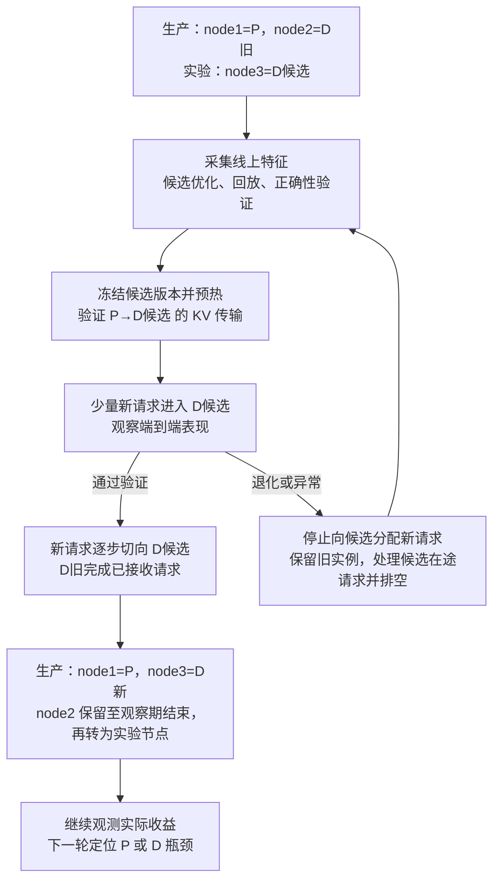

# 研究方案：生产推理框架的运行时控制与在线优化

更新：2026-11-05（三节点 MaaS 备选方案）；框架源码审计日期为 2026-11-03。研究对象为生产级 **vLLM V1 与 SGLang**。论文依据见 [顶会论文调研](01_顶会论文调研.md)；参数结论依据用户在 `~` 下提供的两框架工作树，调度、KV、kernel 和三节点 PD/RDMA 的消费点、行号及文件哈希统一见 [2026-11-03 源码审计](evidence/source-audit-2026-11-03.json)。本文是研究设计，尚未实现接口，也没有 GPU 实验结果。

建议保留原始的两步思路：**先让实际影响执行的策略能够正确地在线改变，再研究 agent 如何在持续负载中取得净收益。** 第一阶段从调度预算与 KV 接纳开始；第二阶段扩展 KV 保留策略和兼容执行路径。参数数量不是研究目标。

| 源码 | 本地路径与固定提交 | 核对状态 |
| --- | --- | --- |
| vLLM V1 | `/Users/zkx/vllm` · `45d0ac9ee197576aefd4e3f67ad98857b6c52697` | 2026-11-03 读取本地 HEAD，工作树干净 |
| SGLang | `/Users/zkx/sglang` · `f77064f635779601c7b20258ce45ded3fa00ac82` | 2026-11-03 读取本地 HEAD，工作树干净 |

本次以这两个本地 HEAD 为版本边界，直接读取对应 Git 对象，未拉取或修改框架。后续源码链接全部固定到上表提交；此前审计保留为历史证据，不用旧提交的行号或哈希描述当前实现。官方 [vLLM 调优文档](https://docs.vllm.ai/en/latest/configuration/optimization/) 和 [SGLang 参数文档](https://docs.sglang.io/docs/advanced_features/server_arguments) 用于了解配置含义；是否可热调，以固定提交的消费路径为准。

## 1. 现在框架具备什么，还缺什么

必须分开三件事：有配置字段、热循环会使用这个值、有受支持的在线更新接口。配置在启动时被复制进 scheduler、pool、backend 或 graph 后，修改原始配置对象未必影响执行。

- **vLLM 已有容量与策略的分离。** `max_num_seqs` 参与 runner 的请求槽位和 graph 准备；`max_num_active_seqs` 限制 scheduler 接纳。`max_num_batched_tokens` 是执行容量相关配置，`max_num_scheduled_tokens` 是 scheduler 每轮发出的预算。可以在既有容量内研究热调，无需先重写 scheduler。[调度配置][V1]、[调度实现][V2]
- **vLLM 已有管理操作与 utility RPC。** 应复用 `EngineCoreRequestType.UTILITY`，增加类型明确、限制允许字段的策略方法。不能说它完全没有运行时管理能力，也不必为首版重新发明消息传输。[EngineCore][V3]、[CoreClient][V4]
- **SGLang 已有 `/set_internal_state`。** 当前允许更新 PP micro-batch 大小、部分 speculative/DSpark 控制；诊断清理命令也在同一入口。它不是任意 `server_args` 的在线 setter。可以扩展其允许列表，但还需处理 scheduler 缓存字段、版本和生效回执。[HTTP 入口][S1]、[内部状态控制器][S2]
- **SGLang 已有自适应。** `NewTokenRatioTracker` 随运行调整未来 token 预留估计，PP 还有可选的动态 chunk cost model。当前 `prefill_decode_interval_min_bs` 还按运行 batch 大小决定是否启用 cadence；非 DP 同步路径中没有 decode 时跳过间隔。新控制器要把这些当作现有机制与基线，不能反复覆盖其内部状态后宣称获得了全部增益。[ratio tracker][S3]、[scheduler][S4]

因此，第一步可以主要做原生策略的在线控制扩展；KV 保留与性能导向 kernel 路由则可能需要新机制。每个动作都应注明属于“暴露已有策略”“补充状态更新协议”还是“新增算法”。

## 2. 哪些参数值得暴露

下表中的“建议动作”均是待实现的研究接口名称，不是声称框架已经支持的 API。A 是优先扩展的调度边界动作；B 需要更多状态或执行路径机制；C 暂不纳入首版不停机搜索。

| 层/优先级 | vLLM 中的实际机制 | SGLang 中的实际机制 | 值得暴露的动作与边界 |
| --- | --- | --- | --- |
| 调度预算 A | `max_num_scheduled_tokens`；输入仍受 `max_num_batched_tokens` 限制 | `PrefillAdder.rem_input_tokens`、`rem_chunk_tokens`，来自 prefill/token 与 chunk 预算 | 在线调预算，限制在已分配资源内；两者不是相同 token 口径 |
| 接纳并发 A | `max_num_active_seqs` → `max_num_active_reqs` | `max_running_requests` 同时关联物理容量和接纳 | vLLM 更新软上限；SGLang 新增独立软上限，保留 pool 容量 |
| 长 prefill 切分 A | `long_prefill_token_threshold`，带单请求例外与可选 fair-share 下限 | `chunked_prefill_size` 进入共享 chunk 预算 | 分别控制单请求 cap 与批次 chunk 预算，不能硬映射为同一个参数 |
| prefill 请求数 A | 没有与右侧完全同义的现成字段 | `prefill_max_requests` 每次构建 adder 时读取 | SGLang 可优先扩展；vLLM 若加入，属于新增接纳策略 |
| prefill 节奏 A | `prefill_schedule_interval`，另有本地/DP 节奏状态与容量逃逸 | `prefill_decode_interval` 与 `prefill_decode_interval_min_bs`，按运行 batch 和同步条件安排 decode 轮次 | 暴露节奏策略，更新计数器；两个 interval 的数值语义不同 |
| KV 接纳 A | `watermark`、`scheduler_reserve_full_isl` | `new_token_ratio_tracker` 估算未来输出的预留 | 分别暴露 headroom、输入完整容纳检查、预留估计策略；不能统一叫“KV 容量” |
| KV 保留 B | block pool/prefix cache 的可驱逐空闲块与复用状态 | radix/unified cache 的锁、节点生命周期和 eviction | 对可驱逐对象设计评分/预算策略；热切换需维护元数据，不能释放活跃引用 |
| 执行路径 B | 已有 composite backend、metadata 路由与 graph capture variant | 已有 prefill/decode backend 分离及若干包装路径 | 只在预构建兼容路径内选策略；性能路由和版本协议仍需开发 |
| 结构容量 C | `max_num_seqs`、KV block 数/size/dtype、TP 与 communicator、graph 准备 | request/token pool、`page_size`、`mem_fraction_static`、并行与 graph 准备 | 首版固定。在线改变需要迁移、重分配或其他专门机制 |

### 2.1 第一批动作怎样落地

**vLLM 先做四个：** `scheduler.token_budget`、`scheduler.active_request_cap`、`scheduler.long_prefill_cap`、`kv.admission_watermark`。它们已有策略落点，优先增加有版本的更新方法，而不是改用另一套 scheduler。

1. **Token budget：** 更新 scheduler 实际读取的预算，同时保留 runner 容量、speculative 预留和输入上限。`1 ≤ budget ≤ capacity` 只是初步约束；过小仍可能饿死排在后面的运行请求，需验证进展、公平性与特殊模型的最小工作单元。
2. **Active cap：** 只影响新接纳；降低时让现有请求自然完成，记录 `running > cap` 的过渡。上调后应重新检查接纳，不强行扩 pool，也不把软上限宣称成即时 batch 大小。
3. **Long-prefill cap：** 保留 `0` 表示关闭、独占请求例外、adaptive fair-share 和 Mamba 对齐等既有规则。动态值改变的是策略上限，不保证每轮恰好处理该数量。
4. **Watermark：** 同步更新 KV manager 初始化后保存的 `watermark_blocks`，不是只改配置字段。当前机制只对已有请求在运行时的 waiting/preempted 接纳保留 headroom，保留首个请求的进展例外；它不缩放物理 KV 池，也不决定哪些 prefix 被保留。[KV manager][V5]

**SGLang 先做三个：** batch chunk 预算、独立的接纳软上限、`prefill_max_requests`。这与 vLLM 的四项不一一对应；比较机制覆盖与行为，不凑相同参数数目。

- **Chunk 预算：** `init_chunked_prefill()` 会把配置复制到 scheduler。更新实际字段，在构造下一轮 `PrefillAdder` 时采用新值；保持正在续算的 `chunked_req`、page/Mamba 对齐和 mixed decode 预算。首版不在线切换 chunked mode 的开关，也不与 PP dynamic chunk sizer 同时争夺同一预算。[scheduler][S4]、[PrefillAdder][S5]
- **接纳软上限：** 新增 `runtime_admission_cap ≤ physical_max_running_requests`；在接纳路径执行限制。已有 chunked 请求保有 request row，续算不能被误当新请求挡住；上调时还需使旧的 `batch_is_full` 结果失效。PP/overlap 下要覆盖 micro-batch 中的在途占用。
- **每轮 prefill 请求数：** `prefill_max_requests` 已在批次构建时读取，适合扩展允许列表。仍需核实部分 prefill、prefix 命中、PP 与已有 max-prefill-batch 约束，不能仅因字段可动态读就省略生效验证。

第二批再加入 cadence 和预留比例策略。修改 SGLang `schedule_conservativeness` 不会自动重建 tracker；接口应规定如何更新 `init/min/decay`、保留或重估 `current`，并报告 reset 成本。外层控制优先调其目标范围与策略，避免每轮抢写 `current`。[ratio tracker][S3]

### 2.2 KV、kernel 与跨机 PD 怎样扩大空间

**KV 的第二阶段应研究保留价值，而非伪装成容量热调。** 第一阶段的接纳动作影响 KV 压力，但尚未优化 eviction 本身。SGLang 的经典 RadixCache 有多种 eviction strategy，UnifiedRadixCache 则有自身锁与生命周期；必须先选定实验 cache 类型。vLLM 的 prefix/block 管理也有引用与回收约束。可研究在可驱逐集合上调整 recency/reuse/重算成本评分，并维护索引；“把策略字符串由 LRU 改成 LFU”不足以完成热更新。[SGLang eviction][S6]、[UnifiedRadixCache][S7]

需要测量的耦合例子：提高接纳并发可能提升当前 GPU 利用率，同时挤走高复用 prefix，随后增加 prefill 重算。若这种跨时间影响实际显著，才有理由联合调 scheduler 与 KV 保留；不能在没有测量时预设它必然显著。

**Kernel 路由已有原生起点，但尚非通用热切换。** vLLM 的 composite backend 会预建 child backend，依据 metadata 选择；当前 `MMPrefixAttentionRouting` 是正确性需求驱动的 image-mask/causal 路由，不是吞吐优化器。其协议明确 graph replay 必须使用 capture 时相同的 child。SGLang 的 prefill/decode backend 也在初始化时构建。[vLLM composite][V6]、[SGLang backend setup][S8]

建议先选同 KV 布局、dtype、模型语义与受支持 shape 的两条路径，预热 backend/workspace；graph 路径需分别准备可路由的 capture，或明确采用 eager fallback。将额外显存、fallback、JIT 和 graph 准备成本全部入账，再讨论按批次选择。修改 `attention_backend` 字符串并不能更新已有对象。此阶段可能成为论文机制，但实现难度明显高于预算控制。

**三节点 RDMA 的 PD 扩展先固定角色布局。** P 表示 prefill 实例，D 表示 decode 实例。先假设每台 node 承担一个角色实例，实例内部的 GPU 数和 TP/PP 布局另行记录；node 数不等于 GPU 数。分别研究 `1P2D`（P → D1/D2）和 `2P1D`（P1/P2 → D），在每条请求的 P 计算、KV 传输、D 接纳与生成之间联合控制。以下是待验证的瓶颈假设，尚无该硬件上的性能测量。[PD 文档][S17]

| 固定拓扑 | 优先验证的问题 | 控制目标 |
| --- | --- | --- |
| 1P2D | 单 P 是否供给不足；两个 D 的队列、上下文和 KV 压力是否失衡；向两个 D 的传输如何共享资源 | 联合调 P 预算、D 选择、每个 D 的接纳和传输公平性 |
| 2P1D | 两个 P 的产出是否超过单 D 的接纳能力；接收中 KV、运行请求和输出增长预留是否争用容量 | 用下游容量约束 P 接纳和在途传输，避免仅优化 P 的局部吞吐 |

PD 分离后的动作需要按角色筛选。原方案的 chunk 预算仍可用于 P 的批处理效率和长短请求公平性；同实例 prefill/decode 交错节奏不直接沿用为纯 P/D 实例的核心动作。KV 是否能随 chunk 流式传输、能否与计算重叠，由具体传输路径决定，不能从开启 chunked prefill 推导。

下表区分已核实的 SGLang 配置和建议研究的更新机制；A/B/C 沿用 §2 的边界。所有字段均以当前固定提交为准。vLLM 的本轮补充以 NIXL 为具体路径，见下表后的对照；两框架通过行为和状态边界对齐动作。

| 调优维度 | 已有配置或机制 | 在线研究边界 |
| --- | --- | --- |
| P 预算、D 接纳 A | §2.1 的预算与接纳机制；D 的 `num_reserved_decode_tokens` 参与预分配计算 | 新增各实例的接纳软上限；预留值已复制到 preallocation queue，更新必须覆盖实际 owner，保留现有分配。[配置][S10]、[D 消费点][S11] |
| P/D 路由 A/B | Gateway 的 `--prefill-policy`、`--decode-policy`；`cache_aware` 的 cache/load 阈值和 `power_of_two` | 现有启动配置可作基线；在线更新入口与状态转换另行实现。新增按队列、KV、前缀复用和传输代价评分的策略属于研究扩展；路由树不是引擎 KV 驱逐策略。[Gateway][S14] |
| KV 预分配时机 B | `disaggregation_decode_allocation_policy=early/prefill_complete` | 首轮在兼容配置中离线比较。改变时机会调整握手和 KV 驻留，热切换需额外协议。[配置][S10]、[兼容校验][S16] |
| KV 传输并发 B/C | Mooncake 的 `SGLANG_DISAGGREGATION_THREAD_POOL_SIZE`、`SGLANG_DISAGGREGATION_QUEUE_SIZE` | 线程池和并行队列在初始化时创建，要求线程数不小于队列数。先固定物理资源，再研究在途字节/请求预算和目标间公平性；后两者是待实现策略。[传输初始化][S12] |
| D 接收节奏 A | `disaggregation_decode_polling_interval` | 实际值首次使用时复制到 scheduler；热更新还需更新计数器并测量接收等待，不能只改原始配置。[轮询消费点][S11] |
| 传输中请求槽位 C | `disaggregation_decode_extra_slots` 加入 D 的物理 request slot 数 | 先作为启动容量调优；运行时只能在既有容量内调整接纳，不能把槽位扩容称为软上限更新。[pool 配置][S13] |
| 两端 KV 复用 B | P 的 prefix cache；`disaggregation_decode_enable_radix_cache` 可复用 D 已有 prefix，减少重复传输 | 开关先固定；研究路由与保留策略联动时维护引用和缓存元数据，区分避免的重算与避免的传输。[PD 配置][S10] |
| GPU/NIC 映射与传输布局 C | `disaggregation_ib_device` 支持 HCA、列表和 per-GPU 映射；backend、KV 布局、TP/PP 为部署配置 | 先验证所选 backend 的 RDMA 路径与有效带宽，离线比较兼容布局；首版固定 device/backend、KV 精度、page size 与并行组。[PD 配置][S10] |

**vLLM NIXL 的对应空间。** 本轮核对 `KVTransferConfig`、NIXL scheduler/worker 和官方使用文档，配置入口是 `kv_connector_extra_config`。其中 `bidirectional_kv_xfer` 可在 P/D 两端启用多轮 D→P KV 回读；首轮固定其开关，在启用的兼容路径内评估复用与重算策略。[配置][V7]、[NIXL 文档][V11]

| 维度 | 当前原生参数与消费点 | 研究边界 |
| --- | --- | --- |
| 传输资源 C | `backends`、`num_threads`、`ucx_backend_params` 进入 NIXL agent/backend 初始化 | 先做部署时调优；UCX 使用 `UCX_TLS`、`UCX_NET_DEVICES`，NCCL 设备变量不控制该 NIXL UCX 路径。[Worker][V8]、[文档][V11] |
| 回读与重算选择 B | `kv_recompute_threshold` 缓存在 scheduler；多轮 D→P 可回读 token 数低于阈值时选择本地重算 | 是已有策略落点；在线更新方法及版本生效仍需实现，不能直接改启动配置。[Base scheduler][V9]、[Pull scheduler][V10] |
| D 侧跨轮保留 B | `decoder_kv_blocks_ttl` 控制双向复用中 D 的 KV 保留，结束请求时生成到期时间 | 更新字段不会改写已发出的 deadline；需规定新旧租期、引用与回收语义，并测量复用收益和占用成本。[Base scheduler][V9]、[Pull scheduler][V10] |
| P 侧传输租期 B | `kv_lease_duration` 同时进入 scheduler 和 worker，派生 heartbeat/extension 状态 | 先固定；若作为在线动作，需协调 owner 和在途 lease，不能把缩短租期当作普通 cache eviction。[Scheduler][V9]、[Worker][V8] |

SGLang NIXL 的设备选择也需记录实际生效来源：非空 `UCX_NET_DEVICES` 会使 `disaggregation_ib_device` 的 CLI 映射被跳过；显式 backend `device_list` 又可覆盖环境设备列表。在未设置该环境变量时，backend `device_list` 与 CLI 映射冲突会被拒绝。调优配置应包含环境和 backend 参数的优先级，避免候选值改变而实际设备未变。[NIXL 初始化][S18]、[PD 文档][S17]

**配置组合遵循固定版本的兼容矩阵。** 固定版本的 `prefill_complete` 要求 Mooncake、Python bootstrap registry、attention TP/CP 和 PP 为 1；attention DP 可在每个 rank 的 attention TP 为 1 时使用。它排除 D 侧 radix/HiCache、staging buffer、运行时角色切换等组合。该策略把 D 的预留推迟到 P 完成后，同时延长 P 的 KV 驻留并移除 prefill 与 KV 传输的重叠；应测量两端代价。支持矩阵和校验必须先于搜索。[PD 文档][S17]、[配置校验][S16]

**P:D 比例变化单独研究。** 固定提交已有 `--enable-pd-role-switch` 和 `/pd_role_switch`，要求目标实例完全空闲、backend 支持角色切换且未开启 staging buffer。当前实现对多个 DP worker 先发 `prepare_only` 并汇总 readiness，再执行切换；调用方仍负责排空入口和串行化切换请求。它重建角色相关结构，必要时准备 decode graph；重建失败会将实例标为不健康，不能假定原地回退。配置校验仍限制 EP、PP、decode CP、speculative 和 DP attention local-control broadcast 等组合。`1P2D ↔ 2P1D` 因而需要路由摘除、排空、切换、重新纳入和失败恢复等编排，不属于首批逐窗口策略动作。[HTTP][S1]、[角色切换][S15]、[Tokenizer 编排][S19]、[兼容校验][S16]

## 3. “无侵入”和“workload 不停”的可测定义

这里的“无侵入”建议定义为：客户端 API、请求内容、模型与生成策略保持一致，业务无需配合切换。它约束业务侧可感知的行为，不约束框架内部改动量。若完全不改框架，则现有控制面不足以完成所有设想。

框架改动分两层。外层控制面是薄层，负责动作 schema、校验、版本、生效回执与代价记账，经各框架 adapter 转发到引擎。内层改动落在原生 scheduler、cache 与 backend 的状态和执行路径上：A 类动作是小范围修改；B 类动作（KV 保留元数据维护、可路由的 graph capture 等）是论文的核心机制，改动深度随机制需要确定。每项内层改动以阶段一的实测机会为依据。

“不停”要求同一服务实例持续接收相同外部到达流，在途请求与活跃 KV 保留，不重启引擎、不清空队列来换配置。允许正常执行边界和可计量的切换代价；需要报告额外等待与停顿，不能用“进程没退出”替代业务连续性。

固定 PD 拓扑的主实验遵守同一连续性定义，保留各实例在途请求与传输状态。角色比例切换另采用“集群持续接单、目标实例先排空”的合同，单独报告排空等待、切换停顿和剩余实例的容量损失；该结果不作为同实例保留在途状态热更新的证据。

主实验固定模型权重、KV 精度和采样语义。SGLang 暴露的 relaxed speculative acceptance 阈值可能改变目标分布，故不纳入本轮无语义变更的性能动作。不同 kernel 的数值差异仍需正确性验证；不预设所有 backend 位级相同。

## 4. 运行时控制接口

研究接口应提交一个类型明确的策略快照，例如 `{expected_version, token_budget, admission_cap, ...}`；框架根据自身支持项校验，不能让 agent 执行任意配置代码。

| 环节 | 必需语义 | 两框架实现落点 |
| --- | --- | --- |
| 发现 | 返回允许动作、owner/scope、动态范围、资源上限和限制 | vLLM 新增 capability utility；SGLang 扩展 internal state |
| 校验 | 校验整个组合、版本与当前状态，拒绝不支持动作 | vLLM EngineCore 策略方法；SGLang 扩展允许列表和 validator |
| 提交 | 在对应执行 owner 的安全边界原子替换快照 | scheduler-only 动作由 scheduler 边界处理，避免线程直接写共享字段 |
| 生效 | 回传版本、首个采用的 batch/step、实际参数与延迟 | 必须区分 accepted、applied、settled；接纳降限可能长期未收敛 |
| 跨 rank | 按动作 scope 决定同步范围，保证相关 collective/graph 路径一致 | TP/PP 协同组、DP attention 约束与独立 replica 分别处理 |
| 失败与回退 | 超时、部分提交和非法版本有明确定义；回退也生成新版本 | 对多 owner 先准备再提交；补偿失败需明确记录 |

不要求每次 scheduler-only 更新都全 GPU 同步；已有在途 batch 可以沿用旧快照。每批按**调度时采用的版本**记录，异步完成后不能误记成返回时的最新版本。需要 worker 执行路径改变的动作才要求相应 worker 准备和确认。

回退旧值不等于恢复旧状态：被驱逐的 prefix、积累的队列、cache 热度都不会自动回来。最小驻留时间与下一次探索条件应根据这些状态恢复决定，而不是固定 sleep 后假定已稳定。一般情况下 HTTP 返回成功也不构成跨 rank 事务已完成的证据。SGLang 的 PD 角色切换已有特定的跨 DP readiness 预检查，适用范围是该操作；通用调度/KV 策略快照仍需独立定义执行和失败语义。[角色编排][S19]

PD 控制还需在动作 schema 中标记 router、P scheduler、D preallocation queue、transfer manager 的 owner，以及源/目标实例和 scope。新请求路由规则按路由时的版本记录，已绑定 P/D 的请求保持绑定；跨 D 重路由已有请求需另做状态迁移。传输准入按目标 D 的可用请求槽和 KV 预算发放 credit，预算收紧只限制新发放，不撤销已发布的目标地址或回收传输仍在引用的 KV。credit/地址的生命周期、取消、完成和失败清理需有幂等回收语义；在途字节预算、公平性与版本回执均是待实现扩展。关联动作在准备和提交期间维持资源约束，不能用多个独立 HTTP 成功响应代替联合生效证明。

## 5. 第二步：agent 如何在线调优

先做“无需 LLM 也能正确执行”的控制面，再评价 agent 的增益。建议分两种时间尺度：框架维持逐 batch 的确定性进展与原生自适应；外层在秒级或更慢的观测窗口提出少量策略变更。具体周期通过响应时间与统计方差确定，不能预先写成普适常数。

**观测：** 到达率与 prompt/output 长度分布、prefix 复用、排队时间/队列年龄、TTFT/ITL、每轮 prefill/decode token、活跃/在途请求、KV 空闲与可驱逐量、重算/抢占/retract、cache 命中、GPU step 时间，以及当前策略版本和距离上次变更的时间。部分内核细粒度指标有额外开销，应采用采样并单独评估。PD 增加每个 P/D 的队列年龄、预留/接收中/运行中 KV 占用、待传输与在途字节、传输排队/完成时间、有效带宽、接收完成到首次 decode 的等待，以及 P 避免重算的命中、D 避免传输的命中、NIXL D→P 回读量和租期到期量；按 request ID 关联各阶段，处理时钟差和阶段重叠。

**决策：** agent 根据机制提出瓶颈假设，选少量相关动作和候选区间；数值优化器或小范围候选评估负责具体数值。执行器只接受通过校验的动作。每次保留假设、证据、动作版本、预期代价和真实反馈，避免只产出一个没有因果解释的大参数向量。

| 观察到的现象 | 优先检验的假设与动作 | 必须同时观察的副作用 |
| --- | --- | --- |
| decode 尾延迟随 prefill 批次上升 | 减少 chunk/长请求 cap，调整节奏 | prefill 排队、长请求饥饿、总 goodput |
| 抢占/retract 与重算上升 | 降接纳并发，增加 KV headroom/合理预留 | GPU 是否欠载、等待时间是否只是转移到队列 |
| prefix 高复用而 cache 很快流失 | 评估保留评分与接纳的联动 | 占用量、其他请求公平性和维护开销 |
| 相同批次形状的执行代价随路径明显不同 | 兼容集合内评估 kernel 路由 | graph fallback、workspace、正确性和准备成本 |
| 2P1D 中 D 接纳等待或 KV 压力上升 | 检验 P 生产、传输准入与 D 容量是否失配，联合调 P 接纳、在途预算和 D 预留 | P 排队与 KV 驻留是否增加，端到端 goodput 是否改善 |
| 1P2D 中 D 负载失衡或供给不足 | 联合检验 P 预算、D 路由与目标间传输公平性 | prefix 复用损失、链路竞争，以及另一 D 是否被饿死 |

缓存、队列和在途工作使 reward 具有历史依赖。不能直接假设“当前 context + 参数 → 即时吞吐”。实验应比较加入状态/切换历史的模型，与普通 contextual BO；对切换后的短期损失与长期收益分别记账，再报告全程累计结果。

LLM 的必要性需要实证：对比手写规则、contextual BO、相同语义知识但不调用 LLM 的控制器，以及加入 LLM 的版本。TuxBot 已有 LLM trimming + MLOS，GPTuner/LaTune 已有参数筛选；“LLM 选子空间 + BO”只是设计起点。[InferenceBench](https://arxiv.org/abs/2607.20468) 报告 agent 在同等时间预算下低于简单超参搜索，同预算的超参搜索因此是必备对照。

### 5.1 MaaS 场景的服务自优化闭环（备选扩展）

本节研究三节点 MaaS 服务的持续自优化：两台节点组成一个生产 `1P1D` 实例，第三台节点承担实验、预热和候选验证。生产侧持续观测真实业务，agent 根据瓶颈证据提出配置或代码修改，在实验节点迭代候选，验证后通过 router 逐步接入生产，再观测实际收益。该设定作为独立的备选扩展，保留原方案与 §7 的实施顺序。本文描述的是待实现和评估的系统设计。

**部署与 API 来源。** 初始部署为 `node1=P`、`node2=D旧`、`node3=实验节点`，P 与 D 通过 RDMA 传输 KV。每台节点承载一个角色实例，实例内部的 GPU 数、TP/PP 布局及模型可部署性分别记录。优化对象为运营方能够修改和部署的推理引擎。agent 调用已部署服务的 API、内部独立副本或外部 API；使用本服务保留内部信息留存和容量复用的部署价值。业务请求与 agent 请求分别标记，业务热路径继续由推理引擎和 router 执行。

**持续观测与瓶颈定位。** 生产侧接入已开发的 profile 工具，长期采集框架计数器与摘要，包括到达率、输入/输出长度、队列年龄、TTFT/ITL、KV 占用、cache 命中、GPU step 时间和 RDMA 传输状态。异常或候选验证触发短时细粒度采样，记录采样预算、持续时间与业务开销。请求级关联贯通 P 排队/计算、KV 传输、D 接纳/计算与输出，区分 D 计算慢、等待 P 供给、等待 KV 和接纳容量不足。诊断输出包含瓶颈假设、证据、候选改动与验证指标；证据不足时继续观测。

**实验节点与候选迭代。** 定位到 D 瓶颈后，在第三台节点启动 D 候选，agent 围绕相关配置、调度逻辑、kernel/backend 或 graph 准备方式进行有限预算迭代。每个候选保存源码/构建版本、配置、依赖、实验负载、正确性结果和性能反馈。实验先筛选局部改进，再验证 P→KV 传输→D 的端到端链路。候选进入生产验证前冻结版本，完成模型加载、编译、CUDA Graph 捕获与预热；承担真实请求后维持该版本，新的探索等待空闲实验节点。

实验负载从近期生产观测构造，覆盖上下文长度、输出长度、并发、到达节奏与 KV 占用，并记录缓存初始条件。独立 D 实验用于筛选候选，其生产价值由端到端验证确认。使用生产 P 额外计算、复制请求或传输 KV 时，将额外资源消耗和业务干扰计入实验成本。P 瓶颈沿用同一流程，在备用节点构建 P 候选，并验证其与生产 D 的连接和协议兼容性。

以替换 D 为例，闭环如下：

**两种更新方式。** 系统按照改动的生效条件选择执行路径。原地更新沿用 §4 的控制接口和状态合同；实例替换将昂贵准备和不兼容的内部重建放在备用节点完成。

| 改动类型 | 执行方式 | 生效与验证边界 |
| --- | --- | --- |
| 有安全边界的预算、阈值、接纳和路由策略 | 在当前实例或 router 中更新 | 校验允许范围、采用版本、执行 owner 与在途请求约束 |
| 接口和状态兼容性明确的策略代码 | 采用经过验证的原地替换机制 | 验证新旧状态兼容、跨 rank 一致性及旧版本引用回收 |
| 需要重新编译、重捕获 graph、重建数据结构或重新初始化的改动 | 在备用节点构建、验证和预热，再切流替换实例 | 验证模型语义、P/D 协议兼容性、端到端收益与排空成本 |

CUDA Graph 相关改动按具体实现确定准备方式和生效条件；需要重捕获或较大初始化成本的候选归入备用节点实验。最小实现先完成 D 候选的启动、回放、预热和实例替换，再扩展 P 替换及与原地更新的联合决策。

**router 与 Mooncake 接入。** router 在服务期间动态管理后端及新请求分配规则。SGLang Model Gateway 已提供动态 worker 管理接口；本方案在这一基础上研究候选资格、灰度流量、版本回执和排空编排。[Gateway][S14] 新请求记录所用路由版本与 P/D 绑定，已经绑定或进入预留、传输阶段的请求继续使用原实例。停止旧实例接纳之后，仍需等待其已分配请求、在途传输、生成计算和流式输出结束，才能回收资源。管理接口接受注册或删除请求后，继续确认操作实际生效；排空完成由上述请求、传输、计算和输出状态共同确认。

Mooncake 接入单独验证传输就绪：新实例建立自己的传输会话并注册目标内存，P 获得与目标实例对应的地址和元数据；旧请求保留原有会话和目标地址，相关传输与计算结束后再注销资源。[Mooncake][S12] 候选涉及 KV 布局、精度、分片或其他状态格式变化时，检查固定版本的支持矩阵与转换能力，并执行端到端正确性验证。HTTP 健康检查和 router 注册之外，还需验证实际 KV 传输与生成。

**连续性与撤回。** 本节采用服务级连续性合同：服务入口持续接单，旧实例完成已接收的正常请求，新实例承担后续分配的请求。允许目标实例排空和重建，并记录切流、排空与预热代价；该合同区别于 §3 主实验的同实例保留在途状态更新。第一版实例替换保留活跃请求在原实例上运行，完成切换无需搬迁这些请求的活跃 KV；新实例的缓存热度通过预热和后续业务积累。

候选退化时停止向其分配新请求，并将后续流量交回旧实例。候选已接收的请求按其健康状态完成、取消或报告失败；撤回路由规则只改变后续分配。旧实例排空后继续保留至观察期结束，保留期间不承担下一轮实验；释放后转为可轮转的实验节点。node3 因而只是初始实验位置，后续由退出生产的节点接替。

**收益验证与成本核算。** 候选接入期间，D 替换短时形成 `1P2D`，P 替换短时形成 `2P1D`。实验分别报告共存阶段与切换后稳态的表现，以相同生产角色数量、到达负载、模型权重、采样语义与 SLO 比较 `P+D旧` 和 `P+D新`，分离修改收益与扩容收益。灰度评估记录流量分摊造成的 batch 变化、缓存冷启动和新旧实例负载差异；生产负载变化通过匹配窗口和固定到达计划回放控制。

总成本包括备用节点的 GPU 时间、编译/回放/预热、profile、LLM 推理、共享 P/D 与 RDMA 干扰、切流、排空和失败恢复。三台同规格节点相对两台节点增加 50% 的节点投入，资源收益同时按完整三节点预算报告。使用本服务 API 时，内部源码、配置、拓扑、trace 与日志保留在运营方控制域内，测量闲时容量复用及满载时挤占业务的代价；使用外部 API 时，明确发送数据边界并计入调用费用。保密和成本价值以数据流边界及实测总开销验证。

本节评估覆盖低开销观测的诊断准确性与时延、候选回放的排序与生产表现一致性、首次有效优化时间、接入和排空耗时、撤回损失，以及全程累计业务 SLO goodput。对照包括相同三节点预算的仅观测方案、人工或固定周期的实验与滚动发布、同预算规则/BO/超参搜索，以及完整 agent 闭环；消融区分原地更新、备用节点替换和二者联合。研究增量落在观测如何指导有限预算实验、实验结果如何支持接入决策，以及包含全部试错和切换成本后的持续净收益。

## 6. 怎么证明收益来自正确机制

**问题设定。** 部署时确定模型、硬件与结构容量（§2 的 C 类）；服务运行中变化的是 workload，主要维度包括到达率与突发程度、prompt/output 长度分布、prefix 复用程度，以及交互与批处理请求的 SLO 组合。在固定模型与资源下，workload 非平稳，不同阶段对应不同的最优运行时策略，静态配置只能在各阶段之间折中。控制器在固定容量内调整 A/B 类策略，例如长 prompt 阶段的 chunk 预算与长 prefill cap、突发阶段的接纳并发与 KV headroom、高复用阶段的缓存保留倾向。

**先验证动态机会。** 固定模型、硬件、容量和正确性条件，在短/长 prompt、不同 output 长度、prefix 复用、到达突发间切换，确认最优可执行策略确实变化。验证回答三个问题。第一，各阶段最优静态配置之间的差距，以及单一折中配置相对各阶段最优的损失；公开生产 trace 提供阶段变化的依据：[Azure LLM inference trace 2023](https://github.com/Azure/AzurePublicDataset/blob/master/AzureLLMInferenceDataset2023.md)/[2024](https://github.com/Azure/AzurePublicDataset/blob/master/AzureLLMInferenceDataset2024.md) 记录请求时间戳与输入/输出 token 数，分 code 与 conversation 两类；[BurstGPT](https://github.com/HPMLL/BurstGPT) 记录 Azure OpenAI GPT 服务的时间戳、会话 ID 与请求/响应 token 数；[Mooncake trace](https://github.com/kvcache-ai/Mooncake/tree/main/FAST25-release/traces) 另含 remap 后的 KV 块哈希，可用于分析 prefix 复用。变化幅度以本项目测量为准，核实记录见 [web-verification](evidence/web-verification.json) 的 `workload_traces`。第二，原生机制已吸收的部分：vLLM/SGLang 的逐 batch 调度与 SGLang ratio tracker 作为对照，研究机会是原生机制跟不上的那部分变化。第三，阶段变化的速度与可预测性：阶段变化慢且可预测时，离线为各阶段调优并按时切换（LaTune 式离线 Pareto 加在线选择）即可覆盖；阶段变化快、事先不可知，或切换伴随 KV 流失与在途请求影响时，需要把切换代价与缓存历史纳入决策的在线控制器。第三点决定本工作与已有动态调优的差别，即切换发生在有状态的生产引擎中。一个静态配置已基本覆盖时，研究重心转向机会更大的维度，不引入复杂 agent。预印本 [P-PAS](https://arxiv.org/abs/2608.15171) 显示 vLLM 单个 token 预算的动态切换相对最佳静态值降低平均端到端延迟 3.0–3.1%，单旋钮的在线收益有限；机会测量同时覆盖跨层耦合与 PD 场景。

**主指标采用带 SLO 的累计交付量。** 报告持续实验中满足 TTFT/ITL 或明确请求级 SLO 的完成请求数和输出 token 数，除以同一总墙钟时间。SLO 口径事先定义，不通过缩短输出获得吞吐。探索、切换、LLM 调用、profile 和 fallback 都在计时内；累计交付只统计业务请求，排除 agent 请求；共享资源造成的业务损失已包含在观测结果内，不再重复扣减。外部 API、独立副本与 profile 资源另行列账。额外报告 profile 开销、诊断延迟、策略迁移耗时、代码准备/验证耗时和回退损失，避免把低外部 API 账单误写成低系统成本。测量协议预先登记，基线取诚实调优的配置，结果在不同机器上复现，对应 [AutoTuneBench](https://arxiv.org/abs/2609.18123) 总结的弱基线与跨机器失效。正确性检查覆盖完整词表输出并辅以代码审查；[SEIS](https://arxiv.org/abs/2610.04646) 中曾有引擎通过精度门限而省略约 39% 的词表行。

**使用外部固定到达流。** 客户端不能因服务变慢而自动降低发压量。所有方案接收相同到达计划；拒绝、超时、取消、未完成请求及实验结束时队列都要报告。线上部署中，同一段流量只能经历一种策略，对照实验采用两种方式：线上流量按副本切分给不同控制器，以及记录线上 trace 后按固定到达计划回放。结果同时给出 raw throughput、goodput、尾延迟、公平性、错误率和资源成本，避免只服务短请求就得到漂亮均值。

| 比较组 | 要回答的问题 |
| --- | --- |
| 框架默认 + 原生自适应 | 是否优于当前生产机制，包括 SGLang ratio tracker/适用的动态 chunk |
| 充分调优的 best static | 是否存在必须在线改变的机会；静态调优预算也公开 |
| 手写动态规则 / QoServe 类成本或 slack 策略 | 收益是否只来自简单 chunk、接纳或 cadence 规则 |
| SCOOT 类 BO、OnlineTune 类 contextual BO、OPPerTune | 自动搜索和非平稳适配是否需要 agent；共同可执行动作与预算 |
| LaTune 式离线 Pareto + 在线选择 | 预选配置是否已足够；实际热更新由共同执行层提供并标注为移植 |
| TuxBot 风格语义控制 / trimming | 是已有在线 agent 的移植即可，还是推理状态模型确有增益 |
| Autopoiesis 类在线策略演化 | LLM 改写策略代码是否已足够；引擎内有状态生效与切换代价建模是否带来额外收益 |
| MaaS 扩展：仅观测不调优、固定采样与触发式 profile | 轻量指标、触发式 profile 和重型 trace 的收益/开销边界在哪里 |
| MaaS 扩展：不同策略/代码更新机制 | 参数切换、策略双版本、预构建 backend 变体各自的安全边界和迁移成本 |
| MaaS 扩展：API 来源对照 | 目标服务自身 API、外部 API、独立副本、无 LLM 控制器在隐私、成本、干扰和收益上的差异 |
| 同预算超参搜索 | agent 是否优于简单搜索；InferenceBench 中 agent 低于该基线 |
| 分阶段 oracle | 提供可达参考；保留真实切换代价，不能每阶段偷偷获得新热缓存 |

以上“类方法”是需实现/移植的比较设计，不声称原 artifact 可直接运行于本接口。资源不足时先完成共同空间的强基线，再扩充维度；不要用被删掉关键机制的弱实现代替原方法。

**实验展开：** 首先单实例、固定容量、文本 dense 模型，跑稳态、突发与连续阶段变化；之后跨两框架、至少两种模型规模和不同 GPU，并加入 TP/PP 或 DP 中与主张相关的拓扑。KV 扩展覆盖至少两种 prefix 复用模式，kernel 扩展只覆盖实际兼容硬件；不假设所有组合都支持。

三节点 RDMA 评估分别固定 1P2D 与 2P1D，在相同模型、总 GPU 资源、到达流和 SLO 下比较。先记录 GPU/NIC 布局、实际传输 backend、KV 格式、支持矩阵和有效带宽；单独扫描 P 计算预算、传输并发、D 接纳和路由，确定瓶颈在哪一段及其随负载的变化。拓扑内的联合控制与最优静态配置、默认路由、队列反馈规则、相同动作空间的 BO 比较；仅调 P、仅调传输、仅调 D、仅路由与联合控制分别消融。在模型能部署且功能口径一致时，加入相同总资源的 P/D 混部基线，区分架构选择收益和在线控制收益。新控制器不得通过少接收、拒绝或饿死长请求获得表面改善。

首轮 workload 覆盖长输入/短输出、短输入/长输出、长度混合、prefix 复用和到达突发的连续切换，长度与到达依据沿用已核实 trace。报告各阶段时间与排队、两端 KV 驻留、传输在途量和端到端 TTFT/ITL，阶段重叠时不把分段耗时简单相加。原生可用的两端缓存、传输并发和预分配策略按兼容矩阵分组比较，不强行构造不支持的全组合。NIXL 双向复用另加显式多轮会话重放，保留跨轮 KV 元数据，分别记录回读、重算和 D 侧保留占用；不能用独立无状态请求的压测代替该场景。角色比例切换放在独立实验，计入排空、graph 准备、路由更新和恢复成本；与固定拓扑内控制的结果分开。

**关键消融：** scheduler/KV/kernel 单独与联合；有无切换状态建模；有无语义缩小空间；有无 LLM；原生自适应开/关；持续指标与触发式 profile 的开销；参数快照、策略双版本和预构建 backend 变体的迁移方式；目标服务自身 API、外部 API、独立副本和无 LLM 控制器。所有有状态方法从相同初始条件开始整段 replay，重复并报告不确定性；不能逐候选 reset cache 后拿来估计真实连续服务收益。

## 7. 实施顺序与工作量

| 阶段 | 可审查的交付物 | 完成标准 |
| --- | --- | --- |
| 1. 机会测量 | 两框架预算、接纳、KV 压力的静态与阶段切换曲线；基于公开 trace 的静态配置与原生机制损失分析 | 动态最优确有差别，原生机制尚未覆盖 |
| 2. vLLM 控制原型 | 四个候选动作、utility 接口、版本与生效日志 | 持续到达流中生效；降限、非法动作和回退有可验证结果 |
| 3. SGLang 对照 | 三个候选动作、扩展 internal state、独立接纳上限 | 保留原生机制，证明接口语义可迁移而非简单字段同名 |
| 4. 在线优化 | 强规则/BO/离线选择基线，再加入 agent | 同动作、同预算、相同 SLO 下提高全程累计交付 |
| 5. 状态机制 | KV 保留热切换与兼容 kernel 路由，按实测机会大小依次实现 | 每项的正确性条件、切换代价与跨层收益均有测量 |
| 6. 规模与泛化 | 多 rank（TP/DP）一致生效协议；三节点 RDMA 的固定 1P2D/2P1D 联合控制；两框架、多模型规模、多 GPU 拓扑的评估与 artifact | 逐段瓶颈、动作边界和全程收益可复核；两框架的具体 connector 按各自支持矩阵验证 |

整体目标覆盖 scheduler、KV、kernel 三层。vLLM 先行验证接口与机会，SGLang 从设计阶段参与并检验泛化。每个阶段的完成标准同时决定下一阶段的投入：某层实测机会小时，资源转向机会更大的层。三节点条件具备时，在阶段 1 增加 PD 瓶颈测量；阶段 2–4 的接口稳定后，优先尝试固定拓扑的“P 预算/接纳 + D 接纳 + 路由 + 传输背压”。若其机会大于 kernel 路由，可先投入该扩展；角色比例切换在固定拓扑结果之后单独立项。

从工作量看，TuxBot 的许多 OS 动作复用已有 sysctl/sysfs setter，但仍要处理权限、硬件可用性、参数相依与 host 作用域。推理调度预算的 setter 本身可能也很小；难度增长主要来自缓存状态、异步 batch、派生对象与分布式一致性。不能按“41 个 OS 参数 = 41 个框架参数”估算，也不能因改动行数少就否定机制价值。

在本次提交中，vLLM `EngineArgs` 有 259 个直接公开声明字段，`SchedulerConfig` 22 个、`KVTransferConfig` 9 个；SGLang `Schedule` 40 个、`Disagg` 27 个。此为固定提交的 AST 字段口径，包含结构、诊断和不适合优化的配置，不等于热调维度，子配置不可相加。本次选定类的字段及哈希保存在 [2026-11-03 字段清单](evidence/framework-parameter-inventory-2026-11-03.json)，[2026-10-31 全量清单](evidence/framework-parameter-inventory-2026-10-31.json) 保留作历史快照。首批仅规划上述 4/3 个动作，不声称已得到两框架可热调参数总数。

## 8. 面向 SOSP/OSDI，论文主张应该落在哪里

“增加一些参数 + 让 LLM 搜索”有很强的已有工作重叠。更值得检验的主张是：**生产推理的在线优化受有状态切换约束；显式描述动作生效、缓存/队列历史和执行兼容性，能够用更少在线损失完成跨层适配，并在两种框架中成立。**

论文需要形成三类证据。第一是问题证据：在两框架与公开 trace 上测量静态配置与原生动态机制的损失，并说明其来源——配置在启动时固化进 scheduler、pool 与 graph，切换会影响在途状态。第二是机制证据：A 类预算控制构成基础，主线由 B 类机制承担，即 KV 保留热切换与可路由的 kernel 切换，各自给出正确性条件与切换代价。第三是收益证据：在探索、切换、LLM 调用与控制器开销全部计入后，累计 SLO goodput 相对 §6 中的最强基线（best static、QoServe 类策略、SCOOT/OnlineTune 类 BO、TuxBot 风格 agent，在共同动作空间与相同预算下实现）有清晰、可重复的提升，并以消融把增益归因于状态与切换建模及跨层联合控制。

PD 扩展的候选主张是：在固定资源与角色布局下，显式建模 P 计算、KV 在途状态和 D 接纳的耦合，可以减少局部调优引起的队列与 KV 积压，提高端到端累计 SLO goodput。该主张仍需实验支持，并与已调研的 DistServe 资源/并行规划、Llumnix 请求迁移，以及原生路由和简单背压规则区分；新增网络参数或支持角色切换本身不构成充分贡献。

MaaS 自优化仍是一个备选扩展方向。“用已部署的服务优化自己”保留为特色部署模式，以内部信息留存和容量复用作为系统卖点；同时允许受信任的外部 API 或独立副本。真正要证明的是，在全部 API、profile、迁移和回退成本计入后，闭环仍提高业务 SLO goodput。若选择这个备选方向，候选主张应聚焦两项机制：低开销的分层观测与触发式 profile，以及面向有状态推理引擎的策略/代码热迁移。Autopoiesis 是“服务自我优化”叙事的直接对照，但其策略热替换合同不能直接覆盖 vLLM/SGLang 的 KV、graph、backend 和跨 rank 状态；FlashVector 的生产回放与 canary 则可作为 profile/验证流程的对照。

评估覆盖 vLLM 与 SGLang、多种模型规模、至少一种多 GPU 拓扑，以及稳态、突发与阶段切换负载。两框架共同支持的是机制抽象和实验结论，参数实现可以各自不同。产出以两框架上的可审查补丁、实验脚本与 trace 形式发布，支持 artifact evaluation 与上游合入。

各层投入随实测结果调整：简单规则或 BO 已取得相同收益时，agent 主张相应收缩；只有 scheduler 有机会时，论文聚焦调度；kernel 切换成本无法摊销时，kernel 移出在线动作。论文强度来自问题、机制与证据，参数数量本身不构成贡献。

## 9. 源码定位

以下链接固定到文首两个本地 HEAD；[当前审计](evidence/source-audit-2026-11-03.json) 保存调度、KV、kernel 和 PD 消费点的 Git blob、SHA-256、行号及“原生能力/待实现扩展”边界。[原源码审计](evidence/source-audit-2026-11-01.json) 和 [原 PD 补充审计](evidence/pd-rdma-source-audit-2026-11-03.json) 保留其原提交，供追溯版本变化。这里只读源码并整理方案，没有修改两框架代码。

| 范围 | vLLM | SGLang |
| --- | --- | --- |
| 参数与消费路径 | [SchedulerConfig][V1]、[Scheduler][V2] | [Schedule 配置][S9]、[Scheduler][S4]、[PrefillAdder][S5] |
| 在线消息与接口 | [EngineCore][V3]、[CoreClient][V4] | [HTTP][S1]、[InternalStateController][S2] |
| KV 与已有自适应 | [KVCacheManager][V5] | [TokenRatioTracker][S3]、[Eviction 策略][S6]、[UnifiedRadixCache][S7] |
| 执行路径 | [Composite attention][V6] | [Attention backend setup][S8] |
| PD 配置与消费路径 | [KVTransferConfig][V7]、[NIXL worker][V8]、[Base scheduler][V9]、[Pull scheduler][V10] | [Disagg 配置][S10]、[Decode][S11]、[Mooncake][S12]、[Pool configurator][S13] |
| PD 路由、组合与角色切换 | [NIXL 使用文档][V11]；其他 connector 与角色编排未作通用能力结论 | [Gateway][S14]、[Role switch][S15]、[兼容校验][S16]、[PD 文档][S17]、[NIXL][S18]、[Tokenizer 控制][S19] |

[V1]: https://github.com/vllm-project/vllm/blob/45d0ac9ee197576aefd4e3f67ad98857b6c52697/vllm/config/scheduler.py
[V2]: https://github.com/vllm-project/vllm/blob/45d0ac9ee197576aefd4e3f67ad98857b6c52697/vllm/v1/core/sched/scheduler.py
[V3]: https://github.com/vllm-project/vllm/blob/45d0ac9ee197576aefd4e3f67ad98857b6c52697/vllm/v1/engine/core.py
[V4]: https://github.com/vllm-project/vllm/blob/45d0ac9ee197576aefd4e3f67ad98857b6c52697/vllm/v1/engine/core_client.py
[V5]: https://github.com/vllm-project/vllm/blob/45d0ac9ee197576aefd4e3f67ad98857b6c52697/vllm/v1/core/kv_cache_manager.py
[V6]: https://github.com/vllm-project/vllm/blob/45d0ac9ee197576aefd4e3f67ad98857b6c52697/vllm/v1/attention/backends/composite.py
[S1]: https://github.com/sgl-project/sglang/blob/f77064f635779601c7b20258ce45ded3fa00ac82/python/sglang/srt/entrypoints/http_server.py
[S2]: https://github.com/sgl-project/sglang/blob/f77064f635779601c7b20258ce45ded3fa00ac82/python/sglang/srt/managers/scheduler_components/internal_state.py
[S3]: https://github.com/sgl-project/sglang/blob/f77064f635779601c7b20258ce45ded3fa00ac82/python/sglang/srt/managers/scheduler_components/new_token_ratio_tracker.py
[S4]: https://github.com/sgl-project/sglang/blob/f77064f635779601c7b20258ce45ded3fa00ac82/python/sglang/srt/managers/scheduler.py
[S5]: https://github.com/sgl-project/sglang/blob/f77064f635779601c7b20258ce45ded3fa00ac82/python/sglang/srt/managers/schedule_policy.py
[S6]: https://github.com/sgl-project/sglang/blob/f77064f635779601c7b20258ce45ded3fa00ac82/python/sglang/srt/mem_cache/evict_policy.py
[S7]: https://github.com/sgl-project/sglang/blob/f77064f635779601c7b20258ce45ded3fa00ac82/python/sglang/srt/mem_cache/unified_radix_cache.py
[S8]: https://github.com/sgl-project/sglang/blob/f77064f635779601c7b20258ce45ded3fa00ac82/python/sglang/srt/model_executor/model_runner_components/attention_backend_setup.py
[S9]: https://github.com/sgl-project/sglang/blob/f77064f635779601c7b20258ce45ded3fa00ac82/python/sglang/srt/arg_groups/fields/schedule.py
[S10]: https://github.com/sgl-project/sglang/blob/f77064f635779601c7b20258ce45ded3fa00ac82/python/sglang/srt/arg_groups/fields/disagg.py
[S11]: https://github.com/sgl-project/sglang/blob/f77064f635779601c7b20258ce45ded3fa00ac82/python/sglang/srt/disaggregation/decode.py
[S12]: https://github.com/sgl-project/sglang/blob/f77064f635779601c7b20258ce45ded3fa00ac82/python/sglang/srt/disaggregation/mooncake/conn.py
[S13]: https://github.com/sgl-project/sglang/blob/f77064f635779601c7b20258ce45ded3fa00ac82/python/sglang/srt/model_executor/pool_configurator.py
[S14]: https://github.com/sgl-project/sglang/blob/f77064f635779601c7b20258ce45ded3fa00ac82/sgl-model-gateway/README.md
[S15]: https://github.com/sgl-project/sglang/blob/f77064f635779601c7b20258ce45ded3fa00ac82/python/sglang/srt/disaggregation/role_switch.py
[S16]: https://github.com/sgl-project/sglang/blob/f77064f635779601c7b20258ce45ded3fa00ac82/python/sglang/srt/arg_groups/pd_disaggregation_hook.py
[S17]: https://github.com/sgl-project/sglang/blob/f77064f635779601c7b20258ce45ded3fa00ac82/docs/docs/advanced_features/pd_disaggregation.mdx
[V7]: https://github.com/vllm-project/vllm/blob/45d0ac9ee197576aefd4e3f67ad98857b6c52697/vllm/config/kv_transfer.py
[V8]: https://github.com/vllm-project/vllm/blob/45d0ac9ee197576aefd4e3f67ad98857b6c52697/vllm/distributed/kv_transfer/kv_connector/v1/nixl/base_worker.py
[V9]: https://github.com/vllm-project/vllm/blob/45d0ac9ee197576aefd4e3f67ad98857b6c52697/vllm/distributed/kv_transfer/kv_connector/v1/nixl/base_scheduler.py
[V10]: https://github.com/vllm-project/vllm/blob/45d0ac9ee197576aefd4e3f67ad98857b6c52697/vllm/distributed/kv_transfer/kv_connector/v1/nixl/pull_scheduler.py
[V11]: https://github.com/vllm-project/vllm/blob/45d0ac9ee197576aefd4e3f67ad98857b6c52697/docs/features/nixl_connector_usage.md
[S18]: https://github.com/sgl-project/sglang/blob/f77064f635779601c7b20258ce45ded3fa00ac82/python/sglang/srt/disaggregation/nixl/conn.py
[S19]: https://github.com/sgl-project/sglang/blob/f77064f635779601c7b20258ce45ded3fa00ac82/python/sglang/srt/managers/tokenizer_control_mixin.py
