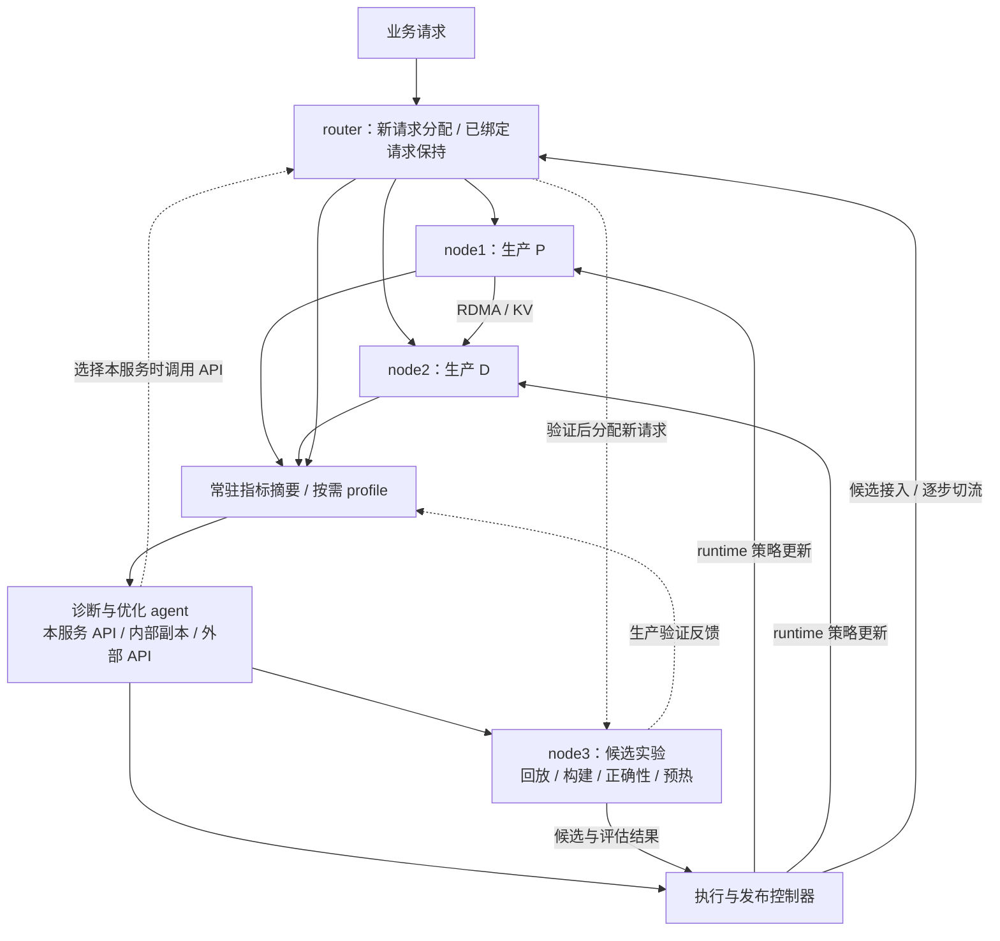
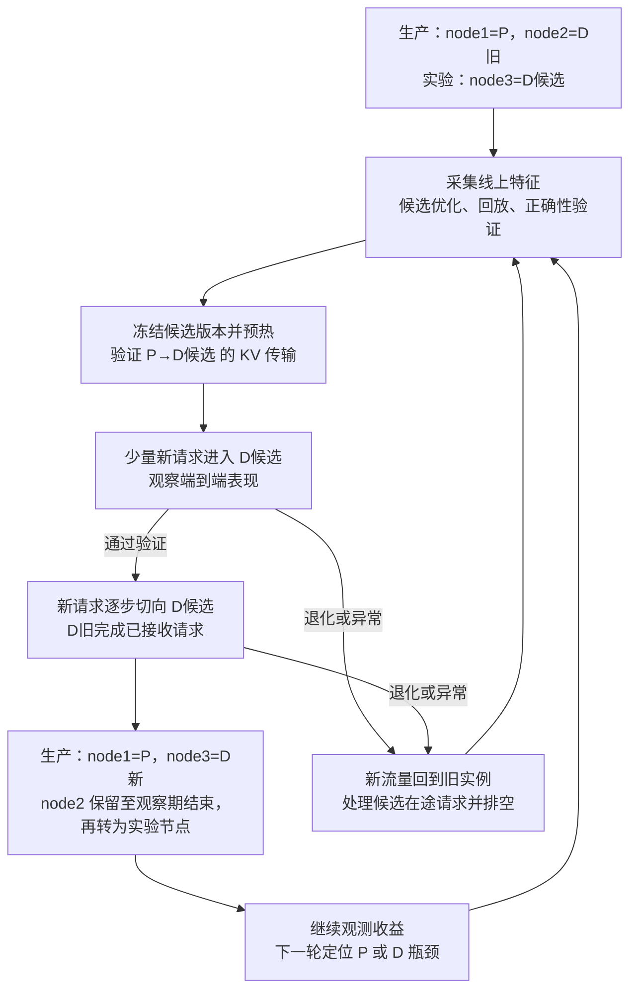

# 研究方案：MaaS 服务的持续自优化

更新：2026-11-05。核心部署为三节点 RDMA 集群：两台节点运行生产 `1P1D`，一台节点用于实验、验证和轮转替换。研究对象为运营方可修改和部署的 **SGLang 与 vLLM V1**。当前阶段为研究设计与固定版本源码审计，框架实现与 GPU/RDMA 实验按 §8 推进。论文依据见 [文献调研](01_顶会论文调研.md)，实现依据见 [源码审计](evidence/source-audit-2026-11-03.json)。

## 1. 应用场景与研究目标

MaaS 运营方已经部署具备商业价值的大模型，持续接收真实业务请求。业务流量提供负载变化和性能问题的观测来源，已部署模型也可通过自身 API 为诊断、配置搜索和代码优化提供推理能力。系统将生产观测、候选实验、在线发布与效果反馈连接成持续闭环。

研究目标是：**在服务入口持续接单的条件下，低开销发现瓶颈，为不同改动选择原地更新或备用节点实验，以可计量的试错和切换成本持续改善业务 SLO goodput。**

方案围绕五项系统能力展开：

| 能力 | 系统设计 | 评估内容 |
| --- | --- | --- |
| 持续服务 | 生产实例承接业务，候选在备用节点准备；新请求逐步切流，旧请求在原实例完成 | 业务错误率、尾延迟、切流与排空耗时 |
| 低开销诊断 | 常驻摘要观测与按需细粒度 profile，关联请求的 P、传输和 D 阶段 | 观测开销、定位准确性、诊断时延 |
| 两种优化路径 | runtime 原地调整兼容策略，offline 在备用节点搜索配置、修改代码、构建和预热 | 首次有效优化时间、可优化范围、总收益 |
| PD 分离下的组件替换 | 按瓶颈独立优化 P 或 D，管理 router 绑定和 Mooncake 传输就绪 | 局部收益到端到端收益的转化、连接与状态生命周期 |
| 使用本服务优化本服务 | agent 复用已有模型 API，内部信息保留在运营方控制域 | 数据流边界、推理能力、容量复用与完整成本 |

agent 的推理来源包括本服务、内部独立副本和外部 API。使用本服务是特色部署方式，保密价值涉及内部源码、配置、硬件拓扑、性能 trace 和业务摘要；容量复用价值来自闲时推理资源。评估分别记录内部资源占用和外部调用费用。

## 2. 三节点架构与持续闭环

初始部署为 `node1=P`、`node2=D旧`、`node3=实验节点`。P 执行 prefill，D 执行 decode，KV 通过 RDMA 传输。每台节点承载一个角色实例，节点内部的 GPU 数、模型容量和 TP/PP 布局随实验登记。router 与控制器部署在具备相应 CPU 资源的主机上，GPU 资源按三个节点核算。

系统由生产服务、观测诊断、优化实验和发布控制四部分组成：

生产服务维持逐 batch 执行与原生自适应。观测模块提供近期状态与瓶颈证据，agent 在较慢时间尺度提出实验和改动。执行器校验动作、控制资源预算并记录采用版本。发布控制器根据实验与生产验证结果扩大候选流量、保留旧实例或撤回候选。

实验节点是可轮转角色。候选成为生产实例后，旧实例完成已分配请求并保留至观察期结束，随后接替实验任务。候选开始接收真实业务时冻结版本，后续代码探索在下一个可用实验节点开展。

## 3. 持续观测与瓶颈诊断

生产侧接入已开发的 profile 工具，长期收集轻量指标摘要。细粒度采样由异常、归因需要或候选验证触发，采样范围和时长受观测预算约束。每次观测关联请求、批次、实例、配置与代码版本，以及实验和切流阶段。

| 观测层 | 主要信息 | 对应诊断 |
| --- | --- | --- |
| 业务与路由 | 到达率、输入/输出长度、请求类型、队列年龄、TTFT/ITL、错误与取消 | 负载变化、路由失衡、SLO 退化 |
| P 计算 | prefill token/批次、chunk、prefix 命中、GPU step、排队时间 | P 供给、长短请求公平性、重算与批处理效率 |
| KV 传输 | 待传输与在途量、有效带宽、发送/接收等待、目标预留 | 链路竞争、传输排队、P/D 接纳失配 |
| D 计算 | 活跃请求、上下文长度、KV 占用、decode step、接收完成到首次 decode 的等待 | 计算效率、显存压力、接纳与 batching |
| 执行路径 | kernel/graph 路径、fallback、workspace、热点采样 | 候选代码或配置的改进位置 |

诊断输出采用“现象 → 瓶颈假设 → 支持证据 → 候选动作 → 验证指标”的形式。例如，D 延迟升高时，先区分 GPU 执行、等待 P、等待 KV 和接纳排队，再选择 D 内部优化、P 预算调整或传输控制。指标关联处理跨机时钟差与阶段重叠。

观测策略从常驻摘要逐步增加采样粒度。证据充分时进入实验，证据不足时补充定向采样，阶段稳定时降低采样频率。评估通过可控瓶颈注入与完整 trace 对照，测量误报、漏报、诊断时延及业务干扰。

## 4. runtime 更新与 offline 实验

系统将生产问题映射到两种执行方式。**runtime 更新**在运行实例的安全边界调整兼容策略；**offline 实验**在备用节点完成候选搜索、代码修改、构建和验证，再通过发布流程接入。offline 描述实验与生产流量分离的执行位置，生产服务在实验期间持续运行。

### 4.1 原地更新

原地更新优先覆盖 P 计算预算、D 接纳软上限、KV 预留目标和新请求路由策略。动作通过框架 adapter 提交给实际执行 owner，在调度、接纳或路由边界采用新版本。

| 环节 | 执行语义 |
| --- | --- |
| 能力发现 | 返回动作、owner、作用实例、允许范围、兼容条件与当前版本 |
| 校验与提交 | 校验候选组合、预期版本和实际资源；在 owner 的执行边界提交 |
| 生效回执 | 区分 accepted、applied 和 settled，记录首个采用的 batch/请求及实际值 |
| 在途处理 | 已接纳请求沿用有效分配；降限影响后续接纳，现有工作自然收敛 |
| 多 rank 协同 | 按动作范围协调相关 worker，记录准备、采用与失败状态 |
| 回退与后续观测 | 提交新的回退版本，继续观测队列、缓存热度及恢复过程 |

框架 adapter 复用 vLLM 的 utility RPC 和 SGLang 的 internal-state 管理路径，补充动作允许列表、派生字段更新与版本回执。[vLLM EngineCore][V3]、[CoreClient][V4]、[SGLang HTTP][S1]、[InternalStateController][S2] scheduler-only 动作在 scheduler 边界执行，涉及 worker/backend 的动作协调相应执行组。

### 4.2 备用节点实验与实例替换

备用节点承载需要重新初始化、编译、重捕获 CUDA Graph 或重建内部结构的候选。候选完成准备后固定版本，经端到端验证和小流量观察进入生产。实验空间覆盖启动配置及框架代码，受模型语义、内存容量、P/D 协议和所选硬件约束。

| 优化对象 | runtime 路径 | offline 路径 |
| --- | --- | --- |
| P 批处理与接纳 | 调整实际调度预算、每轮接纳和公平性策略 | 搜索启动配置，修改 batch 构建与调度实现 |
| D batching 与 KV 预留 | 调整独立接纳软上限及兼容的预留策略 | 搜索运行容量，修改调度与预分配逻辑 |
| KV 保留与复用 | 在已有引用与元数据合同内更新策略 | 比较 cache 实现、保留算法与布局兼容方案 |
| kernel/backend 与 CUDA Graph | 选择已准备且状态兼容的路径 | 编译或修改 kernel，选择 backend，准备 workspace 与 graph |
| 传输与连接资源 | 在已分配资源内调整准入和公平性策略 | 配置线程池、队列、GPU/NIC 映射及支持的传输布局 |
| router | 更新新请求分配规则与候选资格 | 实验候选路由策略，验证分配行为与接入效果 |

动作空间按瓶颈逐步展开，已有配置调整与代码修改分别保存实验预算。PD 分离后，P 预算主要影响 prefill 批处理、排队与 KV 产出，D 接纳主要影响 decode batching、KV 压力与生成延迟；控制器联合观察两端和传输反馈。

执行方式的选择依据改动兼容性、准备时间、预期收益持续时间、当前业务压力和实验节点状态。轻量策略形成较快反馈循环，配置与代码实验形成较慢迭代循环。两种方式共用候选记录、版本和收益账本。

## 5. 候选生成、回放与验证

agent 根据诊断证据选择优化组件和执行方式，生成少量候选，通过工具完成编辑、构建、测试和测量。规则、BO 与超参搜索复用相同的实验工具和预算。每个候选保存源码或构建哈希、配置、依赖、兼容条件、负载窗口、初始状态和测量结果，历史候选按负载与硬件特征复用。

验证分为三层：

1. **局部筛选。** 在实验节点测量与瓶颈相关的组件指标，保留具有改善潜力的候选，并记录 batch、上下文与 KV 条件。
2. **端到端验证。** 对候选执行实际 P→KV 传输→D 路径，检查连接、输出、延迟和资源占用，准备生产接入。
3. **生产验证。** 分配受控的新请求流量，观察业务 SLO、错误、队列与资源变化，决定扩大流量或撤回。

回放保留近期生产负载的到达节奏、输入/输出长度、并发、prefix 复用和 KV 压力，分别报告冷启动与预热条件。D 实验通过登记的 prefill/KV 准备过程建立上下文；合成 KV 或组件微基准用于局部筛选，完整生成与端到端结果承担接入验证。实验复用生产 P/D 或共享 RDMA 时，记录附加计算、KV 传输和业务干扰，并按预算限制实验速率。

正确性验证固定模型权重、tokenizer、采样规则和输出要求，检查生成结果、logits/数值误差、完整词表路径和 KV 传输一致性。候选代码同时接受语义检查与代码审查。性能评估采用预先确定的到达计划、测量窗口和 SLO，保留失败候选与测量噪声信息。

候选评分包含局部改善、端到端收益、准备耗时、资源占用和适用负载。新观测显示负载漂移时，重新确认候选适用性并补充验证。实验预算覆盖整个优化过程的墙钟时间、候选数量、GPU/CPU 时间和 LLM 调用。

## 6. router 接入、KV 连接与节点轮转

### 6.1 发布流程

以 D 替换为首个实现路径，生产 P 保持运行，实验节点构建 D 候选。发布流程如下：

P 替换沿用相同流程：新 P 完成模型、缓存与传输准备，承接后续分配请求；旧 P 完成已有计算与 KV 发送后排空。D 替换期间短时形成 `1P2D`，P 替换期间短时形成 `2P1D`，稳定生产布局回到 `1P1D`。节点角色随轮转重新启动和初始化，实例重建时间计入优化周期。

### 6.2 router 的动态管理

router 维持业务入口和流式连接，动态管理候选资格及新请求分配。SGLang Model Gateway 提供 worker 管理与独立 P/D 路由策略，可作为接入基础。[Gateway][S14] 发布控制器在此基础上维护下列阶段：

| 阶段 | 后端状态与操作 |
| --- | --- |
| 准备 | 注册候选并限制为验证流量，检查模型版本、容量、预热与传输就绪 |
| 灰度 | 按预设规则为候选分配部分新请求，记录路由版本与 P/D 绑定 |
| 扩大流量 | 根据端到端观测增加新请求份额，同时确认候选的目标负载承载能力 |
| 旧实例排空 | 旧实例退出新请求选择集合，保留已分配请求的计算、传输与输出 |
| 观察与轮转 | 保留旧实例作为撤回目标，观察期结束后释放并转入实验角色 |
| 撤回 | 恢复旧实例的新请求资格，处理候选已有请求并收敛其资源 |

管理接口的 accepted 回执之后，控制器确认操作实际生效。已绑定的请求以及进入预留或传输阶段的请求，保留原 P/D 关系；候选资格变更在新分配边界生效。排空条件同时覆盖已分配请求、KV 传输、GPU 执行和流式输出，相关计数及版本进入发布日志。

### 6.3 Mooncake 连接与连续性

新实例建立自己的传输会话、注册目标内存并发布元数据，生产对端使用对应地址完成真实 KV 传输验证。固定版本的连接实现与配置约束见 [Mooncake][S12]、[PD 配置][S10]、[兼容校验][S16]、[PD 文档][S17]。候选清单包含 KV 格式、dtype、page size、并行分片、模型版本和 backend，兼容检查覆盖所需转换路径与双方支持条件。

旧请求的会话、目标地址和内存引用保持到相应传输与计算结束，随后执行注销和回收。实例撤回时，新请求回到保留的旧实例；候选已有请求按健康状态完成、取消或返回失败，并记录恢复结果。

系统采用**服务级连续性**：入口持续接单，已接收的正常请求在原实例完成，后续请求逐步进入新实例。runtime 更新保留所在实例的活跃状态，offline 候选在独立进程准备并通过排空替换接入。两条路径分别记录停顿、额外等待、缓存重建和失败处理。

## 7. 实验设计与收益评估

### 7.1 负载与主要指标

实验覆盖稳态、突发、阶段切换，以及长输入/短输出、短输入/长输出、混合长度和 prefix 复用场景。公开 trace 使用已核实的 [Azure 2023](https://github.com/Azure/AzurePublicDataset/blob/master/AzureLLMInferenceDataset2023.md)/[2024](https://github.com/Azure/AzurePublicDataset/blob/master/AzureLLMInferenceDataset2024.md)、[BurstGPT](https://github.com/HPMLL/BurstGPT) 和 [Mooncake trace](https://github.com/kvcache-ai/Mooncake/tree/main/FAST25-release/traces)，来源记录见 [文献与 trace 核实](evidence/web-verification.json)。具备业务环境时补充运营方控制域内的真实流量观测与验证。

主指标为全程累计满足 TTFT/ITL 或请求级 SLO 的业务完成量，分别报告请求数、输出 token 数及其除以总墙钟时间得到的 goodput。测量覆盖观测、实验、构建、预热、切流、排空和恢复，业务请求与 agent/回放请求分开统计。共享资源造成的业务影响体现在交付结果中，资源与费用另外列账。

各方法使用相同模型、采样语义、SLO 和外部到达计划。实验记录拒绝、超时、取消、错误、未完成请求及结束时积压，并报告尾延迟、公平性和输出质量。重复实验给出波动范围，持续运行实验保留缓存、队列和策略历史。

### 7.2 对照与消融

| 对照或消融 | 评估目的 |
| --- | --- |
| 相同三节点预算、仅观测与原生自适应 | 持续优化相对现有运行方式的业务收益 |
| 充分调优的静态配置、离线候选库加在线选择 | 真实负载变化带来的持续优化空间 |
| 人工或固定周期实验与滚动发布 | 观测驱动的实验时机与发布决策收益 |
| 规则、BO、同预算超参搜索 | agent 在诊断、配置与代码实验中的增益 |
| 仅 runtime、仅 offline、两者联合 | 两种执行方式的适用范围与联合价值 |
| 固定采样、持续重型 profile、触发式采样 | 诊断质量与观测开销的权衡 |
| P、D、传输或路由单独优化与联合优化 | 局部改进、跨组件耦合与端到端收益 |
| 本服务 API、内部副本、外部 API | 数据边界、模型能力、容量竞争与费用差异 |
| 常规使用第三节点扩容的部署 | 实验容量投入与直接扩容的收益比较 |

相关方法按共同动作与预算实现对照。SCOOT/OnlineTune 类方法用于配置搜索，Autopoiesis 类方法用于策略演化对照；配置搜索在共同参数空间比较，代码实验另行报告改动内容、搜索预算与人工优化对照。具体比较范围在实验配置中登记，依据见 [文献调研](01_顶会论文调研.md)。

候选接入期间分别报告双实例共存与切换后稳态。比较 `P+D旧` 与 `P+D新` 时保持生产角色数量一致，固定负载与 SLO，并控制灰度分流后的 batch 变化和缓存预热条件。小流量结果用于逐步扩大验证，目标负载下的稳态结果用于确认容量与最终收益。

### 7.3 成本、保密与机制证据

成本账本覆盖三个节点的 GPU 时间、CPU、内存、网络、profile、构建/编译、回放/预热、LLM 推理和失败恢复。三台同规格节点相对两台节点增加 50% 的节点投入，资源效率按完整三节点预算核算，并与第三节点直接用于生产扩容的方式比较。

本服务 API 的实验分别测量闲时与满载场景下的 token 开销、排队、KV 占用及业务干扰。API 来源对照记录所用模型与提示，在匹配能力和推理预算的条件下分析部署方式差异。保密评估记录源码、trace、业务摘要、工具和日志的实际数据流向，以及外部调用使用的聚合或脱敏边界。

机制证据包括诊断准确性、候选回放与生产排序的一致性、首次有效优化时间、候选构建和预热时间、路由生效时间、排空耗时、撤回损失及长期收益。负载阶段变化实验同时测量候选适用期与准备时间，分析实验预算、验证强度和发布时机的关系。

## 8. 实施路线与交付物

首个原型采用 SGLang、Mooncake 与三节点 `1P1D+实验节点`，先完成 D 的完整闭环，再扩展 P、runtime 更新和 vLLM。vLLM 采用其已审计的 NIXL 路径检验共同机制。[SGLang PD][S17]、[vLLM NIXL][V11]

| 阶段 | 交付物 | 验收内容 |
| --- | --- | --- |
| 1. 生产基线与观测 | 三节点部署脚本、固定模型/拓扑清单、指标与请求关联、瓶颈注入和负载回放 | P、传输与 D 瓶颈定位结果，持续观测开销 |
| 2. D 替换闭环 | 备用 D 的启动/预热、传输验证、router 灰度、排空、撤回与轮转 | 入口持续接单、旧请求完成、版本及资源生命周期可追踪 |
| 3. 实验与优化器 | 候选构建、正确性检查、回放工具、结果存档，规则/BO 与 agent 接入 | 相同预算下首次有效优化时间与端到端收益 |
| 4. runtime 路径 | P 预算、D 接纳等有版本动作，执行方式选择与统一收益账本 | 原地更新生效、收敛与两种路径的联合收益 |
| 5. P 与代码扩展 | P 替换、实际热点代码或 kernel/graph 候选、分布式兼容验证 | 不同修改深度的准备代价、正确性与持续收益 |
| 6. 跨框架与泛化 | vLLM adapter、NIXL 接入、不同模型规模/GPU 与负载的复现实验 | 共同机制、各框架实现差异和完整资源效率 |

各阶段产出可审查的框架补丁、部署与实验脚本、候选记录和结果。runtime 动作从实际消费点扩展：vLLM 优先使用调度预算和接纳软上限，SGLang 增加独立接纳软上限并更新 scheduler 实际字段；后续动作按观测到的瓶颈投入。

## 9. 研究主张与已有工作

本研究提出并评估**由生产观测驱动、结合 runtime 更新与备用节点实验的 MaaS 持续优化闭环**。核心机制包括低开销观测指导实验、候选从回放到生产的验证、以及面向 PD 有状态服务的接入与轮转。研究检验这些机制在给定总资源和优化预算下对长期业务交付的作用。

| 相关路线 | 本方案承接的基础 | 本研究重点 |
| --- | --- | --- |
| SCOOT、LaTune 等配置优化 | 配置搜索、负载特征和候选复用 | 持续生产观测下的实验选择、执行方式与发布收益 |
| TuxBot、OnlineTune、OPPerTune 等在线调优 | 运行中控制、观测反馈与预算 | LLM 推理的队列、KV、graph 和 P/D 状态 |
| Autopoiesis 在线策略演化 | 策略代码生成、候选评估与纯函数热替换 | 主流引擎中的组件实验、两种更新路径和生产接入 |
| FlashVector 生产优化、SEIS/VibeServe 引擎生成 | profile、代码优化与验证 | LLM PD 服务的持续观测、候选轮转与完整成本 |
| DistServe、Llumnix 等 PD 与调度系统 | 计算通信划分、路由及状态管理 | 固定集群内面向持续优化的组件替换与闭环控制 |

相关论文的版本、机制和证据见 [文献调研](01_顶会论文调研.md)，Autopoiesis 的直接重叠与边界见其独立精读条目。论文结果围绕三类证据组织：真实负载中的优化机会、诊断/实验/发布的机制效果，以及全部成本计入后的持续业务收益。使用本服务 API 的保密与容量复用价值作为部署层证据单独评估。

## 附录 A. 框架基础与源码定位

以下源码固定到 2026-11-03 的本地审计提交。现有能力为 adapter 和实验工具提供落点，动作版本、统一实验协议及发布控制按本文方案实现。

| 框架 | 固定提交 | 原生基础与实现落点 |
| --- | --- | --- |
| vLLM V1 | `45d0ac9ee197576aefd4e3f67ad98857b6c52697` | `max_num_scheduled_tokens`、`max_num_active_seqs`、utility RPC、KV manager 和 NIXL |
| SGLang | `f77064f635779601c7b20258ce45ded3fa00ac82` | scheduler/PrefillAdder、internal-state 允许列表、Model Gateway、Mooncake 与 PD 配置 |

vLLM 的 scheduler 预算与 runner 容量分别管理；SGLang 的 chunk 配置会复制到 scheduler，接纳能力与物理 pool 之间通过新增软上限解耦。原生 ratio tracker 等自适应机制保留在基线中。[vLLM 配置][V1]、[Scheduler][V2]、[SGLang Scheduler][S4]、[PrefillAdder][S5]、[Ratio tracker][S3]

KV 保留策略遵循活跃引用和可驱逐集合的生命周期。执行路径选择保持 backend、metadata 与 graph capture 的兼容关系，workspace、编译及预热成本进入候选评估。[vLLM KV][V5]、[Composite backend][V6]、[SGLang eviction][S6]、[Unified cache][S7]、[Backend setup][S8]

Mooncake 线程池和队列属于初始化资源；PD 预分配策略、cache、staging 和并行配置按固定版本支持矩阵组合。vLLM NIXL 的 backend、回读、租期和 D 侧保留分别由对应 scheduler/worker 消费，实验配置同时登记 owner 与作用范围。[Mooncake][S12]、[兼容校验][S16]、[vLLM KVTransferConfig][V7]、[NIXL worker][V8]、[Base scheduler][V9]、[Pull scheduler][V10]

| 范围 | vLLM | SGLang |
| --- | --- | --- |
| 调度与在线控制 | [SchedulerConfig][V1]、[Scheduler][V2]、[EngineCore][V3]、[CoreClient][V4] | [Schedule 配置][S9]、[Scheduler][S4]、[PrefillAdder][S5]、[HTTP][S1]、[InternalStateController][S2] |
| KV 与执行路径 | [KVCacheManager][V5]、[Composite attention][V6] | [Ratio tracker][S3]、[Eviction][S6]、[UnifiedRadixCache][S7]、[Backend setup][S8] |
| PD 与传输 | [KVTransferConfig][V7]、[NIXL worker][V8]、[Base scheduler][V9]、[Pull scheduler][V10]、[NIXL 文档][V11] | [Disagg 配置][S10]、[Decode][S11]、[Mooncake][S12]、[Pool configurator][S13]、[NIXL][S18] |
| 路由与编排 | connector 对应的外部路由与 adapter | [Gateway][S14]、[Role switch][S15]、[兼容校验][S16]、[PD 文档][S17]、[Tokenizer 控制][S19] |

[当前源码审计](evidence/source-audit-2026-11-03.json) 保存 Git blob、SHA-256、行号与能力分类；[字段清单](evidence/framework-parameter-inventory-2026-11-03.json) 保存所选配置类的字段口径。[原源码审计](evidence/source-audit-2026-11-01.json) 与 [原 PD 审计](evidence/pd-rdma-source-audit-2026-11-03.json) 保留为历史记录。

[V1]: https://github.com/vllm-project/vllm/blob/45d0ac9ee197576aefd4e3f67ad98857b6c52697/vllm/config/scheduler.py
[V2]: https://github.com/vllm-project/vllm/blob/45d0ac9ee197576aefd4e3f67ad98857b6c52697/vllm/v1/core/sched/scheduler.py
[V3]: https://github.com/vllm-project/vllm/blob/45d0ac9ee197576aefd4e3f67ad98857b6c52697/vllm/v1/engine/core.py
[V4]: https://github.com/vllm-project/vllm/blob/45d0ac9ee197576aefd4e3f67ad98857b6c52697/vllm/v1/engine/core_client.py
[V5]: https://github.com/vllm-project/vllm/blob/45d0ac9ee197576aefd4e3f67ad98857b6c52697/vllm/v1/core/kv_cache_manager.py
[V6]: https://github.com/vllm-project/vllm/blob/45d0ac9ee197576aefd4e3f67ad98857b6c52697/vllm/v1/attention/backends/composite.py
[S1]: https://github.com/sgl-project/sglang/blob/f77064f635779601c7b20258ce45ded3fa00ac82/python/sglang/srt/entrypoints/http_server.py
[S2]: https://github.com/sgl-project/sglang/blob/f77064f635779601c7b20258ce45ded3fa00ac82/python/sglang/srt/managers/scheduler_components/internal_state.py
[S3]: https://github.com/sgl-project/sglang/blob/f77064f635779601c7b20258ce45ded3fa00ac82/python/sglang/srt/managers/scheduler_components/new_token_ratio_tracker.py
[S4]: https://github.com/sgl-project/sglang/blob/f77064f635779601c7b20258ce45ded3fa00ac82/python/sglang/srt/managers/scheduler.py
[S5]: https://github.com/sgl-project/sglang/blob/f77064f635779601c7b20258ce45ded3fa00ac82/python/sglang/srt/managers/schedule_policy.py
[S6]: https://github.com/sgl-project/sglang/blob/f77064f635779601c7b20258ce45ded3fa00ac82/python/sglang/srt/mem_cache/evict_policy.py
[S7]: https://github.com/sgl-project/sglang/blob/f77064f635779601c7b20258ce45ded3fa00ac82/python/sglang/srt/mem_cache/unified_radix_cache.py
[S8]: https://github.com/sgl-project/sglang/blob/f77064f635779601c7b20258ce45ded3fa00ac82/python/sglang/srt/model_executor/model_runner_components/attention_backend_setup.py
[S9]: https://github.com/sgl-project/sglang/blob/f77064f635779601c7b20258ce45ded3fa00ac82/python/sglang/srt/arg_groups/fields/schedule.py
[S10]: https://github.com/sgl-project/sglang/blob/f77064f635779601c7b20258ce45ded3fa00ac82/python/sglang/srt/arg_groups/fields/disagg.py
[S11]: https://github.com/sgl-project/sglang/blob/f77064f635779601c7b20258ce45ded3fa00ac82/python/sglang/srt/disaggregation/decode.py
[S12]: https://github.com/sgl-project/sglang/blob/f77064f635779601c7b20258ce45ded3fa00ac82/python/sglang/srt/disaggregation/mooncake/conn.py
[S13]: https://github.com/sgl-project/sglang/blob/f77064f635779601c7b20258ce45ded3fa00ac82/python/sglang/srt/model_executor/pool_configurator.py
[S14]: https://github.com/sgl-project/sglang/blob/f77064f635779601c7b20258ce45ded3fa00ac82/sgl-model-gateway/README.md
[S15]: https://github.com/sgl-project/sglang/blob/f77064f635779601c7b20258ce45ded3fa00ac82/python/sglang/srt/disaggregation/role_switch.py
[S16]: https://github.com/sgl-project/sglang/blob/f77064f635779601c7b20258ce45ded3fa00ac82/python/sglang/srt/arg_groups/pd_disaggregation_hook.py
[S17]: https://github.com/sgl-project/sglang/blob/f77064f635779601c7b20258ce45ded3fa00ac82/docs/docs/advanced_features/pd_disaggregation.mdx
[V7]: https://github.com/vllm-project/vllm/blob/45d0ac9ee197576aefd4e3f67ad98857b6c52697/vllm/config/kv_transfer.py
[V8]: https://github.com/vllm-project/vllm/blob/45d0ac9ee197576aefd4e3f67ad98857b6c52697/vllm/distributed/kv_transfer/kv_connector/v1/nixl/base_worker.py
[V9]: https://github.com/vllm-project/vllm/blob/45d0ac9ee197576aefd4e3f67ad98857b6c52697/vllm/distributed/kv_transfer/kv_connector/v1/nixl/base_scheduler.py
[V10]: https://github.com/vllm-project/vllm/blob/45d0ac9ee197576aefd4e3f67ad98857b6c52697/vllm/distributed/kv_transfer/kv_connector/v1/nixl/pull_scheduler.py
[V11]: https://github.com/vllm-project/vllm/blob/45d0ac9ee197576aefd4e3f67ad98857b6c52697/docs/features/nixl_connector_usage.md
[S18]: https://github.com/sgl-project/sglang/blob/f77064f635779601c7b20258ce45ded3fa00ac82/python/sglang/srt/disaggregation/nixl/conn.py
[S19]: https://github.com/sgl-project/sglang/blob/f77064f635779601c7b20258ce45ded3fa00ac82/python/sglang/srt/managers/tokenizer_control_mixin.py
