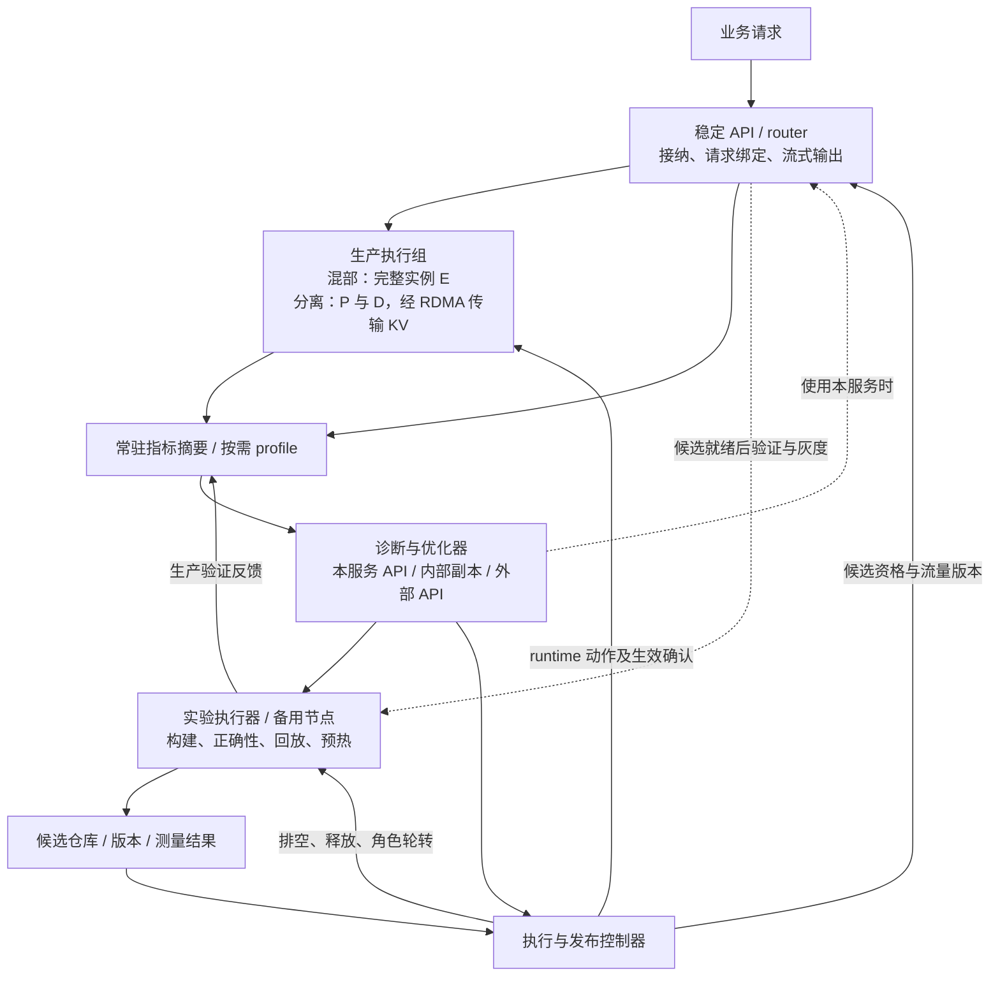
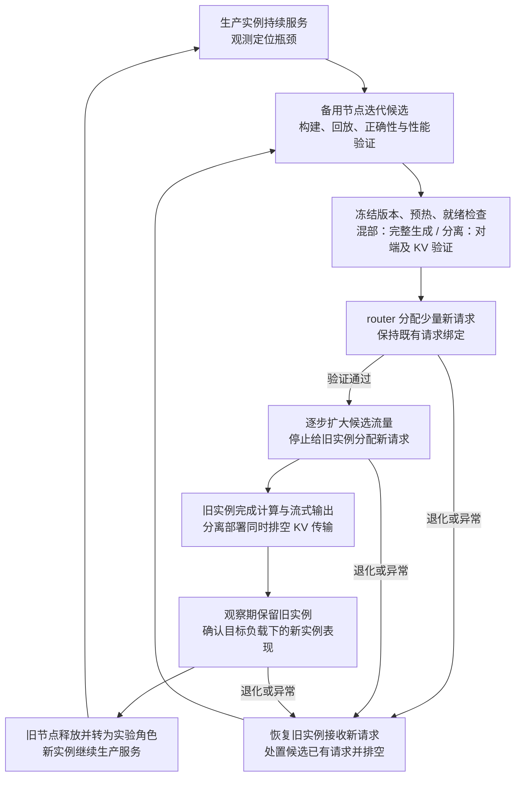

# 研究方案：MaaS 服务的持续自优化

更新：2026-11-05。系统覆盖 P/D 混部与 P/D 分离两种部署：混部以一个生产节点和一个实验节点构成双节点闭环，分离以生产 `1P1D` 和一个实验节点构成三节点 RDMA 闭环。两种部署共用观测、实验、发布与节点轮转机制。研究对象为运营方可修改和部署的 **SGLang 与 vLLM V1**。当前阶段为研究设计与固定版本源码审计，框架实现与 GPU/RDMA 实验按 §8 推进。论文依据见 [文献调研](01_顶会论文调研.md)，实现依据见 [源码审计](evidence/source-audit-2026-11-03.json)。

## 1. 应用场景与研究目标

MaaS 运营方已经部署具备商业价值的大模型，持续接收真实业务请求。业务流量提供负载变化和性能问题的观测来源，已部署模型也可通过自身 API 为诊断、配置搜索和代码优化提供推理能力。系统将生产观测、候选实验、在线发布与效果反馈连接成持续闭环。

研究目标是：**在服务入口持续接单的条件下，低开销发现瓶颈，为不同改动选择原地更新或备用节点实验，以可计量的试错和切换成本持续改善业务 SLO goodput。**

方案围绕五项系统能力展开：

| 能力 | 系统设计 | 评估内容 |
| --- | --- | --- |
| 持续服务 | 生产实例承接业务，候选在备用节点准备；新请求逐步切流，旧请求在原实例完成 | 业务错误率、尾延迟、切流与排空耗时 |
| 低开销诊断 | 常驻摘要观测与按需细粒度 profile，关联请求的 prefill、decode、调度和适用的跨机传输阶段 | 观测开销、定位准确性、诊断时延 |
| 两种优化路径 | runtime 原地调整兼容策略，offline 在备用节点搜索配置、修改代码、构建和预热 | 首次有效优化时间、可优化范围、总收益 |
| 两种部署下的实例替换 | 混部替换完整推理实例，分离按瓶颈替换 P 或 D；统一管理就绪、请求绑定和排空 | 完整服务的连续性、局部到端到端收益、状态生命周期 |
| 使用本服务优化本服务 | agent 复用已有模型 API，内部信息保留在运营方控制域 | 数据流边界、推理能力、容量复用与完整成本 |

agent 的推理来源包括本服务、内部独立副本和外部 API。使用本服务是特色部署方式，保密价值涉及内部源码、配置、硬件拓扑、性能 trace 和业务摘要；容量复用价值来自闲时推理资源。评估分别记录内部资源占用和外部调用费用。

## 2. 服务架构与部署形态

### 2.1 完整服务与控制闭环

系统面向一个持续接收请求的 MaaS 服务。稳定 API 入口负责鉴权、请求接纳、路由与流式输出，生产执行组完成模型推理，优化控制面根据观测组织实验和发布。控制面及其记录独立于被替换的引擎进程运行，实例重建期间持续管理发布状态。入口、观测和控制组件部署在具备相应 CPU 资源的主机上，其资源计入总预算。

| 服务组件 | 职责与接口 | 持久记录或执行状态 |
| --- | --- | --- |
| API 入口与 router | 接收业务与优化器请求；管理候选资格、流量份额、请求绑定、流式连接与取消 | 请求 ID、路由版本、后端及生成状态 |
| 生产执行组 | 运行完整混部实例，或协作的 P/D 实例；上报就绪与负载，执行有版本的 runtime 动作 | 模型与构建版本、动作版本、活跃请求、KV 与执行资源 |
| 观测与诊断 | 汇总业务和引擎指标，触发定向 profile，输出瓶颈证据与待验证假设 | 观测窗口、采样成本、关联 trace 与诊断结果 |
| 优化器与实验执行器 | 选择候选和执行方式，调用模型 API，构建、测试、回放与预热 | 候选源码/镜像哈希、配置、正确性和性能结果、预算消耗 |
| 发布控制器与候选仓库 | 核验就绪、逐步切流、排空、撤回及节点轮转；保存可复用版本 | 发布阶段、流量版本、生效回执、恢复目标与资源释放状态 |

生产服务维持逐 batch 执行与原生自适应。优化器在较慢时间尺度提出实验和改动，执行器检查能力、状态条件与资源预算，发布控制器依据验证结果扩大候选流量、保留旧实例或撤回。使用本服务 API 时，优化请求经稳定入口发送，单独标记并限制并发、token 和队列预算；业务压力升高时降低优化推理与实验速率，推迟下一轮实验。

### 2.2 混部与分离部署

| 部署形态 | 稳定生产布局 | 实验节点与替换单位 | 发布后的角色轮转 |
| --- | --- | --- | --- |
| P/D 混部，两节点 | `node1=E旧`，同一完整实例执行 prefill 和 decode | `node2=实验`，构建和预热完整候选 `E新` | 新请求逐步进入 node2；node1 完成旧请求并经过观察期后转为实验节点 |
| P/D 分离，三节点 | `node1=P`、`node2=D旧`，通过 RDMA 传输 KV | `node3=实验`，按瓶颈构建 P 或 D 候选 | D 替换后 node3 承接 D、node2 转为实验节点；P 替换按同样方式交接 |

混部实例在本地管理 prefill/decode 调度、KV cache 和生成状态，实验节点独立运行同一模型的完整候选。分离部署把计算角色与传输链路作为诊断对象，候选接入时验证 P/D 配对、KV 格式和连接状态。两种部署中，一个节点均可包含多张 GPU；所选模型、精度与 TP/PP 布局须满足该角色的节点容量。需要跨节点模型并行时，生产与备用资源按完整执行组扩展，并按实际节点数核算。

实验节点是可轮转角色。候选开始接收真实业务时冻结版本；旧实例完成请求并保留至观察期结束后，接替下一轮实验。两节点部署在灰度与观察期间由新旧两个完整实例占用资源，三节点部署在对应阶段由生产对端及新旧角色实例占用资源；下一轮构建在备用资源释放后开始。

## 3. 持续观测与瓶颈诊断

生产侧接入已开发的 profile 工具，长期收集轻量指标摘要。细粒度采样由异常、归因需要或候选验证触发，采样范围和时长受观测预算约束。每次观测关联请求、批次、实例、配置与代码版本，以及实验和切流阶段。

| 观测层 | 主要信息 | 对应诊断 |
| --- | --- | --- |
| 业务与路由 | 到达率、输入/输出长度、请求类型、队列年龄、TTFT/ITL、错误与取消 | 负载变化、路由失衡、SLO 退化 |
| prefill 计算 | prefill token/批次、chunk、prefix 命中、GPU step、排队时间 | 混部中的阶段竞争，分离中的 P 供给，以及公平性、重算与批处理效率 |
| KV 状态与传输 | 本地分配/驱逐、prefix 复用、显存压力；分离时的在途量、带宽、收发等待与目标预留 | 本地容量与复用效率，分离链路竞争和 P/D 接纳失配 |
| decode 计算 | 活跃请求、上下文长度、KV 占用、decode step；分离时接收完成到首次 decode 的等待 | 计算效率、接纳与 batching，混部 prefill 干扰和分离接收等待 |
| 执行路径 | kernel/graph 路径、fallback、workspace、热点采样 | 候选代码或配置的改进位置 |

诊断输出采用“现象 → 瓶颈假设 → 支持证据 → 候选动作 → 验证指标”的形式。混部场景中，decode 延迟升高时分析 prefill 插入、chunk 预算、批次构建和 KV 压力；分离场景中，再区分 GPU 执行、等待 P、等待 KV 和接纳排队，选择对应组件与动作。指标关联记录阶段重叠，跨机路径处理时钟差。

观测策略从常驻摘要逐步增加采样粒度。证据充分时进入实验，证据不足时补充定向采样，阶段稳定时降低采样频率。评估通过可控瓶颈注入与完整 trace 对照，测量误报、漏报、诊断时延及业务干扰。

## 4. runtime 更新与 offline 实验

系统将生产问题映射到两种执行方式。**runtime 更新**在运行实例的安全边界调整兼容策略；**offline 实验**在备用节点完成候选搜索、代码修改、构建和验证，再通过发布流程接入。offline 描述实验与生产流量分离的执行位置，生产服务在实验期间持续运行。

### 4.1 原地更新

原地更新覆盖混部实例的 prefill/chunk 预算、请求接纳软上限和兼容的 KV 策略，以及分离实例的 P 预算、D 接纳与 KV 预留目标；router 更新新请求分配策略。动作通过框架 adapter 提交给实际执行 owner，在调度、接纳或路由边界采用新版本。

| 环节 | 执行语义 |
| --- | --- |
| 能力发现 | 返回动作、owner、作用实例、允许范围、兼容条件与当前版本 |
| 校验与提交 | 校验候选组合、预期版本和实际资源；在 owner 的执行边界提交 |
| 生效回执 | 区分 accepted、applied 和 settled，记录首个采用的 batch/请求及实际值 |
| 在途处理 | 已接纳请求沿用有效分配；降限影响后续接纳，现有工作自然收敛 |
| 多 rank 协同 | 按动作范围协调相关 worker，记录准备、采用与失败状态 |
| 回退与后续观测 | 提交新的回退版本，继续观测队列、缓存热度及恢复过程 |

框架 adapter 复用 vLLM 的 utility RPC 和 SGLang 的 internal-state 管理路径，补充动作允许列表、派生字段更新与版本回执。[vLLM EngineCore][V3]、[CoreClient][V4]、[SGLang HTTP][S1]、[InternalStateController][S2] scheduler-only 动作在 scheduler 边界执行，涉及 worker/backend 的动作协调相应执行组。

### 4.2 备用节点实验与实例替换

备用节点承载需要重新初始化、编译、重捕获 CUDA Graph 或重建内部结构的候选。候选完成准备后固定版本，经端到端验证和小流量观察进入生产。实验空间覆盖启动配置及框架代码，受模型语义、内存容量、所选硬件和相应部署协议约束。混部候选包含完整 prefill/decode 执行路径及本地 KV 管理；分离候选额外登记对端与传输兼容条件。

| 优化对象 | runtime 路径 | offline 路径 |
| --- | --- | --- |
| prefill/chunk 调度 | 调整实际调度预算、每轮接纳和公平性策略 | 搜索启动配置，修改 batch 构建与调度实现 |
| decode batching 与请求接纳 | 调整独立接纳软上限及兼容的预留策略 | 搜索运行容量，修改调度与预分配逻辑 |
| KV 保留与复用 | 在已有引用与元数据合同内更新策略 | 比较 cache 实现、保留算法与布局兼容方案 |
| kernel/backend 与 CUDA Graph | 选择已准备且状态兼容的路径 | 编译或修改 kernel，选择 backend，准备 workspace 与 graph |
| 传输与连接资源 | 在已分配资源内调整准入和公平性策略 | 配置线程池、队列、GPU/NIC 映射及支持的传输布局 |
| router | 更新新请求分配规则与候选资格 | 实验候选路由策略，验证分配行为与接入效果 |

动作空间按瓶颈逐步展开，已有配置调整与代码修改分别保存实验预算。混部实例联合调整 prefill 与 decode 的计算份额、chunk 与接纳策略，观测两阶段共享 GPU、batch 和 KV 空间的影响。PD 分离后，P 预算主要影响 prefill 批处理、排队与 KV 产出，D 接纳主要影响 decode batching、KV 压力与生成延迟；控制器联合观察两端和传输反馈。

执行方式的选择依据改动兼容性、准备时间、预期收益持续时间、当前业务压力和实验节点状态。轻量策略形成较快反馈循环，配置与代码实验形成较慢迭代循环。两种方式共用候选记录、版本和收益账本。

## 5. 候选生成、回放与验证

agent 根据诊断证据选择优化组件和执行方式，生成少量候选，通过工具完成编辑、构建、测试和测量。规则、BO 与超参搜索复用相同的实验工具和预算。每个候选保存源码或构建哈希、部署形态、目标角色、配置、依赖、兼容条件、负载窗口、初始状态和测量结果，历史候选按负载与硬件特征复用。

验证分为三层：

1. **局部筛选。** 在实验节点测量与瓶颈相关的组件指标，保留具有改善潜力的候选，并记录 batch、上下文与 KV 条件。
2. **端到端验证。** 混部候选执行完整输入、prefill、decode 和流式输出；分离候选执行实际 P→KV 传输→D 路径。检查输出、连接、延迟、资源占用与取消处理，确认生产接入条件。
3. **生产验证。** 分配受控的新请求流量，观察业务 SLO、错误、队列与资源变化，决定扩大流量或撤回。

回放保留近期生产负载的到达节奏、输入/输出长度、并发、prefix 复用和 KV 压力，分别报告冷启动与预热条件。混部实验在备用节点独立加载完整模型和请求，测量共享调度与本地 KV 生命周期。分离部署中，D 实验通过登记的 prefill/KV 准备过程建立上下文；合成 KV 或组件微基准用于局部筛选，完整生成与端到端结果承担接入验证。完整分离链路验证涉及 P、D 两端资源；单个备用节点上的组件实验与端到端验证分别登记资源来源。实验复用生产 P/D 或共享 RDMA 时，记录附加计算、KV 传输和业务干扰，并按预算限制实验速率。

正确性验证固定模型权重、tokenizer、采样规则和输出要求，检查生成结果、logits/数值误差、完整词表路径、本地 KV 正确性，以及分离部署的 KV 传输一致性。候选代码同时接受语义检查与代码审查。性能评估采用预先确定的到达计划、测量窗口和 SLO，保留失败候选与测量噪声信息。

候选评分包含局部改善、端到端收益、准备耗时、资源占用和适用负载。就绪检查覆盖模型与 tokenizer 一致性、完整生成、目标容量、预热、健康状态和相应的连接条件；灰度规则预先登记 SLO、错误率、样本量、观测窗口与撤回阈值，扩大流量时继续验证目标负载下的表现。新观测显示负载漂移时，重新确认候选适用性并补充验证。实验预算覆盖整个优化过程的墙钟时间、候选数量、GPU/CPU 时间和 LLM 调用。

## 6. 服务发布、状态管理与节点轮转

### 6.1 统一发布流程

发布以完整可运行候选为单位，混部替换整个推理实例，分离替换选定 P/D 角色。控制器执行“实验 → 就绪 → 灰度 → 扩大流量 → 排空 → 观察 → 轮转”，每个阶段保存版本、检查结果和恢复目标。同一执行组串行发布候选，控制指令携带预期版本与操作 ID；控制器重启后核对实例、路由与在途状态，再继续或撤回当前发布。发布前核对生产动作版本与对端版本；实验期间的 runtime 更新进入候选适用性复核与补充验证。

混部部署从 `node1=E旧、node2=实验` 开始。node2 完成完整实例构建和预热后进入灰度；旧请求继续在 node1 完成生成，新请求逐步进入 node2。node1 排空并经过观察期后成为下一轮实验节点，稳定生产角色仍为一个完整实例。

分离部署从 `node1=P、node2=D旧、node3=实验` 开始。D 候选在 node3 建立接收与执行能力，验证生产 P 到候选的 KV 传输后接收新请求；node2 排空并经过观察期后成为实验节点。P 替换中，新 P 完成计算及传输准备，旧 P 完成已有计算与 KV 发送后排空。D/P 替换期间分别短时形成 `1P2D`/`2P1D`，稳定布局回到 `1P1D`。

### 6.2 router、请求绑定与恢复

router 维持稳定业务入口和流式连接，动态管理候选资格与新请求份额。控制器通过框架路由 adapter 执行注册、就绪确认、分流、停止新接纳与排空查询；分离路径采用已审计的 SGLang Model Gateway worker 管理与 P/D 路由基础。[Gateway][S14]

| 阶段 | 共同操作 | 混部实例 | 分离角色 |
| --- | --- | --- | --- |
| 准备 | 核对模型、构建、容量、预热和恢复版本 | 验证完整生成与本地 KV 分配 | 验证 P/D 兼容、会话与目标内存 |
| 灰度与扩大 | 分配受控新请求，记录版本与业务结果 | 请求绑定到一个完整实例 | 请求绑定到明确的 P/D 配对 |
| 排空 | 停止旧实例新接纳，等待原有工作完成 | 请求、GPU 执行与流式输出结束，活跃 KV 引用释放 | 同时等待预留、在途传输和相关内存引用释放 |
| 观察与轮转 | 保留旧版本及资源，观察后交接实验角色 | 旧完整实例释放 | 旧角色释放，对端继续服务 |
| 撤回 | 恢复旧实例新接纳，处理候选已有请求 | 由候选完成、取消或按故障结果结束 | 进一步收敛候选连接、预留与传输 |

管理接口的 accepted 回执之后，控制器确认操作实际生效。请求绑定在接纳时记录，生成中的流式请求及其取消沿原路径处理；灰度份额影响后续分配。旧实例排空同时跟踪接纳、队列、执行和输出，长请求的排空等待计入发布耗时；超时、取消及异常终止记录为相应业务结果。候选出现故障时，控制器恢复后续请求到健康版本，并记录候选在途请求的恢复结果。

### 6.3 KV 与执行资源生命周期

混部请求的活跃 KV 与调度状态由所属实例持有，随请求完成和引用释放回收；可复用的 prefix cache、graph 与 workspace 在观察期内保留，实例退出后统一释放。候选通过真实输入重新建立自己的 KV；prefix cache 与 graph 的准备和热度单独测量。候选冷缓存引起的额外 prefill、显存占用和尾延迟进入验证与收益账本。

分离候选建立自己的传输会话、注册目标内存并发布元数据，生产对端使用对应地址完成真实 KV 传输验证。固定版本的连接实现与配置约束见 [Mooncake][S12]、[PD 配置][S10]、[兼容校验][S16]、[PD 文档][S17]。候选清单包含 KV 格式、dtype、page size、并行分片、模型版本和 backend，兼容检查覆盖所需转换路径与双方支持条件。

已绑定的请求以及进入预留或传输阶段的请求保留原 P/D 关系。旧会话、目标地址和内存引用保持到相应传输与计算结束，随后注销和回收。撤回期间同步记录连接、内存和请求的收敛状态。观察期结束并释放旧实例后，历史版本按候选仓库记录重新部署，重建与预热成本进入后续发布或恢复过程。

系统采用**服务级连续性**：入口持续接单，正常在途请求在所属实例完成，新请求逐步进入准备好的候选。runtime 更新在安全边界保留所在实例的活跃状态，offline 候选在独立进程中准备并通过排空替换接入。两种部署、两条更新路径分别记录停顿、额外等待、缓存重建和失败处理。

## 7. 实验设计与收益评估

### 7.1 负载与主要指标

实验分别在双节点混部与三节点分离部署上开展，固定各自的总资源预算，覆盖稳态、突发、阶段切换，以及长输入/短输出、短输入/长输出、混合长度和 prefix 复用场景。公开 trace 使用已核实的 [Azure 2023](https://github.com/Azure/AzurePublicDataset/blob/master/AzureLLMInferenceDataset2023.md)/[2024](https://github.com/Azure/AzurePublicDataset/blob/master/AzureLLMInferenceDataset2024.md)、[BurstGPT](https://github.com/HPMLL/BurstGPT) 和 [Mooncake trace](https://github.com/kvcache-ai/Mooncake/tree/main/FAST25-release/traces)，来源记录见 [文献与 trace 核实](evidence/web-verification.json)。具备业务环境时补充运营方控制域内的真实流量观测与验证。

主指标为全程累计满足 TTFT/ITL 或请求级 SLO 的业务完成量，分别报告请求数、输出 token 数及其除以总墙钟时间得到的 goodput。测量覆盖观测、实验、构建、预热、切流、排空和恢复，业务请求与 agent/回放请求分开统计。共享资源造成的业务影响体现在交付结果中，资源与费用另外列账。

各方法使用相同模型、采样语义、SLO 和外部到达计划。实验记录拒绝、超时、取消、错误、未完成请求及结束时积压，并报告尾延迟、公平性和输出质量。重复实验给出波动范围，持续运行实验保留缓存、队列和策略历史。

### 7.2 对照与消融

| 对照或消融 | 评估目的 |
| --- | --- |
| 相同部署形态和总节点预算、仅观测与原生自适应 | 持续优化相对现有运行方式的业务收益 |
| 充分调优的静态配置、离线候选库加在线选择 | 真实负载变化带来的持续优化空间 |
| 人工或固定周期实验与滚动发布 | 观测驱动的实验时机与发布决策收益 |
| 规则、BO、同预算超参搜索 | agent 在诊断、配置与代码实验中的增益 |
| 仅 runtime、仅 offline、两者联合 | 两种执行方式的适用范围与联合价值 |
| 固定采样、持续重型 profile、触发式采样 | 诊断质量与观测开销的权衡 |
| 混部的 prefill/decode 调度与 KV 联合优化；分离的 P、D、传输与路由优化 | 两种拓扑的局部改进、共享资源竞争与跨组件耦合 |
| 本服务 API、内部副本、外部 API | 数据边界、模型能力、容量竞争与费用差异 |
| 备用节点直接用于生产扩容的部署 | 混部增加完整副本、分离扩充对应角色，与实验容量投入比较 |

相关方法按共同动作与预算实现对照。SCOOT/OnlineTune 类方法用于配置搜索，Autopoiesis 类方法用于策略演化对照；配置搜索在共同参数空间比较，代码实验另行报告改动内容、搜索预算与人工优化对照。具体比较范围在实验配置中登记，依据见 [文献调研](01_顶会论文调研.md)。

候选接入期间分别报告双实例共存与切换后稳态。混部比较 `E旧` 与 `E新`，分离比较 `P+D旧` 与 `P+D新`，均保持相应生产角色数量一致，固定负载与 SLO，并控制灰度分流后的 batch 变化和缓存预热条件。小流量结果用于逐步扩大验证，目标负载下的稳态结果用于确认容量与最终收益。

### 7.3 成本、保密与机制证据

成本账本覆盖全部生产与实验节点的 GPU 时间、CPU、内存、网络、profile、构建/编译、回放/预热、LLM 推理和失败恢复。同规格节点条件下，混部从一个生产节点增加一个备用节点，节点投入增加 100%；分离从两个生产节点增加一个备用节点，增加 50%。资源效率分别按完整双节点或三节点预算核算，并与备用节点直接用于生产扩容的方式比较。跨节点执行组按实际资源核算，两种部署的结果分别报告。

本服务 API 的实验分别测量闲时与满载场景下的 token 开销、排队、KV 占用及业务干扰。API 来源对照记录所用模型与提示，在匹配能力和推理预算的条件下分析部署方式差异。保密评估记录源码、trace、业务摘要、工具和日志的实际数据流向，以及外部调用使用的聚合或脱敏边界。

机制证据包括诊断准确性、候选回放与生产排序的一致性、首次有效优化时间、候选构建和预热时间、路由生效时间、排空耗时、撤回损失及长期收益。负载阶段变化实验同时测量候选适用期与准备时间，分析实验预算、验证强度和发布时机的关系。

## 8. 实施路线与交付物

实施以统一服务接口组织两种部署。SGLang 双节点混部完成完整实例的观测、实验与轮转基线，三节点 PD 路径使用 Mooncake 完成 D 替换并扩展 P。两条部署路径复用候选仓库、动作版本、发布状态机与成本账本；vLLM 混部及其已审计的 NIXL 分离路径用于检验跨框架机制。[SGLang PD][S17]、[vLLM NIXL][V11]

| 阶段 | 交付物 | 验收内容 |
| --- | --- | --- |
| 1. 两种生产基线与观测 | 双节点混部、三节点分离部署清单，固定模型/拓扑，指标关联、瓶颈注入和回放 | 混部阶段竞争及分离计算/传输瓶颈定位，持续观测开销 |
| 2. 混部完整实例闭环 | 完整候选启动/预热，router 灰度、请求绑定、排空、撤回与双节点轮转 | 完整生成、流式连接与取消处理，版本和本地 KV 生命周期 |
| 3. PD 组件替换闭环 | 备用 D 的传输验证与三节点轮转，随后实现 P 替换 | P/D 配对、会话与目标内存生命周期，入口持续接单 |
| 4. 实验与优化器 | 共用构建、正确性、回放与候选工具，规则/BO 和 agent 接入 | 两种部署相同预算口径下的有效优化时间与业务收益 |
| 5. runtime 与代码迭代 | 有版本的预算/接纳动作、路径选择，热点 kernel/graph 或调度候选 | 原地更新与实例替换的联合效果、不同修改深度的准备代价 |
| 6. 跨框架与泛化 | vLLM adapter、NIXL 接入，不同模型规模/GPU 与负载的复现实验 | 两种部署的共同机制、实现差异和完整资源效率 |

各阶段产出可审查的框架补丁、部署与实验脚本、候选记录和结果。runtime 动作从实际消费点扩展：vLLM 优先使用调度预算和接纳软上限，SGLang 增加独立接纳软上限并更新 scheduler 实际字段；后续动作按观测到的瓶颈投入。

## 9. 研究主张与特性对照

本研究以**固定集群预算下的 MaaS 持续优化**为目标。生产观测指导优化机会与候选选择，控制器联合选择 runtime 原地更新或备用节点实验，通过混部完整实例替换或分离 P/D 角色接入，执行逐步切流、排空和节点轮转。研究检验执行方式选择与发布机制对长期业务交付的作用，计入观测、实验、优化器推理和切换的完整成本。

✓：论文明确覆盖；△：覆盖部分环节或相邻能力；—：核对原文未见该机制展开。Ours 为方案设计目标，待实现与实验验证。

| 相关工作类别与代表 | 生产观测驱动持续调优 | 按需低开销诊断 | runtime 策略原地更新 | 隔离资源配置/代码实验 | 两种更新路径联合决策 | PD 候选发布与节点轮转 |
| --- | :---: | :---: | :---: | :---: | :---: | :---: |
| 配置搜索与适配：SCOOT、LaTune | △ | — | △ | ✓ | — | — |
| 在线参数调优：TuxBot 等 | ✓ | △ | ✓ | — | — | — |
| 在线策略演化：Autopoiesis | ✓ | △ | ✓ | — | — | △ |
| 推荐服务栈优化：FlashVector | ✓ | △ | — | ✓ | — | — |
| MaaS 生产推理优化：Herschel | ✓ | ✓ | — | ✓ | — | △ |
| PD 与动态调度：DistServe、Llumnix | △ | △ | △ | — | — | △ |
| **Ours（设计目标）** | **✓** | **✓** | **✓** | **✓** | **✓** | **✓** |

各列按执行机制判定：runtime 原地更新指兼容参数或策略在现有运行实例内生效；隔离资源实验指在独立资源上运行真实引擎的配置或代码候选；两种路径联合决策指依据兼容性、准备代价、负载与预期收益选择原地更新或实例替换；PD 发布与轮转覆盖候选版本准备、router 接入、KV 会话与目标内存、在途请求排空和节点角色交接；完整混部实例采用同一发布协议，管理本地 KV 与生成状态。

△ 的具体范围如下：

- **配置搜索与适配**：LaTune 提供运行时配置选择，SCOOT 提供配置搜索与独立评估；该行概括这类工作的已有能力。
- **Autopoiesis**：近期 trace 驱动策略演化，候选由 simulator 回放评估，纯函数策略原地替换；PD 相关能力为请求调度和 serving plan 重配置。
- **Herschel**：按需挂载 profiler，在空闲或可抢占资源上开展引擎/kernel 实验，案例包含 PD handoff、recurrent/prefix state 与 graph 条件；专家审查后的 canary/rollout 位于其系统之外。
- **DistServe、Llumnix**：分别提供 PD 资源规划与在线调度、跨实例重调度与在途状态迁移，支撑 PD 发布所需的部分调度和状态管理能力。

FlashVector 已覆盖生产同机型隔离节点、真实请求回放、持续触发、PR 交付与 shadow canary。本文的研究重点落在**两种更新路径的联合决策、混部与分离服务的统一发布和节点轮转协议，以及固定资源预算下的长期净收益**。使用本服务 API 的保密与容量复用价值作为部署层证据单独评估。

论文版本、机制与证据见 [文献调研](01_顶会论文调研.md)；Herschel、Autopoiesis 与 FlashVector 的逐节阅读和实验口径见其 §4 精读条目。

## 附录 A. 框架基础与源码定位

以下源码固定到 2026-11-03 的本地审计提交。现有能力为 adapter 和实验工具提供落点，动作版本、统一实验协议及发布控制按本文方案实现。

| 框架 | 固定提交 | 原生基础与实现落点 |
| --- | --- | --- |
| vLLM V1 | `45d0ac9ee197576aefd4e3f67ad98857b6c52697` | `max_num_scheduled_tokens`、`max_num_active_seqs`、utility RPC、KV manager 和 NIXL |
| SGLang | `f77064f635779601c7b20258ce45ded3fa00ac82` | scheduler/PrefillAdder、internal-state 允许列表、Model Gateway、Mooncake 与 PD 配置 |

vLLM 的 scheduler 预算与 runner 容量分别管理；SGLang 的 chunk 配置会复制到 scheduler，接纳能力与物理 pool 之间通过新增软上限解耦。原生 ratio tracker 等自适应机制保留在基线中。[vLLM 配置][V1]、[Scheduler][V2]、[SGLang Scheduler][S4]、[PrefillAdder][S5]、[Ratio tracker][S3]

KV 保留策略遵循活跃引用和可驱逐集合的生命周期。执行路径选择保持 backend、metadata 与 graph capture 的兼容关系，workspace、编译及预热成本进入候选评估。[vLLM KV][V5]、[Composite backend][V6]、[SGLang eviction][S6]、[Unified cache][S7]、[Backend setup][S8]

Mooncake 线程池和队列属于初始化资源；PD 预分配策略、cache、staging 和并行配置按固定版本支持矩阵组合。vLLM NIXL 的 backend、回读、租期和 D 侧保留分别由对应 scheduler/worker 消费，实验配置同时登记 owner 与作用范围。[Mooncake][S12]、[兼容校验][S16]、[vLLM KVTransferConfig][V7]、[NIXL worker][V8]、[Base scheduler][V9]、[Pull scheduler][V10]

| 范围 | vLLM | SGLang |
| --- | --- | --- |
| 调度与在线控制 | [SchedulerConfig][V1]、[Scheduler][V2]、[EngineCore][V3]、[CoreClient][V4] | [Schedule 配置][S9]、[Scheduler][S4]、[PrefillAdder][S5]、[HTTP][S1]、[InternalStateController][S2] |
| KV 与执行路径 | [KVCacheManager][V5]、[Composite attention][V6] | [Ratio tracker][S3]、[Eviction][S6]、[UnifiedRadixCache][S7]、[Backend setup][S8] |
| PD 与传输 | [KVTransferConfig][V7]、[NIXL worker][V8]、[Base scheduler][V9]、[Pull scheduler][V10]、[NIXL 文档][V11] | [Disagg 配置][S10]、[Decode][S11]、[Mooncake][S12]、[Pool configurator][S13]、[NIXL][S18] |
| 路由与编排 | connector 对应的外部路由与 adapter | [Gateway][S14]、[Role switch][S15]、[兼容校验][S16]、[PD 文档][S17]、[Tokenizer 控制][S19] |

[当前源码审计](evidence/source-audit-2026-11-03.json) 保存 Git blob、SHA-256、行号与能力分类；[字段清单](evidence/framework-parameter-inventory-2026-11-03.json) 保存所选配置类的字段口径。[原源码审计](evidence/source-audit-2026-11-01.json) 与 [原 PD 审计](evidence/pd-rdma-source-audit-2026-11-03.json) 保留为历史记录。

[V1]: https://github.com/vllm-project/vllm/blob/45d0ac9ee197576aefd4e3f67ad98857b6c52697/vllm/config/scheduler.py
[V2]: https://github.com/vllm-project/vllm/blob/45d0ac9ee197576aefd4e3f67ad98857b6c52697/vllm/v1/core/sched/scheduler.py
[V3]: https://github.com/vllm-project/vllm/blob/45d0ac9ee197576aefd4e3f67ad98857b6c52697/vllm/v1/engine/core.py
[V4]: https://github.com/vllm-project/vllm/blob/45d0ac9ee197576aefd4e3f67ad98857b6c52697/vllm/v1/engine/core_client.py
[V5]: https://github.com/vllm-project/vllm/blob/45d0ac9ee197576aefd4e3f67ad98857b6c52697/vllm/v1/core/kv_cache_manager.py
[V6]: https://github.com/vllm-project/vllm/blob/45d0ac9ee197576aefd4e3f67ad98857b6c52697/vllm/v1/attention/backends/composite.py
[S1]: https://github.com/sgl-project/sglang/blob/f77064f635779601c7b20258ce45ded3fa00ac82/python/sglang/srt/entrypoints/http_server.py
[S2]: https://github.com/sgl-project/sglang/blob/f77064f635779601c7b20258ce45ded3fa00ac82/python/sglang/srt/managers/scheduler_components/internal_state.py
[S3]: https://github.com/sgl-project/sglang/blob/f77064f635779601c7b20258ce45ded3fa00ac82/python/sglang/srt/managers/scheduler_components/new_token_ratio_tracker.py
[S4]: https://github.com/sgl-project/sglang/blob/f77064f635779601c7b20258ce45ded3fa00ac82/python/sglang/srt/managers/scheduler.py
[S5]: https://github.com/sgl-project/sglang/blob/f77064f635779601c7b20258ce45ded3fa00ac82/python/sglang/srt/managers/schedule_policy.py
[S6]: https://github.com/sgl-project/sglang/blob/f77064f635779601c7b20258ce45ded3fa00ac82/python/sglang/srt/mem_cache/evict_policy.py
[S7]: https://github.com/sgl-project/sglang/blob/f77064f635779601c7b20258ce45ded3fa00ac82/python/sglang/srt/mem_cache/unified_radix_cache.py
[S8]: https://github.com/sgl-project/sglang/blob/f77064f635779601c7b20258ce45ded3fa00ac82/python/sglang/srt/model_executor/model_runner_components/attention_backend_setup.py
[S9]: https://github.com/sgl-project/sglang/blob/f77064f635779601c7b20258ce45ded3fa00ac82/python/sglang/srt/arg_groups/fields/schedule.py
[S10]: https://github.com/sgl-project/sglang/blob/f77064f635779601c7b20258ce45ded3fa00ac82/python/sglang/srt/arg_groups/fields/disagg.py
[S11]: https://github.com/sgl-project/sglang/blob/f77064f635779601c7b20258ce45ded3fa00ac82/python/sglang/srt/disaggregation/decode.py
[S12]: https://github.com/sgl-project/sglang/blob/f77064f635779601c7b20258ce45ded3fa00ac82/python/sglang/srt/disaggregation/mooncake/conn.py
[S13]: https://github.com/sgl-project/sglang/blob/f77064f635779601c7b20258ce45ded3fa00ac82/python/sglang/srt/model_executor/pool_configurator.py
[S14]: https://github.com/sgl-project/sglang/blob/f77064f635779601c7b20258ce45ded3fa00ac82/sgl-model-gateway/README.md
[S15]: https://github.com/sgl-project/sglang/blob/f77064f635779601c7b20258ce45ded3fa00ac82/python/sglang/srt/disaggregation/role_switch.py
[S16]: https://github.com/sgl-project/sglang/blob/f77064f635779601c7b20258ce45ded3fa00ac82/python/sglang/srt/arg_groups/pd_disaggregation_hook.py
[S17]: https://github.com/sgl-project/sglang/blob/f77064f635779601c7b20258ce45ded3fa00ac82/docs/docs/advanced_features/pd_disaggregation.mdx
[V7]: https://github.com/vllm-project/vllm/blob/45d0ac9ee197576aefd4e3f67ad98857b6c52697/vllm/config/kv_transfer.py
[V8]: https://github.com/vllm-project/vllm/blob/45d0ac9ee197576aefd4e3f67ad98857b6c52697/vllm/distributed/kv_transfer/kv_connector/v1/nixl/base_worker.py
[V9]: https://github.com/vllm-project/vllm/blob/45d0ac9ee197576aefd4e3f67ad98857b6c52697/vllm/distributed/kv_transfer/kv_connector/v1/nixl/base_scheduler.py
[V10]: https://github.com/vllm-project/vllm/blob/45d0ac9ee197576aefd4e3f67ad98857b6c52697/vllm/distributed/kv_transfer/kv_connector/v1/nixl/pull_scheduler.py
[V11]: https://github.com/vllm-project/vllm/blob/45d0ac9ee197576aefd4e3f67ad98857b6c52697/docs/features/nixl_connector_usage.md
[S18]: https://github.com/sgl-project/sglang/blob/f77064f635779601c7b20258ce45ded3fa00ac82/python/sglang/srt/disaggregation/nixl/conn.py
[S19]: https://github.com/sgl-project/sglang/blob/f77064f635779601c7b20258ce45ded3fa00ac82/python/sglang/srt/managers/tokenizer_control_mixin.py
