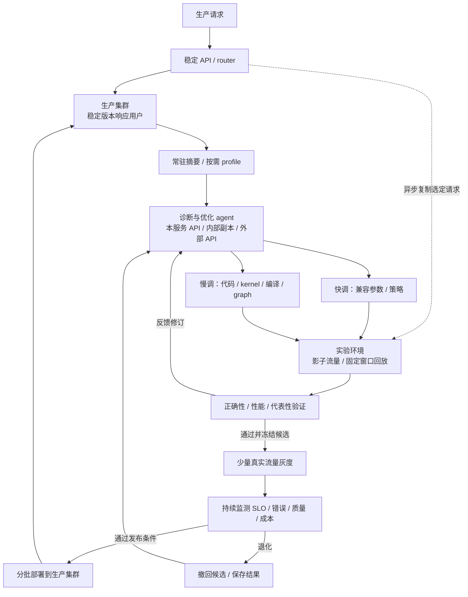
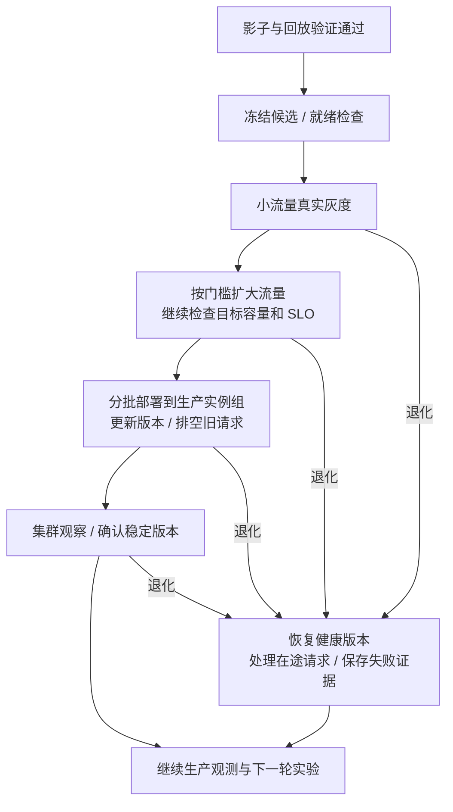

# 研究方案：生产流量驱动的 MaaS 影子实验与持续自优化

更新：2026-11-06。系统连接生产观测、影子流量实验、快调与慢调、灰度验证和生产集群部署。研究对象为运营方可修改和部署的 **SGLang 与 vLLM V1**，覆盖 P/D 混部和 P/D 分离服务。当前阶段为研究设计与固定版本源码审计，框架实现与 GPU 实验按 §8 推进。论文依据见 [文献调研](01_顶会论文调研.md)，实现依据见 [源码审计](evidence/source-audit-2026-11-03.json)。集群内 P/D 配比与角色调整作为独立问题，见 [PD 配比弹性调整构想](03_研究构想_MaaS集群PD配比弹性调整.md)。

## 1. 应用场景与研究目标

MaaS 运营方部署具备商业价值的大模型，持续接收真实业务请求。业务流量提供性能问题、输入分布和负载变化的观测来源。系统在生产服务旁配置实验资源，将选定请求复制为影子流量，agent 在实验环境中形成和修订优化候选，再依据验证结果推动灰度与集群部署。

研究目标是：**在有限实验资源和生产干扰预算下，利用生产观测安排快调与慢调，通过影子验证和灰度反馈自动决定候选发布，持续提高满足业务 SLO 的交付能力。**

| 系统能力 | 设计内容 | 评估证据 |
| --- | --- | --- |
| 低开销观测与诊断 | 常驻指标摘要，按需补采细粒度 profile，输出瓶颈假设和证据 | 开销、定位质量、诊断时延 |
| 生产流量驱动实验 | 实时影子流量与固定窗口回放，关联生产和候选版本 | 负载代表性、测量可重复性、候选排序可信度 |
| 快调与慢调 | 兼容参数/策略调整，以及代码、kernel、backend、graph 迭代 | 实验成本、首次有效优化时间、联合收益 |
| 自动验证与发布 | 正确性和性能门槛、灰度、持续监测、扩大部署与撤回 | 发布成功率、误发布、恢复损失、人工介入 |
| 完整成本下的业务收益 | 统一记录生产、实验和优化器资源，持续测量业务 SLO goodput | 累计交付、资源效率、成本回收时间 |

agent 可调用本服务、内部独立副本或外部 API。使用本服务时，源码、配置、硬件拓扑和性能记录在运营方控制域内处理，复用已有推理容量。优化请求单独标记并限制并发、token 和队列预算，业务压力升高时降低优化速率。数据流、模型能力、容量竞争和外部调用费用分别评估。

## 2. 生产服务与旁路实验架构

### 2.1 服务组件

稳定 API 入口持续接收业务请求，生产集群响应用户。镜像入口异步复制受选请求，实验环境完成候选执行并将结果交给评估器。控制面独立保存候选、实验与发布状态，连接诊断、资源调度和部署适配器。

| 组件 | 职责 | 记录内容 |
| --- | --- | --- |
| API 入口与 router | 接纳、鉴权、流式输出；镜像选样和灰度路由 | 请求 ID、负载类别、路由版本、后端绑定 |
| 生产集群 | 执行稳定版本，逐步接收验证后的候选版本 | 构建/配置版本、SLO、队列、KV 与设备状态 |
| 观测与诊断 | 汇总摘要、请求定向 profile、关联跨层瓶颈 | 观测窗口、证据、假设、采样成本 |
| 实验执行器与资源池 | 构建、启动、快调、慢调、回放和影子执行 | 资源拓扑、候选版本、输出、性能和失败结果 |
| 评估器与候选仓库 | 正确性对照、代表性分析、收益评估和版本冻结 | 工作负载、初始状态、测量波动、适用条件 |
| 发布控制器 | 灰度、监测、扩大部署、撤回和部署状态恢复 | 发布阶段、判定证据、生效回执、恢复版本 |

影子响应进入评估器，用户响应来自生产版本。灰度请求由候选真实响应用户。生产、影子、回放和优化器请求采用不同标记，业务交付统计仅计入业务请求。

### 2.2 混部、分离与实验资源

| 服务形态 | 实验环境 | 验证关注点 |
| --- | --- | --- |
| P/D 混部 | 完整候选实例执行 prefill、decode 和本地 KV 管理 | 共享调度、阶段竞争、显存、缓存和完整生成 |
| P/D 分离 | 候选执行组覆盖相关 P/D 角色、传输链路及依赖 | 两端配合、传输成本、端到端表现与版本兼容 |
| 多卡或跨节点并行 | 按所需 TP/PP/EP 及模型容量分配实验执行组 | 通信拓扑、并行语义和目标负载承载能力 |

“实验节点”是最小原型中的资源单位，完整架构使用可分配的实验资源池。模型可由一个节点承载时，一个生产节点加一个实验节点形成混部原型。PD 或跨节点并行候选按端到端执行组申请资源；单个组件微基准用于前期筛选，完整发布验证登记实际依赖和资源来源。

实验资源按候选阶段分配：局部筛选使用所需最小资源，完整验证复现目标执行关系，灰度使用已登记的生产兼容资源。资源不足时排队、缩小可验证的候选范围或等待预算，候选记录保存其已验证规模。预留、空闲和可抢占容量进入统一预算；中断后的实验恢复、重测与机会成本计入账本。

## 3. 持续观测与影子流量

### 3.1 观测与诊断

生产接入已有 profile 工具，长期收集轻量摘要，依据异常、诊断缺口和候选验证需要触发细粒度采样。观测关联请求、批次、实例、代码、配置和发布阶段。

| 观测层 | 主要信息 | 对应问题 |
| --- | --- | --- |
| 业务与路由 | 到达率、输入/输出长度、TTFT/ITL、队列、错误和取消 | 负载漂移、路由失衡、SLO 退化 |
| prefill/decode | chunk、token 预算、step 时间、活跃请求与 batch | 混部阶段竞争、分离两端供需与计算效率 |
| KV 与传输 | 分配/驱逐、prefix 命中、显存、在途量、收发等待 | 缓存压力、复用成本和通信瓶颈 |
| 执行路径 | kernel/graph、fallback、workspace、host 提交间隔 | 代码、算子与配置的优化位置 |

诊断输出为“现象 → 假设 → 支持证据 → 候选动作 → 验证指标”。证据不足时增加定向采样，证据充分时进入实验；稳定阶段降低采样频率。观测质量通过瓶颈注入和完整 trace 对照评估。

### 3.2 影子采样与负载代表性

镜像策略按模型、租户类别、输入/输出长度、prefix 复用和时间窗口分层选样，保存选样规则与丢弃统计。镜像发送采用独立队列和预算，实验阻塞时限流或丢弃镜像，记录缺失范围。原始请求的数据访问规则、日志保留与优化器 API 来源统一登记。

实验保留到达节奏、并发、取消与会话关系，并测量影子环境自己的排队、batch 和缓存热度。采样比例改变后重新确认目标压力的代表性；候选在目标负载下的容量通过回放和扩展影子验证测量。

实时影子观察当前负载下的行为，固定窗口回放用于可重复比较。基线与候选在登记的资源和初始状态下使用相同请求及到达计划；生产指标作为现场参照，配对实验承担收益归因。模型生成采用约定的采样、随机性与输出规则，候选输出长度、提前终止和取消差异单独记录。

## 4. 快调与慢调的联合实验

快调与慢调描述改动及执行成本；影子、灰度和正式部署描述验证与发布阶段。两类改动先在实验环境中验证，再按各自生效方式进入生产。

| 优化类型 | 实验行为 | 生产生效方式 |
| --- | --- | --- |
| 快调 | 在候选实例调整兼容的 chunk/token 预算、接纳、缓存与策略版本，短周期测量修订 | 在目标实例安全边界应用有版本动作，按实例组逐步扩大 |
| 慢调 | 修改调度、代码、kernel、backend、布局或 graph 配置，构建并重新启动预热 | 发布固定构建及配置，通过灰度与分批部署更新实例 |

动作空间包含 prefill/decode 调度、KV 保留与复用、执行路径、传输参数和路由策略。adapter 返回动作 owner、允许范围、兼容条件、版本和预期准备成本。涉及初始化、编译和状态重建的候选按慢调执行，已准备且兼容的策略按快调执行。实际动作以已审计消费点和新增实现为依据。[vLLM Scheduler][V2]、[SGLang Scheduler][S4]、[PrefillAdder][S5]

控制器根据瓶颈证据、负载预计持续时间、实验资源、准备成本和预期收益分配预算。快调可筛选有价值的配置区域，慢调改变实现后重新评估快调配置。两者共用候选和成本记录，通过仅快调、仅慢调及联合执行比较其价值。

生产快调通过 vLLM utility RPC、SGLang internal-state 路径和新增 adapter 执行，在 scheduler 或相关 worker 边界提交，记录 accepted、applied、settled 及首个采用批次。多 rank 动作协调相应执行组，降限影响后续接纳，活跃状态遵循既有引用合同。[EngineCore][V3]、[CoreClient][V4]、[SGLang HTTP][S1]、[InternalStateController][S2]

## 5. 候选验证与自动判定

候选记录保存源码/镜像哈希、配置、模型/tokenizer、硬件与并行拓扑、动作条件、负载窗口、初始缓存状态和实验结果。每次试验关联基线、候选和资源版本，失败结果进入后续搜索；验证期间的依赖变化触发适用性复核。

| 验证阶段 | 检查内容 | 阶段结果 |
| --- | --- | --- |
| 局部筛选 | 构建、单元语义、完整算子和相关组件性能 | 保留具有端到端潜力的候选 |
| 完整回放与影子 | 完整生成、数值/输出质量、目标压力、端到端 SLO、资源和误差范围 | 确认候选适用负载与灰度资格 |
| 生产灰度 | 用户实际体验、错误、质量、容量、依赖兼容和业务干扰 | 扩大份额、延长观察或撤回 |
| 集群发布后观察 | 多实例负载、缓存、尾延迟和收益持续性 | 接纳生产版本，继续下一轮观测 |

正确性检查固定权重、tokenizer、采样语义和输出要求，覆盖完整词表、数值误差、本地 KV 及适用的传输一致性。确定性与随机生成分别采用登记的比较规则。候选覆盖长短输入、长生成、取消和异常恢复，测量保留失败请求与结束积压。

发布规则预先登记正确性要求、SLO、错误率、质量、样本量、观察窗口和收益门槛。评估器依据证据决定补测、进入灰度、扩大部署或撤回；证据不足时保留稳定版本。人工处理进入可记录的例外流程，评估记录介入原因、次数和耗时。

初期以已有可运行模型建立基线。新模型与目标硬件的启动适配可作为前置任务：收集接口与算子兼容问题，构建功能基线并验证正确性，随后进入相同实验闭环。启动适配的实现范围和结果单独记录。

## 6. 灰度与生产集群部署

候选通过影子验证后冻结源码、配置和依赖，分配独立发布版本。生产部署适配器执行就绪检查、灰度、分批更新、生效确认、排空和撤回，调用所选集群的部署管理能力。

影子请求与业务灰度请求分别计量。灰度资源可由生产兼容实验资源划出，也可在生产中单独部署；承担业务的候选冻结版本，后续搜索使用其他空闲资源或等待本轮发布结束。实验环境继续承担研发验证，发布产物通过版本和部署记录进入集群。

router 保持已接纳请求的实例绑定、流式输出与取消路径，流量份额影响后续接纳。慢调发布等待旧请求、GPU 执行和相关资源引用结束；分离部署额外检查 P/D 版本、KV 格式、会话、预留与在途传输。[Gateway][S14]、[Mooncake][S12]、[兼容校验][S16]

同一部署组串行发布，控制指令携带操作 ID 和预期版本，控制器重启后核对路由、实例和在途状态恢复流程。稳定版本在登记的恢复窗口内保留，释放后的重建与预热计入恢复成本。候选故障时恢复后续请求到健康版本，已有请求的完成、取消、错误及重试结果单独记录。

## 7. 实验与成本评估

### 7.1 负载与交付指标

实验覆盖混部、PD 分离及可承载的多卡模型，按实际生产和实验资源登记预算。负载包含稳态、突发、阶段漂移、长输入/短输出、短输入/长输出和 prefix 复用。公共负载来源使用已核实的 Azure、BurstGPT 与 Mooncake trace，见 [文献与负载记录](evidence/web-verification.json)；业务环境补充运营方控制域内的真实影子流量。

主指标为全程累计满足 TTFT/ITL 或请求级 SLO 的业务完成量，分别报告请求数、输出 token 数和按总墙钟时间计算的 goodput。测量包括观测、实验、构建、预热、灰度、分批部署和恢复，记录拒绝、超时、错误、取消与结束积压。输出质量、尾延迟和租户公平性同时报告。

### 7.2 对照与机制证据

| 对照或消融 | 研究问题 |
| --- | --- |
| 原生自适应、充分调优静态配置、历史候选选择 | 持续实验相对已有运行方式的收益 |
| 规则、BO、同预算搜索与 agent | 诊断、候选生成和代码修订的价值 |
| 仅快调、仅慢调、联合安排 | 两类改动的预算分配与相互作用 |
| 固定回放、实时影子、两者联合 | 新鲜度、可重复性和生产收益预测 |
| 不同影子比例、采样策略、缓存和压力条件 | 低成本实验的代表性边界 |
| 固定发布规则、证据驱动自动发布、专家审查流程 | 自动化程度、误发布、人工时间与恢复成本 |
| 不同实验资源规模和预留/可抢占来源 | 优化速度、资源占用、实验中断和净收益 |
| 本服务 API、内部副本、外部 API | 保密、能力、费用及生产容量竞争 |

相关方法在共同动作和预算下比较。配置搜索与代码实验分别记录范围，Herschel 类机制用于生产诊断与受控实验对照，FlashVector 类机制用于持续触发、回放及 canary 对照；实现细节与比较范围随实验配置登记。

### 7.3 完整资源成本

成本账本记录生产、实验、优化器和发布期间的 GPU/CPU 时间、内存、网络、trace、构建、回放、预热、API 调用、人工及失败恢复。影子推理是额外工作，采样、重复试验和中断重跑分别计量。实验资源按实际数量与使用时长核算，比较固定预留、动态申请和相同资源直接用于业务扩容的收益。

资源配置实验同时报告最小可运行规模、目标拓扑代表性、候选并行数、等待与完成时间。灰度期间与发布后稳态分别测量，控制 batch、缓存和生产角色数量；实验与业务请求分开统计。机制证据包含诊断质量、影子/回放候选排序与生产收益的一致性、首次有效优化时间、发布成功率、人工介入及成本回收时间。

## 8. 实施路线

| 阶段 | 交付物 | 验收内容 |
| --- | --- | --- |
| 1. 观测与镜像基线 | SGLang 混部、固定模型、请求关联、镜像限流和评估器 | 生产不等待镜像、数据关联、采样缺失可追踪 |
| 2. 实验与候选仓库 | 快调 adapter、慢调构建、回放、正确性和性能工具 | 同条件比较、版本复现、完整候选验证 |
| 3. 灰度与集群发布 | 发布状态机、真实流量份额、分批部署、撤回与恢复 | 完整请求路径、SLO 检查和生效回执 |
| 4. 联合优化与自动判定 | agent/规则/BO、预算分配、补测和发布决策 | 联合收益、误发布与人工介入 |
| 5. 资源与服务形态扩展 | 多卡实验池、PD 端到端环境、vLLM adapter | 资源代表性、部署兼容与完整成本 |

各阶段产出可审查的框架补丁、实验及部署脚本、候选和结果记录。生产侧原地动作从已审计的调度预算和接纳消费点扩展，慢调从实际热点实现开始，能力分类与源码依据保留于附录 A。

## 9. 研究主张与特性对照

本研究提出生产观测驱动的 MaaS 持续优化闭环，研究**有限资源下快调与慢调的联合安排、影子证据对生产收益的预测，以及从候选到灰度和集群部署的自动判定**。生产形态、实验拓扑和部署方式作为验证条件，全部成本计入长期业务交付。

✓：原文明确覆盖；△：覆盖部分环节或相邻能力；—：原文未见该机制展开。Ours 为待实现和实验验证的设计目标；同类代表的机制范围分别核对。

| 相关工作类别与代表 | 生产观测驱动持续调优 | 按需低开销诊断 | runtime 策略原地更新 | 隔离资源配置/代码实验 | 快调与慢调联合安排 | 影子验证与灰度发布闭环 |
| --- | :---: | :---: | :---: | :---: | :---: | :---: |
| 配置搜索与适配：SCOOT、LaTune | △ | — | △ | ✓ | — | — |
| 在线参数调优：TuxBot 等 | ✓ | △ | ✓ | — | — | — |
| 在线策略演化：Autopoiesis | ✓ | △ | ✓ | — | — | — |
| 推荐服务栈优化：FlashVector | ✓ | △ | — | ✓ | △ | ✓ |
| MaaS 生产推理优化：Herschel | ✓ | ✓ | — | ✓ | △ | △ |
| PD 与动态调度：DistServe、Llumnix | △ | △ | △ | — | — | — |
| **Ours（设计目标）** | **✓** | **✓** | **✓** | **✓** | **✓** | **✓** |

快调与慢调联合安排指实验预算和执行方式的共同选择，以及实现变化后的配置复评。FlashVector 已同时优化配置与代码并持续触发，当前主张的增量通过两种速度的预算决策和自动发布效果建立。其 §5.4 明确描述隔离节点生产请求回放与 shadow-traffic canary；实时请求镜像的覆盖范围另行核对。Herschel 使用空闲或可抢占资源开展真实实验，专家审查后进入系统之外的 canary/rollout。表中“影子验证与灰度发布”按这些已展开的环节标注。

Autopoiesis 用近期 trace 和 simulator 评估演化策略，原地替换纯函数。TuxBot 类工作提供运行中参数控制，DistServe/Llumnix 提供部署、调度与状态管理基础。低开销 profiling、隔离实验和灰度发布均承接已有机制；本方案以联合决策、证据可信度、自动化程度和完整成本组织实验。具体版本与数字口径见 [文献调研](01_顶会论文调研.md) 第一部分 §1.4。

## 附录 A. 框架基础与源码定位

以下源码固定到 2026-11-03 的本地审计提交。现有能力为 adapter 和实验工具提供落点，动作版本、统一实验协议及发布控制按本文方案实现。

| 框架 | 固定提交 | 原生基础与实现落点 |
| --- | --- | --- |
| vLLM V1 | `45d0ac9ee197576aefd4e3f67ad98857b6c52697` | `max_num_scheduled_tokens`、`max_num_active_seqs`、utility RPC、KV manager 和 NIXL |
| SGLang | `f77064f635779601c7b20258ce45ded3fa00ac82` | scheduler/PrefillAdder、internal-state 允许列表、Model Gateway、Mooncake 与 PD 配置 |

vLLM 的 scheduler 预算与 runner 容量分别管理；SGLang 的 chunk 配置会复制到 scheduler，接纳能力与物理 pool 之间通过新增软上限解耦。原生 ratio tracker 等自适应机制保留在基线中。[vLLM 配置][V1]、[Scheduler][V2]、[SGLang Scheduler][S4]、[PrefillAdder][S5]、[Ratio tracker][S3]

KV 保留策略遵循活跃引用和可驱逐集合的生命周期。执行路径选择保持 backend、metadata 与 graph capture 的兼容关系，workspace、编译及预热成本进入候选评估。[vLLM KV][V5]、[Composite backend][V6]、[SGLang eviction][S6]、[Unified cache][S7]、[Backend setup][S8]

Mooncake 线程池和队列属于初始化资源；PD 预分配策略、cache、staging 和并行配置按固定版本支持矩阵组合。vLLM NIXL 的 backend、回读、租期和 D 侧保留分别由对应 scheduler/worker 消费，实验配置同时登记 owner 与作用范围。[Mooncake][S12]、[兼容校验][S16]、[vLLM KVTransferConfig][V7]、[NIXL worker][V8]、[Base scheduler][V9]、[Pull scheduler][V10]

| 范围 | vLLM | SGLang |
| --- | --- | --- |
| 调度与在线控制 | [SchedulerConfig][V1]、[Scheduler][V2]、[EngineCore][V3]、[CoreClient][V4] | [Schedule 配置][S9]、[Scheduler][S4]、[PrefillAdder][S5]、[HTTP][S1]、[InternalStateController][S2] |
| KV 与执行路径 | [KVCacheManager][V5]、[Composite attention][V6] | [Ratio tracker][S3]、[Eviction][S6]、[UnifiedRadixCache][S7]、[Backend setup][S8] |
| PD 与传输 | [KVTransferConfig][V7]、[NIXL worker][V8]、[Base scheduler][V9]、[Pull scheduler][V10]、[NIXL 文档][V11] | [Disagg 配置][S10]、[Decode][S11]、[Mooncake][S12]、[Pool configurator][S13]、[NIXL][S18] |
| 路由与编排 | connector 对应的外部路由与 adapter | [Gateway][S14]、[Role switch][S15]、[兼容校验][S16]、[PD 文档][S17]、[Tokenizer 控制][S19] |

[当前源码审计](evidence/source-audit-2026-11-03.json) 保存 Git blob、SHA-256、行号与能力分类；[字段清单](evidence/framework-parameter-inventory-2026-11-03.json) 保存所选配置类的字段口径。[原源码审计](evidence/source-audit-2026-11-01.json) 与 [原 PD 审计](evidence/pd-rdma-source-audit-2026-11-03.json) 保留为历史记录。

[V1]: https://github.com/vllm-project/vllm/blob/45d0ac9ee197576aefd4e3f67ad98857b6c52697/vllm/config/scheduler.py
[V2]: https://github.com/vllm-project/vllm/blob/45d0ac9ee197576aefd4e3f67ad98857b6c52697/vllm/v1/core/sched/scheduler.py
[V3]: https://github.com/vllm-project/vllm/blob/45d0ac9ee197576aefd4e3f67ad98857b6c52697/vllm/v1/engine/core.py
[V4]: https://github.com/vllm-project/vllm/blob/45d0ac9ee197576aefd4e3f67ad98857b6c52697/vllm/v1/engine/core_client.py
[V5]: https://github.com/vllm-project/vllm/blob/45d0ac9ee197576aefd4e3f67ad98857b6c52697/vllm/v1/core/kv_cache_manager.py
[V6]: https://github.com/vllm-project/vllm/blob/45d0ac9ee197576aefd4e3f67ad98857b6c52697/vllm/v1/attention/backends/composite.py
[S1]: https://github.com/sgl-project/sglang/blob/f77064f635779601c7b20258ce45ded3fa00ac82/python/sglang/srt/entrypoints/http_server.py
[S2]: https://github.com/sgl-project/sglang/blob/f77064f635779601c7b20258ce45ded3fa00ac82/python/sglang/srt/managers/scheduler_components/internal_state.py
[S3]: https://github.com/sgl-project/sglang/blob/f77064f635779601c7b20258ce45ded3fa00ac82/python/sglang/srt/managers/scheduler_components/new_token_ratio_tracker.py
[S4]: https://github.com/sgl-project/sglang/blob/f77064f635779601c7b20258ce45ded3fa00ac82/python/sglang/srt/managers/scheduler.py
[S5]: https://github.com/sgl-project/sglang/blob/f77064f635779601c7b20258ce45ded3fa00ac82/python/sglang/srt/managers/schedule_policy.py
[S6]: https://github.com/sgl-project/sglang/blob/f77064f635779601c7b20258ce45ded3fa00ac82/python/sglang/srt/mem_cache/evict_policy.py
[S7]: https://github.com/sgl-project/sglang/blob/f77064f635779601c7b20258ce45ded3fa00ac82/python/sglang/srt/mem_cache/unified_radix_cache.py
[S8]: https://github.com/sgl-project/sglang/blob/f77064f635779601c7b20258ce45ded3fa00ac82/python/sglang/srt/model_executor/model_runner_components/attention_backend_setup.py
[S9]: https://github.com/sgl-project/sglang/blob/f77064f635779601c7b20258ce45ded3fa00ac82/python/sglang/srt/arg_groups/fields/schedule.py
[S10]: https://github.com/sgl-project/sglang/blob/f77064f635779601c7b20258ce45ded3fa00ac82/python/sglang/srt/arg_groups/fields/disagg.py
[S11]: https://github.com/sgl-project/sglang/blob/f77064f635779601c7b20258ce45ded3fa00ac82/python/sglang/srt/disaggregation/decode.py
[S12]: https://github.com/sgl-project/sglang/blob/f77064f635779601c7b20258ce45ded3fa00ac82/python/sglang/srt/disaggregation/mooncake/conn.py
[S13]: https://github.com/sgl-project/sglang/blob/f77064f635779601c7b20258ce45ded3fa00ac82/python/sglang/srt/model_executor/pool_configurator.py
[S14]: https://github.com/sgl-project/sglang/blob/f77064f635779601c7b20258ce45ded3fa00ac82/sgl-model-gateway/README.md
[S15]: https://github.com/sgl-project/sglang/blob/f77064f635779601c7b20258ce45ded3fa00ac82/python/sglang/srt/disaggregation/role_switch.py
[S16]: https://github.com/sgl-project/sglang/blob/f77064f635779601c7b20258ce45ded3fa00ac82/python/sglang/srt/arg_groups/pd_disaggregation_hook.py
[S17]: https://github.com/sgl-project/sglang/blob/f77064f635779601c7b20258ce45ded3fa00ac82/docs/docs/advanced_features/pd_disaggregation.mdx
[V7]: https://github.com/vllm-project/vllm/blob/45d0ac9ee197576aefd4e3f67ad98857b6c52697/vllm/config/kv_transfer.py
[V8]: https://github.com/vllm-project/vllm/blob/45d0ac9ee197576aefd4e3f67ad98857b6c52697/vllm/distributed/kv_transfer/kv_connector/v1/nixl/base_worker.py
[V9]: https://github.com/vllm-project/vllm/blob/45d0ac9ee197576aefd4e3f67ad98857b6c52697/vllm/distributed/kv_transfer/kv_connector/v1/nixl/base_scheduler.py
[V10]: https://github.com/vllm-project/vllm/blob/45d0ac9ee197576aefd4e3f67ad98857b6c52697/vllm/distributed/kv_transfer/kv_connector/v1/nixl/pull_scheduler.py
[V11]: https://github.com/vllm-project/vllm/blob/45d0ac9ee197576aefd4e3f67ad98857b6c52697/docs/features/nixl_connector_usage.md
[S18]: https://github.com/sgl-project/sglang/blob/f77064f635779601c7b20258ce45ded3fa00ac82/python/sglang/srt/disaggregation/nixl/conn.py
[S19]: https://github.com/sgl-project/sglang/blob/f77064f635779601c7b20258ce45ded3fa00ac82/python/sglang/srt/managers/tokenizer_control_mixin.py
