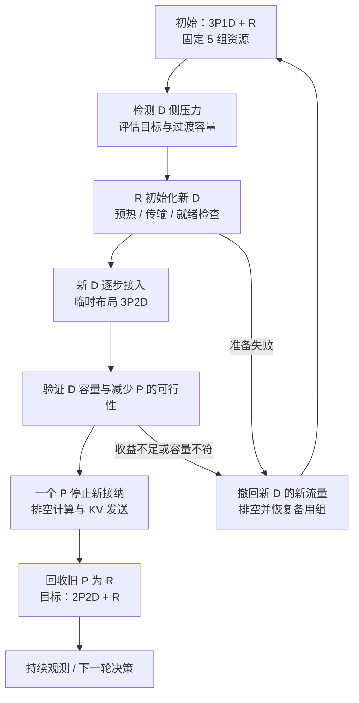

# 研究构想：MaaS 集群的 PD 配比弹性调整

更新：2026-11-06。本文研究固定集群资源内随业务负载变化调整 prefill/decode 容量的机制，使用备用执行组准备目标角色、逐步接入和排空源角色，形成可持续的配比转换。当前为独立初步构想，部署控制器、容量模型与实验尚待实现。MaaS 影子实验与持续自优化方案见 [主研究方案](02_研究方案_MaaS影子实验与持续自优化.md)。

## 1. 场景：同一模型服务中的业务构成变化

设定一个 MaaS 模型端点，同时承接文档理解、RAG、交互对话和长文本生成。场景设计包含三个连续阶段：

| 业务阶段 | 请求构成 | 待验证的容量压力 | 控制目标 |
| --- | --- | --- | --- |
| 文档处理阶段 | 长上下文请求占比高，输出较短 | prefill 排队与 TTFT 压力，decode 容量余量 | 在 SLO 约束下增加有效 P 容量 |
| 内容生成阶段 | 输入较短，生成长度和活跃会话增加 | decode 驻留、KV 容量与 ITL 压力 | 在 SLO 约束下增加有效 D 容量 |
| 混合或突发阶段 | 两类请求交替、突发或租户比例漂移 | 负载判断滞后、双端排队或链路瓶颈 | 选择维持、调整配比或采用已有接纳策略 |

上述关系作为实验假设，控制器依据实测计算、KV、链路与排队状态决定资源分配。相同输入/输出长度在不同 prefix 命中、模型、并行配置和硬件下产生的压力分别校准。

首个场景固定模型、权重、精度与可兼容的 P/D 协议，在同构资源池内改变角色数量。后续扩展模型规模、异构设备和多租户约束，并登记转换成本及适用范围。

## 2. 问题定义与资源单位

研究目标为：**在固定 GPU 预算和业务 SLO 下，联合选择目标 P/D 配比、转换时机、备用容量和转换顺序，使负载变化期间的累计业务交付最大化。**

执行组是能承载一个 P 或 D 角色的最小模型并行资源集合，可为单卡、多卡节点或跨节点组。每个候选计划登记设备数量、显存、TP/PP/EP、KV 格式和连接条件。P/D 配比同时报告角色数量与实际 GPU 分配；不同规模执行组通过校准后的容量比较。

| 决策 | 输入 | 输出 |
| --- | --- | --- |
| 目标配比 | 到达、长度分布、prefix 命中、SLO、两端容量与 KV/链路状态 | 各执行组的 P/D 目标角色和流量分配 |
| 转换时机 | 变化预计持续时间、排队、准备与排空时间、当前恢复能力 | 立即准备、延后或维持现状 |
| 备用容量 | 模型可运行规模、转换并发、恢复窗口、资源机会成本 | 预留组数、规格和使用顺序 |
| 转换路径 | 当前布局、目标布局、拓扑、存量请求和兼容条件 | 逐步准备、接入、缩减、排空及回收计划 |

主评估量为满足 TTFT/ITL 或请求级 SLO 的累计业务完成量，并报告 GPU 时间、尾延迟、转换等待、失败恢复及备用资源成本。期末积压、错误与未完成请求进入结果，稳态吞吐单独测量。

## 3. 用备用执行组桥接配比转换

### 3.1 固定五组资源的示例

以下为同规格且每组可承载单个角色的设计示例，`R` 表示备用执行组。生产初始为 `3P1D + R`，业务向长输出阶段变化后，目标为 `2P2D + R`。

1. 保留现有生产路径，在 R 上初始化新 D，完成权重、graph、KV pool 和传输准备。
2. 新 D 通过与生产 P 的端到端检查后，逐步接收新请求；集群暂时运行 `3P2D`，备用容量用于转换。
3. 控制器验证两个 D 的目标负载表现，选择一个 P 停止接收新请求，其余 P 承接后续 prefill。
4. 旧 P 完成已接纳计算、KV 发送及相关资源引用释放后退出角色。
5. 回收该执行组为 R，达到 `2P2D + R`，继续观测。

反向转换从 `2P2D + R` 准备新 P，短时达到 `3P2D`，随后选择一个 D 停止新接纳；该 D 完成已有生成、传输和输出后释放，恢复 `3P1D + R`。D 的长生成驻留会影响备用容量恢复时间，控制器按实际排空进度安排后续转换。

### 3.2 配比可行性与备用资源

固定三个同规格执行组时，`1P1D + R` 可以变为 `2P1D` 或 `1P2D`，此时三个组全部进入生产。若要保持一个 R，生产资源仍为两组，在两端各至少一组的前提下，生产配比仍为 `1P1D`。资源计划分别说明最终是否恢复备用容量、何时恢复以及恢复期间的能力。

一个备用组可以桥接上述一次单组转换。其适用条件是目标角色可在该组运行、其他生产资源能承担转换负载、源组能在允许时间内排空。并行转换、多卡角色、拓扑限制和较长恢复窗口决定是否需要更多备用资源。实验分别比较无备用、一组备用和更大备用池，测量变化响应与可用生产容量的权衡。

## 4. 容量诊断、计划与防抖

控制器持续观测 P 队列、prefill token 率、D 活跃请求、KV 压力、step 时间、收发等待和业务 SLO。模型校准不同长度、batch、prefix 热度及并行配置的有效容量，估计目标与过渡阶段能承载的到达过程。

配比决策同时检查计算与传输。增加 D 前评估 P 供给和 KV 链路，减少 P 前评估剩余 P 的 TTFT 及排队余量。router 份额与角色接纳策略配合更新，角色就绪和路由实际采用分别确认。

决策比较保持现状与转换后在预计时间窗内的业务完成量，将模型加载、编译/graph、预热、切流、存量请求排空、缓存损失和恢复成本放入同一预测。输入包含负载预计持续时间及估计误差，实验检验成本回收预测与实际结果的一致性。

控制器通过最小驻留时间、收益门槛、滞回区间与转换并发预算减少反复切换；新证据不足时保持当前布局，已经开始的转换按阶段继续、延后或撤回。初期采用可解释规则与容量模型，实现后比较预测式规划与其他决策方法。

## 5. 路由、KV 和转换生命周期

| 阶段 | 操作与状态 |
| --- | --- |
| 计划 | 登记源角色、目标角色、当前与目标容量、备用预算和恢复路径 |
| 准备 | 在备用组建立目标实例，核对模型、KV 格式、并行与连接配置 |
| 接入 | 完成真实 KV/生成验证，发布新路由版本，增加新请求份额 |
| 缩减 | 检查剩余容量，源角色退出新请求选择集合 |
| 排空 | 等待源角色的已分配请求、计算、传输、输出与相关引用完成 |
| 回收 | 释放会话与注册内存，回收执行组，更新备用池状态 |
| 监测与恢复 | 观察配比效果，记录故障、撤回和重新初始化成本 |

每个新请求记录 P/D 配对和路由版本，已进入预留、传输和生成的请求沿原路径完成。P 排空覆盖计算与发送，D 排空覆盖接收、生成、输出和 KV 占用。长请求超过等待预算时按预先登记的取消、超时或其他处置规则处理，并计入业务损失。

新实例建立独立传输会话和注册目标内存，旧连接与内存保留到引用释放。原型采用 prepare、activate、stop-admission、drain、release 接口，由 adapter 连接框架与 router。各操作带操作 ID、预期版本和回执，控制器保存事务阶段，重启后根据实例与传输事实恢复。

备用组被激活且源组尚未释放时，恢复能力依赖仍保留的源角色与当前容量；源角色释放后，反向转换需重新准备资源。失败在准备、接入、排空及回收阶段分别注入，测量恢复路径和暂时容量缺口。

## 6. 框架基础与实现范围

实现依据固定为 2026-11-03 的 [源码审计](evidence/source-audit-2026-11-03.json) 与 [PD 审计](evidence/pd-rdma-source-audit-2026-11-03.json)。SGLang 的 P/D 路由、连接与兼容校验，以及 vLLM NIXL 的 scheduler/worker 传输消费点为实现提供落点。[Gateway][S14]、[Mooncake][S12]、[兼容校验][S16]、[NIXL worker][V8]、[NIXL scheduler][V9]

角色选择、备用容量规划、版本回执、统一排空条件和转换恢复由本构想的控制器与 adapter 实现。原型允许释放后重启并加载目标角色，测量完整准备成本；预留权重、预热缓存和框架内角色切换作为后续可比较的加速机制。源码中已有 role-switch 路径按其固定版本适用条件核对。[Role switch][S15]

## 7. 实验设计

| 维度 | 实验内容 | 观察结果 |
| --- | --- | --- |
| 负载变化 | 长输入与长输出阶段切换、突发、短暂噪声和周期变化 | 配比收益、响应滞后、反复切换 |
| 集群资源 | 不同生产组数，固定总预算下 0/1/多备用组 | 可行转换范围与生产机会成本 |
| 角色准备 | 冷加载、已有镜像/编译缓存、预热状态 | 准备时间、GPU/内存占用、恢复时间 |
| 请求状态 | 长生成、不同 KV 热度、取消、传输延迟 | 排空等待、缓存损失、端到端影响 |
| 决策方法 | 最佳静态配比、DistServe 式重规划、Splitwise 式借用、FluidPD 式原地切换、成本感知规划 | 累计 SLO 交付与转换成本 |
| 机制消融 | 仅目标配比、加入准备成本、加入排空与备用计划、防抖 | 目标与完整路径联合决策的贡献 |
| 异常恢复 | 准备失败、激活失败、连接失效、控制器重启 | 错误、恢复时间、备用恢复和资源泄漏 |

对照在相同总 GPU 与网络条件下运行。报告全程累计 SLO 完成量、TTFT/ITL、P/D 利用、KV 压力、转换次数、各阶段时长、等待恢复备用容量的时间及 GPU 成本。最佳静态布局与预知阶段的计划作为稳态和规划参照，其信息条件分别注明。

实施先固定同模型同构配置，完成一次 `3P1D+R ↔ 2P2D+R` 的往返转换，再加入负载驱动决策、失败恢复和不同备用规模。资源受限时先验证较小布局的接入及排空机制，完整比例变化在可满足容量约束的规模上评估。

## 8. 研究问题与已有工作

本文研究固定总资源下 P/D 容量变化的执行路径，联合选择目标配比、转换时机、备用容量及恢复顺序。评估围绕负载变化全过程的累计 SLO 交付、暂时容量缺口和备用执行组恢复时间组织。

| 相关路线 | 已有工作展开的机制 | 本构想的对照与研究问题 |
| --- | --- | --- |
| 动态借用与角色转换：Splitwise、EPD、Arrow、FluidPD | 混合池、队列/SLO 驱动角色调整、运行实例切换；FluidPD 展开方向性排空与防抖 | 备用组先准备目标角色、再排空源角色，与原地排空后切换的适用条件和交付差异 |
| 布局与预测式配比：DistServe、Mooncake、DOPD | 并行/副本规划、显著变化后重新配置、需求预测和实例数控制 | 将目标布局与准备、接入、排空及恢复的实际路径联合规划 |
| 状态回收与准备：Llumnix、BlitzScale、HFX | 请求 KV 迁移、加载中参与服务、预初始化、D2D 权重传输与连接准备 | 长 D 请求的自然排空与主动迁移；备用组准备方式及恢复时机 |
| 阶段容量的替代组织：Libra、TaiChi、EcoServe、LoongServe、TokenScale | 请求切分、混合执行、时间维度分离、弹性序列并行、可转换 decoder | 固定角色与更细粒度工作分配在干扰、通信、准备成本上的差异 |

动态 P/D 配比、运行中角色转换和持续服务已有直接先例。当前构想以备用执行组桥接为具体路径，将原地转换作为兼容条件下的另一条对照路径，研究两者在权重/graph 准备差异、长生成驻留、跨机传输及变化持续时间下的选择。备用资源按占用时长与恢复时机计入固定总预算。

相关原文、发表身份、版本和机制对照见 [文献调研第二部分](01_顶会论文调研.md)，其中 EPD、Splitwise、DistServe 与 Libra 为优先顶会阅读，FluidPD 为直接相关预印本；[专项核对证据](evidence/pd-elasticity-literature-2026-11-06.json) 固定本次采用版本和定位。论文尚未实现的本构想机制与已有论文报告分别记录。

主方案研究代码/配置候选从影子实验进入生产，本文研究既定服务实现下 P/D 资源的重新分配。两者可共用观测、版本和路由 adapter，分别评估实验发布收益与容量重配置收益。

[S14]: https://github.com/sgl-project/sglang/blob/f77064f635779601c7b20258ce45ded3fa00ac82/sgl-model-gateway/README.md
[S12]: https://github.com/sgl-project/sglang/blob/f77064f635779601c7b20258ce45ded3fa00ac82/python/sglang/srt/disaggregation/mooncake/conn.py
[S16]: https://github.com/sgl-project/sglang/blob/f77064f635779601c7b20258ce45ded3fa00ac82/python/sglang/srt/arg_groups/pd_disaggregation_hook.py
[V8]: https://github.com/vllm-project/vllm/blob/45d0ac9ee197576aefd4e3f67ad98857b6c52697/vllm/distributed/kv_transfer/kv_connector/v1/nixl/base_worker.py
[V9]: https://github.com/vllm-project/vllm/blob/45d0ac9ee197576aefd4e3f67ad98857b6c52697/vllm/distributed/kv_transfer/kv_connector/v1/nixl/base_scheduler.py
[S15]: https://github.com/sgl-project/sglang/blob/f77064f635779601c7b20258ce45ded3fa00ac82/python/sglang/srt/disaggregation/role_switch.py
