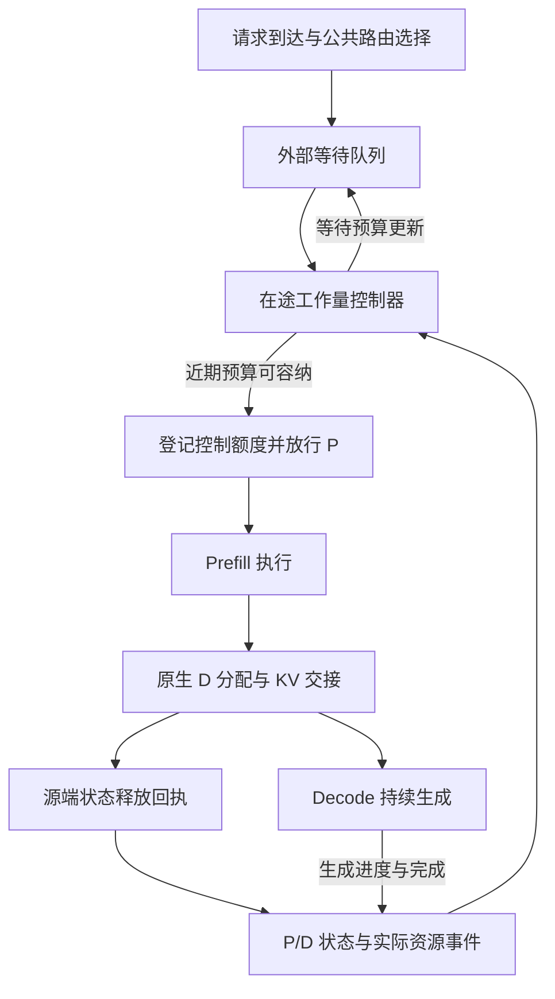

# 研究方案：PD 分离下的 SLO 感知在途工作量控制

更新：2026-11-15。研究聚焦固定 P/D 布局中的在线接纳：根据下游近期承载能力决定新请求何时进入 prefill，并跟踪请求从计算、KV 交接到 decode 的资源占用。当前阶段为文献与源码核对，原型和收益评价列入实施计划。相关机制与版本见 [文献调研第四部分](01_顶会论文调研.md#第四部分固定布局-pd-联合路由接纳与长尾控制)，本次聚焦依据见 [证据记录](evidence/pd-wip-focus-2026-11-15.json)。

## 1. 一个研究问题

**在输出长度未知、请求动态到达的 PD 服务中，如何依据 D 的近期承载能力放行 prefill，控制跨阶段在途工作量，使 KV 驻留、资源阻塞与重算减少，并提高固定资源下的累计 SLO 合格交付？**

这里的在途工作量包括已经放行、正在 P 计算、等待或执行 KV 交接，以及已进入 D 的请求。控制器观察请求所处阶段、实际资源占用和近期服务速度，在请求进入昂贵计算之前决定放行时刻，并根据完成与释放事件更新预算。

主指标为固定发送窗口内同时满足请求级 TTFT、输出间隔目标并完整交付的请求数与速率。p50 体验、p95/p99 延迟、拒绝率、积压和各类请求的交付分别报告。模型、总 GPU、P/D 配比、采样语义和局部执行配置在对照间一致。

本研究选择这一问题，是因为它连接了请求级 SLO 与跨引擎实际资源生命周期，具有明确的控制动作、可测量的损失和生产框架落点。预期收益来自减少已物化 KV 引起的阻塞、无效重算与阶段空档。假设需要在经过调优的原生 PD 路径上检验。

## 2. 系统现象与收益来源

### 2.1 从请求排队到 KV 驻留

请求在外部等待时主要占用控制元数据；进入 P 后会产生需要保存和交接的模型状态。当 P 完成速度与 D 的接纳速度短时不匹配时，待交接请求可能继续占用 P 的不可回收资源。若 D 提前分配空间，对应请求仍在 P 排队，这部分容量也可能等待较长时间才进入有效使用。

两端各自的队列长度只能描述部分状态。一个队列元素可能代表尚未计算的短请求，也可能代表占据大量源端状态、等待交接的长上下文请求。控制器需要同时看到请求阶段、状态大小、预计就绪时刻和资源释放进度。

在本次核对的 SGLang commit `f0820d5138c666f6ae67da799eb9fcf68ef6a42e` 中，P 侧传输队列在成功事件后释放请求；特定 bootstrap 资源冲突路径会释放并重新排队。源码同时具有 `prefill_complete` 延迟 D 分配和 gateway 固定并发门控。上述路径为问题提供实现落点，其触发频率和性能影响由实验测量。[固定版本证据](evidence/pd-wip-focus-2026-11-15.json)

### 2.2 工作量超前造成的损失

| 状态 | 需要观测的现象 | 控制目标 |
| --- | --- | --- |
| P 已完成、D 尚未接纳 | 不可回收 KV 驻留、slot 或 metadata 占用、后续 prefill 阻塞 | 根据近期可交接能力限制新的物化工作 |
| D 已分配、P 尚未就绪 | D 空间提前占用、可运行请求接纳受限 | 将接纳准备与请求预计就绪时刻对齐 |
| 资源冲突后重新执行 | 释放重排、重新 prefill、KV 重传 | 降低预测与实际资源兑现之间的失配 |
| 限流过于保守 | D 等待输入、P 空闲而服务仍有余量 | 保留足够的在途工作以覆盖计算和传输时延 |

研究同时记录外部等待、P 排队、交接等待与 D 执行。只有等待位置发生变化时，结果体现为延迟重新分配；资源阻塞、重算或空档减少并带来净交付改善时，结果体现为有效服务能力的提升。

### 2.3 可检验的因果链

预期机制为：短时超前的 prefill 产生较多在途 KV → 占用 P/D 交接资源 → 阻塞本可推进的工作或触发重算 → 降低合格交付。实验通过保持到达、路由和执行配置一致，仅改变放行策略，检验各环节的变化。

首轮先确认目标栈中是否存在上述损失，再测量控制能够消除的比例。对于主要由 D 必要计算决定的排队区间，单独报告容量约束及控制开销。

## 3. 已有工作与研究位置

| 工作或实现 | 已覆盖机制 | 本研究的对照关系 |
| --- | --- | --- |
| [TetriInfer，固定作者 v1](papers/51_TetriInfer_arxiv_v1.pdf) §3.3–3.4 | 输出长度预测、资源感知 D 选择、reserve-static / reserve-dynamic 局部接纳 | 预测未来资源与预留作为已有基础；比较跨阶段放行与源端驻留控制 |
| [Evolving Infra v2](papers/40_EvolvingInfra_arxiv_v2.pdf) Appendix D.1/E.3 | P 开始时选择 D；计入尚未回报的已派发请求 | P-start binding 与在途账本基线 |
| [MAPS，ICML 2026](papers/45_MAPS_ICML2026.pdf) §3 | 校准输出上界、D free/reserved KV、原子预留 | 相同预测信息下的 D 内存接纳基线，局部排序单独控制 |
| [DMRS v1](papers/48_DMRS_arxiv_v1.pdf) §2、Appendix H.2 | P 已完成 KV 驻留与 D 接纳的双内存模型、离线调度 | 对照在线到达、未知输出、真实交接耗时和 SLO 目标 |
| [Mooncake，FAST 2025](papers/22_Mooncake_FAST2025.pdf) §4 | cache/load/SLO 路由及接纳 | 复用或移植为固定路由基线 |
| [SGLang 固定版本](evidence/pd-wip-focus-2026-11-15.json) | 固定 D 派发并发门控、延迟 D 分配、源端释放和重排 | 调优后作为实际工程基线，逐项登记支持的模型和 transport |

已有工作提供资源预测、绑定时机、内存接纳和背压组件。本研究聚焦这些组件之间的在线闭环：**由实际 KV 生命周期约束尚未进入 prefill 的工作，使放行量随下游接纳能力和交接进度变化。** 评价同时覆盖上游驻留、下游有效服务和端到端 SLO。

预测器采用固定的离线 profile 与已有长度估计方法，传输采用目标栈原生路径。原来的绑定时机方案作为基线变量；接收端干扰与预测误差作为成本和扰动因素进入同一个问题的评价。

## 4. 控制模型与资源口径

### 4.1 控制边界

固定服务模型、权重、精度、P/D 角色、并行拓扑、KV 格式、局部 scheduler 与 graph 执行。主执行器位于 router/dispatcher 与 P 的接纳边界，决定请求的放行时刻及所需的控制额度。

首版采用共同的 P/D 选择规则和外部队列次序。控制策略在同一候选请求上进行放行或等待判定；请求级路由算法与局部排序保持为公共基线能力。每个 P 的入口分别设门，避免单个目标 D 的等待阻塞无关 P 路径。对队首阻塞的处理采用预先固定的相同规则。

客户端声明的输出上限和 SLO 类别属于可观测输入。真实剩余输出长度通过在线进度和固定估计方法处理；完整未来长度与到达仅用于离线诊断。

### 4.2 两类预算与物理资源

控制器使用两类预算：**内存占用预算**表示在途状态对 P/D 可接纳空间的影响，**时间窗口内的工作预算**表示近期可以完成的计算和交接量。相同请求数在不同长度分布下对应不同预算消耗。

| 账本 | 内容 | 释放或更新依据 |
| --- | --- | --- |
| 外部待放行 | prompt、SLO、目标路径、预计工作量 | 请求放行、取消或超时 |
| 已放行待执行 | 尚未反映到 P 状态的请求及预计就绪时刻 | P 接纳与执行事件 |
| P 侧实际占用 | 执行中和已完成待交接的不可回收状态 | 原生 allocator/refcount 的释放或可驱逐状态变化 |
| D 侧待兑现额度 | 已许可但尚未实际分配的预算 | 分配确认、许可失效或取消 |
| D 侧实际占用与增长 | 已分配 block、在途接收、活跃 decode 的状态增长 | 分配、传输、生成与完成事件 |

软件预算表示控制器的接纳判断；物理分配以引擎回执为准。软额度兑现为实际占用时在同一账本事务中转换，避免重复扣除。共享 prefix block 按实际引用与唯一物理块统计；可驱逐缓存、不可回收状态与未兑现额度分别记录。hybrid 模型按实际状态类型与 layout 计算内存需求。

### 4.3 核心观测量

P 侧待交接占用记为 \(B_P^{wait}(t)\)，表示在时刻 \(t\) 因交接引用而仍不可回收的实际字节数。其时间积分

\[
A_P=\int_{t_0}^{t_1}B_P^{wait}(t)\,dt
\]

刻画等待交接所占用的 byte-seconds。D 的提前分配占用采用对应的 \(A_D\)。两项与阻塞、重算、首 token、输出停顿共同分析。

控制器还记录最老待交接请求的年龄、P 因资源受限暂停的时间、D 缺少可运行输入的时间、在途请求预计完成时间，以及状态采样年龄。资源驻留下降和 SLO 改善之间的关系通过消融与事件关联确认。

## 5. 在线在途工作量控制

### 5.1 从放行到交接完成

计算与 KV 传输的并行关系沿用目标 connector。图中节点表示控制与生命周期依赖；逐层/分块传输可以在 prefill 完全结束前发生。

### 5.2 有界窗口内的放行判断

控制窗口覆盖近期 prefill 与传输时延，长度依据固定 profile 和运行观测校准。对待放行请求，控制器估计其在窗口内的 P 占用、就绪时刻、交接消耗及 D 增长需求，与已放行工作和实际活跃状态合并。

放行判断同时满足以下条件：

1. P 的在途字节预算能够容纳预计新增占用，并保留执行所需空间。
2. 预计就绪区间内，D 的内存和服务预算能够容纳新增请求及已有请求的继续生成。
3. 请求的 TTFT 余量和已有 decode 的输出间隔风险处于预定接纳范围。

控制预算由近期完成速率、占用趋势和预测误差余量更新，设置上下界、变化幅度和最小进展额度。固定 watermark、固定请求数上限和调优后的固定字节预算采用相同观测作为对照。复杂模型的价值由相对这些简单控制的净收益确定。

### 5.3 兑现、释放与失配处理

放行额度具有 request ID、版本、目标路径、有效期和预计字节量。请求进入执行阶段后，预算依据实际占用更新；到期事件只撤销尚未启动的控制额度。已进入计算或传输的资源保留到原生安全释放事件。

D 的物理分配按目标引擎协议重新检查。资源不足时，后续放行量随实际压力下调，已有请求通过原生等待或恢复路径推进。源端释放、D 分配和完成回执采用幂等事件，取消与失败后的资源归属可由日志核对。

这一协议将预测与资源兑现分开：预测决定何时产生新的在途工作，实际事件决定当前占用和下一轮预算。

### 5.4 低开销与稳定性

正常运行使用聚合计数和请求阶段事件；逐步 trace 用于选定的诊断窗口。控制器维护增量账本，按资源事件触发更新，周期采样用于校准和漏报对账。状态过期时切换到经过调优的固定预算。

通过预算变化限幅、回滞和最小进展额度控制振荡。各请求类别记录等待、放行与完成，队列规则中的 aging 参数在候选比较前冻结。

## 6. 实验与判断依据

### 6.1 首个机会实验

以 1P2D 为起点，开启真实 KV 传输、连续组批与生产 graph 配置。先标定原生容量，再扫描轻载、接近 SLO 容量和短时过载。到达序列与请求大小来自真实 trace；受控突发用于机制归因。

首个实验同时测量 \(A_P\)、\(A_D\)、P 阻塞、D 缺输入、重算/重传、外部等待和联合 SLO 交付。比较原生路径、最佳固定门控与固定字节预算。由此判断在途超前是否造成可减少的执行损失，以及动态控制具有多少空间。

功能验证采用较小模型或已确认支持的 KV 类型；正式评价使用目标模型与并行布局。若采用当前 Qwen hybrid 模型，先核对状态传输和延迟分配路径的兼容性。本次 SGLang 固定版本的 `prefill_complete` 检查限定于 full-attention/DSA 状态，目标部署能力由实际选用版本确认。

### 6.2 强基线与机制消融

| 对照 | 目的 |
| --- | --- |
| 调优后的原生 PD、固定路由与接纳配置 | 确定实际工程基线 |
| SGLang-style 固定派发门控及目标栈支持的延迟分配 | 评价已有背压与分配时机的效果 |
| 固定请求数、固定在途字节数、固定占用 watermark，分别充分调优 | 评价复杂控制相对简单额度控制的收益 |
| Evolving Infra-style P-start binding＋在途记账 | 隔离延迟绑定与状态补记效果 |
| MAPS / TetriInfer-style D 资源接纳，相同长度信息与局部队列规则 | 比较只控制下游接纳与控制前端物化工作的区别 |
| 本文完整控制及去掉源端驻留、去掉预计就绪时刻、固定预算三个消融 | 确定各项状态与动态更新的作用 |

相同 transport、KV 存储层级和内存预算构成一组主对照。目标栈已有 host staging 或卸载能力时，将其作为单独对照组，计算全部内存、复制和带宽成本。其后的多 P、多 D 评价考察并发放行与共享链路。

### 6.3 负载与指标

开放回放使用 Mooncake conversation/toolagent 的固定时间段、长度与 prefix 信息，重建输入标为确定性重建。AgentX 作为闭环扩展，固定会话、依赖、工具等待与并发条件，保留 end-to-start 和 spawn/join；后续请求随前序完成触发。[来源记录](evidence/pd-slo-routing-research-2026-11-15.json)

开发、验证和留出数据按时间划分，独立重复并交叉执行顺序。SLO、预测方法、缓存初始化和准入规则在候选比较前冻结。业务指标包含发送窗口内 goodput、到达 cohort 最终达标率、任务完成时间、拒绝、超时、积压和排空。

客户端第一 token 的转发语义在基线间一致。实际 token ITL、流式 chunk gap 和平均 TPOT 分别统计；同时记录交接后第一次输出停顿。各段事件保存时钟来源与跨机误差。

### 6.4 成立条件

研究主张由一条完整证据链支持：强基线存在可归因的在途资源损失；控制器减少相应驻留、阻塞、重算或空档；相同资源与负载下净 SLO 交付改善；改善在留出流量、预测误差和状态滞后下保持。

将等待提前到外部队列的效果单独报告。若源端驻留降低而合格交付相同，结论限定为资源占用改善；若控制成本超过收益，结果用于确定该机制的适用范围。

## 7. 实施安排与预期成果

1. **能力与观测核对。** 固定引擎、模型、connector 和 graph 配置，建立放行、分配、传输与释放事件口径，确认目标栈的已有门控。
2. **机会与简单基线。** 在 1P2D 上完成容量标定、资源损失归因及固定预算搜索，形成第一张 motivation 图。
3. **单一控制器。** 实现增量账本、预计就绪窗口、动态放行预算和实际事件结算，复用原生执行与恢复路径。
4. **同条件评价。** 完成强基线、机制消融、真实动态负载、误差与故障扰动，以及完整成本测量。
5. **规模与适用范围。** 扩展多 P/D 和跨机配置，评价并发放行、共享资源及不同 KV 路径。

预期成果是一套连接请求 SLO 与跨阶段 KV 生命周期的在线在途工作量控制机制，以及其收益来源、控制稳定性和适用范围的实证结果。

[03](03_研究构想_MaaS集群PD配比弹性调整.md) 的配比变化、[04](04_研究方案_参数化调度器的表达能力与在线优化.md) 的局部 scheduler 与 [02](02_研究方案_MaaS影子实验与持续自优化.md) 的优化发布流程分别保留其研究范围；本文在固定布局与固定执行机制下评价放行控制。
