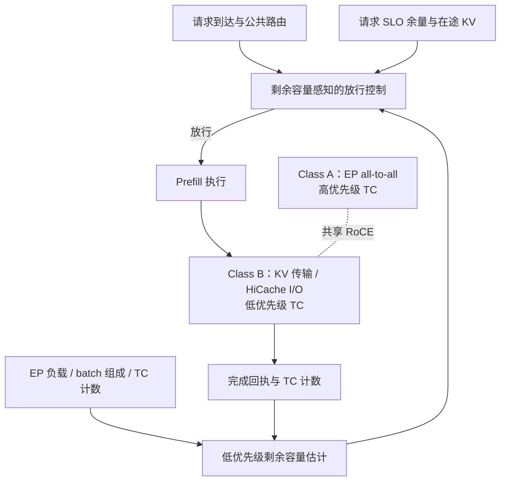

# 研究方案：PD 分离下跨机 EP 通信与 KV 传输的 RDMA 协同

更新：2026-11-17。研究场景为 **MLA 架构 MoE 模型**的 P/D 分离服务：P 与 D 均可开启**跨机专家并行（EP）**，跨机 EP all-to-all 与 P→D KV 传输、HiCache 分层 I/O 共享同一 **RoCE** fabric。DualPath 已识别 KV 流量对 EP AllToAll 的干扰，并以静态硬件优先级隔离保护模型执行通信。本方案研究这一隔离在 AMD RoCE 栈上的实际效果，以及隔离之后低优先级 KV 流量剩余容量与请求放行、交接和逐 token SLO 的协同。当前处于文献与源码核对阶段，原型与 GPU 实验列入实施计划。本方案的硬件前提是 **AMD ROCm 栈**（`mori` EP 后端、RoCE 互联），与其余方向使用的 NVIDIA 路径审计分属不同 scope。证据见 [初始记录](evidence/ep-kv-rdma-coscheduling-2026-11-17.json) 与 [全文复核记录](evidence/ep-kv-rdma-fulltext-review-2026-11-17.json)，文献见 [文献调研第五部分](01_顶会论文调研.md#第五部分跨机-ep-通信与-kv-传输的-rdma-协同)。

其余方向分别见 [MaaS 影子实验方案](02_研究方案_MaaS影子实验与持续自优化.md)、[PD 配比弹性构想](03_研究构想_MaaS集群PD配比弹性调整.md)、[参数化调度器方案](04_研究方案_参数化调度器的表达能力与在线优化.md) 与 [PD 在途工作量控制](05_研究方案_PD分离下的SLO感知在途工作量控制.md)。本方案与 05 共享 PD 分离与放行控制的观测口径，研究对象是共享 RDMA fabric 上两类流量的隔离与协同。

## 1. 一个研究问题

**在 MLA MoE 的 PD 分离服务中，当 P、D 开启跨机 EP 时，延迟关键的 EP all-to-all 与批量 KV 传输共享 RoCE fabric。硬件优先级隔离（DSCP→TC、开启 PFC 的无损队列、按权重分配带宽）在 AMD RoCE 栈上能消除多少干扰？隔离后，KV 流量只能使用 EP 通信剩下的带宽，而剩余带宽随 batch 组成、EP 度和突发变化。serving 调度器如何依据这一剩余容量安排 prefill 放行、KV 交接与预取，在保护 ITL 的同时避免 TTFT、交接等待和接纳延迟恶化，提高固定资源下的联合 SLO 合格交付？**

Class A 是 P 与 D 每层一次的 EP dispatch/combine，其中 decode 侧逐 token 发生，延迟最关键。Class B 是 P→D 的 KV 页传输与 HiCache 分层 I/O。硬件隔离保护 Class A，Class B 的代价转移到交接与首 token 上。控制器的作用时间尺度为调度步与请求放行，不在亚毫秒级突发之间插入流量。

主指标为固定发送窗口内同时满足 TTFT 与逐 token 输出间隔目标并完整交付的请求数与速率。ITL p95/p99、TTFT、KV 交接等待、接纳延迟和 Class B 吞吐分别报告。模型、总 GPU、P/D 配比、EP 度、采样语义和 KV transport 在对照间一致。

## 2. 系统现象与收益来源

### 2.1 已识别的干扰与已有隔离

DualPath（arXiv v2）§4 明确指出，额外的 KV-Cache 传输会干扰 EP AllToAll、TP/CP ReduceScatter/AllGather 等延迟敏感的集合通信（PDF 第 6 页）。§5 认为这些集合通信是亚毫秒级突发，依靠软件 traffic shaper 在高优先级窗口之间插入低优先级 I/O 不可行，因此把 GPU 进出流量统一经计算网卡，借助网络原生 QoS 隔离（PDF 第 6–7 页）。§5.1 在 InfiniBand 上把模型推理流量映射到高优先级 VL，把包括 KV 传输在内的其他流量映射到低优先级 VL，以 WRR 将约 99% 带宽留给高优先级 VL（PDF 第 7 页）。附录 A.1 给出 RoCE 的对应配置：DSCP 映射到硬件 TC，四个开启 PFC 的无损 RDMA TC，按权重分配带宽（PDF 第 16 页）。

DualPath 的实验在 InfiniBand、每节点 8 张 Hopper GPU 的集群上进行（§7，PDF 第 9 页）；§7.5 消融拆分 layerwise prefill、dual-path loading 与调度算法（PDF 第 11 页），本次复核未见流量隔离的有无对照或干扰幅度测量。RoCE 配置为文中描述的设计，没有对应评测。DualPath 也在每个 PE/DE 上分配少量 DRAM 作为 KV 缓冲（PDF 第 5 页）。

### 2.2 隔离之后仍需回答的问题

| 现象 | 需要观测的量 | 研究目标 |
| --- | --- | --- |
| RoCE 无损 TC 之间的残余耦合 | 各 TC 的 PFC pause、交换机/网卡共享缓冲占用、Class A 延迟分布 | 测量硬件隔离在 AMD RoCE 栈上的有效范围 |
| 网络 QoS 不覆盖的路径 | 同一 GPU 的 PCIe/主机路径争用、EP 与 KV 是否经同一网卡 | 定位网络 TC 之外的耦合点 |
| Class B 只能使用剩余带宽 | 剩余带宽随 batch 组成、EP 度的变化，KV 交接等待、TTFT | 将剩余容量纳入放行与交接决策 |
| 静态权重与负载不匹配 | 固定权重下 Class B 饥饿或 Class A 保护过度 | 评估权重或放行预算随负载调整的收益 |
| MLA 的小消息 | 压缩 KV 的消息数、多 P 到同一 D 的 incast | 区分字节预算与消息速率约束 |

DualPath 依据亚毫秒突发否定了软件错峰，本方案沿用该判断，把控制放在调度步与请求放行层面，并把亚毫秒错峰列为需要实测的可行性对照。

### 2.3 可检验的因果链

预期机制为：硬件隔离保护 Class A → Class B 只能获得随 EP 负载变化的剩余带宽 → 交接等待与源端 KV 驻留随之波动 → TTFT 与接纳延迟恶化或 P 侧阻塞（与 05 的在途工作量相互作用）→ 联合 SLO 交付下降。实验先测量隔离前后 Class A 的干扰幅度，再在隔离开启时检验剩余容量感知的放行能否减少 Class B 侧损失。只改变等待位置与真正减少停顿、阻塞或重算分别报告。

## 3. 已有工作与研究位置

| 工作 | 已覆盖机制 | 本方案的对照关系 |
| --- | --- | --- |
| [DualPath](papers/57_DualPath_arxiv_v2.pdf)（arXiv v2） | KV 传输干扰 EP AllToAll；IB VL 优先级隔离，RoCE TC/DSCP 配置；DRAM 缓冲；否定亚毫秒软件错峰 | 隔离机制作为直接基线；测量其在 AMD RoCE 上的残余耦合，研究隔离后的剩余容量协同 |
| [ExpertPlex](papers/56_ExpertPlex_arxiv_v2.pdf)（arXiv v2） | 跨阶段共享专家，两阶段激活流量在共享网络上互相干扰；one-sided、attention 发起的 MoE 通信尽量使用不相交路径 | 不同部署结构的干扰来源；本方案保持标准 PD 分离与 P→D KV 传输 |
| [MegaScale-Infer](papers/55_MegaScaleInfer_arxiv_v4.pdf)（arXiv v4） | attention/FFN 分离、ping-pong 流水、M2N 通信库 | 激活通信的效率机制，不处理 KV 与 EP 共存 |
| [TraCT](papers/58_TraCT_arxiv_v1.pdf)（arXiv v1） | 指出 RDMA KV 传输对网络拥塞敏感，以 CXL 共享内存取代 RDMA 路径 | 硬件路径替代；本方案保持 RoCE |
| [Topology-Aware Data Movement](papers/59_TopologyAware_arxiv_v2.pdf)（arXiv v2） | 按互联层级选择传输方式，联合考虑专家分派与 KV 局部性的放置 | 分析模型与投影结果；本方案需要真机测量 |
| [NetKV](papers/43_NetKV_arxiv_v1.pdf)（arXiv v1） | 拓扑距离与动态拥塞驱动 D 选择 | 仿真评价；作为固定路由基线 |
| [CASSINI](papers/53_CASSINI_NSDI2024.pdf)（NSDI 2024）、[MLCC](papers/54_MLCC_arxiv_v2.pdf)（MLTCP 发表于 HotNets 2024）、Crux（SIGCOMM 2024） | 训练作业依据迭代级通信相位做时间错位、拥塞控制调速或通信调度 | 训练侧方法先例；推理 decode 的通信周期更短、随 batch 变化，竞争流量与接纳绑定 |
| [Lina](papers/52_Lina_ATC2023.pdf)（ATC 2023） | 训练中 all-to-all 优先于并发 allreduce | 同一作业内两类集合通信的优先级先例 |
| DeepEP（代码库） | EP all-to-all kernel；建议 EP 流量使用独立虚拟通道，不配置 fabric 拥塞控制 | 静态隔离指引 |

KV 与 EP 通信的干扰及静态优先级隔离已有直接工作。本方案的研究位置为：AMD RoCE 无损 TC 下隔离效果的实测；隔离之后 KV 剩余容量与请求放行、交接、TTFT 的协同；静态权重与负载感知调整的比较；MLA 小消息与跨机 decode EP 负载下的适用范围。Crux 的发表身份来自 SIGCOMM 2024 官方日程页，本地未归档 PDF。

## 4. 控制模型与资源口径

### 4.1 控制边界

固定服务模型（MLA MoE）、权重、精度、P/D 角色、EP 度、并行拓扑、KV transport 与局部 scheduler。网络 QoS 配置（DSCP/TC 映射、PFC、TC 权重）作为实验变量登记。控制器位于请求放行与 KV 传输/HiCache 子系统的提交边界，依据 Class A 负载、剩余容量估计和请求 SLO 余量，决定放行时刻、KV 传输与预取的提交顺序及并发；EP kernel 与 transport 内部实现保持不变。

请求级路由、D 选择与局部排序保持为公共基线能力。NetKV 式网络感知 D 选择可作为固定路由基线。

### 4.2 流量类与预算

| 流量类 | 时序特征 | 预算与释放依据 |
| --- | --- | --- |
| Class A：decode EP all-to-all | 每层每步同步突发，延迟关键 | 高优先级 TC，不受控 |
| Class A′：prefill EP all-to-all | 每层一次，影响 TTFT | 高优先级 TC，与 decode 共享 |
| Class B1：P→D KV 传输 | prefill 完成或分层触发；MLA 下为较多小消息 | 低优先级 TC；提交并发按剩余容量估计授予，完成回执释放 |
| Class B2：HiCache 预取/回写 | 批量，可延迟、可取消 | 低优先级 TC；与 B1 共享剩余容量预算 |

**剩余容量预算**是本方案相对 05 新增的账本：估计每个控制窗口内低优先级 TC 可获得的带宽与消息速率，由 Class A 负载、TC 权重和实测完成速率更新。05 的内存占用预算与时间窗工作预算继续适用，三者共同决定 prefill 放行。

### 4.3 核心观测量

分别记录 Class A 的单次 all-to-all 时延分布与 decode step 时间、各 TC 的 PFC pause 与丢包、D 侧接收队列、KV 交接等待、TTFT、ITL 尾部、Class B 实际吞吐、DRAM 缓冲占用。隔离前后、静态权重与动态控制下的变化通过事件关联与消融确认。

## 5. 机制与对照阶梯

机制按以下阶梯比较：

1. **无隔离**：Class A 与 Class B 共用同一 TC，确定干扰上界。
2. **静态硬件隔离（DualPath 式）**：DSCP→TC 映射、开启 PFC 的无损 TC、固定权重；测量残余耦合与 Class B 侧代价。
3. **剩余容量感知放行（本方案主体）**：保留静态隔离，由控制器依据剩余容量估计安排 prefill 放行与 KV/预取提交。
4. **负载感知权重调整**：在可配置的网卡与交换机上调整 TC 权重，与第 3 级比较收益与配置成本。
5. **亚毫秒软件错峰（可行性对照）**：检验 DualPath 所述的不可行性在 AMD 栈上是否成立。

DRAM 缓冲沿用 DualPath 与 HiCache 已有机制，作为 Class B 延迟提交时的承载层，额外内存与复制成本计入结果。

### 5.1 兑现、失配与稳定性

提交额度带 request ID、目标路径、有效期与预计字节/消息数；到期只撤销尚未启动的提交，已进入 RDMA 的传输保留到引擎完成事件。剩余容量估计失准时退回静态隔离下的固定预算。预算变化限幅、回滞与最小进展额度用于控制振荡，避免 Class B 长期饥饿。

## 6. 实验与判断依据

### 6.1 首个机会实验

最小配置为两节点：一个 decode 实例跨两节点开启 EP，或 P、D 各占一节点并逐步扩大到跨机 EP；MLA MoE 模型，`mori` EP 后端，`mooncake` 或 `mori` PD 传输，RoCE 开启 PFC。先在稳态 decode 下标定 all-to-all 时延与 ITL，再注入受控 KV 传输与 HiCache 预取：

1. 同一 TC 下测量干扰幅度。
2. 开启 DSCP→TC 隔离后重复测量，得到残余耦合。
3. 在隔离开启时提高 decode EP 负载，测量 Class B 剩余带宽、交接等待与 TTFT 的变化。

第 1–2 步决定硬件隔离在目标栈上是否已足够；第 3 步决定剩余容量协同是否有收益空间。

### 6.2 强基线与消融

| 对照 | 目的 |
| --- | --- |
| 无隔离原生并发 | 干扰上界 |
| DualPath 式静态 TC 隔离，权重充分调优 | 工程基线；残余耦合与 Class B 代价 |
| 05 的在途工作量控制，不感知网络剩余容量 | 区分内存/工作预算与网络预算的作用 |
| 剩余容量感知放行（本方案） | 隔离之上的协同收益 |
| 负载感知 TC 权重调整 | 网络配置层调整与调度层控制的比较 |
| CASSINI/MLCC 式时间错位或调速移植 | 训练侧方法在推理时间尺度下的适用性 |

相同 EP 度、KV transport 与 RoCE 配置构成一组主对照。EP 度、MLA 与 GQA 的 KV 大小、单 NIC 与多 NIC 绑定作为敏感性维度。

### 6.3 负载与指标

开放回放使用已核实的 Azure、BurstGPT 与 Mooncake trace，覆盖到达突发、长短输入/输出与 prefix 复用；受控 KV 注入用于机制归因。报告联合 SLO 合格交付、ITL 尾部、TTFT、KV 交接等待、接纳延迟、各 TC 的 PFC 计数、Class B 吞吐与 DRAM 缓冲成本。

### 6.4 成立条件

研究主张由完整证据链支持：目标栈上存在可测的 EP/KV 干扰；在静态隔离之后，Class B 侧代价或残余耦合仍可归因；剩余容量感知控制在相同资源与负载下改善联合 SLO 交付；改善在 EP 负载变化、估计失准与故障扰动下保持。若静态隔离已同时保护 Class A 且 Class B 代价很小，结论为硬件隔离在该栈上已足够，研究收束为测量结果与配置指引。

## 7. 框架基础与实现范围

实现依据为本机当前 HEAD：SGLang `074aeaf67499d06cc61300971fae90bcf4297670`、vLLM `60bd6dd2edd175a1c55fd3488f871e4c3d2ef27d`（均 2026-11-16），审计对象为 **AMD ROCm 路径**，与历史 NVIDIA 路径审计分属不同 scope，历史记录保持不变，本机 HEAD 不标为上游最新。文件哈希与行锚点见 [初始记录](evidence/ep-kv-rdma-coscheduling-2026-11-17.json)。

| 范围 | 落点与现状 |
| --- | --- |
| 跨机 EP all-to-all | SGLang `moe_a2a_backend` 含 `mori`，`moriep.py` 选择 `InterNodeV1LL`/`InterNodeV1`/`IntraNode` kernel，带 `MORI_ENABLE_SDMA` 等 env；vLLM `all2all_backend` 含 `mori`/`nixl_ep`，`rocm.py` 有对应分支。[S-a2a][S-mori-ep][V-a2a][V-rocm] |
| PD KV 传输 | `disaggregation_transfer_backend` 默认 `mooncake`，另有 `mori` conn（`MoriKVManager`，经 `MORI_RDMA_DEVICES`、`SGLANG_MORI_QP_PER_TRANSFER` 配置）。[S-disagg][S-mori-pd] |
| 网卡选择 | `disaggregation_ib_device` 选 KV 传输用 HCA，由 Mooncake/NIXL UCX 消费；EP all-to-all 不读取该参数。[S-disagg] |
| 内存层级 | HiCache host pool、`hicache_write_policy`、`hicache_storage_prefetch_policy`、`hicache_mem_layout`。[S-hicache] |

聚焦检索显示，EP all-to-all 与 PD KV 传输是两条独立配置路径，各自选择 RDMA 设备与 QP；两条路径中未发现 DSCP/TC 标记或速率协调配置，`traffic_class` 仅出现在 `tensorcast_store` 存储 daemon 配置。DSCP/TC 隔离可能通过 RDMA 库、环境变量或网卡/交换机配置实现，需在 `mori` 与 Mooncake 后续调研中确认。剩余容量估计与放行协同为本方案的新增实现。

[S-a2a]: https://github.com/sgl-project/sglang/blob/074aeaf67499d06cc61300971fae90bcf4297670/python/sglang/srt/arg_groups/fields/exec_.py
[S-mori-ep]: https://github.com/sgl-project/sglang/blob/074aeaf67499d06cc61300971fae90bcf4297670/python/sglang/srt/layers/moe/token_dispatcher/moriep.py
[S-disagg]: https://github.com/sgl-project/sglang/blob/074aeaf67499d06cc61300971fae90bcf4297670/python/sglang/srt/arg_groups/fields/disagg.py
[S-mori-pd]: https://github.com/sgl-project/sglang/blob/074aeaf67499d06cc61300971fae90bcf4297670/python/sglang/srt/disaggregation/mori/conn.py
[S-hicache]: https://github.com/sgl-project/sglang/blob/074aeaf67499d06cc61300971fae90bcf4297670/python/sglang/srt/arg_groups/fields/memory.py
[V-a2a]: https://github.com/vllm-project/vllm/blob/60bd6dd2edd175a1c55fd3488f871e4c3d2ef27d/vllm/config/parallel.py
[V-rocm]: https://github.com/vllm-project/vllm/blob/60bd6dd2edd175a1c55fd3488f871e4c3d2ef27d/vllm/platforms/rocm.py
