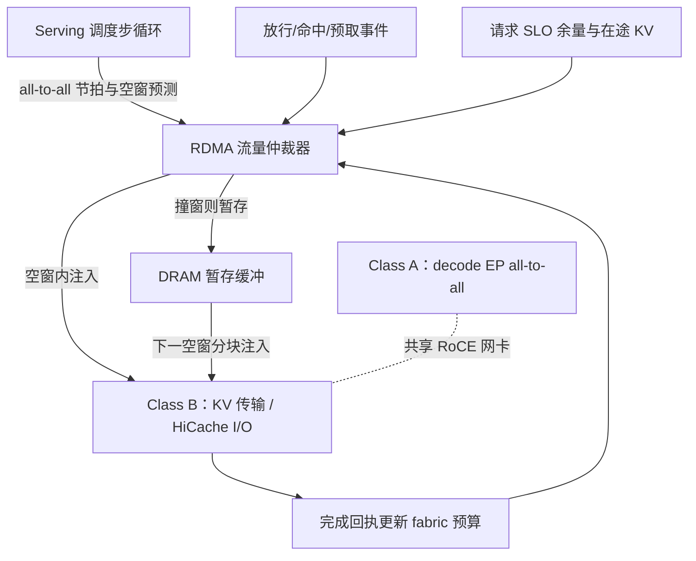

# 研究方案：PD 分离下跨机 EP 通信与 KV 传输的 RDMA 协同

更新：2026-11-17。研究聚焦一个固定场景：在 **MLA 架构的 MoE 模型** 上做 P/D 分离服务，P 与 D 都可能开启**跨机专家并行（EP）**，解码侧逐 token 的 EP all-to-all 与 P→D 的 KV 传输共享同一 **RoCE** fabric。本方案研究由 serving 调度器驱动的两类 RDMA 流量协同仲裁。当前为独立初步方案，处于文献与源码核对阶段，原型与 GPU 实验列入实施计划；本方案的硬件前提是 **AMD ROCm 栈**（`mori` EP 后端、RoCE 互联），与其余方向使用的 NVIDIA 路径审计分属不同 scope。相关机制与版本见 [本次证据记录](evidence/ep-kv-rdma-coscheduling-2026-11-17.json)。

其余方向分别见 [MaaS 影子实验方案](02_研究方案_MaaS影子实验与持续自优化.md)、[PD 配比弹性构想](03_研究构想_MaaS集群PD配比弹性调整.md)、[参数化调度器方案](04_研究方案_参数化调度器的表达能力与在线优化.md) 与 [PD 在途工作量控制](05_研究方案_PD分离下的SLO感知在途工作量控制.md)。本方案与 05 共享 PD 分离与放行控制的观测口径，但研究对象是**网络 fabric 上的流量仲裁**而非内存接纳。

## 1. 一个研究问题

**在 MLA MoE 的 PD 分离服务中，当 P、D 均开启跨机 EP 时，解码侧逐 token 的 EP all-to-all（延迟关键、跨 EP 组同步、由调度步驱动）与入站 PD KV 传输（批量、可延迟、与接纳绑定）共享同一 RoCE fabric。如何由 serving 调度器利用其对 all-to-all 节拍、请求 SLO 余量和在途 KV 的已知信息，协同仲裁这两类 RDMA 流量——将批量 KV/缓存流量错峰注入 all-to-all 的空窗，必要时用内存层级暂存时移——在不饿死 KV 命中与新请求接纳的前提下，减少 PFC 反压导致的解码停顿，提升固定资源下的逐 token SLO 合格交付？**

这里的两类流量在 D 侧网卡上相遇：Class A 是 decode 每层一次的 EP dispatch/combine，Class B 是从 P 入站的 KV 页以及 HiCache 分层 I/O。控制器观察调度步节拍、在途 KV 传输量和请求 SLO 余量，决定 Class B 的注入时刻与分块，并根据完成事件更新预算。

主指标为固定发送窗口内同时满足逐 token 输出间隔目标并完整交付的请求数与速率，重点报告 **ITL p95/p99 尾延迟**及其中可归因于 Class B 突发的部分。模型、总 GPU、P/D 配比、EP 度、采样语义和 KV transport 在对照间一致。

本研究选择这一问题，是因为它连接了解码逐 token SLO 与共享 RDMA fabric 的实际争用，有明确的控制动作（相位错峰、分块、暂存时移、接纳耦合）、可测量的损失（PFC pause 导致的 all-to-all 停顿）和生产框架落点（`mori` EP 与 PD 传输的独立配置路径）。

## 2. 系统现象与收益来源

### 2.1 两类 RDMA 流量的时序冲突

跨机 EP 的 decode all-to-all 是**同步突发**：一个 EP 组内所有 rank 在每层 dispatch/combine 处汇合，任一 rank 的网络停顿都会拖住整组这一步 token。KV 传输是**批量大象流**，由 prefill 完成或命中回填触发，时刻不受解码步约束。当一次 KV 传输突发在 all-to-all 窗口内占满 D 侧网卡缓冲时，RoCE 的 PFC 反压可能暂停正在进行的 all-to-all，使整个 EP 组的解码在该步停滞，表现为 ITL 尾延迟尖峰。

MLA 把单请求 KV 压成低维潜向量，Class B 的**总字节量显著下降**，但由此产生的是**大量小消息**：多个 P 向同一 D 推送压缩 KV，问题从带宽占用转向 **message-rate 与 incast**——小消息在错误时刻到达同样触发 PFC，而多对一的小消息更易形成 incast。因此 MLA 使"错峰/仲裁"比"限带宽"更贴近问题本质。

### 2.2 损失与控制目标

| 现象 | 需要观测的量 | 控制目标 |
| --- | --- | --- |
| KV 突发撞上 decode all-to-all | PFC pause 事件、all-to-all 暴露时间、ITL 尾部 | 将 Class B 注入 all-to-all 空窗 |
| 多 P 向同一 D 的小消息 incast | D 侧接收队列深度、丢包/重传、交接尾延迟 | 限制并发注入、分散到不同空窗 |
| 过度隔离或限流 | D 等待 KV 输入、P 出站阻塞、接纳延迟 | 保留足够在途 KV 覆盖交接时延 |
| 静态物理隔离的残余耦合 | 不同 traffic class / 网卡下的 PFC 缓冲共享 | 衡量物理隔离之外还需多少时序协同 |

研究同时记录 all-to-all 暴露、KV 交接等待与接纳延迟。只有流量等待位置改变时，结果体现为延迟重新分配；PFC 停顿、incast 重传或解码空档减少并带来净交付改善时，结果体现为有效服务能力提升。

### 2.3 可检验的因果链

预期机制为：KV/缓存突发在错误时刻进入 RoCE → 占满 D 侧缓冲触发 PFC → 暂停同步的 decode all-to-all → 整个 EP 组这一步 token 停顿 → ITL 尾延迟恶化。实验保持到达、路由、EP 度和 KV transport 一致，仅改变 Class B 的注入时序，检验各环节的变化，并单独报告"仅改变等待位置"与"真正减少解码停顿"。

## 3. 已有工作与研究位置

本方案的最相关工作分两支：**训练侧已有"用应用层时序协同集合通信与竞争流量"的方法先例**，**推理侧尚无"PD KV 传输与 EP all-to-all 在共享 RoCE 上协同仲裁"的工作**。发表身份按一手核实标注；arXiv-only 条目不计入已核实会议论文，正式归档到 `papers.json` 为后续步骤。

### 3.1 训练侧方法先例（需正面对标）

| 工作 | 已覆盖机制 | 与本方案的差异 |
| --- | --- | --- |
| CASSINI（NSDI 2024，已核实） | 几何 affinity graph 为共享链路的 job 计算时间错位，交错其通信相位 | 训练迭代级时序（秒级、周期、可预测）；本方案是 decode 逐 token（微秒级、随 batch 组成变化、不规则）的空窗 |
| MLTCP / MLCC（HotNets 2024，已核实；arXiv 版改名 MLCC） | 改 ~60 行拥塞控制，使训练流按自身 compute 窗口调速率以错峰 | 竞争流量是另一 job，无 SLO/接纳反向约束；本方案的 Class B 与命中、接纳绑定，压它会饿死新请求 |
| Crux（SIGCOMM 2024，已核实） | GPU 通信调度，按 GPU 密集度优先化、减少训练 job 间争用 | 驱动者是训练循环；本方案由 serving 调度器驱动，并需逐 token SLO 判定 |
| Lina（ATC 2023，已核实） | 训练中将 all-to-all 优先于并发 allreduce | 同一 job 内两类集合通信；本方案是集合通信 vs 点对点 KV 传输 |

这些工作确立了"应用已知自身通信相位 → 时移/调速竞争流量"是可行方法。本方案的增量落在**推理 serving 的时序粒度、SLO/接纳反向约束、以及 KV 传输这一具体竞争流量**上。

### 3.2 推理侧相关工作与缺口

| 工作 | 直接覆盖 | 与本方案的对照关系 |
| --- | --- | --- |
| ExpertPlex（arXiv-only） | 指出 prefill/decode 流量在共享网络互相干扰，用 attention-initiated MoE 通信规避 | 属 AFD（attention-FFN 分离）架构、重组通信模式；其主导跨机流量是激活 dispatch 而非 P→D KV 传输 |
| MegaScale-Infer（arXiv-only） | 分离 attention/FFN，ping-pong 流水，M2N 通信库降 dispatch 开销 | 同为 AFD；未分析 KV 传输与 all-to-all 的共存争用 |
| DualPath（arXiv-only） | 将 KV 加载路径与模型执行通信**物理路径/网卡隔离**以避免干扰 | 直接对照基线："路径隔离" vs 本方案的"时序错峰" |
| NetKV（arXiv-only，papers.json id 43） | 网络代价 oracle（拓扑距离+动态拥塞）驱动 D 选择 | 仅模拟、无真机 RDMA；解决"选哪个 D"，不解决同一 fabric 上两类流量的时序仲裁 |
| TraCT（arXiv-only） | 承认 KV 传输对网络争用高度敏感，改用 CXL rack-scale 共享内存绕开网络 | 用硬件绕开问题；本方案在 RoCE 上直接调度 |
| Topology-Aware Data Movement（arXiv-only） | 联合考虑 MoE expert dispatch 与 KV locality 的放置、分层传输 | NVLink 域放置、纯分析投影；不分析两类流量在共享链路的争用 |
| DeepEP（库，无论文） | 低延迟 EP all-to-all kernel；建议把 EP 放到单独 VL / `sl_idx` | 仅给出静态隔离指引，明确不配置拥塞控制，不针对 KV 传输协调 |
| Mooncake Transfer Engine / NIXL（代码库） | RoCE/UCX 上的 KV 批量传输、多网卡聚合、拓扑感知选网卡 | 作为 Class B 的实际传输层；其自身不与 EP 集合通信协同 |

**缺口**：没有工作显式地在同一 RoCE/IB fabric 上，对 PD KV 传输 RDMA 流量与 MoE EP all-to-all 做协同调度/QoS/优先级仲裁；MLA 压缩 KV 的 RDMA 传输成本也无实测量化。AFD 系统（Step-3、MegaScale-Infer、ExpertPlex）框的是激活 dispatch 干扰，与本方案"PD KV 移动与 EP all-to-all 争网卡"是不同问题。本方案据此确立研究位置；绝对新颖性在落盘前再做一轮领域内补充检索确认。

## 4. 控制模型与资源口径

### 4.1 控制边界

固定服务模型（MLA MoE）、权重、精度、P/D 角色、EP 度、并行拓扑、KV transport 与局部 scheduler。主执行器位于 serving 调度步循环与 KV 传输/HiCache 子系统之间：它知道 decode 步的 all-to-all 何时触发、哪些请求在等 KV 交接及其 SLO 余量、在途 KV 传输的大小与目标。它不改变 EP kernel 与 KV transport 的内部实现，只仲裁 Class B 的注入时刻、分块与暂存。

请求级路由、D 选择与局部排序保持为公共基线能力（可复用 NetKV 式网络感知选择作为固定基线）。本方案在给定路由结果之上研究 fabric 时序。

### 4.2 三类流量与 fabric 预算

| 流量类 | 时序特征 | 预算与释放依据 |
| --- | --- | --- |
| Class A：decode EP all-to-all | 每层每步同步突发，延迟关键，节拍由调度步驱动 | 不受控，作为关键路径；其空窗是可分配资源 |
| Class B1：P→D KV 传输 | 批量/小消息（MLA），prefill 完成或命中触发，可延迟 | 注入额度按空窗与 SLO 余量授予，完成回执释放 |
| Class B2：HiCache 分层 I/O | 预取/回写，批量，可延迟与可取消 | 同 B1，并可用 DRAM 暂存时移 |

**fabric headroom 预算**是本方案相对 05 新增的第三类账本：估计每个 all-to-all 空窗内 D 侧网卡的可用 RoCE 容量，Class B 的注入不得侵占 Class A 的关键路径窗口。软预算表示控制器判断，物理注入以传输引擎回执为准，兑现时在同一事务转换避免重复扣除。

### 4.3 核心观测量

记 all-to-all 在一个 decode 步内的暴露时间（未被计算掩盖的部分）为关键量；Class B 突发引发的 PFC pause 次数、D 侧接收队列峰值、交接尾延迟、以及 ITL 尾部中与 Class B 时间相关的尖峰共同分析。内存暂存引入的额外 DRAM 占用与时移延迟单列。资源驻留/停顿下降与 SLO 改善之间的关系通过消融与事件关联确认。

## 5. 协同仲裁机制

### 5.1 由调度器驱动的两类流量仲裁

控制动作按侵入性递增分三级，作为同一机制的消融阶梯：

1. **静态物理隔离（基线，对应 DeepEP 指引 / DualPath）**：将 Class A 与 Class B 放在不同 RoCE traffic class / service level 或不同网卡/rail，测量 PFC 缓冲共享造成的残余耦合。
2. **时序错峰（本方案主体）**：调度器将 Class B 分块注入 all-to-all 突发之间的空窗；撞窗的 KV 用 DRAM（HiCache host pool）暂存并在下一空窗注入，用富余内存换取关键路径的清空。
3. **接纳耦合（与 05 衔接）**：放行控制限制新 prefill，从源头约束未来 KV 突发规模，使 Class B 始终落在 Class A 留下的 fabric headroom 内。

### 5.2 内存层级作为时间缓冲

本方案把"显存/DRAM 富余"用作时间解耦器而非单纯容量层：KV 产出后不立即推上 RoCE，而是可落在 host DRAM 暂存，由仲裁器在空窗分块 pace。HiCache 的 host pool、`write_back` 写策略与预取策略为此提供落点；暂存的额外内存与时移延迟计入成本，与"立即注入"对照。

### 5.3 兑现、失配与稳定性

注入额度带 request ID、目标路径、有效期与预计字节/消息数；到期只撤销未启动的注入，已进入 RDMA 的传输保留到引擎安全完成事件。空窗预测失准（all-to-all 节拍抖动、batch 组成突变）时退回静态隔离基线。通过注入速率限幅、回滞与最小进展额度控制振荡，避免 Class B 长期饥饿导致命中与接纳停滞。

## 6. 实验与判断依据

### 6.1 首个机会实验

最小配置：P 与 D 各跨 2 节点开 EP，或先用单个 decode 实例跨 2 节点 EP，MLA MoE（如 DeepSeek 系），`mori` EP 后端，`mooncake`/`mori` PD 传输，RoCE 打开 PFC。稳态解码下标定 all-to-all 节拍与基线 ITL，中途注入批量 KV 交接/HiCache 预取突发，测量 ITL 尾部是否出现与 PFC pause 相关的尖峰，量化"一次 Class B 突发停住整个 EP 组这一步解码"的幅度。此图为整条线的 motivation；只需两节点即可取得。

### 6.2 强基线与机制消融

| 对照 | 目的 |
| --- | --- |
| 无隔离的原生并发（Class A/B 同网卡同优先级） | 确定争用损失上界 |
| 静态 traffic class / 网卡隔离（DeepEP 指引、DualPath 式路径隔离） | 评价物理隔离能消除多少，残余耦合多少 |
| 时序错峰 + DRAM 暂存（本方案） | 评价调度器时序协同相对静态隔离的净收益 |
| 叠加接纳耦合（与 05 联动） | 评价从源头约束 Class B 规模的增量 |
| CASSINI/MLTCP 式迭代级错峰移植到推理 | 对照训练方法直接迁移的适用性与粒度失配 |

相同 EP 度、KV transport、RoCE 配置构成主对照。MLA 的小消息 incast 与非 MLA（GQA）的大 KV 作为敏感性维度分别测量。

### 6.3 负载与指标

开放回放使用已核实的公共 trace（Azure、BurstGPT、Mooncake）覆盖到达突发、长短输入/输出与 prefix 复用；注入的 KV 突发用受控模式做机制归因。主指标为发送窗口内逐 token SLO 合格交付；同时报告 all-to-all 暴露、PFC pause、D 侧 incast 指标、交接尾延迟、接纳延迟与 DRAM 暂存成本。单纯改变流量等待位置与真正减少解码停顿分别报告。

### 6.4 成立条件

研究主张由一条完整证据链支持：强基线（含静态隔离）存在可归因于 Class A/B 时序冲突的解码停顿；仲裁器减少相应 PFC pause 与 all-to-all 暴露；相同资源与负载下净逐 token SLO 交付改善；改善在 EP 节拍抖动、预测失准与故障扰动下保持。若静态隔离已消除大部分冲突、时序协同增量有限，结论限定为"物理隔离足够"的适用范围；若仲裁成本超过收益，结果用于界定该机制的适用边界。

## 7. 框架基础与实现范围

实现依据固定为本机当前 HEAD：SGLang `074aeaf67499d06cc61300971fae90bcf4297670`、vLLM `60bd6dd2edd175a1c55fd3488f871e4c3d2ef27d`（均 2026-11-16），审计 **AMD ROCm 路径**，与历史 NVIDIA 路径审计分属不同 scope，不改写历史记录，也不将本机 HEAD 标为上游最新。文件 SHA、行锚点与能力范围见 [本次证据](evidence/ep-kv-rdma-coscheduling-2026-11-17.json)。

| 范围 | 落点与现状 |
| --- | --- |
| 跨机 EP all-to-all | SGLang `moe_a2a_backend` 含 `mori`，`moriep.py` 为 AMD EP dispatcher，`InterNodeV1LL`/`InterNodeV1` 为跨机低延迟/高吞吐 kernel，带 `MORI_ENABLE_SDMA` 等 env；vLLM `all2all_backend` 含 `mori`/`nixl_ep`，`rocm.py` 有专门分支。[S-a2a][S-mori-ep][V-a2a][V-rocm] |
| PD KV 传输 | `disaggregation_transfer_backend` 默认 `mooncake`，另有 `mori` conn（`MoriKVManager`，经 `MORI_RDMA_DEVICES`、`SGLANG_MORI_QP_PER_TRANSFER` 配置）。[S-disagg][S-mori-pd] |
| 网卡选择 | `disaggregation_ib_device` 选 KV 传输用 HCA，仅 Mooncake/NIXL UCX 消费；EP 的 all-to-all 不读该参数。[S-disagg] |
| 内存层级 | HiCache host pool、`hicache_write_policy`、`hicache_storage_prefetch_policy`、`hicache_mem_layout` 为暂存与时移提供落点。[S-hicache] |

**关键现状**：EP all-to-all 与 PD KV 传输是**两条独立配置路径**，各自独立选 RDMA 网卡与 QP，框架内无共享仲裁器；本次在 EP 与 PD 传输路径中未发现 traffic class / QoS / 速率协商机制（traffic_class 仅出现在 `tensorcast_store` 存储 daemon 配置）。因此本方案提出的调度器级仲裁、空窗错峰与暂存时移均为**新增实现**，不是已有能力；本次为聚焦 grep 核对，非穷尽审计。all-to-all 节拍钩子与 traffic class 分离是否可由框架暴露，以及 `mori` EP/PD 的具体 RDMA 资源协商接口，需一轮完整的 AMD 栈源码审计确认。

将新增论文正式归档进 `papers.json`/`references.bib`（下载、抽取文本、一手复核）为后续步骤，当前 §3 以 arXiv ID 与已核实发表身份引用。

[S-a2a]: https://github.com/sgl-project/sglang/blob/074aeaf67499d06cc61300971fae90bcf4297670/python/sglang/srt/arg_groups/fields/exec_.py
[S-mori-ep]: https://github.com/sgl-project/sglang/blob/074aeaf67499d06cc61300971fae90bcf4297670/python/sglang/srt/layers/moe/token_dispatcher/moriep.py
[S-disagg]: https://github.com/sgl-project/sglang/blob/074aeaf67499d06cc61300971fae90bcf4297670/python/sglang/srt/arg_groups/fields/disagg.py
[S-mori-pd]: https://github.com/sgl-project/sglang/blob/074aeaf67499d06cc61300971fae90bcf4297670/python/sglang/srt/disaggregation/mori/conn.py
[S-hicache]: https://github.com/sgl-project/sglang/blob/074aeaf67499d06cc61300971fae90bcf4297670/python/sglang/srt/arg_groups/fields/memory.py
[V-a2a]: https://github.com/vllm-project/vllm/blob/60bd6dd2edd175a1c55fd3488f871e4c3d2ef27d/vllm/config/parallel.py
[V-rocm]: https://github.com/vllm-project/vllm/blob/60bd6dd2edd175a1c55fd3488f871e4c3d2ef27d/vllm/platforms/rocm.py
